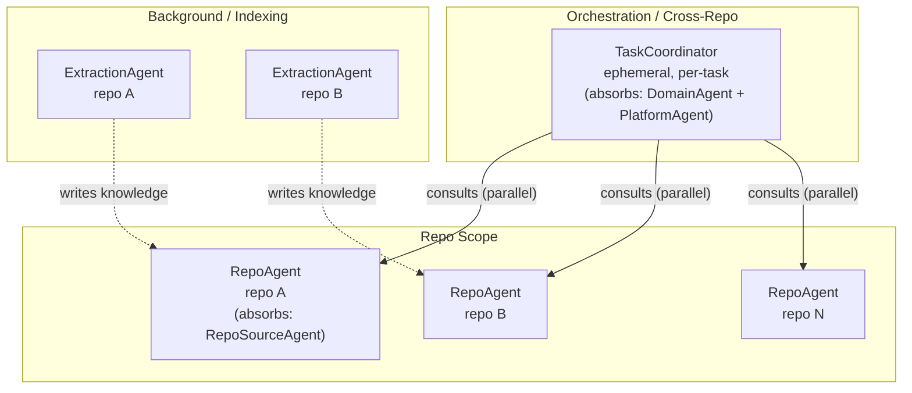
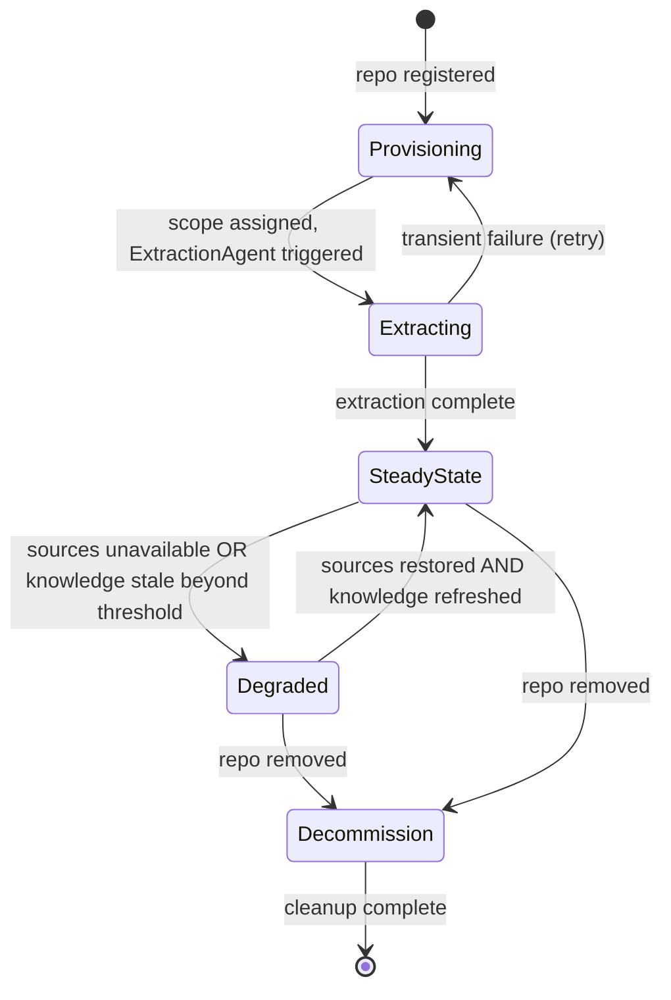
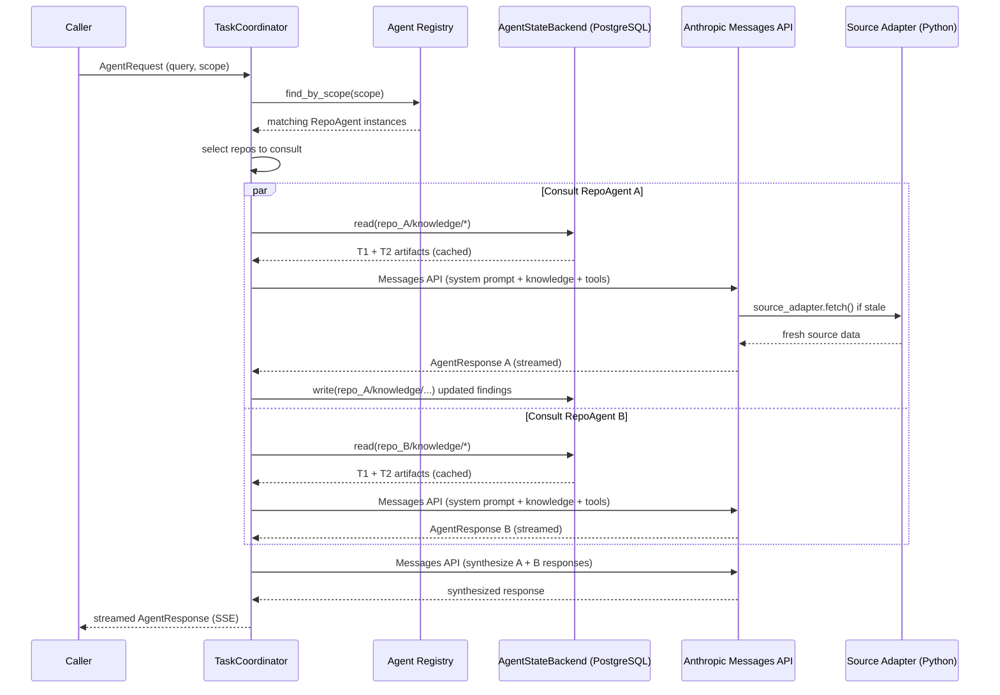
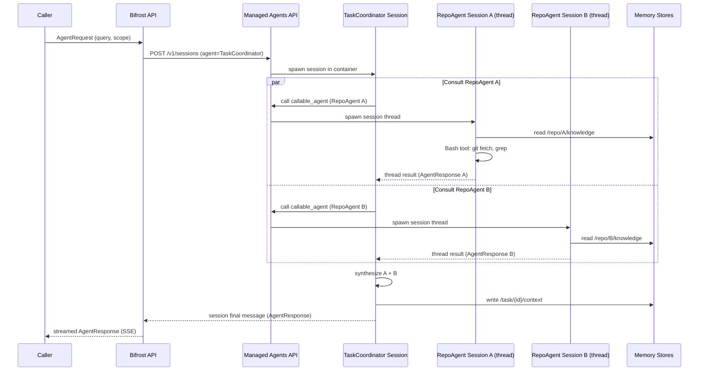

# S8 -- Agent Workforce Specification

> Status: Draft
> Depends on: S1 (Knowledge Model), S2 (Source Adapters), S3 (Freshness), S5 (Flow Model), S6 (Dependency Model), S9 (Orchestration)

---

## 1. Purpose and Scope

This spec defines Bifrost's agent workforce: taxonomy, capabilities, lifecycle, and implementation across two execution tracks. Track A (V1, available now): agents run as Python classes with in-process Anthropic Messages API calls. Track B (future, requires Managed Agents Research Preview access): agents run as Anthropic Managed Agent Sessions in cloud containers. All agent interfaces are defined as Python abstractions — both tracks implement the same interface. Switching tracks requires no business logic changes.

Agents exist to make the workforce model concrete: instead of one monolithic LLM answering every question, Bifrost decomposes engineering understanding into scope-bounded specialists that can be consulted individually or composed through orchestration (see S9).

This spec covers:
- The taxonomy of agent types and their knowledge boundaries
- The capabilities contract every agent must satisfy
- How agents acquire, store, and refresh knowledge
- Agent lifecycle from provisioning through decommission
- The implementation model (LLM + RAG + tools)
- The agent registry and discovery mechanism
- Global rules versus local learning
- The communication protocol between agents and orchestrators

This spec does NOT cover:
- How agents are composed into multi-agent task flows (see S9 -- Orchestration)
- The Knowledge Store schema itself (see S1 -- Knowledge Model)
- Source adapter internals (see S2 -- Source Adapters)
- Freshness tracking mechanics (see S3 -- Freshness)

---

## 2. Glossary References

| Term | Definition |
|---|---|
| **Specialist / Agent** | A stateless, LLM-backed entity that owns a bounded slice of Bifrost knowledge and can answer queries within that scope. |
| **Task** | A user or system request that requires one or more agents to produce findings, evidence, and synthesis. |
| **Repo** | A single source code repository registered in Bifrost. |
| **Domain** | A logical grouping of repos that together serve a coherent business or engineering purpose. |
| **Source** | An external system connected to Bifrost via a source adapter (e.g., Git, Jira, Slack, runtime traces). |
| **KnowledgeArtifact** | A discrete unit of extracted, derived, or learned knowledge stored in the Knowledge Store. Includes T1 (broad mappings) and T2 (extracted/learned knowledge). |
| **T1 Artifact** | Broad mapping: where truth lives, which source objects matter, relevance links. |
| **T2 Artifact** | Extracted knowledge: entities, relationships, flow hints, dependency hints, patterns, conventions. |
| **AgentRuntime** | Abstract interface for agent execution. Track A: in-process Python class calling Messages API. Track B: Anthropic Managed Agent Session. |
| **AgentStateBackend** | Abstract interface for agent state persistence. Track A: PostgreSQL tables. Track B: Anthropic Memory Stores. |
| **Track A** | Primary build track — custom Python agent loops, Anthropic Messages API, PostgreSQL state, customer-hosted. Ships in V1. |
| **Track B** | Future enhancement track — Anthropic Managed Agent Sessions, Memory Stores, Anthropic-hosted containers. Requires Managed Agents Research Preview access. |

---

## 3. Requirements Traceability

This spec addresses requirements from Section 14 of the Bifrost requirements document.

| Requirement | Section | How addressed |
|---|---|---|
| 14.1 Workforce of specialist agents | Taxonomy (sec 5) | Three agent types: RepoAgent, TaskCoordinator, ExtractionAgent |
| 14.2 Specialists by repo+source, repo, domain, org/platform, task | Taxonomy (sec 5) | RepoAgent covers repo + all sources; TaskCoordinator covers domain/platform/task scope via synthesis |
| 14.3 Specialist expectations (findings, evidence, confidence, etc.) | Capabilities Contract (sec 6), Communication Protocol (sec 12) | AgentResponse interface with required fields; dual-track delivery |
| 14.4 Global rules and local learning | Global Rules vs Local Learning (sec 11) | Global rules enforced platform-wide (PostgreSQL table or read-only Memory Store); local learning stored as scoped artifacts per repo |
| 14.5 Workforce visibility | Agent Registry (sec 10) | Central registry exposing id, type, scope, capabilities, freshness, health |

Additional traceability:

| Requirement | How addressed |
|---|---|
| 15.2 Task master / coordinating agent | TaskCoordinator agent type (sec 5.3) |
| 15.4 Structured communication | Communication Protocol (sec 12) |
| 22.3 Extensibility (new specialist types) | Agent Registry supports dynamic registration (sec 10) |
| 22.4 Observability (specialist health) | Registry health monitoring (sec 10.3) |
| 22.5 Scalability | Track A: stateless per-invocation, horizontally scalable; Track B: managed container sessions |

---

## 4. Design Goals and Non-Goals

### 4.1 Goals

1. **Bounded expertise over general intelligence.** Each agent should be deeply capable within its scope rather than weakly capable across everything.
2. **Composability.** Agents must be independently consultable and composable through orchestration without tight coupling.
3. **Transparency.** Every agent response must carry evidence, confidence, freshness, and gap information. No black-box answers.
4. **Horizontal scalability.** Adding repos or domains adds agents, not complexity to existing agents.
5. **Knowledge grounding.** Agent answers must be grounded in Knowledge Store artifacts, not in unscoped LLM generation.
6. **Graceful degradation.** When sources are unavailable or knowledge is stale, agents must flag this clearly rather than silently degrade.

### 4.2 Non-Goals

1. **Fine-tuned models per agent.** V1 agents share the same base LLM. Specialization comes from scoped context, not model weights.
2. **Autonomous agent-to-agent communication.** Agents do not directly invoke other agents. All composition goes through orchestration (S9).
3. **Long-running agent processes.** Track A: agents are async Python functions — no separate long-running process, runs within the Bifrost API server process. Track B: sessions may run for extended periods in Anthropic containers but terminate on completion. Both tracks: extraction must checkpoint state regularly so it can be resumed.
4. **Code execution.** Track A agents analyze code as text (no code execution). Track B agents may execute code within Anthropic-managed sandboxed containers via the Bash tool.
5. **User-facing conversational memory.** Agents do not maintain multi-turn conversational state. Task context is managed by the TaskCoordinator.

---

## 5. Agent Taxonomy

The taxonomy has been flattened from five types to three. The previous DomainAgent and PlatformAgent responsibilities have been absorbed into TaskCoordinator. The previous RepoSourceAgent responsibilities have been absorbed into RepoAgent (as source adapter calls). This simplification removes one delegation level, which is required for Track B compatibility (Managed Agents support only one level of callable-agent delegation).

### 5.1 Taxonomy Diagram

```
Orchestration layer
    |
    v
+-------------------+
| TaskCoordinator   |  ephemeral, per-task
| (was: TC +        |  cross-repo synthesis,
|  DomainAgent +    |  domain + platform scope
|  PlatformAgent)   |
+-------------------+
    |  consults (parallel or sequential)
    v
+-------------------+
| RepoAgent         |  one per repo
| (was: RepoAgent + |  all sources, all knowledge
|  RepoSourceAgent) |  for that repo
+-------------------+

+-------------------+
| ExtractionAgent   |  standalone, background
| (new explicit     |  cold-start indexing,
|  type)            |  not a query responder
+-------------------+
```

### 5.2 RepoAgent

**Replaces:** RepoAgent + RepoSourceAgent (merged)

**Scope:** Single repository, all sources.

**Knowledge boundary:** Everything within one repo — code structure, Jira tickets, PRs, docs, runtime traces.

**Responsibilities:**
- Comprehensive understanding of a single repo across all connected sources
- Calls source adapters (Python plugins in Track A; MCP servers in Track B) directly — no intermediate RepoSourceAgent layer
- Answers repo-level questions: "What does this repo do?", "What are its major flows?", "What changed recently?", "What PRs touched module Y this month?"
- Maintains repo-level learned patterns and conventions

**Knowledge owned:** T1 + T2 artifacts scoped to the repo. Aggregates across all source-specific knowledge.

**Callable agents:** None (leaf node in hierarchy).

**Track A implementation:**
- Python class `RepoAgent` implementing `AgentRuntime`
- Constructor takes: repo config, `AgentStateBackend` instance, source adapter instances
- `execute()` method: loads state from `AgentStateBackend`, checks freshness, calls Anthropic Messages API with repo-scoped context, returns streaming events via `AsyncGenerator[AgentEvent, None]`
- Uses Python source adapter plugins to fetch Jira tickets, PR data, commit history, etc.

**Track B implementation:**
- Anthropic Agent Definition with system prompt scoped to the repo
- Tools: Bash (git clone, grep, file analysis), File I/O, MCP servers per source (GitHubMCP, JiraMCP)
- Memory stores attached: `/repo/{id}/knowledge` (read-write), `/repo/{id}/conventions` (read-write), `/repo/{id}/freshness` (read-write)

### 5.3 TaskCoordinator

**Replaces:** TaskCoordinator + DomainAgent + PlatformAgent (all merged)

**Scope:** Cross-repo synthesis, task lifecycle, response generation.

**Knowledge boundary:** All repos in scope for the task; domain-level and platform-level synthesis.

**Responsibilities:**
- Understands the task intent and determines scope (which repos are relevant)
- Selects which RepoAgents to consult (via Agent Registry)
- Orchestrates consultation (parallel via `asyncio.gather` in Track A, session threads in Track B)
- Synthesizes findings into a single response, including cross-repo and domain-level insights
- Detects conflicts and gaps across agent responses
- Preserves task log
- Handles domain-level questions ("How do repos A and B interact?") and platform-level questions ("Which services depend on auth?") by synthesizing across RepoAgent responses

**Knowledge owned:** None persistent. Operates on task context assembled at invocation time.

**Callable agents:** RepoAgent instances (one per repo in scope).

**Track A implementation:**
- Python class `TaskCoordinator` implementing `AgentRuntime`
- Determines scope (which repos) via PostgreSQL metadata query
- Calls N `RepoAgent` instances via `asyncio.gather` (parallel) or sequentially
- Collects responses, synthesizes via LLM call (Messages API)
- Streams synthesized response to user via SSE

**Track B implementation:**
- Anthropic Agent Definition with `callable_agents: [list of RepoAgent IDs]`
- Spawns session threads for parallel repo consultation (one thread per RepoAgent)
- Reads thread responses, synthesizes in coordinator LLM context
- Streams via session SSE events

**Note:** TaskCoordinator orchestration behavior is specified in detail in S9 (Orchestration). This spec defines its place in the taxonomy and its interface contract.

### 5.4 ExtractionAgent

**Type:** New explicit type (previously implicit in bootstrap process).

**Purpose:** Dedicated cold-start extraction — not a query responder, purely an indexer. Builds the initial knowledge base for a repo so that RepoAgents have knowledge to load on first query.

**Scope:** Single repository, focused on building initial knowledge base.

**Responsibilities:**
- Enumerates all files, commits, PRs, and linked Jira tickets for a repo
- Extracts T1 and T2 artifacts: component boundaries, flow hints, dependency hints, conventions
- Writes extracted knowledge to `AgentStateBackend` (PostgreSQL in Track A, Memory Store in Track B)
- Checkpoints progress so extraction can be resumed after interruption
- Triggered by: repo registration, webhook (new commit), manual refresh, staleness detection

**Callable agents:** None (standalone).

**Track A implementation:**
- Python async function (not a persistent class)
- Runs as a background job triggered by repo registration or manual refresh
- Processes files in batches (configurable, default 20 files/batch)
- After each batch: writes findings to PostgreSQL + `AgentStateBackend`, updates freshness cursor
- Resumes from checkpoint if interrupted: reads cursor from state backend on restart

**Track B implementation:**
- Anthropic Agent Definition optimized for long-running extraction
- Bash tool for git clone + file enumeration
- Checkpoints after every N files by writing freshness state to memory store
- Session completes (and is billed) per extraction run

### 5.5 Removed Types

The following agent types have been removed from the taxonomy. Their responsibilities have been absorbed:

| Removed Type | Absorbed Into | Notes |
|---|---|---|
| **DomainAgent** | TaskCoordinator | Cross-repo synthesis and domain-level pattern analysis now performed by TaskCoordinator during response generation |
| **PlatformAgent** | TaskCoordinator | Org-wide platform and shared service understanding synthesized by TaskCoordinator across relevant RepoAgents |
| **RepoSourceAgent** | RepoAgent | Source-specific fetching handled directly by RepoAgent via source adapter plugin calls; no intermediate agent needed |

---

## 6. Agent Capabilities Contract

Every agent must declare its capabilities and return structured responses.

### 6.1 Capability Declaration

```python
from enum import Enum
from typing import Literal
from pydantic import BaseModel


class AgentScope(BaseModel):
    type: Literal["repo", "task", "extraction"]
    repo_id: str | None = None
    task_id: str | None = None


class QueryType(str, Enum):
    EXPLAIN = "explain"                # what is X, how does X work
    TRACE_FLOW = "trace_flow"          # trace an end-to-end flow
    FIND_SIMILAR = "find_similar"      # find similar implementations
    IMPACT_ANALYSIS = "impact_analysis"  # blast radius, dependency impact
    FRESHNESS_CHECK = "freshness_check"  # how current is knowledge of X
    PATTERN_MATCH = "pattern_match"    # find recurring patterns
    DEPENDENCY_QUERY = "dependency_query"  # direct and indirect dependencies
    CHANGE_SUMMARY = "change_summary"  # what changed recently
    VALIDATE = "validate"              # validate proposed work against existing patterns
    PLAN = "plan"                      # plan implementation steps


class AgentCapabilities(BaseModel):
    scope: AgentScope                       # what this agent covers
    knowledge_domain: list[str]             # keywords, concepts, technologies
    supported_query_types: list[QueryType]
    freshness: "FreshnessState"             # how current this agent's knowledge is
```

### 6.2 Response Contract

```python
from enum import Enum
from typing import Literal
from pydantic import BaseModel


class ConfidenceLevel(str, Enum):
    """Canonical definition — see S3."""
    CONFIRMED = "confirmed"      # directly supported by current source evidence
    INFERRED = "inferred"        # derived from patterns or indirect evidence
    STALE = "stale"              # based on evidence that may be outdated
    UNCERTAIN = "uncertain"      # low evidence, best-effort answer
    UNKNOWN = "unknown"          # cannot answer within current knowledge


class FreshnessState(BaseModel):
    last_source_check: str       # ISO 8601 timestamp
    last_knowledge_update: str   # ISO 8601 timestamp
    lag_seconds: int | None = None  # estimated lag behind source truth
    is_stale: bool
    stale_reason: str | None = None


class EvidenceRef(BaseModel):
    source_type: str              # e.g., "git", "jira", "runtime"
    source_id: str                # identifier within the source system
    snippet: str | None = None    # relevant excerpt
    freshness: FreshnessState
    access_path: str              # how to retrieve the full source


class Finding(BaseModel):
    id: str
    summary: str
    detail: str
    confidence: ConfidenceLevel
    source_refs: list[EvidenceRef]


class Gap(BaseModel):
    description: str
    possible_sources: list[str]   # where the gap might be filled
    impact: Literal["blocking", "reduces_confidence", "informational"]


class AgentRef(BaseModel):
    agent_id: str
    agent_type: str
    reason: str                   # why this agent should be consulted


class UsageInfo(BaseModel):
    model: str                    # which model produced this response
    input_tokens: int
    output_tokens: int
    cost_estimate_usd: float      # estimated cost of this agent call


class GapReport(BaseModel):
    pass  # defined in detail elsewhere


class Correction(BaseModel):
    pass  # defined in detail elsewhere


class FeedbackInfo(BaseModel):
    gap_reports: list[GapReport]
    corrections: list[Correction]
    quality_signal: Literal["helpful", "partially-helpful", "unhelpful"] | None = None
    # quality_signal is None until user provides feedback post-delivery


class AgentResponse(BaseModel):
    findings: list[Finding]
    evidence: list[EvidenceRef]
    confidence: ConfidenceLevel
    freshness: FreshnessState
    gaps: list[Gap]
    suggested_consults: list[AgentRef]  # "you should also ask..."
    context_truncated: bool             # True when RAG context was cut off due to budget
    excluded_artifacts: list[str] | None = None  # IDs of artifacts excluded due to context overflow

    usage: UsageInfo
    feedback: FeedbackInfo | None = None
```

### 6.3 Dual-Track Response Contract

Both Track A and Track B agents must return responses conforming to `AgentResponse`. In Track B, this is delivered as the thread final message content. In Track A, this is the return value of the `execute()` call.

Additionally, all agents must write their findings to the `AgentStateBackend` (component descriptions, flow summaries, extracted entities) so subsequent queries can load from state without full re-analysis. This applies to both tracks: Track A writes to PostgreSQL `knowledge_text_cache`; Track B writes to the attached Memory Store.

### 6.4 Core Interfaces

```python
from abc import ABC, abstractmethod
from collections.abc import AsyncGenerator


class AgentRuntime(ABC):
    """Abstract interface — same for both tracks."""

    @abstractmethod
    async def execute(self, task: "AgentTask") -> AsyncGenerator["AgentEvent", None]:
        """Stream events during task execution."""
        ...

    @abstractmethod
    def get_definition_id(self) -> str:
        """Track A: class name, Track B: Anthropic agent ID."""
        ...

    session_id: str | None = None                            # Track B: active session ID (None in Track A)
    track_b_session_config: "TrackBSessionConfig | None" = None  # Track B: session parameters (None in Track A)


class TrackBSessionConfig(BaseModel):
    max_duration_ms: int              # default: 900_000 (15 min)
    checkpoint_interval: int          # Fixed at CHECKPOINT_INTERVAL = 20 in packages/extraction — not overridable
    mcp_tools: list["MCPToolConfig"]  # tools available to this agent session
    memory_store_path: str            # root path for this agent's Memory Store writes


class MCPToolConfig(BaseModel):
    server_name: str         # e.g., "bifrost-git-mcp", "bifrost-storage"
    tool_names: list[str]    # tools available from this server
    endpoint: str            # MCP server endpoint URL


class AgentStateBackend(ABC):
    """Abstract interface for agent state persistence."""

    @abstractmethod
    async def read(self, path: str) -> str | None: ...

    @abstractmethod
    async def write(self, path: str, content: str, precondition: str | None = None) -> None: ...

    @abstractmethod
    async def list(self, path_prefix: str) -> list[str]: ...

    # Track A implementation: PostgreSQL-backed (SELECT/INSERT into knowledge_text_cache)
    # Track B implementation: Anthropic Memory Store API calls
```

---

## 7. Agent Knowledge Scope

### 7.1 Knowledge Ownership by Agent Type

Each agent type owns a specific slice of the Knowledge Store.

| Agent Type | T1 Artifacts Owned | T2 Artifacts Owned | Access Pattern |
|---|---|---|---|
| RepoAgent | All T1 for repo across all sources | Repo-level entities, flows, dependencies, patterns, source-specific artifacts (previously RepoSourceAgent) | Direct read from AgentStateBackend, scoped to repo |
| TaskCoordinator | None | None persistent (ephemeral task context only) | Reads task input + assembles context from consulted RepoAgents; synthesizes domain/platform understanding from aggregated RepoAgent responses |
| ExtractionAgent | All T1 for repo (writes during extraction) | All T2 for repo (writes during extraction) | Writes to AgentStateBackend; does not respond to queries |

### 7.2 Knowledge Store Access

Agents access the shared Knowledge Store for artifacts within their declared scope. Access is read-scoped at query time:

- Agent receives its scope definition at instantiation
- Knowledge Store queries are filtered to that scope
- Agents cannot read artifacts outside their scope without going through orchestration

### 7.3 Local Learning

Agents accumulate local learning -- repo-specific or domain-specific conventions, patterns, and heuristics -- stored as agent-scoped T2 artifacts in the Knowledge Store.

Examples of local learning:
- "This repo uses the factory pattern for all service instantiation"
- "PR descriptions in this repo follow the ADR-linked template"
- "Domain X uses event-driven communication between repos A and B"

Local learning is:
- Extracted from repeated patterns observed during knowledge extraction
- Validated or refined by user feedback
- Stored as T2 artifacts with `learning_type: "convention" | "heuristic" | "pattern"` metadata
- Loaded into agent RAG context on invocation

### 7.4 Knowledge Refresh

Agents track freshness of the artifacts within their scope.

Refresh triggers:
- Source change notification (webhook, poll) indicates artifacts may be stale
- Agent detects stale freshness during query response
- User or system requests explicit refresh
- Scheduled reconciliation cycle

Refresh behavior:
- Agent marks affected artifacts as potentially stale
- Requests re-extraction from the relevant source adapter (S2)
- Updates T1 mappings and T2 artifacts in the Knowledge Store
- Updates its own freshness state in the Agent Registry

---

## 8. Agent Lifecycle

### 8.1 State Machine (applies to both tracks)

```
                 repo
                 registered
                     |
                     v
              +--------------+
              | Provisioning |
              +--------------+
                     |
                     v
              +--------------+
              |  Extracting  |--- extraction fails ---> [Provisioning] (retry)
              | (background) |
              +--------------+
                     |
                     v
              +--------------+   sources unavailable   +-----------+
              | Steady-State |------------------------>| Degraded  |
              +--------------+                         +-----------+
                     ^                                       |
                     |        sources restored               |
                     +---------------------------------------+
                     |
                     |  repo removed
                     v
              +--------------+
              | Decommission |
              +--------------+
```

### 8.2 Track A Lifecycle

**1. Initialization (at Bifrost startup):**
- Load agent configs from PostgreSQL (`agent_configs` table)
- Instantiate `AgentStateBackend` (PostgreSQL implementation)
- Register agent types in in-memory registry (type -> class mapping)

**2. Per-Task Execution:**
- Coordinator calls `agent_runtime.execute(task)`
- Agent reads state from `AgentStateBackend` (freshness check, cached knowledge)
- Agent calls Anthropic Messages API with scoped context (system prompt + retrieved knowledge)
- Agent streams results back to coordinator via `AsyncGenerator[AgentEvent, None]`
- Agent writes updated findings to `AgentStateBackend` before completing

**3. Extraction Job (background):**
- Triggered by: repo registration, webhook (new commit), manual refresh, staleness detection
- `ExtractionAgent` processes files in batches (configurable: default 20 files/batch)
- After each batch: writes findings to PostgreSQL + `AgentStateBackend`, updates freshness cursor
- Checkpointed: if job restarts, reads cursor and resumes from last batch

### 8.3 Track B Lifecycle (when Managed Agents access granted)

**1. One-time Setup:**
- Create Agent Definitions via `POST /v1/agents` (one per agent type: RepoAgent, TaskCoordinator, ExtractionAgent)
- Create Environment via `POST /v1/environments` (Python + git container spec)
- Store Definition IDs and Environment ID in Bifrost config
- Create Memory Stores via `POST /v1/memory_stores` (one per repo, one global)

**2. Per-Task Execution:**
- Create Session via `POST /v1/sessions` (agent=TaskCoordinator ID, env=environment ID, resources=[memory stores])
- Stream events from `GET /v1/sessions/{id}/stream`
- Handle tool confirmations if needed (auto-approve known-safe tools)
- Session terminates when coordinator completes synthesis

**3. Extraction Session (background):**
- Create Session via `POST /v1/sessions` (agent=ExtractionAgent ID)
- Session runs in Anthropic container: clones repo, analyzes code, writes to memory store
- Checkpoints after each batch via memory store write
- Session completes (and is billed) per extraction run

### 8.3a Track B Session Lifecycle

Each Track B session (RepoAgent, ExtractionAgent, or TaskCoordinator sub-thread) follows this state machine:

**States:** `initializing` -> `loading_context` -> `executing` -> `checkpointing` -> `completed` | `timed_out` | `failed`

**Transitions:**

- **`initializing`**: session created via `POST /v1/sessions`; MCP tools registered from `TrackBSessionConfig.mcp_tools`; Memory Store path set from `TrackBSessionConfig.memory_store_path`. Session receives `session_id` assigned by Managed Agents platform.

- **`loading_context`**: reads existing checkpoint (if any) from Memory Store at `{memory_store_path}/checkpoint.json` to determine resume point. If no checkpoint exists, begins from scratch. Loads prior knowledge artifacts into LLM context.

- **`executing`**: performs agent task — extraction (file enumeration and analysis), consultation (query answering from loaded knowledge), or synthesis (TaskCoordinator cross-repo aggregation). Progresses through work units, counting files processed against `checkpoint_interval`.

- **`checkpointing`**: triggered when files-processed count reaches `checkpoint_interval` or when a timeout warning event is received. Writes intermediate results to Memory Store. After checkpoint write completes, transitions back to `executing`.

- **`completed`**: task finished successfully. Final `AgentResponse` written to Memory Store and/or returned as session final message. Session terminates.

- **`timed_out`**: session wall-clock time exceeded `max_duration_ms`. Agent writes an emergency checkpoint to Memory Store (partial results + resume cursor), then signals TaskCoordinator with `status: 'timed_out', checkpoint_path: '...'`. TaskCoordinator may re-spawn session to resume from checkpoint.

- **`failed`**: unrecoverable error (tool failure, schema violation, context overflow). Agent writes error state to Memory Store at `{memory_store_path}/error.json` with error type, last-known-good cursor, and stack context. Signals failure to TaskCoordinator.

**Constraints (from known Managed Agents limitations):**
- Hierarchy is flat: TaskCoordinator -> RepoAgent (one level only). RepoAgent cannot spawn sub-agents. (L1)
- Track B does not use local filesystem clone — all Git access is via Git MCP sidecar, not local `git clone`. (L3)
- MCP tools are sidecar processes discovered via MCP protocol at session start; `MCPToolConfig.endpoint` is resolved at `initializing` time. (L4)
- Sessions must complete or reach a checkpoint within `max_duration_ms` (default 15 min). (L5)

### 8.4 Lifecycle Phase Definitions

**Provisioning:** Triggered when a repo is registered in Bifrost. Creates the agent entry in the Agent Registry with status `provisioning`. Assigns scope, determines which source adapters are relevant.

**Extracting:** ExtractionAgent runs in the background to build initial knowledge. In Track A: background job writing to PostgreSQL. In Track B: managed session writing to memory store. Transitions to `steady_state` on completion; retries on transient failure.

**Steady-State:** Normal operating mode. RepoAgent responds to queries using knowledge loaded from `AgentStateBackend`. Refreshes knowledge on source change notifications. Accumulates local learning.

**Degraded:** Entered when underlying sources become unavailable. Agent continues to respond using cached/stale knowledge. All responses flagged with `is_stale: True`. Periodically checks source availability for recovery.

**Decommission:** Triggered when a repo is removed from Bifrost. Agent marked as `decommissioning`. Scoped knowledge artifacts cleaned up. Agent entry removed from registry (or archived for audit).

### 8.5 Track B Session Pool

Track B sessions are subject to a platform concurrency limit (L7). Bifrost manages a session pool to stay within that limit.

```python
from pydantic import BaseModel


class SessionPoolConfig(BaseModel):
    max_concurrent_sessions: int  # default: 3 (Research Preview limit)
    queue_timeout: int            # ms to wait for available session slot
    session_start_timeout: int    # ms to wait for session to initialize
```

**Queuing behavior:** When `max_concurrent_sessions` is reached, new consultation requests are queued. If a queued request waits longer than `queue_timeout` without a session slot becoming available, the request returns immediately with `status: 'degraded', coverage_level: 'partial'` — indicating the response was generated from whatever agent results were already available, without the full set of RepoAgent consultations.

**Session slot lifecycle:**
1. Slot acquired when `POST /v1/sessions` is called (session enters `initializing`)
2. Slot released when session reaches `completed`, `timed_out`, or `failed`
3. TaskCoordinator sub-threads (RepoAgent session threads) each consume a slot — parallel fan-out is bounded by pool size

**Operator configuration:** `SessionPoolConfig` is set in Bifrost config and can be adjusted as Managed Agents platform limits evolve. The Research Preview default of 3 concurrent sessions means a TaskCoordinator consulting 3+ repos will either serialize some consultations or degrade to partial coverage.

---

## 9. Agent Implementation Model

### 9.1 Architecture

Each agent is an LLM-backed, stateless-per-invocation runtime that receives:

1. **System prompt**: defines the agent's role, scope, constraints, and output format requirements
2. **Tool access**: scoped tools for state backend queries and source adapter calls
3. **RAG context**: relevant T1 and T2 artifacts pre-loaded from `AgentStateBackend` for the agent's scope

Both tracks satisfy the same `AgentRuntime` and `AgentStateBackend` interfaces. The underlying execution mechanism differs per track.

### 9.2 Track A Invocation Flow

```
Request arrives
    |
    v
Registry lookup --> agent class (type, scope)
    |
    v
Context assembly:
  - Load system prompt template for agent type
  - Inject scope parameters
  - Read T1/T2 artifacts from PostgreSQL (AgentStateBackend)
  - Load local learning (agent_conventions table) for this repo
  - Bind Python source adapter instances
    |
    v
Anthropic Messages API call with assembled context
    |
    v
Structured response (AgentResponse) streamed via AsyncGenerator
    |
    v
Agent writes updated findings to PostgreSQL (AgentStateBackend)
Response logged, returned to caller (streamed via SSE)
```

### 9.3 Track B Invocation Flow

```
Request arrives
    |
    v
Session creation: POST /v1/sessions (agent=DefinitionID, resources=[memory stores])
    |
    v
Session executes in Anthropic container:
  - System prompt + memory store content loaded automatically
  - Agent calls MCP server tools (GitHubMCP, JiraMCP) for source data
  - Agent calls callable_agents for sub-consultation (RepoAgent threads)
    |
    v
Session SSE stream delivers events to Bifrost
    |
    v
Final thread message = AgentResponse
Session terminates, memory stores persist
```

### 9.4 Model Assignment

Each agent type uses a model matched to its computational complexity. Routing and triage tasks use faster, cheaper models; analysis and synthesis tasks use stronger models.

| Agent / Role | Model |
|---|---|
| ExtractionAgent — file triage | `claude-haiku-4-5` |
| ExtractionAgent — component/flow/dep analysis | `claude-sonnet-4-6` |
| RepoAgent — knowledge consultation | `claude-sonnet-4-6` |
| TaskCoordinator — scope determination and routing | `claude-haiku-4-5` |
| TaskCoordinator — final cross-repo synthesis | `claude-opus-4-6` |
| Adversarial validation (S9) | `claude-sonnet-4-6` |

These defaults are configurable via environment variables:

```
LLM_MODEL_ROUTING=claude-haiku-4-5
LLM_MODEL_ANALYSIS=claude-sonnet-4-6
LLM_MODEL_SYNTHESIS=claude-opus-4-6
```

The `usage` field in `AgentResponse` records which model was actually used for each call (see section 6.2).

### 9.5 System Prompt Structure

Each agent type has a prompt template. At invocation, the template is populated with:

- Agent identity and scope (e.g., "You are the RepoAgent for repository `webhook-api`")
- Scope boundaries (what the agent should and should not answer)
- Available tools and their usage patterns
- Output format requirements (AgentResponse schema)
- Global rules (confidence reporting, evidence requirements, safety constraints)
- Local learning loaded from the agent's state (conventions table in Track A; conventions memory store in Track B)

### 9.6 Tool Access

**Track A — Python tools bound at invocation:**

| Tool | Purpose | Available to |
|---|---|---|
| `state_backend.read` | Read T1/T2 artifacts from PostgreSQL | All agents |
| `state_backend.write` | Write findings to PostgreSQL | All agents |
| `source_adapter.fetch` | Retrieve fresh data from a source system | RepoAgent |
| `source_adapter.check_freshness` | Check if source has changed since last extraction | RepoAgent, ExtractionAgent |
| `registry.lookup` | Find other agents by scope or capability | TaskCoordinator |
| `registry.health` | Check health/freshness of another agent | TaskCoordinator |

**Track B — MCP server tools attached to session:**

| Tool | Purpose | Available to |
|---|---|---|
| Bash | git clone, grep, file enumeration, AST analysis | RepoAgent, ExtractionAgent |
| File I/O | Read/write files within container FS | RepoAgent, ExtractionAgent |
| GitHubMCP | PR data, commit history, branch info | RepoAgent |
| JiraMCP | Linked tickets, work items | RepoAgent |
| `callable_agents` | Spawn sub-agent session threads | TaskCoordinator |

### 9.7 RAG Context Selection and Overflow

When an agent loads knowledge for a question, the total T1/T2 artifacts relevant to the query may exceed the LLM context window (128K tokens for sonnet-4-6, 200K for the full window). The following selection algorithm is applied:

**Selection algorithm:**

```python
from dataclasses import dataclass


@dataclass
class ContextSelectionResult:
    included: list["KnowledgeArtifact"]
    excluded: list["KnowledgeArtifact"]
    context_truncated: bool


def select_context(
    candidates: list["KnowledgeArtifact"],
    budget: int,  # tokens
) -> ContextSelectionResult:
    # Sort by relevance score (recency x freshness x query similarity)
    ranked = sorted(
        candidates,
        key=lambda a: compute_relevance_score(a),
        reverse=True,
    )

    included: list[KnowledgeArtifact] = []
    used = 0

    for artifact in ranked:
        cost = estimate_tokens(artifact)
        if used + cost > budget:
            break
        included.append(artifact)
        used += cost

    return ContextSelectionResult(
        included=included,
        excluded=ranked[len(included):],
        context_truncated=len(included) < len(ranked),
    )


def compute_relevance_score(a: "KnowledgeArtifact") -> float:
    recency = 1 / (1 + days_since(a.metadata.indexed_at))
    freshness = (
        1.0 if a.metadata.lag_indicator == "current"
        else 0.8 if a.metadata.lag_indicator == "slightly-behind"
        else 0.5
    )
    query_similarity = cosine_similarity(a.embedding, query_embedding)
    return recency * freshness * query_similarity
```

**Context budget allocation:**

| Content type | Max tokens |
|-------------|-----------|
| System prompt | 3,000 |
| Query context | 1,000 |
| T2 domain synthesis | 4,000 |
| T1 component artifacts | 30,000 |
| T1 flow artifacts | 15,000 |
| T1 dependency artifacts | 10,000 |
| Reserve for output | 5,000 |

**Overflow reporting:**

When context is truncated, the agent's response must set `context_truncated: True` and populate `excluded_artifacts` with the IDs of omitted entities. Both fields are part of the canonical `AgentResponse` interface defined in section 6.2.

The coordinator propagates `context_truncated` to the final `TaskResult` so the API/CLI can surface it.

### 9.8 Knowledge Index Compression

For each repo, a pre-computed T2 summary entity (target: <=5,000 tokens) is maintained. Agents load the compressed index first, then request full entities only for matches. This pattern keeps context load predictable regardless of repo size.

**Index structure:**

```python
from pydantic import BaseModel


class ComponentIndexEntry(BaseModel):
    id: str
    name: str
    purpose: str               # max 100 chars
    key_interfaces: list[str]  # max 5
    confidence: ConfidenceLevel
    freshness_state: str


class FlowIndexEntry(BaseModel):
    id: str
    name: str
    entry_point: str
    segment_count: int
    confidence: ConfidenceLevel


class RepoKnowledgeIndex(BaseModel):
    """T2 entity: per-repo compressed knowledge index."""

    id: str                    # bifrost:knowledge-index:{repo-id}
    entity_type: str = "knowledge_index"

    repo_id: str
    component_count: int
    flow_count: int
    dependency_count: int

    # Compressed summary — one line per entity
    component_index: list[ComponentIndexEntry]
    flow_index: list[FlowIndexEntry]

    total_token_estimate: int  # tracked to stay under 5K
    generated_at: str          # ISO timestamp
    based_on_revision: str     # git SHA

    metadata: "MetadataEnvelope"
```

**How agents use the index:**

```
1. RepoAgent receives consultation request
2. Load RepoKnowledgeIndex (<=5K tokens) from AgentStateBackend at /repo/{id}/index.md
3. Scan index: identify which components/flows match the question scope
4. Request FULL entity documents only for matched entities (1-5 full loads)
5. Use full entity content for LLM analysis

Without compression: load all knowledge for a 200-component repo = ~40K tokens
With compression: load index (5K) + matched entities (5-15K) = ~20K tokens
```

**Compression maintenance:**

The `RepoKnowledgeIndex` is a T2 entity refreshed via freshness propagation: whenever any T1 entity in the repo changes (via extraction), the index is rebuilt. This happens as a post-extraction step in S14 ExtractionAgent after each batch.

Store in AgentStateBackend at path: `/repo/{repo-id}/index.md`

### 9.9 Agent Memory

Agents do not maintain in-process memory across invocations. Instead:

- **Short-term context**: provided at invocation via state backend read + task context
- **Long-term memory (Track A)**: persisted as T2 artifacts in PostgreSQL `knowledge_text_cache`, scoped to the repo
- **Long-term memory (Track B)**: persisted in Memory Stores attached to the session, automatically shared across machines
- On each invocation, relevant long-term memory is loaded into context before the LLM call
- New learnings identified during a request are written back to the state backend before the response completes

---

## 10. Agent Registry

### 10.1 Registry Schema

```python
from enum import Enum
from pydantic import BaseModel


class AgentType(str, Enum):
    REPO = "repo"
    TASK_COORDINATOR = "task_coordinator"
    EXTRACTION = "extraction"


class AgentHealth(str, Enum):
    HEALTHY = "healthy"
    DEGRADED = "degraded"
    UNAVAILABLE = "unavailable"


class LifecycleState(str, Enum):
    PROVISIONING = "provisioning"
    BOOTSTRAP = "bootstrap"
    STEADY_STATE = "steady_state"
    DEGRADED = "degraded"
    DECOMMISSIONING = "decommissioning"


class AgentRegistryEntry(BaseModel):
    id: str                                # unique agent identifier
    type: AgentType                        # "repo" | "task_coordinator" | "extraction"
    scope: AgentScope                      # what this agent covers
    capabilities: AgentCapabilities        # declared capabilities
    freshness: FreshnessState              # current freshness of agent's knowledge
    health: AgentHealth                    # current health status
    last_consulted: str | None = None      # ISO 8601 timestamp of last query
    created_at: str                        # ISO 8601 timestamp
    lifecycle_state: LifecycleState        # provisioning | bootstrap | steady_state | degraded | decommissioning
```

### 10.2 Discovery

The orchestrator (TaskCoordinator) queries the registry to find relevant agents for a task.

Discovery queries:
- By scope: "Find all agents covering repo X"
- By capability: "Find agents that support `trace_flow` queries"
- By domain: "Find all agents in the delivery domain"
- By keyword: "Find agents whose `knowledge_domain` includes `authentication`"

The registry returns matching agents sorted by relevance to the query scope.

### 10.3 Health Monitoring

The registry runs periodic health checks:

- **Freshness check**: Is the agent's knowledge reasonably current relative to its sources? Compares `last_knowledge_update` against source revision timestamps.
- **Source availability check**: Are the agent's underlying sources reachable? Calls `source_adapter.check_freshness` for each connected source.
- **Staleness threshold**: Agents exceeding a configurable staleness threshold are marked `degraded`.

Health state transitions:
- `healthy` to `degraded`: source unavailable OR knowledge exceeds staleness threshold
- `degraded` to `healthy`: sources restored AND knowledge refreshed
- `degraded` to `unavailable`: prolonged source outage beyond a second threshold

---

## 11. Global Rules vs Local Learning

### 11.1 Global Rules

Platform-wide constraints applied to all agents regardless of scope:

- **Output format**: All agents must return structured `AgentResponse` objects
- **Confidence reporting**: Every finding must include a confidence level and evidence references
- **Safety constraints**: Agents must not fabricate evidence; must report gaps honestly
- **Cost budgets**: Per-invocation token budget limits, configurable per agent type
- **Scope enforcement**: Agents must decline queries outside their declared scope and suggest appropriate agents instead

Global rules are injected into every agent's system prompt and enforced at the platform level.

#### Scope Enforcement

Agent scope enforcement is implemented at the **AgentRuntime layer**, not at the prompt level. Scope is injected by the runtime before the agent executes — the agent code never has the opportunity to access out-of-scope resources.

**Track A enforcement:**

```python
class ScopedStorageClient:
    def __init__(self, scope: AgentScope) -> None:
        self._scope = scope

    # All DB queries are automatically scoped
    async def get_components(self, repo_id: str) -> list["Component"]:
        if self._scope.type == "repo" and self._scope.repo_id != repo_id:
            raise ScopeViolation(
                f"RepoAgent {self._scope.repo_id} cannot access {repo_id}"
            )
        return await self.db.query(
            "SELECT * FROM components WHERE repo_id = $1", [repo_id]
        )
```

The `ScopedStorageClient` is the only storage access an agent has. It is constructed by the AgentRuntime with the agent's declared scope and cannot be bypassed.

**Track B enforcement:**

In Track B, scope enforcement is implemented via Memory Store path namespaces. Each session is granted access only to Memory Stores under its scope's path prefix (`/repo/{id}/` for RepoAgents). The Anthropic Managed Agents platform enforces this — agents cannot read stores outside their granted paths.

**Defense in depth:** Prompt injection cannot override scope enforcement because scope is enforced at the infrastructure layer, not the instruction layer.

### 11.2 Local Learning

Scope-specific knowledge accumulated by individual agents:

- **Repo conventions**: "This repo uses the repository pattern for all data access", "Test files follow the `*_test.py` naming convention"
- **Domain heuristics**: "Cross-service calls in this domain always go through the API gateway", "Event schemas are defined in the shared-contracts repo"
- **Pattern catalogs**: Recognized recurring implementation patterns within the agent's scope

### 11.3 Learning Acquisition

Local learning is acquired through three channels:

1. **Pattern extraction**: During knowledge extraction, repeated structural or behavioral patterns are identified and stored as T2 artifacts.
2. **User feedback**: When users confirm, correct, or refine agent outputs, the corrections are stored as validated learning.
3. **Task history**: Insights from past task responses that proved accurate (confirmed by subsequent evidence) are promoted to learned conventions.

All local learning artifacts carry:
- Scope (which agent owns them)
- Confidence (how well-supported the learning is)
- Source basis (what evidence led to the learning)
- Freshness (when was this learning last validated)

### 11.4 Track-Specific Storage

**Track A:** Global rules are stored in the PostgreSQL `global_standards` table and injected into every agent's system prompt at invocation. Local learning (repo-specific conventions, patterns) is stored in the `agent_conventions` table per repo.

**Track B:** Global rules are stored in the read-only Memory Store at path `/global/standards`, attached to each session. Local learning is stored in the `/repo/{id}/conventions` Memory Store per repo, readable and writable by RepoAgent sessions.

Both tracks use the same acquisition logic: agents write new conventions when a confidence threshold is met. The `AgentStateBackend` versioning interface provides rollback capability in both tracks.

#### Global Rule Storage and Administration

Global rules are stored in the `global_agent_rules` PostgreSQL table and loaded into every agent's system prompt at session start:

```sql
CREATE TABLE global_agent_rules (
  id UUID PRIMARY KEY DEFAULT gen_random_uuid(),
  rule_key TEXT UNIQUE NOT NULL,      -- e.g., 'no_fabrication', 'cite_evidence'
  rule_text TEXT NOT NULL,            -- injected verbatim into system prompts
  version INTEGER NOT NULL DEFAULT 1,
  is_active BOOLEAN NOT NULL DEFAULT true,
  created_at TIMESTAMPTZ DEFAULT NOW(),
  updated_at TIMESTAMPTZ DEFAULT NOW()
);
```

**Admin API (Track A):**
- `GET /api/v1/admin/rules` — list all global rules
- `PUT /api/v1/admin/rules/{key}` — update rule text (increments version)
- `POST /api/v1/admin/rules` — create new rule
- `DELETE /api/v1/admin/rules/{key}` — deactivate rule (soft delete)

**Track B:** Global rules stored in a shared Memory Store at path `/global/standards.md`. Changes to this document propagate to all subsequent sessions automatically.

**Runtime injection:** At ExtractionAgent and RepoAgent session start, all active rules are fetched and prepended to the system prompt as a numbered list. Version is logged to `llm_cost_log` for audit.

---

## 11b. Agent State Model

### Track A: PostgreSQL-Backed State

Tables:
```sql
agent_configs(repo_id, agent_type, config_json, created_at, updated_at)
repo_freshness(repo_id, last_commit_indexed, last_indexed_at, status, component_cursor)
knowledge_text_cache(repo_id, entity_type, entity_id, content_text, updated_at, content_hash)
agent_conventions(repo_id, conventions_text, confidence, updated_at)
```

State operations (`AgentStateBackend` PostgreSQL implementation):
```python
async def read(self, path: str) -> str | None:
    # SELECT content_text FROM knowledge_text_cache WHERE path = $1
    ...

async def write(self, path: str, content: str) -> None:
    # UPSERT INTO knowledge_text_cache ...
    ...

async def list(self, prefix: str) -> list[str]:
    # SELECT path FROM knowledge_text_cache WHERE path LIKE $1 || '%'
    ...
```

Cross-machine sharing: requires shared PostgreSQL instance (same DB accessible to all Bifrost instances).

### Track B: Memory Store-Backed State

Store allocation per RepoAgent session:
```
1. /repo/{id}/knowledge    — extracted entities (read-write)
2. /repo/{id}/conventions  — learned patterns (read-write)
3. /repo/{id}/freshness    — freshness state document (read-write)
```

Store allocation per TaskCoordinator session:
```
1. /task/{id}/context      — task findings (read-write)
2. /domain/{id}/synthesis  — domain summaries (read, written by coordinator)
3. /global/standards       — org-wide rules (read-only)
```

State operations (`AgentStateBackend` Memory Store implementation):
```python
async def read(self, path: str) -> str | None:
    # GET /v1/memory_stores/{store_id}/memories/{path}
    ...

async def write(self, path: str, content: str, sha: str | None = None) -> None:
    # POST /v1/memory_stores/{store_id}/memories with precondition
    ...

async def list(self, prefix: str) -> list[str]:
    # GET /v1/memory_stores/{store_id}/memories?path_prefix={prefix}
    ...
```

Cross-machine sharing: automatic — all machines use same memory stores via Anthropic API.

Limits (Track B): 8 memory stores per session; 100KB per document; text-only (no binary blobs). For graph data and relational queries, PostgreSQL remains the source of truth — memory stores hold text summaries and freshness state only.

---

## 11c. Prompt Injection Defenses

Source content (code, commits, PR descriptions, Jira tickets) is loaded into agent context and could contain malicious instructions. Both tracks implement:

1. **Content sandboxing**: system prompt in `system` message role; source content in `user` message role. Instructions in user-role content cannot override system-role constraints.
2. **Structured extraction**: agents are instructed to analyze specific properties (exports, function signatures, dependency declarations) rather than quoting raw text verbatim.
3. **Input length limits**: max 50KB source content per agent call; max 200KB total per session. Content exceeding limits is truncated with a boundary marker.
4. **Canary tokens**: system prompt includes a known marker string; Bifrost validates agent responses do not echo the marker (indicating context hijacking). Responses that echo the marker are rejected and logged.
5. **Response schema validation**: agent responses validated against `AgentResponse` schema before storage or forwarding. Responses failing validation are flagged as `uncertain` confidence and surfaced to the operator log.

---

## 11d. Data Residency

**Track A:** All computation runs within the customer's infrastructure. Source code is sent to Anthropic's LLM API (Messages API calls) as context — Anthropic's standard data processing terms apply. No source code is stored outside customer infrastructure.

**Track B:** Source code is cloned into Anthropic-hosted containers. Extracted knowledge is stored in Anthropic Memory Stores. This requires:
1. Organization reviews and accepts Anthropic's Data Processing Agreement (DPA)
2. Admin enables Track B only after DPA completion (feature flag in Bifrost config)
3. Secret scanning runs before any session is created (pre-clone validation)
4. Repos classified as `RESTRICTED` are excluded from Track B (manual override only)

Track A is recommended for organizations with strict data residency requirements. Track B offers operational simplicity and cross-machine state sharing without requiring a shared PostgreSQL instance.

---

## 12. Agent Communication Protocol

All communication between agents and orchestrators follows a structured protocol. This section defines the wire format; orchestration patterns (fan-out, sequential, conflict resolution) are specified in S9.

### 12.1 Request Format

```python
from typing import Literal
from pydantic import BaseModel


class FreshnessRequirement(BaseModel):
    max_staleness_seconds: int        # reject knowledge older than this
    accept_degraded: bool             # ok to use stale knowledge if flagged?


class RequestBudget(BaseModel):
    max_tokens: int                   # LLM token budget for this request
    max_source_fetches: int           # limit on live source adapter calls
    timeout_ms: int                   # hard timeout


class TaskContext(BaseModel):
    task_id: str
    parent_findings: list[Finding] | None = None  # findings from prior consultation steps
    focus_areas: list[str] | None = None           # areas the coordinator wants emphasized


class AgentRequest(BaseModel):
    query: str                                     # natural language query
    scope: AgentScope                              # target scope for the query
    query_type: QueryType                          # classification of query intent
    depth_hint: Literal["shallow", "standard", "deep"]  # how thorough to be
    freshness_requirement: FreshnessRequirement
    budget: RequestBudget
    task_context: TaskContext | None = None         # optional context from TaskCoordinator
```

### 12.2 Response Format

Responses use the `AgentResponse` interface defined in section 6.2.

### 12.3 Logging

All agent communication is logged with:
- Request ID and task ID
- Agent ID consulted
- Request timestamp and response timestamp
- Request and response payloads (or references to stored payloads for large responses)
- Token usage
- Source fetches performed
- Errors or timeouts

---

## 13. Interface Contracts

### 13.1 Agent Registry API

```python
from abc import ABC, abstractmethod


class RegistryFilter(BaseModel):
    type: AgentType | None = None
    health: AgentHealth | None = None
    lifecycle_state: LifecycleState | None = None
    domain_id: str | None = None
    repo_id: str | None = None


class AgentRegistryAPI(ABC):
    """Abstract interface for the agent registry."""

    # Registration
    @abstractmethod
    async def register(self, entry: AgentRegistryEntry) -> None: ...

    @abstractmethod
    async def deregister(self, agent_id: str) -> None: ...

    # Discovery
    @abstractmethod
    async def find_by_scope(self, scope: AgentScope) -> list[AgentRegistryEntry]: ...

    @abstractmethod
    async def find_by_capability(self, query_type: QueryType) -> list[AgentRegistryEntry]: ...

    @abstractmethod
    async def find_by_keyword(self, keywords: list[str]) -> list[AgentRegistryEntry]: ...

    @abstractmethod
    async def get_agent(self, agent_id: str) -> AgentRegistryEntry | None: ...

    @abstractmethod
    async def list_all(self, filter: RegistryFilter | None = None) -> list[AgentRegistryEntry]: ...

    # Lifecycle
    @abstractmethod
    async def update_lifecycle_state(self, agent_id: str, state: LifecycleState) -> None: ...

    @abstractmethod
    async def update_freshness(self, agent_id: str, freshness: FreshnessState) -> None: ...

    @abstractmethod
    async def update_health(self, agent_id: str, health: AgentHealth) -> None: ...

    @abstractmethod
    async def record_consultation(self, agent_id: str, timestamp: str) -> None: ...
```

### 13.2 Agent Health API

```python
from abc import ABC, abstractmethod
from pydantic import BaseModel


class HealthCheckResult(BaseModel):
    agent_id: str
    health: AgentHealth
    source_availability: dict[str, bool]  # source type -> reachable
    knowledge_freshness: FreshnessState
    last_checked: str


class FreshnessCheckResult(BaseModel):
    agent_id: str
    freshness: FreshnessState
    stale_artifacts: list[str]      # IDs of artifacts that need refresh
    estimated_refresh_cost: int     # estimated tokens for refresh


class RefreshResult(BaseModel):
    agent_id: str
    artifacts_refreshed: int
    artifacts_failed: int
    new_freshness: FreshnessState
    errors: list[str]


class AgentHealthAPI(ABC):
    """Abstract interface for agent health monitoring."""

    # Health checks
    @abstractmethod
    async def check_health(self, agent_id: str) -> HealthCheckResult: ...

    @abstractmethod
    async def check_all_health(self) -> list[HealthCheckResult]: ...

    # Freshness
    @abstractmethod
    async def check_freshness(self, agent_id: str) -> FreshnessCheckResult: ...

    @abstractmethod
    async def trigger_refresh(self, agent_id: str) -> RefreshResult: ...
```

### 13.3 Agent Provisioning API

```python
from abc import ABC, abstractmethod
from pydantic import BaseModel


class ExtractionJobRef(BaseModel):
    job_id: str
    repo_id: str
    started_at: str


class AgentConfig(BaseModel):
    token_budget: int | None = None              # per-invocation token limit
    refresh_interval_seconds: int | None = None
    staleness_threshold_seconds: int | None = None
    custom_system_prompt_additions: str | None = None


class BootstrapResult(BaseModel):
    agent_id: str
    success: bool
    artifacts_created: int
    errors: list[str]
    duration: int                # milliseconds


class BootstrapStatus(str, Enum):
    PENDING = "pending"
    IN_PROGRESS = "in_progress"
    COMPLETED = "completed"
    FAILED = "failed"


class AgentProvisioningAPI(ABC):
    """Abstract interface for agent provisioning."""

    # Provision new agents
    @abstractmethod
    async def provision_repo_agent(
        self, repo_id: str, config: AgentConfig | None = None
    ) -> AgentRegistryEntry: ...

    @abstractmethod
    async def provision_task_coordinator(
        self, config: AgentConfig | None = None
    ) -> AgentRegistryEntry: ...

    @abstractmethod
    async def provision_extraction_agent(
        self, repo_id: str, config: AgentConfig | None = None
    ) -> AgentRegistryEntry: ...

    # Bootstrap / extraction
    @abstractmethod
    async def trigger_extraction(self, repo_id: str) -> ExtractionJobRef: ...

    @abstractmethod
    async def get_extraction_status(self, job_id: str) -> BootstrapStatus: ...

    # Decommission
    @abstractmethod
    async def decommission_agent(self, agent_id: str) -> None: ...
```

---

## 14. Dependencies

| Dependency | Spec | Relationship |
|---|---|---|
| Knowledge Model | S1 | Agents read/write T1 and T2 artifacts. Knowledge Store is the persistence layer for agent knowledge. |
| Source Adapters | S2 | Agents invoke source adapters to fetch fresh data and check source freshness. |
| Freshness Model | S3 | Agents use the freshness model to track and report staleness of their knowledge. |
| Flow Model | S5 | Agents contribute to and query flow representations. Flow knowledge is stored as T2 artifacts. |
| Dependency Model | S6 | Agents contribute to and query dependency graphs. Dependency knowledge is stored as T2 artifacts. |
| Orchestration | S9 | TaskCoordinator is defined here but its orchestration behavior is specified in S9. Communication protocol is shared. |

---

## 15. Key Decisions

### D1: Stateless per-invocation, not long-running processes

Agents are instantiated per-request and torn down after response. No persistent agent processes.

**Rationale:** Simpler operational model, horizontally scalable, no state synchronization issues. Knowledge persistence is handled by the Knowledge Store, not by agent process memory.

**Trade-off:** Higher per-request latency due to context assembly. Mitigated by pre-computed RAG indexes and cached Knowledge Store queries.

### D2: LLM-backed with RAG, not fine-tuned per agent

All agents use the same base LLM. Specialization comes from scoped RAG context, system prompts, and tool access.

**Rationale:** Fine-tuning per agent is operationally expensive, hard to keep current, and creates model management overhead. RAG-based specialization is dynamic and updates with the Knowledge Store.

**Trade-off:** RAG context windows are bounded, limiting the depth of knowledge an agent can reason over in a single invocation. Mitigated by careful artifact ranking and summarization in the RAG pipeline.

### D3: Agent expertise from scoped context, not model specialization

Agent "expertise" is the combination of: (a) a well-scoped system prompt, (b) relevant T1/T2 artifacts loaded via RAG, (c) scoped tool access, and (d) local learning artifacts.

**Rationale:** This makes agents dynamically re-specializable as knowledge changes. No retraining needed when a repo's patterns evolve.

### D4: Local learning stored in Knowledge Store, loaded on invocation

Agent-specific conventions, patterns, and heuristics are stored as T2 artifacts scoped to the agent, not in any agent-local storage.

**Rationale:** Unifies all knowledge in one store. Enables backup, versioning, and auditing of learned knowledge. Survives agent re-provisioning.

### D5: Dual-track architecture with abstract interfaces

All agent execution and state persistence is defined as Python abstract base classes (`AgentRuntime`, `AgentStateBackend`). Track A (PostgreSQL + Messages API in-process) and Track B (Managed Agent Sessions + Memory Stores) both implement these interfaces.

**Rationale:** Track B requires Managed Agents Research Preview access which is not yet available. Building on abstract interfaces means no business logic changes when migrating from Track A to Track B — only the implementing class changes. Feature-flagging per agent type allows incremental migration.

**Trade-off:** Additional abstraction layer adds interface boilerplate. Mitigated by keeping the interfaces minimal (3 methods on `AgentStateBackend`; 1 method on `AgentRuntime`).

### D6: Flatten 5-type taxonomy to 3 types

Original taxonomy (5 types): RepoSourceAgent, RepoAgent, DomainAgent, PlatformAgent, TaskCoordinator. New taxonomy (3 types): RepoAgent, TaskCoordinator, ExtractionAgent.

**Rationale:** (1) Track B Managed Agents supports only one level of callable-agent delegation — a 4-tier hierarchy (TC -> Domain -> Repo -> Source) is not possible. (2) DomainAgent and PlatformAgent responsibilities can be achieved by TaskCoordinator synthesizing across multiple RepoAgent responses. (3) RepoSourceAgent responsibilities are better handled as direct source adapter calls within RepoAgent than as a separate agent tier — the extra hop added latency without meaningful benefit.

**Trade-off:** TaskCoordinator becomes responsible for more synthesis logic (domain and platform reasoning). This is acceptable because TaskCoordinator already has full context from all RepoAgent responses and the synthesis is LLM-driven, not hard-coded.

---

## 16. V1 Scope

V1 implements Track A: `RepoAgent`, `TaskCoordinator`, and `ExtractionAgent` as Python classes using the Anthropic Messages API. Agent state is PostgreSQL-backed (`AgentStateBackend` PostgreSQL implementation). Orchestration is in-process parallel `asyncio.gather` calls. Track B migration path is designed into all interfaces — both `AgentRuntime` and `AgentStateBackend` are abstract interfaces, not concrete implementations. When Managed Agents Research Preview access is granted, Track B can be enabled incrementally (one agent type at a time) via feature flag.

### V1 Includes

- **RepoAgent (Track A).** One `RepoAgent` Python class per registered repo. Handles all source types directly via source adapter plugins (no RepoSourceAgent layer).
- **TaskCoordinator (Track A).** `TaskCoordinator` Python class. Handles cross-repo synthesis including domain-level and platform-level questions by aggregating RepoAgent responses.
- **ExtractionAgent (Track A).** `ExtractionAgent` Python async function. Background job with checkpoint/resume support.
- **AgentStateBackend (PostgreSQL).** `knowledge_text_cache`, `repo_freshness`, `agent_configs`, `agent_conventions` tables.
- **Basic Agent Registry.** CRUD operations, scope-based discovery, basic health check.
- **Structured AgentResponse.** Full response contract with findings, evidence, confidence, freshness, gaps.
- **Basic lifecycle.** Provisioning, extracting, steady-state. Basic staleness flagging.
- **Prompt injection defenses.** Content sandboxing, canary tokens, schema validation (sec 11c).
- **Data residency (Track A).** All computation customer-hosted; only context sent to Anthropic Messages API.

### V1 Deferred

- **Track B (Managed Agent Sessions)**: requires Managed Agents Research Preview access; designed into interfaces but not implemented
- **Local learning**: deferred; agents operate on extracted knowledge only; `agent_conventions` table schema exists but writing is not yet triggered
- **Degraded mode**: basic staleness flagging only; no sophisticated degraded-mode recovery behavior
- **Agent-to-agent direct communication**: all composition through TaskCoordinator
- **Advanced health monitoring**: basic freshness check only; no automated source availability polling or recovery

---

## 17. Future Evolution

**Near-term (post-V1 Track A):**
- Local learning: `agent_conventions` write path; convention extraction from repeated patterns; user feedback loop
- Degraded mode with graceful fallback behavior and source availability polling
- Richer health monitoring with automated refresh triggers
- Additional source adapters (runtime traces, Slack, Confluence) surfaced through RepoAgent

**Medium-term (Track B enablement):**
- Track B migration: enable Managed Agent Sessions for ExtractionAgent first (safest — no user-facing queries, easy to validate)
- Track B for RepoAgent: attach MCP servers (GitHubMCP, JiraMCP), migrate source adapter calls
- Track B for TaskCoordinator: enable callable_agents for parallel RepoAgent session threads
- Incremental rollout: one agent type at a time, feature-flagged per repo

**Long-term:**
- Fine-tuned specialist models for high-value agent types where RAG alone is insufficient
- Agent self-improvement: agents that identify gaps in their own knowledge and proactively request extraction
- Sub-repo specialization: for monorepos, multiple RepoAgents scoped to sub-path boundaries (e.g., `/services/delivery`, `/services/auth`)
- Federated agent networks across organizations
- Agent marketplace: third-party or user-contributed source adapter plugins

---

## 18. Open Questions

1. **RAG context budget allocation.** How should the per-invocation token budget be split between system prompt, RAG context, local learning, and generation? What is the right balance for each agent type?

2. **Learning validation threshold.** How many observations of a pattern are required before it is stored as a learned convention? What confidence threshold triggers promotion from "observed pattern" to "validated convention"?

3. **Agent granularity for monorepos.** Should a monorepo get one RepoAgent or multiple agents scoped to sub-paths? What is the right boundary for agent scope in large repositories?

4. **Freshness SLA per agent type.** What staleness thresholds should trigger degraded state for each agent type? Are some agent types more tolerant of stale knowledge than others?

5. **Cost control.** How should per-invocation budgets be set and enforced? Should agents be able to negotiate for more budget when a query is complex, or is hard enforcement preferred?

6. **Bootstrap cold-start.** For a large repo, bootstrap extraction may be expensive and slow. Should bootstrap be incremental (agent becomes partially useful during bootstrap) or atomic (agent only becomes available after full bootstrap)?

7. **Agent versioning.** When the system prompt template or tool set for an agent type changes, how are existing agents migrated? Is there a concept of agent version that supports gradual rollout?

---

## Appendix A: Agent Taxonomy Diagram (Mermaid)



## Appendix B: Agent Lifecycle State Machine (Mermaid)



## Appendix C: Agent Invocation Sequence Diagrams (Mermaid)

### Track A Sequence



### Track B Sequence


