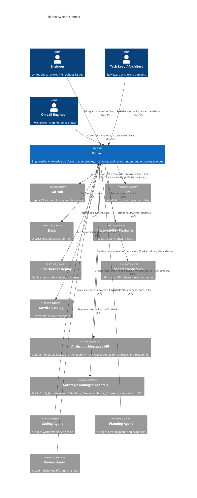
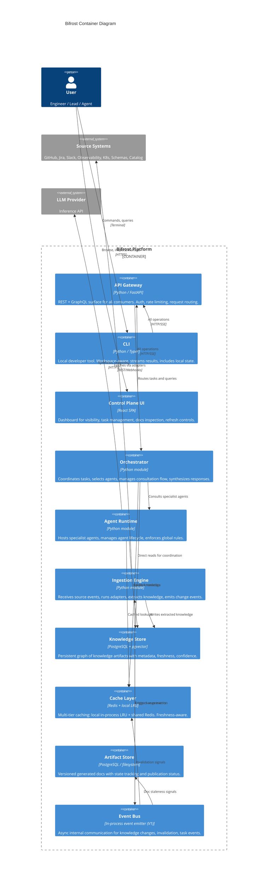
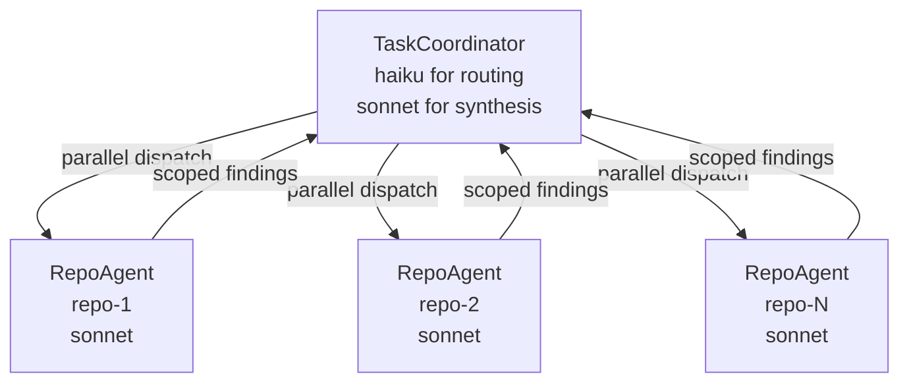
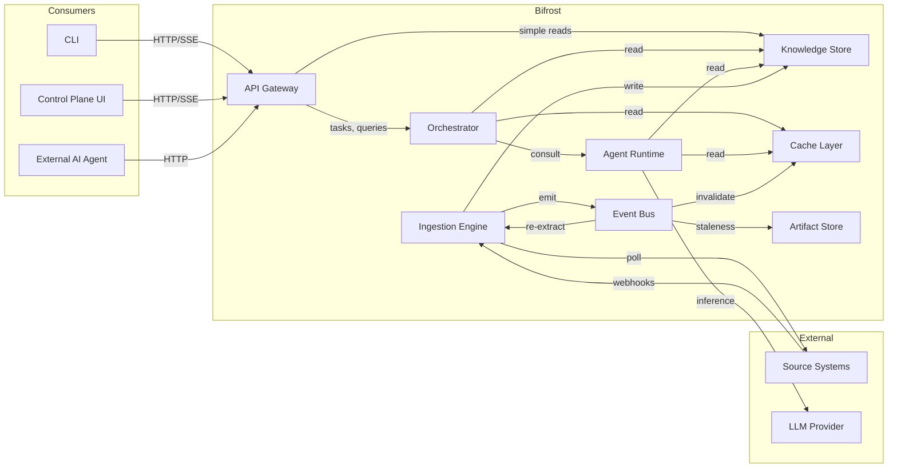
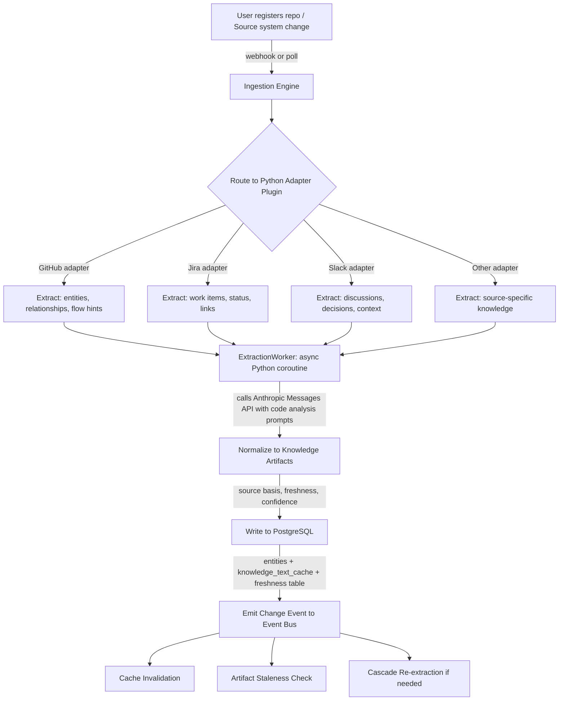
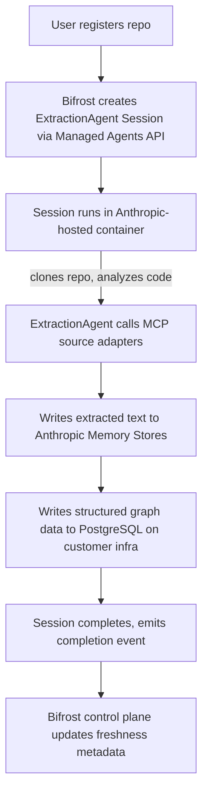
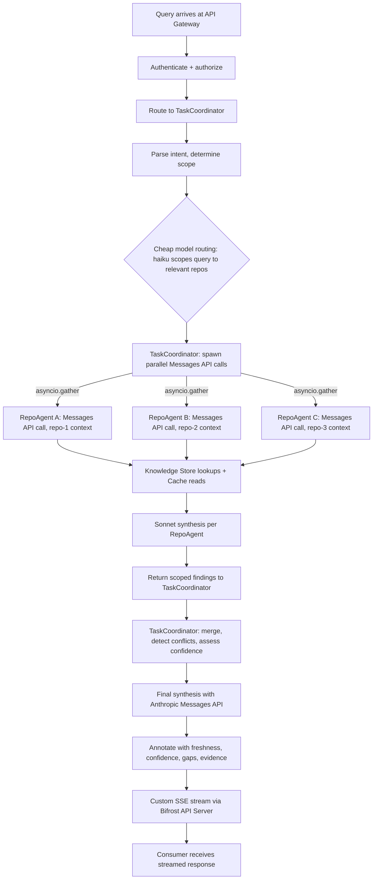
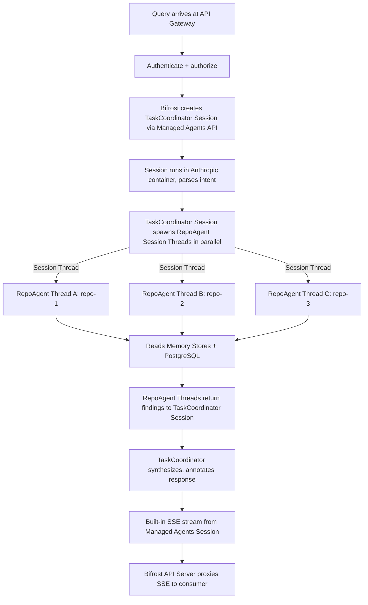
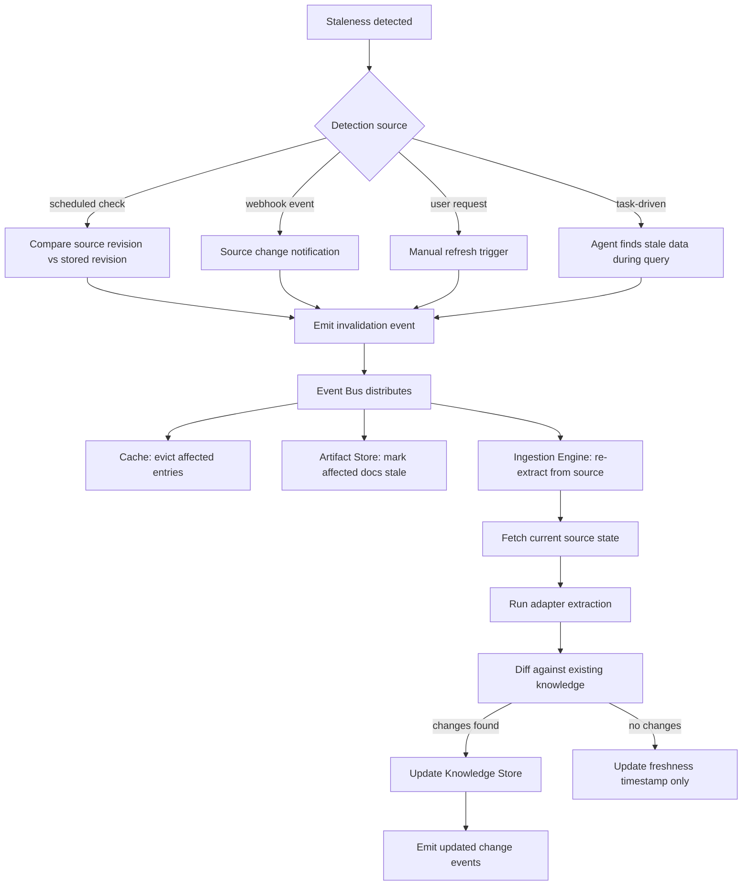
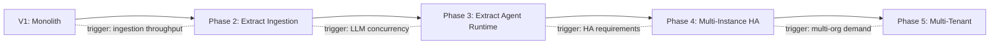

# F2 -- Bifrost System Architecture Overview

**Spec ID:** F2
**Status:** Draft
**Version:** 0.1

This document establishes the overall system shape for Bifrost. All subsystem specifications reference this document as the authoritative architectural frame.

---

## 1. Purpose and Scope

Bifrost is an engineering knowledge platform that assembles, maintains, and serves understanding about codebases, domains, flows, dependencies, and organizational engineering surfaces. It does this for both human users (engineers, leads, on-call responders, architects) and AI consumers (coding agents, planning agents, review agents, docs agents).

This architecture overview defines:

- The system boundary and external integrations
- The major runtime containers and their responsibilities
- How containers communicate
- How data flows through the system on write, read, and refresh paths
- Key architectural decisions with rationale
- V1 scope boundaries and extension points
- Deployment model and technology choices

This document does NOT define internal component designs, data schemas, agent prompt strategies, or UI wireframes. Those belong to their respective subsystem specs.

---

## 2. Requirements Traceability

This architecture is shaped primarily by:

| Requirement section | Architectural impact |
|---|---|
| **§14 Agent workforce** | Agent Runtime container; specialist lifecycle; scoped agent model |
| **§15 Orchestration** | Orchestrator container; task coordination protocol; consultation model |
| **§22 Non-functional** | Caching strategy; monolith-first deployment; extensibility via ports/adapters |
| §2 Core problems | Event-sourced knowledge; freshness-first design; multi-source model |
| §6 Source requirements | Adapter isolation (hexagonal); source-agnostic ingestion |
| §7 Knowledge requirements | Property graph + relational hybrid store; confidence/freshness metadata |
| §9 Flow requirements | First-class flow entities in knowledge graph |
| §12 Freshness/update | Staleness detection; invalidation events; refresh paths |
| §13 Storage/caching | Multi-tier cache; cache visibility metadata |
| §18 UI requirements | Control Plane UI container; dashboard and task views |
| §19 CLI/API | API Gateway; CLI container; streaming responses |
| §20 Logging/audit | Structured logging at orchestration and agent layers |
| §21 Security/governance | Permission-aware adapter access; authorization at API boundary |
| §23 V1 boundaries | Monolith scope; bounded source/repo set; stub boundaries |

---

## 3. Design Goals and Non-Goals

### Goals

1. **Freshness is mandatory, not optional.** Every knowledge artifact carries explicit freshness metadata. The system never silently serves stale data as current.
2. **Source-backed grounding.** Answers trace to source evidence. Confidence and gaps are surfaced, not hidden.
3. **Extensibility at the boundaries.** New source adapters, agent types, document formats, and consumer interfaces can be added without modifying core internals.
4. **Monolith-first, modular inside.** V1 ships as a single deployable process with clear internal module boundaries that allow future extraction.
5. **Incremental depth.** The system supports broad lightweight coverage everywhere, with deeper analysis on demand or for high-value surfaces.
6. **Human and machine parity.** The same knowledge store and orchestration serves both human queries (via UI/CLI) and agent queries (via API).

### Non-Goals

1. **Full source duplication.** Bifrost does not clone all raw source content centrally. It stores extracted knowledge, metadata, and references, fetching raw content on demand.
2. **Real-time streaming from all sources.** V1 uses webhook + polling. Sub-second source propagation is not a target.
3. **Autonomous execution.** V1 supports understanding, planning, and validation. Execution support (making changes, deploying) is deferred.
4. **Multi-tenant SaaS.** V1 targets a single organization. Multi-tenancy is a future concern.
5. **Custom LLM training.** Agents use LLMs via inference APIs with prompt engineering, not fine-tuned models.

---

## 4. Non-Functional Requirements

### Latency Targets

The following targets apply to end-to-end response latency as observed by the caller (CLI, UI, or API consumer), measured from request receipt at the API Gateway to first complete response (or final SSE event for streaming responses).

| Scenario | p50 | p95 | p99 |
|----------|-----|-----|-----|
| Cache hit (fresh T1/T2, single repo) | <1s | <2s | <5s |
| Simple query (1-2 RepoAgents, fresh) | <3s | <8s | <15s |
| Multi-agent query (3-5 RepoAgents) | <8s | <15s | <30s |
| Extraction triggered (cold start, small repo) | <5min | <12min | <20min |
| Incremental refresh (PR-size change) | <30s | <90s | <3min |

These are V1 Track A targets. Track B targets are identical (container overhead is offset by built-in parallelism).

†Track B p95 latency includes session startup overhead (~2-5s) and MCP tool round-trip latency (~100-500ms per call). Track B SLAs are 2-3× Track A SLAs for equivalent operations.

Latency targets are enforced via integration test assertions on the happy path (warm cache, healthy LLM provider). Degraded-mode behavior (LLM unavailable, cache miss, large repo cold start) is tracked separately as an operational metric, not a hard SLA.

---

## 5. System Context (C4 Level 1)

The system context diagram shows Bifrost as a black box with its external actors and systems.



### External Boundaries

**Source systems** provide raw engineering truth. Bifrost connects to them through adapters (see S6). The adapter boundary is the primary extensibility seam -- adding a new source means adding a new adapter, not changing core logic.

**Human users** interact through the CLI (terminal, workspace-integrated) and the Control Plane UI (browser-based dashboard). Both hit the same API Gateway.

**AI consumers** interact through the API Gateway, receiving structured, confidence-annotated responses suitable for further agent reasoning.

**LLM providers / Anthropic APIs** are external inference services. The system has a dual-track dependency model:

- **Track A (V1):** Bifrost depends on the **Anthropic Messages API** only. Agents are custom Python async loops that call the Messages API directly (claude-sonnet-4-6 for complex synthesis, claude-haiku-4-5 for cheap routing/scoping decisions). No Managed Agents access is required for V1 to ship.
- **Track B (future, when Research Preview access is granted):** Bifrost additionally depends on the **Anthropic Managed Agents API** (Agent Definitions, Sessions, Memory Stores). The runtime layer is swapped; business logic and interfaces remain unchanged.

The LLM boundary is abstracted via the `AgentRuntime` ABC so the underlying provider and runtime model can be swapped without modifying agent business logic.

---

## 6. Container Diagram (C4 Level 2)



### Container Responsibilities

**API Gateway.** Single entry point for all external consumers. Handles authentication, authorization, rate limiting, and request routing. Exposes REST endpoints for CRUD operations and a GraphQL endpoint for flexible queries. Supports Server-Sent Events (SSE) for streaming long-running responses (flow traces, plan generation).

**CLI.** Local binary that engineers install in their development environment. Workspace-aware: can detect the current repo, branch, and local diff state, and include that context in requests. Streams results progressively. Thin client -- all logic lives server-side.

**Control Plane UI.** React single-page application providing dashboard views for repos, domains, freshness/lag, specialist coverage, task history, and docs status. Supports triggering refresh actions, inspecting task evidence, and managing source connections. Communicates exclusively through the API Gateway.

**Orchestrator.** The coordination brain for non-trivial tasks. Receives a task (question, plan request, flow trace, etc.), determines scope, selects which specialist agents to consult, manages the consultation flow (parallel where possible, sequential where needed), detects conflicts, synthesizes a final response, and logs the full interaction structure. Implements the orchestration requirements (PRD section 15).

**Agent Runtime.** Hosts and manages specialist agents. Each specialist is scoped (repo, domain, source type, task type) and has access to the Knowledge Store and LLM providers. The runtime enforces global rules (output format, safety, cost budgets), manages agent lifecycle (creation, warm-up, teardown), and tracks agent health and freshness. Implements the requirements of S14.

The Agent Runtime has two concrete implementations behind the same `AgentRuntime` ABC:

- **Track A (V1 — `CustomAgentRuntime`):** Agents run as async Python coroutines within the Bifrost API Server process. The agent loop (receive task → call Anthropic Messages API → execute tools → return response) is implemented in-process via asyncio. State is read/written from PostgreSQL (shared relational DB via SQLAlchemy). All compute remains on customer infrastructure.
- **Track B (future — `ManagedAgentRuntime`):** Agent Sessions run in Anthropic-hosted containers. The Bifrost API Server creates Sessions via the Managed Agents API and proxies their SSE streams. State is persisted in Anthropic Memory Stores (cloud-hosted, shared across machines). Only the Bifrost API Server and PostgreSQL (for graph data) remain on customer infrastructure.

Swapping from Track A to Track B requires changing one runtime config flag (`BIFROST_TRACK=A|B`). No business logic changes are required.

#### §6.1 The Plug-and-Play Switch — Boot-Time Track Selection

The entire Track A → Track B migration happens in ONE place in the codebase: the application boot sequence. All other code uses injected ABCs — they never reference `os.environ["BIFROST_TRACK"]` directly.

```python
# src/bifrost/agents/boot.py — the ONLY place track selection happens
import os
from bifrost.agents.runtime.message_api import MessageApiRuntime
from bifrost.agents.runtime.managed_agent import ManagedAgentRuntime  # stub until Research Preview
from bifrost.db.agent_state import PostgresStateBackend
from bifrost.agents.state.memory_store import MemoryStoreBackend  # stub until Research Preview

def create_agent_infrastructure(deps: BootDeps) -> AgentInfrastructure:
    track = os.environ.get("BIFROST_TRACK", "A")

    if track == "B":
        if os.environ.get("TRACK_B_DPA_CONFIRMED") != "true":
            raise RuntimeError(
                "Track B requires DPA confirmation. Set TRACK_B_DPA_CONFIRMED=true after signing Anthropic DPA."
            )
        return AgentInfrastructure(
            runtime=ManagedAgentRuntime(max_duration_s=900),
            state_backend=MemoryStoreBackend(api_key=deps.anthropic_api_key),
        )

    # Default: Track A
    return AgentInfrastructure(
        runtime=MessageApiRuntime(deps.anthropic_client),
        state_backend=PostgresStateBackend(deps.db),
    )

# All agents receive these as constructor parameters:
# RepoAgent(runtime=runtime, state_backend=state_backend, repo_id=repo_id)
# TaskCoordinator(runtime=runtime, state_backend=state_backend, session_pool=session_pool)
# ExtractionAgent(runtime=runtime, state_backend=state_backend, repo_id=repo_id)
```

**Why this works:**
- `AgentRuntime` ABC: `async execute(task) -> AsyncGenerator[AgentEvent]` — same shape for both tracks
- `AgentStateBackend` ABC: `read/write/list/delete(path)` — same shape for both tracks
- All agent logic operates on these ABCs only
- When Research Preview access is granted, implement `ManagedAgentRuntime` and `MemoryStoreBackend` → Track B is live

**What changes between Track A and B:**
| Concern | Track A | Track B |
|---------|---------|---------|
| LLM calls | `anthropic.messages.create()` | Managed Agent session |
| Agent state | `knowledge_text_cache` table | Anthropic Memory Stores |
| File access | Local git clone (`fs.*`) | Git MCP sidecar tools |
| Session limit | Unlimited concurrent | 3-5 concurrent (pool) |
| Startup latency | ~0ms | ~2-5s per session |

**Ingestion Engine.** The write-side workhorse. Receives source events (webhooks, poll results), routes them to the appropriate source adapter, runs extraction (entities, relationships, flow hints, dependency hints, pattern hints), writes extracted knowledge to the Knowledge Store, and emits change events on the Event Bus. Source adapters implement a common port ABC (S6 hexagonal pattern).

**Knowledge Store.** The persistent heart of the system. Stores all knowledge artifacts (entities, relationships, flows, dependencies, patterns, metadata) in a hybrid model: a property graph for traversable relationships, relational tables for structured metadata and queries, and vector embeddings (pgvector) for similarity search. Every artifact carries source basis, freshness, confidence, and scope metadata (S7.2).

**Cache Layer.** Two tiers: a local in-process LRU cache for hot-path lookups within a single request, and a shared Redis cache for cross-request caching of source metadata, parsed structures, mappings, and recent task outputs. Cache entries carry freshness metadata and support dependency-aware invalidation (S13.4). Cache hits vs. misses are tracked and surfaceable (S13.5).

**Artifact Store.** Stores versioned generated documents (repo overviews, onboarding docs, flow docs, domain summaries, etc.). Tracks document state (draft, published, stale), source basis, and generation metadata. V1 uses PostgreSQL for metadata and local filesystem for document content. Future versions may use object storage.

**Event Bus.** Internal asynchronous communication backbone. In V1, this is an in-process async event emitter (Python asyncio-based, e.g., `aio-pika` or a custom typed abstraction). Carries knowledge change events, cache invalidation signals, doc staleness notifications, and task lifecycle events. Designed to be replaced with a message broker (Redis Streams, NATS) when extracting to multiple processes.

---

## 7. Component Interaction Model

### Agent Hierarchy (both Track A and Track B)

Bifrost uses a strict **2-level agent hierarchy**. There is no DomainAgent layer — domain-level reasoning is absorbed into the TaskCoordinator.

```
TaskCoordinator
  (in-process Python class in Track A;
   Managed Agent Session in Track B)
       │
       ├── RepoAgent [repo-1]
       ├── RepoAgent [repo-2]
       ├── RepoAgent [repo-3]
       └── RepoAgent [repo-N]
           (called in parallel via asyncio.gather() in Track A;
            called as Session Threads in Track B)
```

**Routing model:**
1. TaskCoordinator receives user query.
2. TaskCoordinator uses a cheap model (haiku) to determine which repos are in scope.
3. TaskCoordinator spawns one RepoAgent per in-scope repo, in parallel.
4. RepoAgents return scoped findings.
5. TaskCoordinator synthesizes the final response using a capable model (sonnet).

**Key constraint:** RepoAgents CANNOT call sub-agents. Delegation is exactly one level deep. This constraint holds in both Track A (design decision) and Track B (platform limitation L1).



### Communication Patterns

The system uses two distinct communication patterns, chosen by data flow direction:

| Pattern | Used for | Mechanism |
|---|---|---|
| **Request/Response** | Read path: queries, flow traces, plan requests | Synchronous function calls within the monolith (V1). HTTP internally when extracted. |
| **Event-driven** | Write path: source changes, knowledge updates, invalidation | Async events on the Event Bus. Fire-and-forget with at-least-once delivery within process. |

### Interaction Rules

1. **API Gateway** only talks to the **Orchestrator** (for tasks/queries) and directly to the **Knowledge Store** (for simple CRUD -- e.g., listing repos, checking freshness status).
2. **Orchestrator** talks to the **Agent Runtime** to consult specialists, and reads from the **Knowledge Store** and **Cache** for coordination metadata.
3. **Agent Runtime** specialists read from the **Knowledge Store** and **Cache**, and call **LLM providers** for synthesis. Agents never write to the Knowledge Store directly -- they return findings to the Orchestrator, which may trigger downstream writes.
4. **Ingestion Engine** is the only writer to the **Knowledge Store** for source-derived knowledge. It publishes change events to the **Event Bus** after every write.
5. **Event Bus** delivers invalidation signals to the **Cache Layer** and staleness signals to the **Artifact Store**. It can also trigger re-ingestion in the **Ingestion Engine** for cascade updates.
6. No container reaches into another container's internal state. All interaction is through defined interfaces.



---

## 8. Data Flow

### 8.1 Write Path (Ingestion)

Source system changes flow into the Knowledge Store through a well-defined pipeline. The pipeline differs by runtime track.

**Track A (V1) write path:**



**Track B (future) write path:**



**Key properties of the write path (both tracks):**

- **Event-sourced.** Changes are appended as events before materialized views are updated. This preserves history and supports replay.
- **Adapter-isolated.** Each source adapter implements a port ABC (Track A: Python plugin; Track B: MCP server). The adapter transforms source-specific data into normalized knowledge artifacts. Core logic never sees source-specific types.
- **Metadata-enriched.** Every artifact written carries: source system, source object ID, extraction timestamp, source revision/hash, confidence level, and scope (repo, domain, flow).
- **Eventually consistent.** Writes propagate through the Event Bus. Read models may lag behind by milliseconds to seconds within the monolith.

### 8.2 Read Path (Query)

User and agent queries flow through the TaskCoordinator (Orchestrator), which coordinates RepoAgent consultation and knowledge lookup. The agent hierarchy is strictly 2 levels: **TaskCoordinator → RepoAgents**. There is no intermediate DomainAgent layer — domain-level reasoning is handled by the TaskCoordinator directly.

**Track A (V1) read path:**



**Track B (future) read path:**



**Key properties of the read path (both tracks):**

- **2-level hierarchy.** TaskCoordinator → RepoAgents. DomainAgent is absorbed into the TaskCoordinator. No 3-level hierarchy.
- **Cheap-model routing.** Haiku (or equivalent fast/cheap model) is used for scope/routing decisions (which repos to query). Sonnet (or equivalent) is used for analysis and synthesis.
- **Orchestrated.** The TaskCoordinator decides which RepoAgents to consult based on task scope. Simple single-repo questions may consult one RepoAgent. Cross-domain flow traces may consult several in parallel.
- **Cache-first.** Agents check the Cache Layer before hitting the Knowledge Store. Cache entries carry freshness metadata so agents can decide whether cached data is acceptable for the current task.
- **Confidence-annotated.** Every response carries explicit confidence levels, source freshness, known gaps, and conflicts (S16).
- **Streamable.** Long-running responses (flow traces, plan generation) are streamed via SSE. Track A uses custom SSE streaming in the Bifrost API Server; Track B uses the built-in SSE stream from Managed Agent Sessions.

### 8.3 Refresh Path (Staleness Detection and Re-extraction)



**Key properties of the refresh path:**

- **Multi-trigger.** Refresh can be triggered by scheduled reconciliation, webhook events, user requests, or task-driven discovery of stale data.
- **Selective.** Invalidation is scoped to affected artifacts, not global. A change to one file in one repo does not invalidate the entire knowledge graph.
- **Diff-based.** Re-extraction compares new knowledge against existing knowledge. If nothing meaningful changed, only the freshness timestamp is updated, avoiding unnecessary downstream propagation.

---

## 9. Key Architectural Decisions

### ADR-001: Event-Driven Internal Communication

**Context.** The system has two fundamentally different data flow shapes: writes (source changes propagating into knowledge) and reads (queries assembling answers from knowledge). These have different consistency and latency requirements.

**Decision.** Use event-driven communication for the write path (ingestion, invalidation, refresh) and synchronous request/response for the read path (queries, task coordination).

**Rationale.**
- Write-path events can be processed asynchronously. A 500ms delay between a GitHub webhook and the knowledge store being updated is acceptable. Event-driven decoupling allows the Ingestion Engine to process at its own pace without blocking source systems.
- Read-path queries require low-latency, synchronous coordination. An engineer asking "what does this flow do?" needs a response in seconds, not a callback.
- This split maps naturally to CQRS (see ADR-006).

**Alternatives considered.**
- *Fully synchronous:* Would couple ingestion latency to source system response times. Webhook handlers would block.
- *Fully event-driven:* Would add unnecessary complexity to the read path. Query responses would need correlation IDs and callback mechanisms.

**Consequences.** The Event Bus must support at-least-once delivery within the process. V1 uses an in-process emitter; extraction to a message broker is needed for multi-process deployment.

---

### ADR-002: Monolith-First with Clear Module Boundaries

**Context.** The system has multiple logical containers (Orchestrator, Agent Runtime, Ingestion Engine, etc.) that could be deployed as separate services. However, V1 targets a single organization with bounded scope (§23).

**Decision.** Deploy V1 as a single Python process (uvicorn + FastAPI). Internal containers are Python modules with explicit ABC boundaries, communicating through function calls (reads) and an in-process async event emitter (writes). No HTTP between internal containers in V1.

**Rationale.**
- Eliminates operational complexity of distributed systems in V1: no service mesh, no distributed tracing overhead, no network failure modes between containers.
- Function-call communication is faster and simpler to debug than HTTP.
- Module boundaries are enforced by Python ABCs, Protocols, and linting rules (ruff, mypy), not deployment topology.
- The same ABCs that modules use internally can be promoted to HTTP/gRPC boundaries later.

**Alternatives considered.**
- *Microservices from day one:* Premature for a V1 with a single team. Adds deployment, observability, and consistency overhead without proportional benefit.
- *No module boundaries (big ball of mud):* Would make future extraction painful. The cost of defining ABCs upfront is low.

**Consequences.** Modules must not share database tables directly. Each module owns its data access. Cross-module communication is through defined ABCs only. This discipline pays off when extracting to separate services.

**Extraction triggers for future:** When any of these occur, extract the relevant module:
- Ingestion throughput requires independent scaling
- Agent Runtime needs GPU-adjacent deployment
- Team boundaries align with module boundaries

---

### ADR-003: Python Throughout

**Context.** Bifrost has a CLI, API server, agent runtime, ingestion engine, and (future) React UI. Choosing a consistent backend language simplifies the toolchain and maximizes ecosystem leverage for the AI/LLM domain.

**Decision.** Use Python for all backend components: API server (FastAPI), CLI (Typer), agent runtime, and ingestion engine. The future UI is a React SPA communicating via the API.

**Rationale.**
- The Anthropic Python SDK is first-class and well-maintained; async streaming, tool use, and structured outputs are native.
- Python's ecosystem has the strongest libraries for LLM integration, code analysis (tree-sitter, AST), and data processing.
- Single backend toolchain (uv/pip, ruff, mypy, pytest) reduces cognitive overhead.
- Python's type system (Pydantic models, `TypeAlias`, `Protocol`, ABCs) is expressive enough for the domain model (discriminated unions via tagged Pydantic models, NewType for IDs, generics for adapter ports).
- asyncio provides native async I/O for the concurrent agent-per-repo pattern.

**Alternatives considered.**
- *TypeScript/Node.js:* Enables shared types with React UI, but the LLM/ML ecosystem is weaker. Async model (single-threaded event loop) is less natural for CPU-bound extraction.
- *Go backend:* Better performance characteristics, but worse ergonomics for the kind of dynamic, LLM-integrated, graph-traversal logic Bifrost needs. Stronger case if raw throughput were the bottleneck.

**Consequences.** Performance-critical paths (large graph traversals) should leverage query pushdown to PostgreSQL. CPU-intensive extraction tasks can use `asyncio.to_thread()` or process pools. UI will communicate via API contract (OpenAPI schema from FastAPI), not shared types.

---

### ADR-004: Property Graph + Relational Hybrid for Knowledge Store

**Context.** The Knowledge Store must support: (a) traversable relationships between entities (flows, dependencies, ownership), (b) structured metadata queries (freshness, confidence, scope filtering), and (c) similarity search for pattern discovery.

**Decision.** Use PostgreSQL as the single database, combining:
- Relational tables for entity metadata, freshness tracking, and structured queries
- JSONB columns and recursive CTEs for graph traversal of relationships
- pgvector extension for vector embeddings (similarity search for patterns and implementations)

**Rationale.**
- PostgreSQL is a single operational dependency that covers all three needs adequately for V1 scale.
- Recursive CTEs handle graph traversal well for the expected graph sizes (thousands of entities per domain, not billions).
- pgvector provides vector similarity search without a separate vector database.
- JSONB columns allow flexible schema evolution for different knowledge artifact types.
- Avoids the operational burden of a dedicated graph database (Neo4j) and a separate vector store (Pinecone/Weaviate) in V1.

**Alternatives considered.**
- *Neo4j for graph + PostgreSQL for metadata + Pinecone for vectors:* Optimal for each use case individually, but triples operational complexity. Justified only if PostgreSQL graph traversal becomes a bottleneck.
- *Pure document store (MongoDB):* Poor fit for the relationship-heavy query patterns (flow traversal, dependency chains, blast radius computation).

**Consequences.** Graph traversal performance must be monitored. If recursive CTEs become slow at scale, the first mitigation is materialized views for common traversal patterns. If that is insufficient, extracting the graph to a dedicated graph database is the next step.

---

### ADR-005: LLM Usage Strategy

**Context.** Agents and the Orchestrator use LLMs for synthesis, reasoning, extraction, and plan generation. LLM usage is expensive, variable in latency, and subject to rate limits and availability.

**Decision.** Implement a layered LLM strategy:

1. **Model selection per task complexity.** Simple extraction tasks (entity recognition, relationship extraction) use smaller, faster, cheaper models. Complex synthesis (plan generation, flow explanation, conflict resolution) uses larger models.
2. **Prompt management.** All prompts are versioned templates stored as code, not inline strings. Prompts are parameterized with context from the Knowledge Store.
3. **Context budgets.** Each agent task has a token budget. The Orchestrator allocates budgets based on task complexity. Agents truncate or summarize context to fit within budget.
4. **Cost tracking.** Every LLM call is logged with token counts, model used, latency, and task association. Aggregate costs are surfaceable on the Control Plane UI.
5. **Graceful degradation.** If an LLM provider is unavailable or rate-limited, the system degrades gracefully: return cached results if available, return raw knowledge without synthesis, or return a "synthesis unavailable" response with the underlying data. Never block entirely.

**Rationale.**
- Unbounded LLM usage leads to runaway costs and unpredictable latency. Budgets and model selection per task keep costs proportional to value.
- Prompt versioning enables A/B testing and rollback without code changes.
- Graceful degradation ensures Bifrost remains useful even when LLMs are slow or down. The Knowledge Store still has structured data that can be returned directly.

**Alternatives considered.**
- *Single model for everything:* Simpler but either too expensive (large model for everything) or too weak (small model for complex tasks).
- *Fine-tuned models:* Higher quality for specific tasks, but the training/maintenance cost is not justified in V1 with a rapidly evolving domain model.

**Consequences.** The system needs an LLM abstraction layer (model router) that maps task types to models. This is a V1 build item. Token budget enforcement must happen before LLM calls, not after.

---

### ADR-006: CQRS -- Separate Write and Read Models

**Context.** The write path (ingestion from sources) and read path (query from users/agents) have different performance characteristics, consistency requirements, and access patterns.

**Decision.** Apply CQRS: the Ingestion Engine writes through a normalized event-sourced model. Read-optimized views (materialized per query pattern) serve the read path. The two are eventually consistent, connected by events on the Event Bus.

**Rationale.**
- Write path optimizes for correctness and completeness: every source change is captured with full metadata.
- Read path optimizes for speed: pre-computed views for common query patterns (repo summary, flow trace, dependency graph) avoid expensive joins/traversals at query time.
- Eventually consistent is acceptable because knowledge freshness is already explicit. A read view that is 2 seconds behind the write model is fine -- the freshness metadata will reflect this.

**Alternatives considered.**
- *Single model for reads and writes:* Simpler, but query-time joins across the full knowledge graph would be slow for common operations like flow traces.
- *Full event sourcing with projections:* More powerful but adds complexity. Partial event sourcing (events for writes, materialized views for reads) is sufficient.

**Consequences.** Read views must be rebuilt when the view schema changes. Background jobs maintain view freshness. The system must track view freshness separately from source freshness.

---

### ADR-007: Hexagonal / Ports-and-Adapters for Source Isolation

**Context.** Bifrost must support plug-and-play source addition (§6.1). The system must not assume a fixed set of source systems.

**Decision.** Apply hexagonal architecture (ports and adapters) at the Ingestion Engine boundary. Define port ABCs for source adapter capabilities. Each source system gets an adapter that implements these ABCs. Core ingestion logic depends only on the port ABCs, never on source-specific types.

**Port ABC (conceptual):**

```
SourceAdapter {
  discover(): SourceObject[]
  fetchMetadata(objectId): SourceMetadata
  fetchContent(objectId): SourceContent
  getRevision(objectId): RevisionInfo
  mapToScope(objectId): ScopeMapping  // repo, domain, concept, flow
  subscribe(callback): Subscription   // webhook registration
  poll(since): ChangeSet              // polling fallback
}
```

**Rationale.**
- Adding a new source (e.g., Confluence, an on-call pager, a metrics platform) requires only implementing the adapter ABC. No changes to the Ingestion Engine, Knowledge Store, or any other container.
- Adapter isolation makes testing straightforward: mock the port, test core logic in isolation.
- The same pattern works for output adapters (e.g., publishing docs to Confluence vs. GitHub Pages).

**Alternatives considered.**
- *Plugin system with dynamic loading:* More flexible but adds runtime complexity (class loading, version conflicts). Static adapters compiled into the monolith are sufficient for V1.
- *Generic webhook handler with configuration:* Would work for simple sources but cannot handle the extraction complexity of sources like GitHub (PRs with review threads, commit history, branch topology).

**Consequences.** Adapter authors must implement the full port ABC. A base adapter class with sensible defaults reduces boilerplate. Adapter testing requires source-specific fixtures.

---

### ADR-008: Dual-Track Agent Runtime Strategy

**Status.** Accepted.

**Decision.** Build V1 on a custom agent runtime (Track A) using the Anthropic Messages API directly, while designing all agent ABCs to support Anthropic Managed Agents (Track B) as a drop-in replacement when Research Preview access is granted.

**Context.** Anthropic Managed Agents (multi-agent sessions, memory stores) is in Research Preview with waitlist access. Bifrost cannot block V1 on access approval. However, Managed Agents offers significant long-term advantages: managed containers, shared memory persistence across machines, built-in streaming, and prompt caching. Designing for both tracks from the start avoids a costly rewrite when Track B access becomes available.

**Consequences.**
- V1 ships without waiting for Managed Agents access.
- All agent ABCs are defined as Python abstract base classes with swappable implementations.
- `AgentRuntime` ABC: `initialize()`, `execute(task)`, `get_state()`, `set_state()` — same API for both tracks.
- `AgentStateBackend` ABC: `read(path)`, `write(path, content)`, `list(prefix)` — same API for both tracks. Track A: PostgreSQL; Track B: Memory Stores.
- Track B adoption requires no business logic changes, only runtime config changes (`BIFROST_TRACK=A|B`).
- When Managed Agents access is granted, Track B can be enabled per-agent-type incrementally (e.g., enable Track B for RepoAgents first, keep TaskCoordinator on Track A temporarily).

**Tradeoffs vs Track B:**
- Track A: no shared agent state across machines without a shared PostgreSQL instance (PostgreSQL provides this for structured data, but in-process agent state is per-instance).
- Track A: custom agent loop code to maintain and test.
- Track A: no built-in container sandboxing (agents run inside the Bifrost process; compromise of Bifrost process = access to agent execution).
- Track A: custom SSE streaming implementation required.
- Track B (future): shared state via Memory Stores across all machines, managed container sandboxing, built-in SSE from sessions, less infrastructure code to maintain.

**Managed Agents limitations to plan around (Track B):**
- L1: Max 1 level of delegation. Hierarchy is TaskCoordinator → RepoAgents only. DomainAgent absorbed into TaskCoordinator.
- L2: Research Preview gating. Track A is the V1 fallback.
- L3: Source code in Anthropic containers requires Data Processing Agreement (DPA) review.
- L4: Memory Stores are text-only, 100KB/doc. PostgreSQL still required for structured graph data.
- L5: 8 Memory Stores per session. State allocation must be planned carefully.
- L6: Three cost dimensions in Track B: LLM tokens + container compute + Memory Store storage.
- L7: No persistent containers. Checkpoint to Memory Store regularly.
- L8: Context isolation between Session Threads. Cross-agent knowledge sharing via Memory Stores or shared container filesystem.

#### Track B Known Constraints

| Code | Limitation | Impact on Bifrost | Mitigation in Spec |
|------|-----------|-------------------|-------------------|
| L1 | No recursive delegation (max 1-level) | DomainAgent tier cannot exist as a separate managed agent; TaskCoordinator must absorb domain-level reasoning | Agent hierarchy is defined as exactly 2 levels: TaskCoordinator → RepoAgents (ADR-008 Decision; S14) |
| L2 | Ephemeral sessions (state lost without Memory Store writes) | Any in-flight task state is lost if a session ends unexpectedly | `AgentStateBackend.write()` called after every significant reasoning step; checkpoint interval configurable |
| L3 | No direct filesystem access (must use Git MCP sidecar) | Repo cloning and file reads must go through MCP tool calls, not direct `fs` access | All repo file access routed through `RepoAccessPort`; Track B implementation uses Git MCP sidecar |
| L4 | MCP tools are sidecars (not arbitrary code) | Cannot run arbitrary Python in the managed container; all tool actions must be MCP-defined | Tool ABC defined as MCP-compatible from day one; no in-container `exec` dependencies |
| L5 | Session duration limits (~10-30 min; must checkpoint) | Long-running extractions (large repos) may exceed session lifetime | Tasks decomposed into checkpointable sub-tasks; `TaskCoordinator` resumes from last checkpoint on session restart |
| L6 | No direct inter-agent communication | RepoAgents cannot call each other; cross-repo synthesis must go through TaskCoordinator | All cross-agent data flows through TaskCoordinator; RepoAgents are stateless with respect to each other |
| L7 | Session concurrency limits (~3-5 concurrent in Research Preview) | Parallel multi-repo analysis may be throttled; large domain sweeps serialized | Orchestrator maintains `sessionPool` with `maxConcurrentSessions`; excess tasks queue with backpressure (see Track B deployment section) |
| L8 | Cost opacity (session overhead + MCP + Memory Store costs) | Track B cost per task is harder to predict than Track A (token-only) | Cost tracking logs session ID alongside token counts; session overhead estimated at ~$0.01-0.05/session startup |

---

## 10. V1 Scope Boundary

### Built in V1

| Component | V1 scope |
|---|---|
| Ingestion Engine | GitHub adapter (repos, PRs, commits, reviews), Jira adapter (issues, status) |
| Knowledge Store | Full schema with property graph, relational metadata, pgvector |
| Agent Runtime | RepoAgents (one per repo in scope), TaskCoordinator (absorbs domain-level reasoning). 2-level hierarchy only: TaskCoordinator → RepoAgents. |
| Orchestrator | Single-coordinator model, parallel + sequential consultation |
| API Gateway | REST endpoints for all major operations, GraphQL for flexible queries |
| CLI | Question, flow trace, freshness check, refresh request, local state inclusion |
| Control Plane UI | Repo/domain dashboard, freshness/lag views, task history, basic docs view |
| Cache Layer | Redis shared cache + in-process LRU |
| Artifact Store | Repo overview and flow docs generation, draft/published states |
| Event Bus | In-process typed event emitter |
| LLM integration | Model router with 2 tiers (small/large), prompt templates, cost tracking |

### Stubbed in V1 (ABC exists, implementation is minimal)

| Component | Stub scope |
|---|---|
| Slack adapter | ABC defined, returns empty results. Wired for future implementation. |
| Observability adapter | ABC defined, returns empty results. Runtime correlation deferred. |
| K8s/deploy adapter | ABC defined, returns empty results. |
| Schema registry adapter | ABC defined, returns empty results. |
| Execution support | API surface defined but returns "not supported in V1". |
| Multi-org / tenancy | Single-org assumed; no tenant isolation logic. |

### Deferred (not present in V1)

| Capability | Rationale for deferral |
|---|---|
| Autonomous execution | Requires approval gates, policy engine, extensive safety validation (S21.3) |
| Multi-instance deployment | Monolith-first (ADR-002); extraction triggered by observed bottlenecks |
| Custom LLM fine-tuning | Prompt engineering is sufficient for V1 scope |
| Real-time streaming ingestion | Webhook + polling meets V1 freshness requirements |
| Advanced RBAC | V1 trusts the user/agent identity; fine-grained RBAC is a V2 concern |

---

## 11. Extension Points

The architecture provides four primary extension seams:

### 11.1 Source Adapters

**ABC:** `SourceAdapter` port (see ADR-007).
**How to extend:** Implement the port ABC for a new source system. Register the adapter in the Ingestion Engine's adapter registry. No changes to core logic.
**Examples:** Confluence adapter, on-call pager adapter, metrics platform adapter, GitLab adapter.

### 11.2 Agents

**ABC:** `AgentInterface` ABC defining: scope declaration, knowledge access pattern, consultation protocol, and response format.
**How to extend:** Implement the agent ABC. Register in the Agent Runtime. The Orchestrator's agent selection logic must be updated to know when to consult the new agent.
**Examples:** Security agent (vulnerability analysis), performance agent (runtime bottleneck analysis), migration agent (migration state tracking).

### 11.3 Document Types

**ABC:** `DocGenerator` ABC defining: input knowledge requirements, generation template, freshness tracking, and publication format.
**How to extend:** Implement the generator ABC. Register in the Artifact Store. The refresh path will automatically track staleness for the new doc type.
**Examples:** Migration guide generator, API changelog generator, runbook generator.

### 11.4 Consumer Interfaces

**Extension point:** API Gateway endpoint registration (FastAPI router).
**How to extend:** Add new REST or GraphQL endpoints to the API Gateway. For fundamentally new interaction patterns (e.g., IDE plugin), add a new thin client that calls the API Gateway.
**Examples:** VS Code extension, Slack bot, GitHub Actions integration.

---

## 12. Deployment Model

### V1 (Track A): Single-Process Deployment — Customer Infrastructure Only

```
┌─────────────────────────────────────────────────┐
│  Python Process (uvicorn)  (customer infra)      │
│  ┌───────────┐  ┌──────────┐  ┌──────────────┐ │
│  │ API       │  │TaskCoord.│  │ AgentRuntime │ │
│  │ Gateway   │──│ (Orchestr)│──│ (CustomImpl) │ │
│  └───────────┘  └──────────┘  └──────────────┘ │
│  ┌───────────┐  ┌──────────┐                    │
│  │ Ingestion │  │ Event    │                    │
│  │ Engine    │──│ Bus      │                    │
│  └───────────┘  └──────────┘                    │
└──────────────────────┬──────────────────────────┘
                       │
          ┌────────────┼────────────┐
          │            │            │
     ┌────┴────┐  ┌────┴────┐  ┌───┴────┐
     │PostgreSQL│  │  Redis  │  │ Static │
     │+pgvector │  │  Cache  │  │  UI    │
     └─────────┘  └─────────┘  └────────┘
```

**V1 (Track A) properties:**
- Single Python process (uvicorn + FastAPI) running all containers as Python modules. `asyncio.to_thread()` or process pools for CPU-intensive extraction tasks.
- Agents run in-process as async Python coroutines. No external container dependency for agent execution.
- All data (knowledge graph, agent state, freshness metadata, extracted knowledge text) stays on customer infrastructure in PostgreSQL.
- SSE streaming is implemented as custom server-sent events in the Bifrost API Server.
- **Data residency:** All source code and extracted knowledge remain on customer infrastructure. No data is sent to Anthropic beyond LLM inference payloads (prompts + completions).

**Module layout:** `src/bifrost/{core,server,cli,db,adapters,agents}/` — each directory maps to a logical container from the C4 diagram. `core` contains the knowledge model and shared types (Pydantic models, ABCs). `server` is the FastAPI API Gateway. `cli` is the Typer CLI. `db` contains SQLAlchemy models and the `AgentStateBackend` PostgreSQL implementation. `adapters` contains source adapter plugins. `agents` contains `AgentRuntime`, agent definitions, and the boot-time track selection.

**External dependencies (V1):** PostgreSQL (knowledge store + artifact store metadata + agent state), Redis (shared cache, optional for small deployments), filesystem (artifact content). The React UI is served as static files from a CDN/reverse proxy.

### V1.5 (Track B): When Managed Agents Research Preview Access Is Granted

```
┌───────────────────────────────────┐    ┌─────────────────────────────────────┐
│  Customer Infrastructure           │    │  Anthropic Cloud                    │
│                                   │    │                                     │
│  ┌───────────┐  ┌──────────────┐  │    │  ┌────────────────────────────────┐ │
│  │ API       │  │ Bifrost      │  │◄──►│  │ Managed Agent Sessions         │ │
│  │ Gateway   │──│ Control      │  │    │  │ (TaskCoordinator + RepoAgents) │ │
│  └───────────┘  │ Plane        │  │    │  └────────────────────────────────┘ │
│                 └──────────────┘  │    │  ┌────────────────────────────────┐ │
│  ┌───────────┐                   │    │  │ Anthropic Memory Stores         │ │
│  │PostgreSQL │  (graph data      │    │  │ (agent state, knowledge text)   │ │
│  │+pgvector  │   only)           │    │  └────────────────────────────────┘ │
│  └───────────┘                   │    └─────────────────────────────────────┘
└───────────────────────────────────┘
```

**V1.5 (Track B) properties:**
- Agent Sessions run in Anthropic's cloud containers. Repo cloning and code analysis moves to Anthropic infrastructure.
- Agent state (configs, knowledge text, freshness) moves to Anthropic Memory Stores. PostgreSQL remains for structured graph data (entities, relationships, flows, dependencies).
- Built-in SSE from Managed Agent Sessions replaces custom SSE streaming. Bifrost API Server proxies the session event stream.
- Enabled by changing `BIFROST_TRACK=B`. No business logic changes required.
- **Data residency note:** Track B sends source code to Anthropic-hosted containers for analysis. This requires Data Processing Agreement (DPA) review with Anthropic before enabling. Track A keeps all data on customer infrastructure and does not have this requirement.

**Session Pool**: Track B concurrent session limit (estimated 3-5 in Research Preview) requires a session queue. The orchestrator must maintain a `sessionPool` with configurable `maxConcurrentSessions` (default: 3). Excess tasks queue with backpressure signaled via `429 Too Many Sessions` internal error.

**Environment configuration.** All configuration via environment variables with sensible defaults:
- `DATABASE_URL` -- PostgreSQL connection string
- `REDIS_URL` -- Redis connection string
- `ANTHROPIC_API_KEY` -- Anthropic API key (used for both Messages API in Track A and Managed Agents API in Track B)
- `BIFROST_TRACK` -- `A` (default, V1 custom runtime) or `B` (Managed Agents, requires Research Preview access)
- `LLM_MODEL_ANALYSIS` -- model for complex analysis/synthesis tasks (default: `claude-sonnet-4-6`)
- `LLM_MODEL_ROUTING` -- model for cheap scope/routing decisions (default: `claude-haiku-4-5`)
- `PORT` -- HTTP port (default: 3000)
- `LOG_LEVEL` -- logging verbosity (default: info)
- `SOURCE_GITHUB_TOKEN` -- GitHub PAT for API access
- `SOURCE_JIRA_TOKEN` -- Jira API token
- `SOURCE_JIRA_URL` -- Jira instance URL

**Container-ready.** The process is designed to run in a Docker container. A `Dockerfile` is provided. Health check endpoint at `/health`. Graceful shutdown on SIGTERM.

---

## 13. Technology Recommendations

| Layer | Technology | Rationale |
|---|---|---|
| Runtime | Python 3.12+ | Mature, async-native (asyncio), strongest LLM/AI ecosystem |
| Language | Python 3.12+ (strict mypy) | Type safety via mypy strict mode, Pydantic for runtime validation |
| Web framework | FastAPI | Async-native, auto-generated OpenAPI docs, Pydantic integration |
| GraphQL | Strawberry (FastAPI-native) | Code-first GraphQL with Python type annotations |
| Database | PostgreSQL 16+ | Relational + JSONB + recursive CTEs + pgvector |
| Vector search | pgvector extension | Embedded in PostgreSQL, no separate service |
| Cache | Redis 7+ | Shared cache with TTL, pub/sub for invalidation |
| In-process cache | cachetools or custom LRU | Fast, size-bounded, per-process |
| Event bus (V1) | Custom async event emitter | In-process, zero-dependency, type-safe via Pydantic events |
| Streaming | Server-Sent Events (SSE) | Simple, HTTP-native, firewall-friendly. Track A: custom SSE in Bifrost API Server. Track B: proxied from Managed Agent Session SSE stream. |
| **LLM (Track A)** | **Anthropic Messages API** | **Direct inference. `claude-sonnet-4-6` for analysis/synthesis. `claude-haiku-4-5` for cheap routing/scoping decisions.** |
| **LLM (Track B)** | **Anthropic Managed Agents API** | **Same models as Track A. Agent Definitions + Sessions replace custom Python loops. Memory Stores replace PostgreSQL-backed agent state.** |
| **Cheap-model routing** | **`claude-haiku-4-5`** | **Used for scope decisions (which repos to query, query classification). Fast and cheap. Sonnet reserved for analysis and synthesis.** |
| Frontend | React 18+ with TypeScript | Component model, ecosystem. Communicates via API (OpenAPI schema). |
| State management | TanStack Query (React Query) | Cache-first data fetching for UI |
| CSS | Tailwind CSS | Utility-first, fast iteration |
| Testing | pytest + Playwright | pytest for unit/integration, Playwright for E2E |
| Package manager | uv | Fast, modern Python package management |
| Linting | ruff + mypy | Consistent style (ruff), type safety (mypy strict) |
| Build | hatchling or setuptools | Standard Python packaging |
| Container | Docker | Standard containerization |
| ORM / query builder | SQLAlchemy 2.0 (async) | Type-safe SQL, mature PostgreSQL support, async session |
| CLI | Typer | Type-safe CLI with auto-generated help, async support |

---

## 14. Integration Testing Strategy

Integration tests validate the interactions between containers and with external dependencies. The strategy is layered:

### Layer 1: Module Interface Tests

Each container's public interface is tested against its contract. Mock dependencies at the port boundary.

- **Ingestion Engine:** Given a mock source adapter returning fixture data, verify correct knowledge artifacts are produced and change events are emitted.
- **Orchestrator:** Given mock agents returning fixture findings, verify correct consultation flow, conflict detection, and synthesis.
- **Agent Runtime:** Given mock Knowledge Store data, verify agents produce correctly structured, confidence-annotated responses.

### Layer 2: Container Integration Tests

Test pairs of containers working together with real dependencies (test database, test Redis).

- **Ingestion Engine + Knowledge Store:** Verify end-to-end write path: source fixture in, query knowledge store, confirm correct artifacts with metadata.
- **Orchestrator + Agent Runtime + Knowledge Store:** Verify end-to-end read path: seed knowledge store, submit query, confirm response structure and content.
- **Event Bus + Cache Layer:** Verify invalidation: write knowledge, cache a read, emit change event, confirm cache eviction.

### Layer 3: API Integration Tests

Test the full stack through the API Gateway with a test database.

- Submit queries through REST/GraphQL, verify response structure and content.
- Submit ingestion webhooks, verify knowledge store is updated and cache is invalidated.
- Test SSE streaming for long-running responses.

### Layer 4: Source Adapter Tests

Each source adapter has integration tests against the real source API (or a recorded fixture).

- **GitHub adapter:** Test against a fixture repository. Verify entity extraction, relationship mapping, revision tracking.
- **Jira adapter:** Test against recorded API responses. Verify work item extraction, status mapping.

### Test Infrastructure

- **Test database:** PostgreSQL instance per test suite, created and destroyed automatically. Use `pg_tmp` or Docker.
- **Test Redis:** Redis instance per test suite, flushed between tests.
- **Source fixtures:** Recorded API responses (not live calls) for deterministic, fast tests.
- **LLM mocks:** All LLM calls are mocked in integration tests. LLM integration is tested separately in a dedicated slow-test suite with real API calls.

---

## 15. Future Evolution

### Phase 1: V1 (Monolith)

Single Python process (uvicorn + FastAPI). PostgreSQL + Redis. GitHub + Jira adapters. Repo + domain + flow specialists. CLI + UI + API.

### Phase 2: Scale Ingestion

**Trigger:** Ingestion throughput exceeds single-process capacity (many repos, frequent changes).
**Action:** Extract Ingestion Engine to a separate process with its own Event Bus connection. Use Redis Streams or NATS for inter-process events. Ingestion can now scale horizontally.

### Phase 3: Scale Agent Runtime

**Trigger:** Agent consultation latency is dominated by LLM call concurrency limits within a single process.
**Action:** Extract Agent Runtime to separate worker processes. Orchestrator dispatches consultation requests via a task queue (BullMQ on Redis). Agent workers can scale independently and potentially run on GPU-adjacent infrastructure.

### Phase 4: Multi-Instance

**Trigger:** High availability requirements or multiple-team deployment.
**Action:** Run multiple API Gateway instances behind a load balancer. Knowledge Store (PostgreSQL) handles concurrent access. Redis cache is already shared. Event Bus moves to a durable message broker.

### Phase 5: Multi-Tenant (if needed)

**Trigger:** Bifrost offered to multiple organizations.
**Action:** Tenant isolation at the database level (schema-per-tenant or row-level security). Tenant-aware routing at the API Gateway. Per-tenant LLM cost tracking.



---

## 16. Open Questions

| # | Question | Impact | When to resolve |
|---|---|---|---|
| OQ-1 | What is the token budget strategy for V1? Should there be hard per-task limits or soft advisory budgets? | Cost control, response quality | Before Agent Runtime implementation |
| OQ-2 | How do we handle Knowledge Store schema migrations as the domain model evolves? Flyway-style versioned migrations, or a more flexible JSONB-first approach? | Developer experience, data integrity | Before Knowledge Store implementation |
| OQ-3 | Should the Event Bus in V1 support persistence (write-ahead log) or is at-most-once in-process delivery acceptable? | Data durability for write path | Before Ingestion Engine implementation |
| OQ-4 | What is the authorization model for AI agent consumers? API keys with scope restrictions, or OAuth2 client credentials? | Security, API design | Before API Gateway implementation |
| OQ-5 | Should V1 support local-only mode (no PostgreSQL/Redis, SQLite + in-memory cache) for individual developer use? | Developer experience, adoption | Before deployment model finalization |
| OQ-6 | How do we handle rate limiting for source system APIs (GitHub, Jira) across adapter polling and on-demand fetches? | Reliability, source system compliance | Before adapter implementation |
| OQ-7 | What is the right granularity for vector embeddings in pgvector? Per-entity, per-relationship, per-flow-segment? | Similarity search quality, storage cost | Before Knowledge Store schema design |
| OQ-8 | Should the Orchestrator's agent selection be rule-based (V1) or itself LLM-driven? | Complexity, cost, flexibility | Before Orchestrator implementation |
