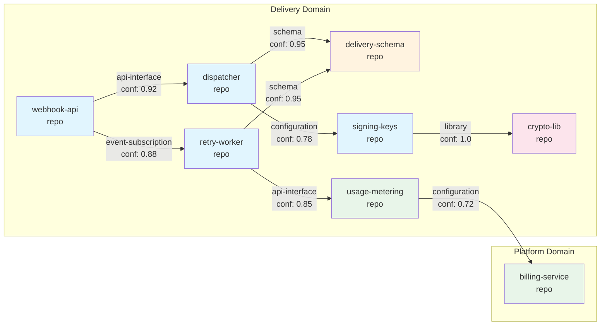

# S6 — Dependency and Impact Model Specification

| Field        | Value                        |
|--------------|------------------------------|
| Spec ID      | S6                           |
| Title        | Dependency and Impact Model  |
| Status       | Draft                        |
| Authors      | Bifrost Core Team            |
| Depends On   | S1 (Knowledge Model), S3 (Freshness Model) |

---

## 1. Purpose and Scope

This specification defines how Bifrost discovers, stores, queries, and reasons about dependencies between engineering entities (repositories, components, interfaces, domains) and how it computes the impact — or blast radius — of a proposed or observed change.

The dependency and impact model is the backbone of several core Bifrost capabilities:
- Answering "what depends on X?" and "what does X depend on?"
- Computing blast radius for a change set
- Surfacing hidden or stale dependencies
- Powering flow-aware planning and validation
- Enabling cross-repo and cross-domain impact analysis

This spec covers the entity model, discovery mechanisms, graph storage, traversal algorithms, query interfaces, freshness tracking, and cross-repo dependency handling. It does not cover flow sequencing (see Flow spec) or runtime trace ingestion (V2).

---

## 2. Glossary References

| Term | Definition |
|------|-----------|
| **Dependency** | A directed relationship between two entities where a change in the target may require awareness, adaptation, or revalidation in the source. |
| **Repo** | A version-controlled code repository. The primary unit of code ownership. |
| **Domain** | A logical grouping of repos that together serve a coherent business or platform function. |
| **Component** | A meaningful sub-unit within a repo — a module, package, service, or bounded context. |
| **Interface** | A contract surface exposed by a component: an API endpoint, event topic, schema, config contract, or shared library export. |
| **Blast Radius** | The set of entities transitively affected by a change, weighted by confidence. |
| **Freshness** | A measure of how recently a dependency was last confirmed by a discovery source. |
| **Hidden Dependency** | A dependency that is not declared or statically discoverable but is inferred from behavioral signals (co-change, ownership overlap, runtime correlation). |

---

## 3. Requirements Traceability

This specification addresses the following requirements from `docs/prd.md`:

| Requirement | Section | Coverage |
|-------------|---------|----------|
| §10.1 Direct and indirect dependency support at repo/domain/org level | Sections 5, 7, 9 |
| §10.2 Dependency types (code, API, schema, config, event, runtime, ownership, migration, inferred) | Section 5 |
| §10.3 Dependency answer requirements (direct, indirect, confidence, missing, stale) | Sections 8, 9 |
| §3.2 Plan: understand likely risks and blast radius | Section 8 |
| §4.1 Reviewer/tech lead: see blast radius, hidden deps | Sections 8, 9 |
| §4.1 Engineer entering midstream: identify direct and indirect deps | Section 9 |
| §5.1 Repo-level: what dependencies it has, what depends on it | Section 9 |
| §5.2 Domain-level: dependencies crossing repo boundaries | Section 11 |
| §5.3 Org-level: cross-domain blast radius, platform dependencies | Sections 7, 8 |
| §7.2 Knowledge quality: source basis, freshness, confidence, gaps | Section 10 |
| §12.1–12.6 Freshness tracking and selective invalidation | Section 10 |
| §16.1 Confidence must be explicit | Sections 5, 8 |
| §16.3 Plan confidence: blast radius, risks, missing evidence | Section 8 |

---

## 4. Design Goals and Non-Goals

### Goals

1. **Multi-level dependency modeling.** Dependencies must be representable at file, component, repo, domain, and org levels with consistent semantics at each level.
2. **Typed edges.** Every dependency must carry a type, direction, confidence score, and freshness timestamp so consumers can filter, rank, and reason about reliability.
3. **Incremental discovery.** Dependency discovery must be incremental — triggered by source changes, not full re-scans.
4. **Blast radius as a first-class operation.** Impact analysis must be a core query, not an afterthought.
5. **Hidden dependency awareness.** The system must actively surface likely-but-unconfirmed dependencies, clearly distinguished from confirmed ones.
6. **Cross-repo coverage.** Dependencies that cross repository boundaries must be discoverable and queryable.
7. **Composability.** The dependency model must integrate cleanly with the Knowledge Model (S1), Freshness subsystem (S3), and Source Adapters (S2).

### Non-Goals

1. **Real-time runtime dependency tracking.** V1 uses static discovery only. Runtime trace integration is deferred to V2.
2. **Automatic dependency remediation.** Bifrost identifies and reports dependencies; it does not automatically fix or migrate them.
3. **Build system integration.** Bifrost does not replace build dependency graphs (Bazel, Gradle). It may consume them as a source.
4. **Semantic versioning enforcement.** Bifrost tracks that a dependency exists and its type; it does not enforce version compatibility policies.

---

## 5. Dependency Entity Model

### 5.1 Core Interfaces

```python
from enum import StrEnum
from typing import Any
from pydantic import BaseModel


class DependencyDirection(StrEnum):
    """Direction of the dependency edge."""
    UPSTREAM = "upstream"          # source_entity depends on target_entity (target is upstream)
    DOWNSTREAM = "downstream"      # source_entity is consumed by target_entity (target is downstream)
    BIDIRECTIONAL = "bidirectional" # mutual dependency


class EntityKind(StrEnum):
    """Discriminator for the entity kind."""
    FILE = "file"
    COMPONENT = "component"
    REPO = "repo"
    DOMAIN = "domain"
    INTERFACE = "interface"
    ORG = "org"


class DiscoveryMethod(StrEnum):
    STATIC_IMPORT = "static_import"              # import/require/include statement
    PACKAGE_MANIFEST = "package_manifest"         # package.json, go.mod, pom.xml, etc.
    SERVICE_CLIENT = "service_client"             # SDK client instantiation (e.g., ShippingClient())
    CONFIG_REFERENCE = "config_reference"         # env var or config referencing another service
    SCHEMA_REFERENCE = "schema_reference"         # proto import, OpenAPI $ref, shared schema ref
    API_ROUTE_MATCH = "api_route_match"           # HTTP/gRPC client call matching a known service route
    EVENT_TOPIC_MATCH = "event_topic_match"       # producer/consumer on same event topic
    CO_CHANGE_INFERENCE = "co_change_inference"   # files that consistently change together
    OWNERSHIP_OVERLAP = "ownership_overlap"       # shared ownership suggesting implicit coupling
    RUNTIME_TRACE = "runtime_trace"               # observed in distributed trace (V2)
    MANUAL_DECLARATION = "manual_declaration"     # explicitly declared by a human or config


class EntityRef(BaseModel):
    """Reference to an engineering entity in the knowledge store."""
    entity_id: str
    """Unique entity ID within the knowledge store."""

    entity_kind: EntityKind
    """Discriminator for the entity kind."""

    qualified_name: str
    """Human-readable qualified name (e.g., "webhook-api/src/api/deliver.ts")."""

    repo_id: str | None = None
    """Repository this entity belongs to, if applicable."""


class FreshnessMetadata(BaseModel):
    """Freshness tracking for a dependency edge."""
    last_confirmed_at: str
    """ISO 8601 timestamp of last confirmation."""

    confirmed_by_source: str
    """The source adapter + revision that last confirmed this dep."""

    staleness_threshold_hours: int
    """Staleness threshold in hours; beyond this, the dep is flagged stale."""


class Dependency(BaseModel):
    """A directed dependency edge between two engineering entities."""
    id: str
    """Unique identifier for this dependency edge."""

    source_entity: EntityRef
    """The entity that depends on (consumes/calls/imports) the target."""

    target_entity: EntityRef
    """The entity being depended upon (provides/exposes/publishes)."""

    dep_type: "DependencyType"
    """Classification of the dependency relationship."""

    direction: DependencyDirection
    """
    Direction of the dependency edge.
    - upstream: source_entity depends on target_entity (target is upstream)
    - downstream: source_entity is consumed by target_entity (target is downstream)
    - bidirectional: mutual dependency
    """

    confidence: float
    """
    Confidence that this dependency actually exists and is correctly typed.
    Range: 0.0 to 1.0
    - 1.0: explicitly declared (package.json, import statement)
    - 0.7-0.9: strongly inferred (API client matching known route)
    - 0.3-0.6: weakly inferred (co-change pattern, naming heuristic)
    - < 0.3: speculative
    """

    discovery_method: DiscoveryMethod
    """How this dependency was discovered."""

    freshness: FreshnessMetadata
    """When this dependency was last confirmed by its discovery source."""

    metadata_envelope: dict[str, Any]
    """
    Extensible envelope for type-specific metadata.
    Contents vary by dep_type. See §5.3 for per-type metadata.
    """
```

### 5.2 Dependency Type Enum

```python
# CANONICAL DEFINITION — All other specs must reference S6 for DependencyType.
# Use hyphenated names (kebab-case), not snake_case.
# ConfidenceLevel is defined canonically in S3 (freshness-confidence.md).
# This spec uses that definition: 'confirmed' | 'inferred' | 'stale' | 'unknown' | 'conflicting'
# (Note: the Dependency entity uses a numeric confidence score 0.0-1.0 for edge weighting;
#  the ConfidenceLevel enum is used in higher-level summaries and metadata envelopes.)

class DependencyType(StrEnum):
    API_INTERFACE = "api-interface"            # Service-to-service API call dependency
    EVENT_SUBSCRIPTION = "event-subscription"  # Event producer/consumer dependency
    DATABASE = "database"                      # Database access dependency
    LIBRARY = "library"                        # Direct code-level import or library dependency
    INFERRED_HIDDEN = "inferred-hidden"        # Inferred from behavioral signals, not directly discoverable
    CONFIGURATION = "configuration"            # Configuration reference dependency
    FILE_SYSTEM = "file-system"                # File system access dependency
    SCHEMA = "schema"                          # Shared schema definition dependency
    RUNTIME = "runtime"                        # Runtime-observed dependency (V2)
    OWNERSHIP = "ownership"                    # Shared team ownership dependency
    MIGRATION = "migration"                    # Transitional migration dependency
```

### 5.3 Dependency Type Definitions

| Type | Definition | Example | Typical Confidence | Discovery Method |
|------|-----------|---------|-------------------|-----------------|
| `library` | Direct code-level import, require, or library dependency. One module's source directly references another's exports. | `import { signPayload } from '@acmeco/signing-sdk'` in the dispatcher service. | 0.95–1.0 | `static_import`, `package_manifest` |
| `api-interface` | A service calls another service's API endpoint. The caller depends on the contract (route, request/response shape) of the callee. | The dispatcher makes `POST /deliveries` to the delivery-gateway service. | 0.7–0.95 | `api_route_match`, `service_client` |
| `schema` | Two entities share a schema definition. A change to the schema affects all consumers. | Both dispatcher and delivery-gateway import `proto/delivery_event.proto`. | 0.85–1.0 | `schema_reference` |
| `configuration` | An entity references another entity through configuration — environment variables, connection strings, feature flags. | `DELIVERY_GATEWAY_URL=https://delivery-gateway.internal` in dispatcher config. | 0.7–0.9 | `config_reference` |
| `event-subscription` | An entity produces events consumed by another entity. Coupled through topic name and event schema. | The dispatcher publishes to `delivery.completed` topic; usage-metering subscribes to it. | 0.75–0.95 | `event_topic_match` |
| `database` | An entity accesses a database directly. Coupled through schema and query contracts. | The dispatcher writes to `deliveries` PostgreSQL database. | 0.85–1.0 | `static_import`, `config_reference` |
| `file-system` | An entity reads from or writes to a shared file system path. | Reports service reads from `/var/data/exports/` written by batch-job service. | 0.7–0.9 | `config_reference`, `static_analysis` |
| `runtime` | A dependency observed only at runtime through traces or call graphs, not statically discoverable. | The dispatcher calls the signing-keys service via service mesh — no static reference in code. | 0.6–0.85 | `runtime_trace` |
| `ownership` | Shared team ownership implying implicit coupling. Changes in one entity are likely coordinated with the other. | `webhook-api` and `webhook-worker` share the same team and deploy pipeline. | 0.3–0.5 | `ownership_overlap` |
| `migration` | A transitional dependency that exists because of an in-progress migration. Entity A depends on both old and new versions of entity B. | The dispatcher calls both `delivery-gateway-v1` and `delivery-gateway-v2` during migration. | 0.6–0.8 | `config_reference`, `manual_declaration` |
| `inferred-hidden` | A dependency not found by any direct method but inferred from behavioral signals: co-change patterns, correlated failures, shared config fragments. | Files in repo A and repo B always change in the same PRs but have no import relationship. | 0.2–0.5 | `co_change_inference`, `ownership_overlap` |

---

## 6. Dependency Discovery

### 6.1 Static Code Analysis

**What:** Parse source files to extract import/require/include statements and resolve them to known entities.

**Sources:**
- Language-specific imports (`import`, `require`, `use`, `#include`)
- Package manifests: `package.json` (npm), `go.mod` (Go), `pom.xml` (Maven), `Cargo.toml` (Rust), `requirements.txt` / `pyproject.toml` (Python)
- Service client instantiations: `new ShippingClient()`, `ShippingService.connect()`

**Output:** `library` and `api-interface` typed dependencies with confidence 0.85–1.0.

**Triggers:** File change in a watched repo (via Source Adapter S2).

### 6.2 Config Analysis

**What:** Scan environment variable definitions, config files, and deployment manifests for references to other services or entities.

**Sources:**
- `.env` files, Kubernetes ConfigMaps/Secrets, Terraform variables
- Connection strings (`DATABASE_URL`, `REDIS_HOST`, `*_SERVICE_URL`)
- Feature flag configurations referencing services

**Output:** `configuration` typed dependencies with confidence 0.7–0.9.

### 6.3 Schema Analysis

**What:** Detect shared schema references across entities.

**Sources:**
- Protobuf `import` statements across repos
- OpenAPI `$ref` fields pointing to shared definitions
- JSON Schema `$ref` pointers
- Database migration files referencing shared tables

**Output:** `schema` typed dependencies with confidence 0.85–1.0.

### 6.4 API Analysis

**What:** Match HTTP/gRPC client calls in code against a registry of known service routes.

**Process:**
1. Extract outbound HTTP calls (fetch, axios, HttpClient, etc.) and gRPC stubs from source.
2. Resolve target URLs against known service route registry (populated from OpenAPI specs, route definitions, API gateway configs).
3. Create `api-interface` edges where matches are found.

**Output:** `api-interface` typed dependencies with confidence 0.7–0.95 (lower when URL is constructed dynamically).

### 6.5 Event Analysis

**What:** Match event producers and consumers by topic name and event type.

**Process:**
1. Extract topic publish calls (Kafka produce, SNS publish, EventBridge put).
2. Extract topic subscribe/consume registrations.
3. Match producers to consumers on the same topic.
4. Where event schemas are available, validate schema compatibility for higher confidence.

**Output:** `event-subscription` typed dependencies with confidence 0.75–0.95.

### 6.6 Runtime Analysis (V2)

**What:** Ingest distributed traces to build observed call graphs.

**Process:**
1. Consume trace spans from an observability source (Jaeger, Datadog, OpenTelemetry collector).
2. Map span service names to known repos/components.
3. Create `runtime` edges for observed calls not present in static analysis.

**Output:** `runtime` typed dependencies with confidence 0.6–0.85. Deferred to V2.

### 6.7 Inference

**What:** Detect likely hidden dependencies from behavioral signals.

**Methods:**

- **Co-change analysis:** Files or components that consistently change together in PRs (above a frequency threshold) likely have a hidden dependency. Score = `co_change_frequency * recency_weight`.
- **Ownership overlap:** Entities with shared team ownership that lack explicit dependencies may be implicitly coupled.

**Output:** `inferred-hidden` typed dependencies with confidence 0.2–0.5. Deferred to V2.

---

## 7. Dependency Graph

### 7.1 Multi-Level Hierarchy

The dependency graph operates at five levels. Each level aggregates edges from the level below.

```
org
 └── domain
      └── repo
           └── component
                └── file
```

- **File level:** Individual source files with import/reference edges.
- **Component level:** Aggregates file-level edges within a module/package boundary. An edge exists between components A and B if any file in A depends on any file in B.
- **Repo level:** Aggregates component-level edges. An edge exists between repos R1 and R2 if any component in R1 depends on any component in R2.
- **Domain level:** Aggregates repo-level edges. An edge exists between domains D1 and D2 if any repo in D1 depends on any repo in D2.
- **Org level:** The complete graph across all domains.

At each level, edges carry:
- The union of `dep_type` values from contributing lower-level edges
- The maximum confidence among contributing edges
- A count of contributing lower-level edges

### 7.2 Typed Edges

Every edge in the graph is typed (see §5.2). A single pair of entities may have multiple edges of different types. For example, repo A may have both a `library` dependency and an `event-subscription` dependency on repo B — these are stored as separate edges.

### 7.3 Cycle Detection and Reporting

The system must detect and report cycles at every graph level:
- **File-level cycles:** Circular imports (common and often benign in some languages).
- **Component-level cycles:** Indicates architectural coupling; flagged as a warning.
- **Repo-level cycles:** A significant architectural concern; flagged prominently.
- **Domain-level cycles:** A critical cross-cutting concern; surfaced as a risk.

Cycle detection runs as a post-processing step after graph updates using Tarjan's algorithm for strongly connected components.

### 7.4 Graph Storage

Dependencies are stored as rows in a relationship table within the knowledge store:

```sql
CREATE TABLE dependencies (
  id              TEXT PRIMARY KEY,
  source_entity   TEXT NOT NULL REFERENCES entities(id),
  target_entity   TEXT NOT NULL REFERENCES entities(id),
  dep_type        TEXT NOT NULL,
  direction       TEXT NOT NULL,
  confidence      REAL NOT NULL,
  discovery_method TEXT NOT NULL,
  last_confirmed  TIMESTAMP NOT NULL,
  staleness_hours INTEGER NOT NULL DEFAULT 168,
  metadata        JSONB,
  created_at      TIMESTAMP NOT NULL DEFAULT NOW(),
  updated_at      TIMESTAMP NOT NULL DEFAULT NOW()
);

CREATE INDEX idx_deps_source ON dependencies(source_entity);
CREATE INDEX idx_deps_target ON dependencies(target_entity);
CREATE INDEX idx_deps_type   ON dependencies(dep_type);
```

**Transitive traversal** uses recursive CTEs:

```sql
WITH RECURSIVE transitive_deps AS (
  -- Base case: direct dependencies of the starting entity
  SELECT
    d.target_entity,
    d.dep_type,
    d.confidence,
    1 AS depth,
    ARRAY[d.source_entity, d.target_entity] AS path
  FROM dependencies d
  WHERE d.source_entity = :start_entity

  UNION ALL

  -- Recursive case: follow edges from discovered targets
  SELECT
    d.target_entity,
    d.dep_type,
    td.confidence * d.confidence AS confidence,  -- product along path
    td.depth + 1,
    td.path || d.target_entity
  FROM dependencies d
  JOIN transitive_deps td ON d.source_entity = td.target_entity
  WHERE td.depth < :max_depth
    AND NOT d.target_entity = ANY(td.path)  -- cycle prevention
)
SELECT * FROM transitive_deps;
```

#### Blast Radius Traversal Limits

The recursive CTE and BFS traversal enforce hard limits to keep queries tractable:

| Limit | Default | Configurable |
|-------|---------|-------------|
| Maximum depth | **5 hops** | Yes, per query via `maxDepth` |
| Maximum fan-out | **20 nodes per hop** | Yes, per deployment config |

**When limits are exceeded:**
1. The traversal stops at the limit boundary — nodes beyond the limit are not returned.
2. A warning is logged server-side: `"blast_radius_limit_hit: depth|fanout exceeded at entity={id}, depth={n}"`.
3. The result is returned as a **partial blast radius** — the response includes only the entities reachable within the limits.
4. The `BlastRadiusResult` carries a `warning` flag to make the truncation explicit to callers:

```python
class BlastRadiusWarning(StrEnum):
    DEPTH_LIMIT_HIT = "depth_limit_hit"
    FANOUT_LIMIT_HIT = "fanout_limit_hit"
    BOTH_LIMITS_HIT = "both_limits_hit"


class BlastRadiusResult(BaseModel):
    # ... existing fields ...
    warning: BlastRadiusWarning | None = None
    # Present when traversal was capped. Callers must not treat the result as complete.
```

**Rationale:** Without limits, a fan-out of 10 at depth 5 yields up to 100,000 candidate paths. At fan-out 20, depth 5, the theoretical maximum is 3.2 million paths — clearly not tractable. The 5-hop / 20-fan-out defaults keep worst-case path counts under ~3 million before confidence filtering eliminates the vast majority of low-signal results.

#### Track B Blast Radius Constraints

- **Recursive CTE blast radius calculation runs in Track A (PostgreSQL).** Track B agents have no direct database access.
- **Track B blast radius** uses a pre-computed `BlastRadiusEstimate` cached in Memory Store at path `/repo/{id}/blast-radius/{component_id}.md`.
- **Cache TTL:** 1 hour. Components do not change rapidly; 1-hour staleness is acceptable for planning and review use cases.
- **Cache miss behavior:** Track B returns `{ status: 'computing', estimated_ready_at: '<ISO timestamp>' }` and enqueues a Track A blast radius job. The caller must poll or subscribe to the Memory Store path for the computed result.
- **Cached document format:** The `BlastRadiusEstimate` document uses the same schema as `BlastRadiusResult` (defined in §8.6), serialized as YAML frontmatter followed by a human-readable markdown summary.
- **Fan-out limit:** Same as Track A (depth: 5, fan-out: 20). Cached results already have this limit applied — callers do not need to re-apply traversal limits.

### 7.5 AgentStateBackend Text Document (Dependency)

Path: `/repo/{repo-id}/dependencies/{dep-id}.md`
(Track A: stored in `knowledge_text_cache` PostgreSQL table at this path; Track B: stored in Anthropic Memory Store at this path)

Content format:
```
---
entity_type: dependency
dep_id: {uuid}
from_component: GatewayClient (dispatcher repo)
to_component: SigningService (signing-keys repo)
dep_type: api-interface
confidence: confirmed
freshness: fresh
source_revision: abc123
updated_at: 2025-01-15T10:00:00Z
---

GatewayClient calls SigningService via REST API.
Endpoint: POST /api/v1/signatures
Contract: OpenAPI spec at signing-keys/api/openapi.yaml (version 2.3.0)
Discovery method: static analysis (import + HTTP call in GatewayClient.ts:142)
Breaking change risk: high (synchronous, blocking call in delivery critical path)
```

---

## 8. Impact / Blast Radius Analysis

### 8.1 Forward Impact

Given a change to entity X, forward impact analysis answers: **what is transitively affected?**

The algorithm traverses the dependency graph in the downstream direction from X, following all typed edges, accumulating affected entities with per-path confidence.

The blast radius algorithm runs against the structured PostgreSQL knowledge graph in both Track A and Track B. The AgentStateBackend (text documents) is used to provide human-readable summaries of affected components, not for graph traversal.

### 8.2 Algorithm

```python
from collections import deque


def get_blast_radius(
    change_set: list[EntityRef], max_depth: int = 5
) -> BlastRadiusResult:
    visited: dict[str, ImpactEntry] = {}
    queue: deque[dict] = deque()

    # Seed the queue with all changed entities
    for entity in change_set:
        queue.append({"entity": entity, "depth": 0, "path_confidence": 1.0, "path": [entity]})
        visited[entity.entity_id] = ImpactEntry(
            entity=entity, depth=0, confidence=1.0, path=[entity], dep_types=[]
        )

    # BFS traversal
    while queue:
        current = queue.popleft()
        if current["depth"] >= max_depth:
            continue

        downstream_deps = get_dependencies(
            current["entity"].entity_id, direction=DependencyDirection.DOWNSTREAM
        )

        for dep in downstream_deps:
            path_confidence = current["path_confidence"] * dep.confidence
            new_depth = current["depth"] + 1
            new_path = current["path"] + [dep.target_entity]

            if dep.target_entity.entity_id not in visited:
                entry = ImpactEntry(
                    entity=dep.target_entity,
                    depth=new_depth,
                    confidence=path_confidence,
                    path=new_path,
                    dep_types=[dep.dep_type],
                )
                visited[dep.target_entity.entity_id] = entry
                queue.append({
                    "entity": dep.target_entity,
                    "depth": new_depth,
                    "path_confidence": path_confidence,
                    "path": new_path,
                })
            else:
                existing = visited[dep.target_entity.entity_id]
                # Keep the highest-confidence path
                if path_confidence > existing.confidence:
                    existing.confidence = path_confidence
                    existing.path = new_path
                existing.dep_types = list(set(existing.dep_types) | {dep.dep_type})

    # Partition results
    direct_impacts = [v for v in visited.values() if v.depth == 1]
    indirect_impacts = [v for v in visited.values() if v.depth > 1]

    # Generate warnings
    missing_dep_warnings = detect_missing_deps(change_set, visited)
    stale_dep_warnings = detect_stale_deps(visited)

    return BlastRadiusResult(
        direct_impacts=direct_impacts,
        indirect_impacts=indirect_impacts,
        confidence_per_path={
            eid: ConfidencePath(confidence=entry.confidence, path=entry.path)
            for eid, entry in visited.items()
        },
        missing_dep_warnings=missing_dep_warnings,
        stale_dep_warnings=stale_dep_warnings,
    )


def detect_missing_deps(
    change_set: list[EntityRef], visited: dict[str, ImpactEntry]
) -> list[MissingDepWarning]:
    warnings: list[MissingDepWarning] = []
    for entity in change_set:
        known_downstream = sum(
            1 for entry in visited.values() if entity in entry.path
        )
        if known_downstream < MINIMUM_EXPECTED_DEPENDENTS:
            warnings.append(MissingDepWarning(
                entity=entity,
                message="Entity has few known dependents — hidden dependencies likely exist",
                suggestion="Run co-change analysis or check runtime traces",
            ))
    return warnings
```

### 8.3 Per-Path Confidence

Confidence along a transitive path is computed as the **product of edge confidences**. This reflects the compounding uncertainty of each hop:

- Direct dep with confidence 0.9 → impact confidence 0.9
- Two-hop path: 0.9 * 0.8 = 0.72
- Three-hop path: 0.9 * 0.8 * 0.7 = 0.504

Paths with confidence below a configurable threshold (default: 0.1) are excluded from results but logged for audit.

### 8.4 Depth-Limited Traversal

- **V1 default:** 3 hops maximum
- **Full system default:** 5 hops maximum
- **Configurable:** callers may specify `maxDepth` per query
- **Rationale:** Beyond 5 hops, confidence degrades below useful thresholds and result sets become impractically large

### 8.5 Missing Dependency Warnings

When an entity has fewer known downstream dependents than statistically expected for its type and position in the graph, the system emits a warning:

> "Entity X has few known dependents — hidden dependencies likely exist."

The threshold is entity-kind-specific:
- A shared library with < 3 known consumers triggers a warning
- An API endpoint with 0 known consumers triggers a strong warning
- An event topic with 0 known subscribers triggers a strong warning

### 8.6 Output Format

```python
class ConfidencePath(BaseModel):
    confidence: float
    path: list[EntityRef]


class ImpactEntry(BaseModel):
    entity: EntityRef
    depth: int
    confidence: float
    path: list[EntityRef]
    dep_types: list[DependencyType]


class MissingDepWarning(BaseModel):
    entity: EntityRef
    message: str
    suggestion: str


class StaleDepWarning(BaseModel):
    dependency_id: str
    source_entity: EntityRef
    target_entity: EntityRef
    last_confirmed_at: str
    hours_since_confirmation: int


class BlastRadiusResult(BaseModel):
    """Full blast radius analysis result."""
    direct_impacts: list[ImpactEntry]
    """Entities one hop away from the change set."""

    indirect_impacts: list[ImpactEntry]
    """Entities two or more hops away."""

    confidence_per_path: dict[str, ConfidencePath]
    """Map from entity ID to the highest-confidence path reaching it."""

    missing_dep_warnings: list[MissingDepWarning]
    """Warnings about entities that likely have undiscovered dependents."""

    stale_dep_warnings: list[StaleDepWarning]
    """Warnings about dependencies that are stale and may no longer hold."""
```

---

## 9. Dependency Queries

### 9.1 Core Query Interfaces

```python
class BlastRadiusOptions(BaseModel):
    max_depth: int | None = None
    min_confidence: float | None = None
    dep_types: list[DependencyType] | None = None


class DependencyGraphMetadata(BaseModel):
    node_count: int
    edge_count: int
    max_depth: int
    stale_edge_count: int
    generated_at: str


class DependencyGraph(BaseModel):
    nodes: list[EntityRef]
    edges: list[Dependency]
    cycles: list[list[EntityRef]]  # Each inner list is a cycle (SCC with >1 node)
    metadata: DependencyGraphMetadata


async def get_dependencies(
    entity_id: str,
    direction: DependencyDirection,
    depth: int = 1,
) -> list[Dependency]:
    """
    Get dependencies for an entity in a given direction.

    Args:
        entity_id: The entity to query from.
        direction: 'upstream' returns what entity_id depends on;
                   'downstream' returns what depends on entity_id.
        depth: Max traversal depth. 1 = direct only. Default: 1.

    Returns:
        Ordered list of dependencies, closest first.
    """
    ...


async def get_blast_radius(
    change_set: list[EntityRef],
    options: BlastRadiusOptions | None = None,
) -> BlastRadiusResult:
    """
    Full impact analysis for a set of changes.

    Args:
        change_set: The entities being changed.
        options: maxDepth, minConfidence, depTypeFilter.

    Returns:
        BlastRadiusResult (see §8.6).
    """
    ...


async def get_hidden_dependencies(entity_id: str) -> list[Dependency]:
    """
    Get inferred but unconfirmed dependencies for an entity.
    These are dependencies with dep_type = 'inferred-hidden'
    or confidence below a confirmation threshold.

    Args:
        entity_id: The entity to check.

    Returns:
        Dependencies that are likely real but not yet confirmed.
    """
    ...


async def get_stale_dependencies(scope: EntityRef) -> list[Dependency]:
    """
    Get dependencies where freshness is below threshold.

    Args:
        scope: An entity (repo, domain, org) to scope the search.

    Returns:
        Dependencies that have not been confirmed within their
        staleness_threshold_hours.
    """
    ...


async def get_dependency_graph(
    scope: EntityRef,
    dep_types: list[DependencyType] | None = None,
) -> DependencyGraph:
    """
    Get the full dependency graph for a scope, optionally filtered by type.
    Used for visualization and bulk analysis.

    Args:
        scope: Root entity to scope the graph (repo, domain, org).
        dep_types: Optional filter to specific dependency types.

    Returns:
        Graph structure with nodes and typed edges.
    """
    ...
```

---

## 10. Dependency Freshness

### 10.1 Per-Dependency Freshness

Every dependency carries a `FreshnessMetadata` object (see §5.1) that records:
- **When** it was last confirmed (`last_confirmed_at`)
- **By what** it was confirmed (`confirmed_by_source`) — e.g., "git-adapter:dispatcher-repo@abc123"
- **How long** before it is considered stale (`staleness_threshold_hours`)

### 10.2 Freshness Inheritance

A dependency's freshness is inherited from the discovery source that last confirmed it:
- A `library` dependency discovered via `static_import` is refreshed whenever the containing file is re-analyzed.
- A `configuration` dependency discovered via `config_reference` is refreshed when the config file is re-scanned.
- An `event-subscription` dependency is refreshed when topic registrations are re-scanned.

### 10.3 Staleness Detection

A dependency is considered **stale** when:

```
NOW() - last_confirmed_at > staleness_threshold_hours
```

Default staleness thresholds by type:
| Dependency Type | Default Staleness Threshold |
|----------------|---------------------------|
| `library` | 168 hours (7 days) |
| `api-interface` | 168 hours (7 days) |
| `schema` | 336 hours (14 days) |
| `configuration` | 336 hours (14 days) |
| `event-subscription` | 336 hours (14 days) |
| `database` | 168 hours (7 days) |
| `file-system` | 336 hours (14 days) |
| `runtime` | 72 hours (3 days) |
| `ownership` | 720 hours (30 days) |
| `migration` | 168 hours (7 days) |
| `inferred-hidden` | 336 hours (14 days) |

### 10.4 Integration with Freshness Subsystem (S3)

Dependency freshness metadata is stored locally on the dependency edge but is also reported to the central Freshness subsystem (S3) so that:
- Repo-level and domain-level freshness dashboards include dependency coverage.
- Stale dependency counts contribute to overall knowledge health scores.
- Freshness-triggered re-scans can target specific dependency discovery pipelines.

---

## 11. Cross-Repo Dependencies

### 11.1 Discovery

Cross-repo dependencies are discovered through:
- **API matching:** HTTP/gRPC calls in repo A that resolve to routes defined in repo B.
- **Event matching:** Topic producers in repo A matched to consumers in repo B.
- **Schema matching:** Shared proto/OpenAPI/JSON Schema references imported across repo boundaries.
- **Config matching:** Environment variables in repo A pointing to services owned by repo B.
- **Package matching:** Internal package dependencies declared in manifests.

### 11.2 Storage

Cross-repo edges are stored identically to intra-repo edges but are distinguishable by comparing `source_entity.repo_id` and `target_entity.repo_id`. They carry:
- Generally **lower default confidence** (0.05–0.15 reduction) because cross-repo discovery relies on heuristic matching rather than direct import resolution.
- A `cross_repo: true` flag in the `metadata_envelope` for easy filtering.

### 11.3 Cross-Domain Aggregation

When source and target repos belong to different domains, the edge also contributes to domain-level and org-level graphs. These aggregated edges are critical for §5.3 org-level requirements (cross-domain blast radius).

---

## 12. Interface Contracts

### 12.1 Dependency CRUD API

| Operation | Endpoint | Description |
|-----------|----------|-------------|
| Create | `POST /dependencies` | Register a new dependency (typically called by discovery pipelines). |
| Read | `GET /dependencies/:id` | Get a single dependency by ID. |
| Update | `PUT /dependencies/:id` | Update confidence, freshness, or metadata. |
| Delete | `DELETE /dependencies/:id` | Remove a dependency (e.g., after source removal). |
| Batch Upsert | `POST /dependencies/batch` | Bulk upsert from a discovery scan. Matches on (source, target, dep_type). |

### 12.2 Blast Radius API

| Operation | Endpoint | Description |
|-----------|----------|-------------|
| Analyze | `POST /blast-radius` | Compute blast radius for a change set. Accepts `{ changeSet, options }`. Returns `BlastRadiusResult`. |

### 12.3 Graph Query API

| Operation | Endpoint | Description |
|-----------|----------|-------------|
| Get Dependencies | `GET /entities/:id/dependencies?direction=&depth=` | Query dependencies for an entity. |
| Get Hidden Deps | `GET /entities/:id/dependencies/hidden` | Get inferred/unconfirmed dependencies. |
| Get Stale Deps | `GET /scopes/:id/dependencies/stale` | Get stale dependencies within a scope. |
| Get Graph | `GET /scopes/:id/dependency-graph?depTypes=` | Get full graph for visualization. |
| Get Cycles | `GET /scopes/:id/dependency-graph/cycles` | Get detected cycles within a scope. |

---

## 13. Dependencies on Other Subsystems

| Subsystem | Dependency | What This Spec Needs From It |
|-----------|-----------|------------------------------|
| **Knowledge Model (S1)** | Entity types and identity | Entity IDs, entity kinds, qualified names. The `EntityRef` type used throughout this spec maps to S1 entities. |
| **Source Adapters (S2)** | Code, config, and schema analysis | S2 adapters parse source files and emit raw dependency signals. This spec defines how those signals are normalized into `Dependency` objects. |
| **Freshness (S3)** | Freshness metadata and staleness tracking | S3 provides the freshness infrastructure. This spec defines per-dependency freshness semantics and reports staleness to S3. |

---

## 14. Key Decisions

### 14.1 Stored Materialized Graph

**Decision:** The dependency graph is stored as a materialized set of edges, not computed on-demand from source each time.

**Rationale:** On-demand computation requires parsing all source files for every query — too slow for interactive use. A materialized graph enables sub-second queries. The graph is updated incrementally when source adapters report changes.

**Trade-off:** The graph may temporarily lag behind source truth. This is acceptable because freshness metadata makes the lag explicit, and users can trigger refresh.

### 14.2 Transitive Depth Default

**Decision:** Default maximum transitive depth is 5 hops (3 in V1).

**Rationale:** At 5 hops with average edge confidence of 0.8, path confidence is 0.8^5 = 0.33 — still marginally useful. Beyond 5 hops, confidence drops below 0.2 and result sets grow combinatorially.

### 14.3 Hidden Dependency Scoring

**Decision:** Hidden dependency score = `co_change_frequency * recency_weight`.

- `co_change_frequency`: fraction of PRs touching entity A that also touch entity B (over the last N PRs).
- `recency_weight`: exponential decay — recent co-changes weigh more than old ones. Half-life of 30 days.

A pair scoring above 0.3 is flagged as a likely hidden dependency.

### 14.4 Separate Dependency Confidence from Entity Confidence

**Decision:** Dependency confidence is independent of entity confidence.

**Rationale:** An entity may be well-understood (high entity confidence) but have a poorly-confirmed dependency on another entity (low dependency confidence). Conflating the two would mask dependency uncertainty behind entity certainty.

---

## 15. V1 Scope

### What V1 includes:

- **Dependency types:** `library`, `api-interface`, `schema`, `configuration`, `event-subscription`.
- **Discovery methods:** Static only — `static_import`, `package_manifest`, `service_client`, `config_reference`, `schema_reference`, `api_route_match`, `event_topic_match`.
- **Graph levels:** File, component, repo. Domain-level aggregation as a computed view.
- **Transitive analysis:** Up to 3 hops.
- **Blast radius:** Forward impact with BFS, per-path confidence, stale warnings.
- **Queries:** All five core queries (§9.1).
- **Freshness:** Per-dependency freshness tracking, staleness detection.
- **Cross-repo:** API and event matching across repos within one domain.
- **Cycle detection:** At component and repo levels.

### What V1 defers:

| Deferred Capability | Target Version | Reason |
|---------------------|---------------|--------|
| Runtime dependencies (`runtime` type) | V2 | Requires trace ingestion infrastructure. |
| Inferred hidden dependencies (`inferred-hidden` type) | V2 | Requires co-change analysis pipeline and sufficient PR history. |
| Migration dependencies (`migration` type) | V2 | Requires migration state modeling (separate spec). |
| Org-level graph | V2 | V1 is scoped to one domain per §23. |
| Transitive depth beyond 3 hops | V2 | 3 hops is sufficient for single-domain V1 scope. |
| Reverse blast radius ("what could cause X to break?") | V2 | Forward impact is higher priority. |

---

## 16. Future Evolution

- **Runtime trace integration (V2):** Ingest OpenTelemetry spans to discover runtime-only dependencies and validate static dependencies against observed behavior. Surface divergence between static and runtime graphs.
- **Hidden dependency inference (V2):** Build co-change analysis pipeline over PR history. Score entity pairs. Surface high-scoring pairs as candidate hidden dependencies for human confirmation.
- **Migration dependency tracking (V2):** Model migration state (old path, new path, migration percentage). Track dual-write and dual-read dependencies during migration windows.
- **Org-level graph (V2):** Extend domain-level aggregation to full org-level. Enable cross-domain blast radius analysis.
- **Dependency health scoring:** Aggregate per-dependency freshness, confidence, and cycle participation into a health score per repo/domain.
- **Dependency diff:** Compare dependency graphs across time (what changed this week?) or across branches (what dependencies does this PR add/remove?).
- **Build system integration:** Consume Bazel/Gradle/Webpack dependency graphs as a high-confidence discovery source.

---

## 17. Open Questions

1. **Confidence calibration.** How do we validate that a confidence of 0.8 actually means "80% likely to be a real dependency"? Do we need a feedback loop from users confirming or rejecting discovered dependencies?

2. **Scale limits on BFS traversal.** For a monorepo with 50,000 files, a 3-hop BFS from a widely-used utility file could return thousands of results. Do we need result-set pagination or a "top N most impacted" mode?

3. **Event schema evolution.** When an event topic exists but the schema has changed, is that a stale dependency or a broken dependency? How do we distinguish "still connected but contract changed" from "no longer connected"?

4. **Cross-repo discovery without a service registry.** API route matching requires knowing what routes exist in target repos. Without a service registry or API gateway config, how do we bootstrap this? Should V1 require an OpenAPI spec or route manifest?

5. **Ownership dependency utility.** Ownership overlap as a dependency type is low-confidence and potentially noisy. Should it be included in blast radius by default, or only surfaced as a separate advisory signal?

6. **Graph storage engine.** The spec assumes a relational store with recursive CTEs. Should we evaluate a purpose-built graph database (Neo4j, Amazon Neptune) for V2 when the graph grows to org scale?

7. **Bidirectional dependencies.** How common are true bidirectional dependencies (vs. two separate unidirectional edges)? Should the model enforce that bidirectional edges are always decomposed into two directed edges?

---

## Appendix A: Example Dependency Graph



**Blast radius example:** A change to `delivery-schema` (DS) with `maxDepth=3`:
- Depth 1 (direct): `dispatcher` (conf: 0.95), `retry-worker` (conf: 0.95)
- Depth 2 (indirect): `webhook-api` via dispatcher (conf: 0.95 * 0.92 = 0.874), `usage-metering` via retry-worker (conf: 0.95 * 0.85 = 0.808), `signing-keys` via dispatcher (conf: 0.95 * 0.78 = 0.741)
- Depth 3 (indirect): `crypto-lib` via dispatcher -> signing-keys (conf: 0.95 * 0.78 * 1.0 = 0.741), `billing-service` via retry-worker -> usage-metering (conf: 0.95 * 0.85 * 0.72 = 0.581)
