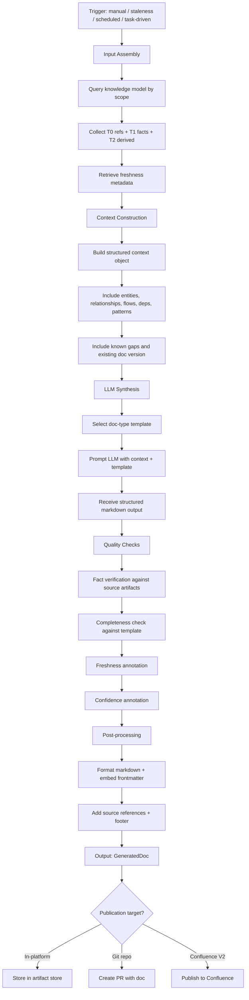
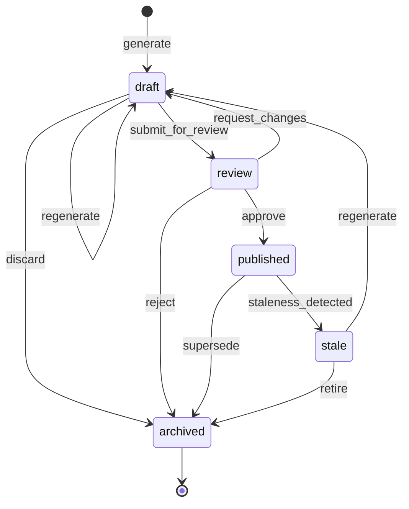

# S13 -- Documentation Generation and Lifecycle Specification

**Spec ID:** S13

## 1. Purpose and Scope

This specification defines how Bifrost generates, maintains, publishes, and retires human-readable documentation from its knowledge model. It covers document types, the generation pipeline, quality safeguards, freshness tracking, lifecycle state management, publication targets, and refresh triggers.

Documentation generation sits at the boundary between machine knowledge and human consumption. Bifrost holds structured knowledge (entities, relationships, flows, dependencies, patterns) derived from many sources. This spec describes how that knowledge is synthesized into coherent, trustworthy, maintainable documents.

Generated documentation is stored via AgentStateBackend. Track A: PostgreSQL `doc_artifacts` table + local filesystem. Track B: Anthropic Memory Stores (built-in versioning, API-accessible). Both tracks support the same publication lifecycle states and publication targets (Git, Confluence).

**In scope:** document types, generation pipeline, metadata model, freshness tracking, lifecycle states, publication targets, refresh triggers, hallucination prevention, interface contracts.

**Out of scope:** the knowledge model itself (S1), source adapters (S2), freshness internals (S3), storage layer (S4), orchestration internals (S9). Those are referenced as dependencies.

---

## 2. Glossary References

| Term | Definition |
|------|-----------|
| **GeneratedDoc** | A document produced by the generation pipeline from structured knowledge artifacts. Carries metadata including type, scope, confidence, freshness, and lifecycle state. |
| **KnowledgeArtifact** | A unit of structured knowledge in the Bifrost knowledge model -- an entity, relationship, flow segment, dependency edge, pattern, or derived insight. Artifacts are tiered: T0 (source references), T1 (extracted facts), T2 (derived/inferred knowledge). |
| **Freshness** | A measure of how current a knowledge artifact or generated document is relative to its upstream sources. Expressed as a combination of source state references (commit SHAs, timestamps) and a staleness severity level. |
| **Confidence** | A measure of how well-grounded a claim or section is. Expressed as a numeric score (0.0--1.0) and a confidence level (`confirmed`, `inferred`, `weak`, `unknown`). Reflects both source quality and derivation chain length. |

---

## 3. Requirements Traceability

This spec addresses requirements from **section 8 (Documentation requirements)** of the Bifrost requirements document, with supporting references to other sections.

| Requirement | Section | Coverage |
|------------|---------|----------|
| Generate and refresh human-readable docs for important surfaces | 8.1 | Generation pipeline (sec 6), refresh triggers (sec 11) |
| System must not depend on complete docs for every source | 8.2 | Design non-goal: docs are supplementary, not foundational |
| Repo overviews, onboarding docs, flow docs, domain summaries, playbooks, migration guides, dependency/risk docs | 8.3 | Document types (sec 5) |
| Show source state a doc reflects | 8.4 | Doc metadata (sec 7), freshness tracking (sec 8) |
| Show when doc was last refreshed | 8.4 | Doc metadata `generated_at` field |
| Show whether doc is stale relative to current source state | 8.4 | Freshness tracking (sec 8) |
| Show whether doc is partial or low-confidence | 8.4 | Confidence annotation, `known_gaps` field (sec 7) |
| Generate updated doc content | 8.5 | Generation pipeline (sec 6) |
| Propose updates for review | 8.5 | PR-based publication workflow (sec 10) |
| Track doc generation status | 8.5 | Lifecycle states (sec 9) |
| Distinguish draft/internal/generated/published states | 8.5 | Lifecycle state machine (sec 9) |
| Freshness must be explicit (12.1) | 12.1 | Freshness tracking (sec 8) per-source staleness |
| Source state tracking (12.2) | 12.2 | `source_state` in doc metadata |
| Lag requirements (12.3) | 12.3 | Staleness severity computation |
| Update triggers (12.4) | 12.4 | Refresh triggers (sec 11) |
| Selective invalidation (12.5) | 12.5 | Staleness detection per source |

---

## 4. Design Goals and Non-Goals

### Goals

1. **Trustworthy output.** Every generated document must be traceable to source knowledge. No free-form hallucination.
2. **Freshness-aware.** Every document carries metadata showing exactly what source state it reflects and whether it is stale.
3. **Human-in-the-loop.** Documents do not reach "published" state without human review. The system proposes; humans approve.
4. **Incremental.** Re-generation should be efficient -- only sections affected by changed sources need re-synthesis.
5. **Composable.** Document types share a common pipeline and metadata model. Adding a new type means adding a template, not a new pipeline.
6. **Source-grounded confidence.** Low-confidence sections are flagged, not hidden. Gaps are declared, not papered over.

### Non-Goals

1. **Complete documentation coverage.** Bifrost does not require or attempt docs for every repo, flow, or domain. Docs are generated for high-value surfaces.
2. **Replacing source systems.** Generated docs summarize and synthesize; they do not replace authoritative source content (code, ADRs, design docs).
3. **Real-time generation.** Docs are not generated on every commit. They are refreshed on meaningful change or explicit request.
4. **WYSIWYG editing.** V1 does not support collaborative editing of generated docs. Edits happen via the source knowledge or regeneration.
5. **Pixel-perfect formatting.** Output is markdown. Rendering is the concern of the publication target.

---

## 5. Document Types

| Type | Description | Typical Size | Refresh Frequency |
|------|------------|-------------|-------------------|
| **Repo Overview** | What the repo does, major components, key interfaces, dependencies, getting started instructions. The entry point for understanding a single repo. | 500--2000 words | On significant code changes (new modules, interface changes, dependency changes) |
| **Onboarding Guide** | What to read first, important flows to understand, ownership and escalation paths, local dev setup, common tasks. Tailored to a new engineer joining the repo or domain. | 1000--3000 words | Monthly, or on structural changes (ownership, team, major flow changes) |
| **Flow Documentation** | End-to-end flow description with entry point, participating services/repos, segment details, async hops, branch conditions, dependencies, side effects. | 500--2500 words per flow | On flow changes (new segments, changed dependencies, new branch conditions) |
| **Domain Summary** | Repos in domain, how they connect, cross-repo flows, shared patterns, migration state, stale or weakly-covered areas. | 1000--3000 words | On domain-level changes (new repos, changed cross-repo flows, migration progress) |
| **Implementation Playbook** | Step-by-step guide for common tasks in a repo: adding an endpoint, deploying, running tests, adding a new event handler, etc. Pattern-based. | 500--1500 words per playbook | On pattern changes (new conventions, tooling changes, process changes) |
| **Migration Guide** | Current state, target state, migration steps, risks, progress tracking, affected repos and flows, rollback considerations. | 1000--3000 words | On migration state changes (steps completed, new risks identified, scope changes) |
| **Dependency/Risk Report** | Dependency graph summary, high-risk areas, stale areas, hidden or inferred dependencies, missing coverage, blast radius analysis. | 500--2000 words | On dependency changes (new dependencies, removed dependencies, version changes) |

---

## 6. Generation Pipeline

### Pipeline Overview

```
Input Assembly --> Context Construction --> LLM Synthesis --> Quality Checks --> Post-processing --> Output
```

### 6.1 Input Assembly

Gather relevant knowledge artifacts for the document scope:

- **T1 facts**: extracted entities, relationships, interfaces, dependencies from source analysis
- **T2 derived knowledge**: inferred flows, patterns, risk signals, dependency chains
- **T0 source references**: pointers to authoritative source content (files, commits, tickets, configs)

The input assembler queries the knowledge model by scope (repo, domain, flow) and collects all artifacts relevant to the target document type. It also retrieves freshness metadata for each artifact.

### 6.2 Context Construction

Build a structured context object for LLM consumption:

```python
from pydantic import BaseModel


class GenerationContext(BaseModel):
    scope: DocScope               # e.g., DocScope(type="repo", id="order-service")
    doc_type: DocType             # e.g., DocType.REPO_OVERVIEW
    entities: list[Entity]        # components, modules, services
    relationships: list[Relationship]  # dependencies, calls, event flows
    flows: list[FlowSummary]      # relevant flow segments
    dependencies: list[Dependency]     # direct and indirect
    patterns: list[Pattern]       # repo/domain conventions
    recent_changes: list[Change]  # relevant recent changes
    freshness: FreshnessMap       # per-source freshness metadata
    known_gaps: list[str]         # areas with weak or missing coverage
    existing_doc: GeneratedDoc | None = None  # previous version if refreshing
```

### 6.3 LLM Synthesis

Prompt the LLM with structured context and a document-type-specific template. The template defines:

- Required sections for the document type
- Expected content per section
- Formatting conventions
- Instructions to cite source artifacts
- Instructions to flag uncertainty

The LLM produces structured markdown content organized by the template sections. It does not receive open-ended "write about this repo" prompts -- it receives a structured context and a structured template.

### 6.4 Quality Checks

After LLM synthesis, the pipeline applies automated quality checks:

| Check | Description | Action on Failure |
|-------|------------|-------------------|
| **Fact verification** | Cross-check key claims (dependency names, interface signatures, component names) against source knowledge artifacts | Flag unverifiable claims, reduce section confidence |
| **Completeness check** | Ensure all required template sections have content | Mark missing sections in `known_gaps` |
| **Freshness annotation** | Embed freshness metadata in the generated document, per-section where possible | Always runs; annotates, does not block |
| **Confidence annotation** | Score each section's confidence based on source coverage and derivation depth; flag low-confidence sections | Sections below threshold get `[low confidence]` markers |

### 6.5 Post-processing

- Format output as markdown with consistent heading structure
- Embed frontmatter metadata (see sec 7)
- Add source reference footnotes linking claims to knowledge artifacts
- Add "generated by Bifrost" footer with generation timestamp

### 6.6 Output

The final output is a markdown document with YAML frontmatter metadata, ready for storage and optional publication.

### Generation Output Storage

```
Track A:
  Generated doc → INSERT into doc_artifacts(id, doc_type, target_id, content, status, version, created_at)
  For Git publication: write to local filesystem at docs/{type}/{target}.md, then git push
  For Confluence: POST content to Confluence REST API directly

Track B:
  Generated doc → write to Memory Store at /docs/{doc-type}/{target-id}.md
  Memory store provides: versioning, audit trail, rollback (via memory_versions API)
  For Git publication: read from memory store → git push (no local filesystem intermediate)
  For Confluence: read from memory store → POST to Confluence API
  Redaction: if doc accidentally includes sensitive content, use memory_versions.redact()
```

### Pipeline Diagram



---

## 7. Doc Metadata

Every generated document carries YAML frontmatter metadata:

```yaml
---
type: repo_overview
scope: bifrost:repo:order-service
generated_at: 2024-01-15T10:30:00Z
source_state:
  repos:
    order-service: "abc123"
  sources:
    jira: "2024-01-15"
    git: "abc123"
confidence: 0.85
confidence_level: inferred
known_gaps:
  - "Runtime behavior not verified"
  - "Deployment config not indexed"
status: draft
version: 3
---
```

### Field Definitions

| Field | Type | Description |
|-------|------|-------------|
| `type` | enum | Document type (see sec 5): `repo_overview`, `onboarding_guide`, `flow_doc`, `domain_summary`, `implementation_playbook`, `migration_guide`, `dependency_risk_report` |
| `scope` | string | Bifrost resource identifier for the document's subject, e.g., `bifrost:repo:order-service`, `bifrost:domain:orders`, `bifrost:flow:checkout-order` |
| `generated_at` | ISO 8601 | Timestamp of generation |
| `source_state` | object | Snapshot of source system state at generation time. Keys are source categories; values are state identifiers (commit SHAs, timestamps, version IDs). |
| `source_state.repos` | map | Repo name to commit SHA at generation time |
| `source_state.sources` | map | Source system name to state identifier at generation time |
| `confidence` | float | Overall document confidence score (0.0--1.0) |
| `confidence_level` | enum | Human-readable confidence level: `confirmed`, `inferred`, `weak`, `unknown` |
| `known_gaps` | string[] | Explicit list of areas where coverage is missing or uncertain |
| `status` | enum | Lifecycle state: `draft`, `review`, `published`, `stale`, `archived` |
| `version` | integer | Monotonically increasing version number for this scope+type combination |

---

## 8. Freshness Tracking

### 8.1 Source State Recording

Every generated document records the exact source state it reflects via the `source_state` frontmatter field. This includes:

- **Repo commit SHAs**: the HEAD commit of each relevant repo at generation time
- **Source timestamps**: the latest indexed state of each non-git source (Jira, Confluence, runtime, etc.)
- **Knowledge artifact versions**: the version of derived knowledge used

### 8.2 Staleness Detection

Staleness is detected by comparing the document's `source_state` with the current state of each source:

```python
from enum import Enum
from pydantic import BaseModel


class StalenessSeverity(str, Enum):
    FRESH = "fresh"
    SLIGHTLY_STALE = "slightly_stale"
    STALE = "stale"
    VERY_STALE = "very_stale"


class ChangeSeverity(str, Enum):
    MINOR = "minor"
    MODERATE = "moderate"
    MAJOR = "major"


class StalenessSignal(BaseModel):
    source: str              # e.g., "git:order-service", "jira"
    doc_state: str           # state at doc generation
    current_state: str       # current source state
    change_description: str  # human-readable summary
    change_severity: ChangeSeverity


class StalenessResult(BaseModel):
    doc_id: str
    severity: StalenessSeverity
    changed_sources: list[StalenessSignal]
    overall_score: float     # 0.0 (fresh) to 1.0 (very stale)
```

### 8.3 Staleness Severity Levels

| Level | Meaning | Example |
|-------|---------|---------|
| **fresh** | Source state unchanged since doc generation | No commits, no ticket updates, no new runtime data |
| **slightly_stale** | Minor changes that likely do not affect doc accuracy | Formatting commits, minor ticket updates, unrelated file changes |
| **stale** | Significant changes that may affect doc accuracy | New endpoints added, dependency version bumps, interface changes |
| **very_stale** | Major structural changes that likely invalidate parts of the doc | Module restructuring, new service dependencies, major flow changes |

### 8.4 Dual-Track Staleness Handling

Generated docs go stale when their source knowledge changes. Both tracks handle invalidation differently:

- Track A: invalidation event → `UPDATE doc_artifacts SET status = 'stale', stale_reason = $reason`
- Track B: invalidation event → update memory store document frontmatter: `status: stale`
- Both: expose staleness via API response envelope: `{ freshness: { state: "stale", reason: "..." } }`

### 8.5 Staleness Signals

Staleness signals enumerate which specific sources changed since document generation:

- Git: commits since recorded SHA, filtered by relevance (files in scope, not just any commit)
- Jira: ticket state changes, new tickets in scope
- Confluence: page edits to related design docs
- Runtime: new trace/metric data showing behavioral changes
- Config: schema or config file changes

---

## 9. Document Lifecycle States

### State Definitions

| State | Description |
|-------|-------------|
| **draft** | Initially generated by the pipeline. Not yet reviewed by a human. May be viewed in-platform. |
| **review** | Submitted for human review. In the git-based workflow, a PR has been created. |
| **published** | Approved by a human reviewer and published to the target (merged PR, published page). Considered the current authoritative generated doc. |
| **stale** | A published document whose source state has changed beyond the staleness threshold. Still accessible but marked as potentially outdated. |
| **archived** | Superseded by a newer version or explicitly retired. Retained for history but not served as current. |

### State Machine



### Storage by Track

Lifecycle state is persisted differently depending on the active AgentStateBackend track:

```
Track A: lifecycle state stored in doc_artifacts.status column

Track B: lifecycle state stored as YAML frontmatter in the memory store document
  Format:
  ---
  status: published
  version: 3
  published_at: 2025-01-15T10:00:00Z
  published_to: confluence:space/page-id
  last_reviewed_by: reviewer@example.com
  ---
```

### State Transitions

| From | To | Trigger | Description |
|------|----|---------|-------------|
| -- | draft | `generate` | Pipeline produces a new document |
| draft | review | `submit_for_review` | User or automation submits doc for review (e.g., creates PR) |
| draft | draft | `regenerate` | Pipeline regenerates the draft (new version, same scope+type) |
| draft | archived | `discard` | User discards an unwanted draft |
| review | published | `approve` | Reviewer approves (e.g., PR merged) |
| review | draft | `request_changes` | Reviewer requests changes; doc returns to draft for regeneration |
| review | archived | `reject` | Reviewer rejects the document entirely |
| published | stale | `staleness_detected` | Automated staleness check finds source state has changed beyond threshold |
| published | archived | `supersede` | A new version of the same scope+type reaches published state |
| stale | draft | `regenerate` | Pipeline regenerates from current source state |
| stale | archived | `retire` | Document is no longer relevant (scope removed, type deprecated) |

---

## 10. Publication Targets

### 10.1 In-Platform (V1)

Documents are stored in the Bifrost artifact store and viewable through the Bifrost UI. This is the default target for all generated docs.

- Storage: versioned artifact store (see S4)
- Access: Bifrost UI and API
- No external system integration required

### 10.2 Git Repository (V1)

Documents are published as markdown files in a git repository via pull request workflow:

1. **Generate**: pipeline produces the document
2. **Create PR**: system creates a branch and PR with the generated/updated markdown file
3. **Review**: human reviews the PR, may request changes
4. **Merge**: reviewer merges the PR
5. **Mark published**: system detects merge and transitions doc to `published` state

This is the primary publication target for V1. It aligns with docs-as-code practices and provides a natural review workflow.

### 10.3 Confluence (V2)

Publish generated documents to a configured Confluence space. Requires:

- Confluence space and parent page configuration per doc scope
- Mapping between Bifrost doc types and Confluence page templates
- Bidirectional sync consideration (edits in Confluence vs. regeneration)

Deferred to V2.

### 10.4 Static Site (V2)

Export generated documents to a static site generator (e.g., Docusaurus, MkDocs). Requires:

- Export format configuration
- Navigation structure generation
- Asset handling

Deferred to V2.

---

## 11. Refresh Triggers

| Trigger Type | Description | Configuration |
|-------------|-------------|---------------|
| **Automatic** | Staleness threshold exceeded. The system periodically checks published docs against current source state and triggers regeneration when staleness severity crosses a configured threshold. | Per doc type: threshold severity level, check interval |
| **Manual** | User explicitly requests a refresh via CLI, UI, or API. | None -- always available |
| **Scheduled** | Periodic regeneration on a fixed schedule regardless of detected staleness. Useful for docs that aggregate many sources (domain summaries). | Per doc type: cron expression or interval |
| **Task-driven** | The orchestration layer (S9) requests a fresh document as part of executing a task. For example, an onboarding task may request a current repo overview. | Triggered by orchestrator; doc type and scope specified in task |

### V1 Scope

V1 supports **manual** refresh only. Automatic, scheduled, and task-driven triggers are deferred to post-V1.

---

## 12. Hallucination Prevention

Hallucination -- generating plausible but incorrect content -- is the primary risk of LLM-based document generation. Bifrost mitigates this through multiple layers:

### 12.1 Template-Driven Generation

The LLM receives a structured template defining required sections, expected content types, and formatting rules. It does not receive open-ended prompts like "describe this repo." Every section has a defined purpose and expected source material.

### 12.2 Source-Grounded Claims

Every factual claim in a generated document must reference one or more knowledge artifacts from the Bifrost knowledge model. The generation prompt instructs the LLM to cite artifacts, and the quality check phase verifies that key claims have source backing.

Claims that cannot be traced to a source artifact are either:
- Removed during quality checks
- Flagged with `[unverified]` markers
- Recorded in `known_gaps`

### 12.3 Confidence Flags

Sections with weak source coverage or long derivation chains are explicitly flagged:

- `[low confidence]` inline markers for specific claims
- Section-level confidence scores in extended metadata
- Document-level `confidence` and `confidence_level` in frontmatter

### 12.4 Human Review Gate

No generated document reaches `published` state without human review. The PR-based workflow ensures that a human reads and approves every published document.

## Human Review Gate (V1 Default)

V1 requires human review before any generated doc is published to external systems.
Generated docs start in `draft` status. Promotion to `published` requires:

```
1. An authorized user calls POST /bifrost/v1/docs/{id}/approve
2. Bifrost records: approver ID, timestamp, doc content hash at time of approval
3. Doc status changes: draft → internal → approved (pending publish) → published
```

Auto-publish (skipping human review) is an admin-configurable opt-in:

```
config: doc_generation.require_human_review: true (default)
When false: docs are published immediately after quality checks pass
```

Audit log: every status transition is logged with actor, timestamp, and content hash.

#### Track B Doc Generation

Doc generation in Track B uses Memory Store as the intermediate storage for draft documents.

- Draft path: `/docs/{doc_id}/draft.md` — written by ExtractionAgent during synthesis
- Human review gate: same approval endpoint (`POST /bifrost/v1/docs/{id}/approve`), but doc content fetched from Memory Store path instead of PostgreSQL
- On approval: doc content copied from Memory Store to PostgreSQL `knowledge_artifacts` table (making it permanent)
- On rejection: Memory Store draft deleted, task status set to `failed` with `reason: 'human_rejected'`

**Track B limitation:** Track B doc generation requires Memory Store to be configured. If Memory Store is unavailable, doc generation falls back to Track A (direct PostgreSQL storage).

---

## 13. Interface Contracts

### 13.1 Doc Generation API

```
POST /api/v1/docs/generate
```

Request:
```python
class GenerateDocRequest(BaseModel):
    doc_type: DocType
    scope: str                          # Bifrost resource identifier
    force_refresh: bool = False         # regenerate even if not stale
```

Response:
```python
class GenerateDocResponse(BaseModel):
    doc_id: str
    version: int
    status: Literal["draft"] = "draft"
    generated_at: datetime              # ISO 8601
    confidence: float
    known_gaps: list[str]
```

### 13.2 Doc Status API

```
GET /api/v1/docs/{doc_id}/status
```

Response:
```python
class DocStatusResponse(BaseModel):
    doc_id: str
    doc_type: DocType
    scope: str
    status: DocLifecycleState
    version: int
    generated_at: datetime
    confidence: float
    staleness: StalenessResult
```

### 13.3 Doc CRUD

```
GET    /api/v1/docs/{doc_id}              -- retrieve document content + metadata
GET    /api/v1/docs?scope=...&type=...  -- list documents by scope and/or type
DELETE /api/v1/docs/{doc_id}              -- archive a document
```

### 13.4 Staleness Check API

```
GET /api/v1/docs/{doc_id}/staleness
```

Response:
```python
class StalenessCheckResponse(BaseModel):
    doc_id: str
    severity: StalenessSeverity
    changed_sources: list[StalenessSignal]
    overall_score: float
    checked_at: datetime  # ISO 8601
```

### 13.5 Bulk Staleness Check

```
POST /api/v1/docs/staleness/check
```

Request:
```python
class BulkStalenessRequest(BaseModel):
    scope: str | None = None                    # check all docs in scope
    doc_type: DocType | None = None             # check all docs of type
    min_severity: StalenessSeverity | None = None  # only return docs at or above this severity
```

---

## 14. Dependencies

| Dependency | Spec | Role |
|-----------|------|------|
| **Knowledge Model** | S1 | Provides input artifacts (T0 source refs, T1 extracted facts, T2 derived knowledge) for the generation pipeline |
| **Freshness System** | S3 | Provides source state tracking, staleness detection, and change severity classification |
| **Storage** | S4 | Provides the versioned artifact store for generated documents and the caching layer for generation intermediates |
| **Orchestration** | S9 | Provides task-driven generation triggers and coordination with other system activities |

---

## 15. Key Decisions

### 15.1 Template-driven LLM generation, not free-form

**Decision:** The LLM always receives a structured context object and a document-type template. It never receives open-ended generation prompts.

**Rationale:** Template-driven generation is more predictable, easier to verify, and less prone to hallucination. It also makes quality checks meaningful -- we can verify that required sections exist and contain expected content types.

### 15.2 Git-based publication (PR workflow) as primary target

**Decision:** The primary publication mechanism is creating a PR in a git repository. Other targets (Confluence, static site) are deferred.

**Rationale:** PR-based workflows provide a natural review mechanism, version history, and integration with existing engineering workflows. Engineers already review PRs; reviewing generated docs in the same workflow reduces friction.

### 15.3 Human review required for "published" state

**Decision:** No document transitions from `draft` or `review` to `published` without explicit human approval.

**Rationale:** LLM-generated content can be subtly wrong in ways that automated checks miss. Human review is the final quality gate. This constraint may be relaxed in future versions for low-risk doc types with strong automated verification.

### 15.4 Staleness tracked per-source, not just per-timestamp

**Decision:** Staleness detection compares each individual source's state, not just "time since generation."

**Rationale:** A document generated 30 days ago may still be fresh if its sources have not changed. A document generated 1 hour ago may be stale if a critical dependency was just updated. Per-source tracking gives accurate staleness assessment.

---

## 16. V1 Scope

### Included in V1

- **Document types:** repo overviews and component docs (one per major component). Flow docs and domain summaries are V1.5.
- **Lifecycle states:** full lifecycle state machine (`draft`, `review`, `published`, `stale`, `archived`)
- **Generation:** full pipeline (input assembly, context construction, LLM synthesis, quality checks, post-processing)
- **Publication:** Git PR workflow (primary) and Confluence REST API
- **Refresh:** manual refresh only (user-triggered via CLI/UI/API)
- **Metadata:** full frontmatter metadata model
- **Freshness:** staleness detection and reporting (read-only -- no automatic action)
- **Storage:** Track A (PostgreSQL `doc_artifacts` table + local filesystem) is V1. Track B (Anthropic Memory Stores) is available when Managed Agents is enabled.
- **Human review gate:** enabled by default in V1 (`doc_generation.require_human_review: true`)

### Deferred to Post-V1

- **Auto-refresh:** automatic regeneration when staleness threshold exceeded
- **Scheduled refresh:** periodic regeneration on cron schedule
- **Task-driven refresh:** orchestrator-triggered generation
- **PR-based publication:** git repository PR workflow
- **Confluence publishing:** Confluence space integration
- **Static site export:** docs site generator export
- **Additional doc types:** onboarding guides, domain summaries, implementation playbooks, migration guides, dependency/risk reports
- **Collaborative editing:** human edits merged with generated content

---

## 17. Future Evolution

### Auto-Refresh Pipeline

Post-V1, the system will support automatic regeneration when staleness exceeds configured thresholds. This requires reliable staleness detection (S3), background job infrastructure, and rate limiting to prevent regeneration storms.

### Multi-Target Publishing

Support publishing the same generated document to multiple targets simultaneously (git repo + Confluence + static site). Requires target-specific formatting adapters and bidirectional sync strategies.

### Doc Quality Scoring

Beyond confidence scores, introduce quality metrics: coverage score (how much of the scope is documented), accuracy score (based on verification results), readability score (structural completeness, section balance). Quality scores inform which docs need attention.

### Collaborative Editing

Support human edits to generated documents that persist across regeneration. Requires a merge strategy: detect which sections were human-edited, preserve those sections, regenerate only machine-managed sections. Complex but high-value for long-lived docs.

### Cross-Doc Linking

Automatically link related documents: a repo overview links to its flow docs, a domain summary links to its repo overviews, a migration guide links to affected flow docs. Requires a doc graph and link maintenance on regeneration.

---

## 18. Open Questions

1. **Incremental regeneration granularity.** Should we regenerate entire documents or individual sections? Section-level regeneration is more efficient but adds complexity to the pipeline and freshness tracking.

2. **Confidence threshold for publication.** What minimum confidence score should a document meet before it can be submitted for review? Too low and reviewers waste time on poor drafts. Too high and we block useful-but-imperfect docs.

3. **Human edit preservation.** When a published document is regenerated, how do we handle sections that a human manually edited after publication? Options: overwrite (simple but loses edits), merge (complex but preserves edits), mark conflicts (middle ground).

4. **Cross-repo flow doc ownership.** A flow document spanning repos A, B, and C -- which repo's review process governs publication? Options: primary repo (where the flow originates), all repos (multi-repo PR), dedicated docs repo.

5. **Rate limiting regeneration.** If many sources change simultaneously (e.g., a large refactor), how do we prevent a storm of regeneration requests? Options: debounce window, priority queue, batch regeneration.

6. **Template versioning.** When a document type template changes, should all existing docs of that type be regenerated? Or only on next refresh?

---

## Appendix A: Example Generated Document

Below is an abbreviated example of a generated repo overview with full metadata.

````markdown
---
type: repo_overview
scope: bifrost:repo:order-service
generated_at: 2024-01-15T10:30:00Z
source_state:
  repos:
    order-service: "abc123def456"
  sources:
    jira: "2024-01-15"
    git: "abc123def456"
confidence: 0.85
confidence_level: inferred
known_gaps:
  - "Runtime behavior not verified"
  - "Deployment config not indexed"
status: draft
version: 3
---

# order-service

## Overview

order-service is a Node.js microservice responsible for placing orders in
the checkout flow. It receives order requests from the checkout-orchestrator,
validates shipping methods against the carrier gateway, and emits
order-placed events to the fulfillment-service.

## Major Components

| Component | Description |
|-----------|-------------|
| `OrderController` | HTTP handler for `/v1/orders` endpoints |
| `OrderProcessor` | Core business logic for order validation and placement |
| `CarrierClient` | Adapter for the external carrier API |
| `EventPublisher` | Kafka producer for order domain events |

## Key Interfaces

- **Inbound**: REST API at `/v1/orders` (POST create, GET status)
- **Outbound**: carrier API via `CarrierClient`
- **Events**: publishes `order.placed`, `order.failed` to Kafka topic `order-events`

## Dependencies

| Dependency | Type | Direction |
|-----------|------|-----------|
| checkout-orchestrator | API consumer | inbound |
| fulfillment-service | event consumer | outbound |
| carrier API | external service | outbound |
| order-db (PostgreSQL) | data store | outbound |

## Getting Started

```bash
npm install
cp .env.example .env   # configure carrier API keys and DB connection
npm run dev             # starts on port 3001
```

## Flows

This service participates in:
- **Checkout Order Flow**: receives order request, places it via the carrier API, emits result [low confidence -- async retry path not fully traced]

---

*Generated by Bifrost v0.1 at 2024-01-15T10:30:00Z. Source: order-service@abc123.*
````
