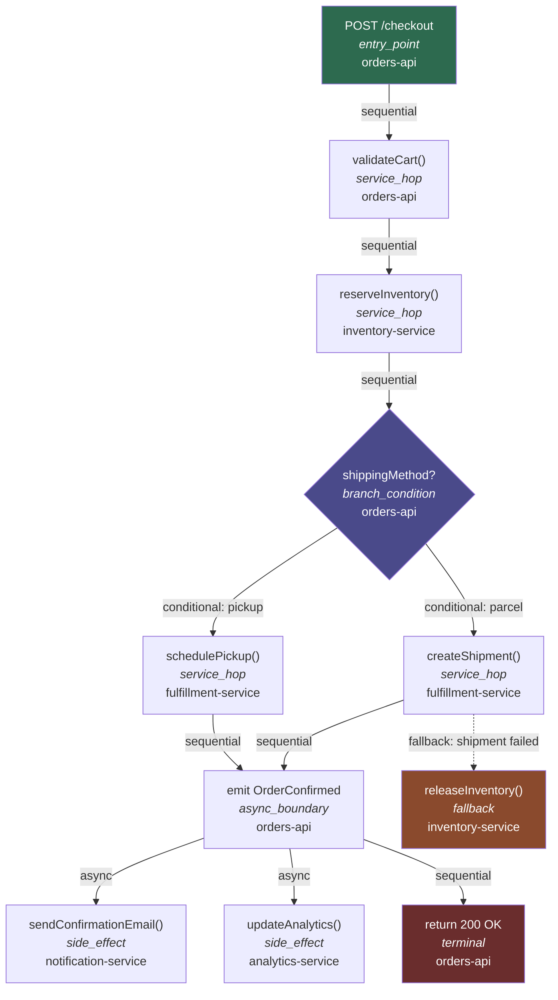
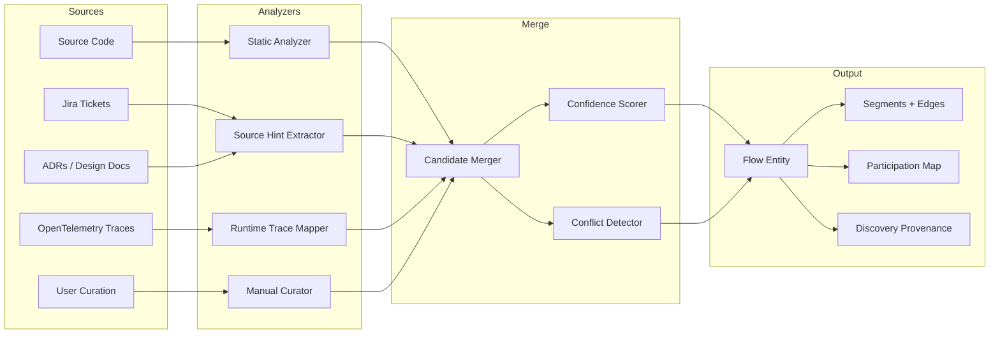
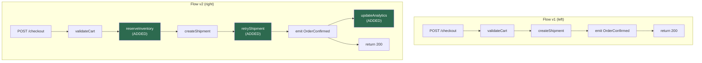

# S5 -- Flow Model Specification

| Field        | Value                                         |
|--------------|-----------------------------------------------|
| Spec ID      | S5                                            |
| Title        | Flow Model                                    |
| Status       | Draft                                         |
| Requirements | 9 (Flow Requirements), 17 (Runtime Correlation) |
| Depends On   | S1 (Knowledge Model), S3 (Freshness Model)    |

---

## 1. Purpose and Scope

This specification defines how Bifrost represents, discovers, stores, queries, and compares **flows** -- the end-to-end paths that engineering work actually follows across services, repos, and async boundaries.

Flows are **first-class objects** in Bifrost, not incidental notes or materialized views. They have their own identity, lifecycle, versioning, freshness tracking, and query surface. This is a key differentiator: most engineering knowledge platforms treat flows as documentation artifacts or inferred by-products. Bifrost treats them as independently managed entities with the same rigor applied to repos, domains, and dependencies.

The scope of this specification covers:

- The entity model for flows, segments, edges, and participation
- How flows are discovered from multiple evidence sources
- How flows are stored as knowledge artifacts
- How flows are queried, compared, and correlated with runtime observations
- How per-segment freshness and confidence propagate to flow-level quality signals

This specification does **not** cover:

- The underlying knowledge model storage engine (see S1)
- Freshness computation mechanics (see S3)
- Source adapter specifics for individual source types
- UI rendering of flow visualizations

---

## 2. Glossary References

| Term               | Definition |
|--------------------|------------|
| **Flow**           | A first-class entity representing an end-to-end path through one or more repos, services, or async boundaries. A flow has an identity, a type, a scope, and is composed of ordered segments connected by typed edges. |
| **FlowSegment**    | A discrete step within a flow. Each segment is anchored to a repo, component, or interface and carries its own confidence and source basis. |
| **FlowEdge**       | A typed connection between two segments in a flow DAG. Edges encode sequencing, conditionality, parallelism, async boundaries, and fallback paths. |
| **FlowParticipation** | A mapping that records which repo/component plays which role in a given flow. |
| **Dependency**     | A relationship between two entities where one relies on the other. Flows expose dependencies as a side effect of their segment-to-segment structure. |
| **KnowledgeArtifact** | Any entity stored in the Bifrost knowledge model with a metadata envelope (source basis, freshness, confidence, scope). Flows are T2 (Tier 2) knowledge artifacts. |
| **Source Basis**   | The set of source references (commits, files, tickets, traces, manual annotations) that provide evidence for a knowledge claim. |
| **Metadata Envelope** | The standard wrapper around any knowledge artifact carrying freshness, confidence, source basis, known gaps, and scope. |

---

## 3. Requirements Traceability

### 3.1 Section 9 -- Flow Requirements

| Requirement | Spec Coverage |
|-------------|---------------|
| 9.1 Flow must be first-class | Flows are independent T2 entities with own lifecycle (Section 5, Decision 15.1) |
| 9.2 Flow understanding must include entry points, segments, async hops, branches, retries, fallbacks, side effects, dependencies, runtime observations, intended vs observed divergence | FlowSegment.segment_type enum covers all listed concepts; FlowEdge types cover sequencing; Runtime Correlation (Section 11) covers observation divergence |
| 9.3 Flow query: keyword, trace, repo participation, change impact, breakpoints | Flow Query API (Section 9) maps each query type |
| 9.4 Flow comparison: similar flows, old vs new, static vs observed, cross-repo | Flow Comparison (Section 10) addresses all four comparison modes |

### 3.2 Section 17 -- Runtime Correlation Requirements

| Requirement | Spec Coverage |
|-------------|---------------|
| 17.1 Runtime correlation conceptually required | Runtime Correlation (Section 11) defines the model; V2 scope (Section 16) |
| 17.2 Observed flow understanding, runtime dependency, comparison against static, surprising/missing edges, symptom-to-code tracing | Section 11 defines span-to-segment mapping and divergence detection |
| 17.3 Runtime freshness tracked separately from code-derived freshness | Section 12 defines per-segment freshness with separate runtime provenance |

### 3.3 Other Sections Referenced

| Requirement Section | Relevance |
|---------------------|-----------|
| 2.4 Engineering work is flow-based | Foundational motivation for this spec |
| 2.5 Multi-repo, multi-source questions | Flow scope: cross_repo, cross_domain |
| 5.1 Repo-level: major flows it participates in | FlowParticipation query by repo |
| 5.2 Domain-level: end-to-end flows inside the domain | Flow scope filtering |
| 7.2 Knowledge quality: source basis, freshness, confidence, gaps | Metadata envelope on every flow and segment |
| 10.1-10.3 Dependency support | Flows surface dependencies through segment structure |
| 12.5 Selective invalidation of flow segments | Per-segment freshness and invalidation |

---

## 4. Design Goals and Non-Goals

### 4.1 Design Goals

1. **Flows as durable entities.** Flows persist independently of the evidence that discovered them. They are created, versioned, queried, and invalidated on their own schedule.

2. **Multi-evidence discovery.** A single flow can be assembled from static analysis, source hints (Jira, ADRs), manual curation, and runtime traces. Each segment carries provenance for how it was discovered and with what confidence.

3. **DAG structure with typed edges.** Flows are directed acyclic graphs, not flat lists. This enables representation of branches, parallel paths, async hops, retry loops, and fallback paths within a single flow.

4. **Per-segment granularity.** Freshness, confidence, and source basis are tracked per segment, not per flow. The flow-level quality signal is derived from its segments.

5. **Configurable granularity.** Segments can represent function-level, service-level, or repo-level steps depending on the repo's configuration and the evidence available.

6. **Query-first design.** The flow model exists to answer questions: "what flows does this repo participate in?", "what breaks if I change this?", "show me the end-to-end path for checkout."

### 4.2 Non-Goals

1. **Runtime execution engine.** Bifrost does not execute flows. It models understanding of flows.

2. **Workflow orchestration.** Bifrost does not manage saga state machines, retry policies, or queue consumers. It represents them as segments for understanding purposes.

3. **Full formal verification.** Flows are best-effort representations of real system behavior. They carry confidence signals, not correctness proofs.

4. **Real-time trace ingestion.** Runtime correlation (V2) operates on trace summaries, not live span streams.

---

## 5. Flow Entity Model

### 5.1 Flow

```python
class ObservationType(StrEnum):
    """Whether this flow was derived from design intent or observed/analyzed behavior."""
    INTENDED = "intended"            # derived from design docs, Confluence, ADRs
    OBSERVED = "observed"            # derived from runtime traces, logs, APM (V2 feature)
    STATIC_ANALYSIS = "static-analysis"  # derived from code analysis (most common in V1)


class Flow(BaseModel):
    """Core flow entity."""

    id: FlowId
    """Unique identifier for this flow."""

    name: str
    """Human-readable name (e.g., "Checkout Flow", "User Registration Saga")."""

    description: str
    """Prose description of what this flow accomplishes."""

    flow_type: FlowType
    """Classification of the flow's communication pattern."""

    scope: FlowScope
    """How many repos/domains this flow spans."""

    entry_points: list[FlowSegmentId]
    """Segments that serve as starting points for the flow."""

    segments: list[FlowSegment]
    """All segments in this flow."""

    edges: list[FlowEdge]
    """All edges connecting segments."""

    participation: list[FlowParticipation]
    """Which repos/components participate and in what roles."""

    metadata_envelope: MetadataEnvelope
    """Standard Bifrost metadata envelope."""

    version: int
    """Flow-level version; incremented on structural changes."""

    tags: list[str]
    """Tags for search and filtering."""

    observation_type: ObservationType
    """Whether this flow was derived from design intent or observed/analyzed behavior."""

    linked_flow_id: str | None = None
    """
    If observation_type = 'observed', links to the corresponding 'intended' flow.
    If observation_type = 'intended', links to the 'observed' version if discovered.
    None if no linked flow exists.
    """

    divergence_notes: str | None = None
    """
    If linked_flow_id is set and the flows differ, document the known divergences.
    Example: "observed flow includes a retry path not present in design doc"
    """


FlowId = str  # e.g., "flow:checkout-order-saga"
FlowSegmentId = str


# CANONICAL DEFINITION — All other specs must reference S5 for FlowType.
class FlowType(StrEnum):
    REQUEST_RESPONSE = "request-response"
    EVENT_DRIVEN = "event-driven"
    BATCH = "batch"
    STREAMING = "streaming"
    SCHEDULED = "scheduled"


class FlowScope(StrEnum):
    SINGLE_REPO = "single_repo"      # Entirely within one repository
    CROSS_REPO = "cross_repo"        # Spans multiple repos within one domain
    CROSS_DOMAIN = "cross_domain"    # Spans multiple domains
```

### 5.2 FlowSegment

```python
class FlowSegment(BaseModel):
    """A single step/node within a flow."""

    id: FlowSegmentId
    """Unique identifier for this segment."""

    flow_id: FlowId
    """Which flow this segment belongs to."""

    order: int
    """Display order (for linear rendering; DAG structure is authoritative)."""

    segment_type: SegmentType
    """What kind of step this segment represents."""

    repo_id: RepoId
    """Repository this segment executes in."""

    component_id: ComponentId | None = None
    """Component or module within the repo."""

    interface_ref: InterfaceRef | None = None
    """Reference to the interface or function (API route, handler, queue consumer)."""

    description: str
    """Human-readable description of what happens at this segment."""

    confidence: ConfidenceLevel
    """How confident the system is that this segment exists and is accurate."""

    source_basis: list[SourceReference]
    """Sources that provide evidence for this segment."""

    discovery_provenance: DiscoveryProvenance
    """How this segment was discovered."""

    metadata_envelope: MetadataEnvelope
    """Per-segment metadata envelope."""


# CANONICAL DEFINITION — All other specs must reference S5 for SegmentType.
class SegmentType(StrEnum):
    SYNC_CALL = "sync-call"
    ASYNC_MESSAGE = "async-message"
    DB_READ = "db-read"
    DB_WRITE = "db-write"
    CACHE_READ = "cache-read"
    CACHE_WRITE = "cache-write"
    EXTERNAL_API = "external-api"


# ConfidenceLevel: See S3 (freshness-confidence.md) for the canonical ConfidenceLevel definition.
# This spec uses: 'confirmed' | 'inferred' | 'stale' | 'unknown' | 'conflicting'
class ConfidenceLevel(StrEnum):
    CONFIRMED = "confirmed"
    INFERRED = "inferred"
    STALE = "stale"
    UNKNOWN = "unknown"
    CONFLICTING = "conflicting"
```

### 5.3 FlowEdge

```python
class FlowEdge(BaseModel):
    """An edge connecting two segments in a flow DAG."""

    from_segment_id: FlowSegmentId
    """Source segment."""

    to_segment_id: FlowSegmentId
    """Target segment."""

    edge_type: EdgeType
    """What kind of transition this edge represents."""

    condition_description: str | None = None
    """Human-readable description of the condition or trigger (for conditional/fallback edges)."""

    annotations: dict[str, str] | None = None
    """Annotations (retry count, timeout, queue name, event type)."""


class EdgeType(StrEnum):
    SEQUENTIAL = "sequential"    # Direct next step
    CONDITIONAL = "conditional"  # Taken only when a condition is met
    ASYNC = "async"              # Crosses an async boundary (queue, event bus, webhook)
    PARALLEL = "parallel"        # Multiple segments execute concurrently
    FALLBACK = "fallback"        # Taken when the primary path fails
```

### 5.4 FlowParticipation

```python
class FlowParticipation(BaseModel):
    """Records a repo/component's role in a flow."""

    flow_id: FlowId
    """Which flow."""

    repo_id: RepoId
    """Which repo participates."""

    component_id: ComponentId | None = None
    """Which component within the repo (optional)."""

    role: ParticipationRole
    """What role this participant plays."""


class ParticipationRole(StrEnum):
    INITIATOR = "initiator"                   # Starts the flow
    PROCESSOR = "processor"                   # Handles a middle step
    RESPONDER = "responder"                   # Provides a response or result
    OBSERVER = "observer"                     # Receives events but does not alter the flow
    SIDE_EFFECT_TARGET = "side_effect_target"  # Receives writes, notifications, or other side effects
```

### 5.5 Discovery Provenance

```python
class DiscoveryProvenance(BaseModel):
    """Records how a segment was discovered."""

    method: DiscoveryMethod
    """Which discovery method produced this segment."""

    discovered_at: Timestamp
    """Timestamp of discovery."""

    discovered_by: str
    """Agent or user that performed the discovery."""

    method_metadata: dict[str, Any] | None = None
    """Additional method-specific metadata."""


class DiscoveryMethod(StrEnum):
    STATIC_ANALYSIS = "static_analysis"    # Code analysis: call graphs, imports, route tracing
    SOURCE_HINT = "source_hint"            # Jira ticket, ADR, design doc reference
    RUNTIME_TRACE = "runtime_trace"        # OpenTelemetry or equivalent trace data
    MANUAL_CURATION = "manual_curation"    # User-defined segment
    HYBRID = "hybrid"                      # Combined from multiple methods
```

---

## 6. Flow as DAG

Flows are modeled as **directed acyclic graphs** where nodes are `FlowSegment` entities and edges are `FlowEdge` entities.

### 6.1 Supported Topologies

| Topology | Description | Edge Types Used |
|----------|-------------|-----------------|
| Linear chain | A -> B -> C | `sequential` |
| Conditional branch | A -> B (if X), A -> C (if Y) | `conditional` |
| Parallel fanout | A -> [B, C, D] concurrently | `parallel` |
| Async hop | A -> queue -> B | `async` |
| Retry loop | A -> A (retry annotation) | `sequential` with retry annotation |
| Fallback path | A -> B (on failure, fall back to C) | `fallback` |
| Converge | B -> D, C -> D | `sequential` (multiple inbound edges) |

### 6.2 Acyclicity Constraint

Flows must be acyclic at the segment level. Retries are modeled not as cycles in the graph but as **annotations on edges** pointing back to the same segment. The edge carries a `retry` annotation with max-attempts and backoff metadata. This preserves the DAG property while still representing retry behavior.

If a real system has genuine cyclic flow (e.g., polling loop), it is modeled as a single segment with an annotation rather than as a graph cycle.

### 6.3 Example Flow DAG



---

## 7. Flow Discovery

Flows can be discovered through multiple methods. Each method produces segment candidates with associated confidence levels. The system merges evidence to build a composite flow.

### 7.1 Static Analysis

**Input:** Source code across repos.

**Techniques:**
- **Call graph traversal:** Starting from known entry points (HTTP handlers, CLI commands, cron jobs), follow function calls across module and service boundaries.
- **API route tracing:** Map route definitions to handlers, then trace handler logic.
- **Event handler mapping:** Identify event publishers and subscribers (Kafka, SQS, RabbitMQ, custom event buses) to connect async boundaries.
- **Import chain analysis:** Follow import graphs to identify cross-module dependencies within a repo.

**Confidence:** Medium to high for well-structured codebases. Lower for dynamic dispatch, reflection, or convention-based routing.

### 7.2 Source-Hint-Based

**Input:** Jira tickets, ADRs, design documents, Confluence pages.

**Techniques:**
- Extract flow descriptions from Jira ticket acceptance criteria or descriptions.
- Parse ADR decision records for references to service interactions.
- Extract sequence diagrams or flow descriptions from design docs.
- Map ticket references in code comments back to flow descriptions.

**Confidence:** Medium. Source hints describe intent, which may diverge from implementation.

### 7.3 Runtime-Trace-Based (V2)

**Input:** OpenTelemetry traces, distributed tracing data.

**Techniques:**
- Map spans to services and operations.
- Reconstruct segment ordering from span parent-child relationships and timestamps.
- Identify async boundaries from span gaps or messaging spans.
- Detect branches from trace fan-out patterns.

**Confidence:** High for observed paths. Does not cover paths that never executed during the observation window.

### 7.4 Manual / Curated

**Input:** User-defined flow definitions.

**Techniques:**
- Users define flows through the UI or API with explicit segment listings.
- Segment annotations link to specific code locations, interfaces, or repos.
- Curated flows can be marked as authoritative for a given path.

**Confidence:** High for accuracy of individual segments. May be stale if not maintained.

### 7.5 Hybrid Discovery

Multiple discovery methods can contribute evidence to the same flow. The system merges evidence using these rules:

1. **Segment matching:** Segments from different methods are matched by (repo_id, component_id, interface_ref) tuples.
2. **Confidence boosting:** A segment confirmed by multiple methods receives a higher confidence than any single method alone.
3. **Conflict detection:** If methods disagree on ordering or existence of a segment, the conflict is recorded and surfaced.
4. **Provenance preservation:** Each segment retains its `discovery_provenance` showing which method(s) contributed.

### 7.6 Discovery Pipeline



---

## 8. Flow Representation Storage

Flows are stored as **T2 knowledge artifacts** in the Bifrost knowledge model (defined in S1). This means they carry the full metadata envelope and participate in the standard freshness, invalidation, and versioning lifecycle.

### 8.1 Storage Structure

Each flow is persisted as a composite artifact containing:

| Component | Description |
|-----------|-------------|
| **Flow header** | id, name, description, flow_type, scope, version, tags, metadata_envelope |
| **Segment list** | All FlowSegment entities with per-segment metadata envelopes |
| **Edge list** | All FlowEdge entities with edge types and annotations |
| **Participation mapping** | All FlowParticipation entries |
| **Discovery provenance** | Per-segment DiscoveryProvenance records |

### 8.2 Versioning

Flows are versioned. A new version is created when:
- A segment is added, removed, or modified
- An edge is added, removed, or its type changes
- A participation mapping changes
- A re-discovery produces structurally different results

Version history is retained for comparison (old vs new).

### 8.3 Indexing

Flows are indexed for query by:
- Flow name and description (full-text)
- Tags and concepts
- Participating repo IDs
- Participating component IDs
- Flow type and scope
- Segment interface references

### 8.4 AgentStateBackend Text Document (Flow)

Path: `/repo/{repo-id}/flows/{flow-id}.md`
(Track A: stored in `knowledge_text_cache` PostgreSQL table at this path; Track B: stored in Anthropic Memory Store at this path)

Content format:
```
---
entity_type: flow
flow_id: {uuid}
flow_name: Checkout Flow
scope: cross-repo
entry_point: POST /api/v2/checkout (cart-service)
confidence: inferred
freshness: fresh
source_revision: abc123
updated_at: 2025-01-15T10:00:00Z
participating_repos: cart-service, fulfillment-service, inventory-service, notifications-service
---

# Checkout Flow

## Entry Point
Service: cart-service | Endpoint: POST /api/v2/checkout
Trigger: user submits checkout

## Segments (in order)
1. **cart-service** — validate cart contents [confidence: confirmed]
   Handler: CartController.checkout() → CartValidator.validate()
   
2. **fulfillment-service** — create shipment [confidence: confirmed]
   Handler: ShipmentController.create() via REST API
   
3. **inventory-service** — decrement stock [confidence: confirmed, async]
   Trigger: message to inventory.decrement topic after shipment creation
   
4. **notifications-service** — send confirmation [confidence: confirmed, async]
   Trigger: message to notifications.send topic
   
5. **analytics-service** — track conversion [confidence: inferred, fire-and-forget]
   Inferred from co-occurrence in Jira tickets, not confirmed in code

## Async Boundaries
- Between step 2 and 3: Kafka topic inventory.decrement
- Between step 2 and 4: Kafka topic notifications.send

## Known Gaps
- Error recovery between shipment failure and inventory rollback: not confirmed
- Whether analytics failure is silent or blocking: unknown

## Source Evidence
- cart-service/src/controllers/CartController.ts (confirmed)
- fulfillment-service/src/controllers/ShipmentController.ts (confirmed)
- ADR-12: Event-driven checkout (confirmed - manual hint)
```

### 8.5 Freshness Tracking for Flows

Flow entities carry their own freshness state (within the AgentStateBackend document header). When any participating repo's code changes, all flow documents involving that repo are marked stale. The invalidation propagation logic is defined in S3.

### 8.6 Cross-Repo Flow Stitching (How Flows Span Multiple Repos)

Track A: TaskCoordinator collects RepoAgent responses for all participating repos, then calls the LLM to stitch them together into a unified flow document. The stitching prompt: "Given these per-repo segment descriptions, construct a unified end-to-end flow DAG. Identify async boundaries, confirm segment ordering, flag gaps." Result: stored at `/domain/{id}/flows/{flow-id}.md` in AgentStateBackend.

Track B: TaskCoordinator session reads per-repo flow segments from attached memory stores, then synthesizes the cross-repo flow. Same output, stored to domain memory store.

#### Track B Flow Analysis Constraints

- **DAG traversal** (FlowEdge graph analysis) runs via PostgreSQL CTE in Track A.
- In Track B, full graph traversal requires READ access to the storage MCP sidecar (`bifrost-storage-mcp`). Track B agents do not have direct DB access.
- **Track B flow queries** fetch pre-computed `FlowReference` documents from Memory Store at path `/repo/{id}/flows/*.md` — no live graph traversal in initial V1.
- **Live graph traversal in Track B is deferred to Track B V2:** it requires the storage MCP tool `execute_graph_query(cte: string)`, which is not in the V1 MCP tool set.
- **V1 Track B flow answers are based on stored flow entities only.** Dynamic edges discovered after the last extraction run may be absent; callers should treat Track B flow answers as best-effort until a fresh extraction has run.

---

## 9. Flow Query API

### 9.1 Query Operations

```python
class FlowQueryAPI(Protocol):
    """Query interface for flow discovery and analysis."""

    async def find_flows(
        self, keyword: str, filters: FlowFilters | None = None
    ) -> list[FlowSummary]:
        """Search flows by keyword against name, description, tags, and concepts."""
        ...

    async def trace_flow(self, flow_id: FlowId) -> FlowDAG:
        """Retrieve the full DAG for a flow: all segments, edges, and participation."""
        ...

    async def find_flows_by_repo(self, repo_id: RepoId) -> list[FlowSummary]:
        """Find all flows that include segments in the given repo."""
        ...

    async def find_flows_by_change(self, change_set: ChangeSet) -> list[AffectedFlow]:
        """
        Given a set of changed files/components, find flows whose segments
        overlap with the change set. Returns affected flows with the
        specific segments at risk.
        """
        ...

    async def find_breakpoints(self, flow_id: FlowId) -> list[Breakpoint]:
        """
        Identify high-risk segments in a flow: low confidence, stale source
        basis, many downstream dependents, or single-source-of-truth segments.
        """
        ...

    async def compare_flows(
        self, flow_id_1: FlowId, flow_id_2: FlowId
    ) -> FlowComparison:
        """Structural diff between two flows (or two versions of the same flow)."""
        ...
```

### 9.2 Supporting Types

```python
class FlowFilters(BaseModel):
    """Filters for flow search queries."""

    flow_type: FlowType | None = None
    scope: FlowScope | None = None
    repo_id: RepoId | None = None
    min_confidence: ConfidenceLevel | None = None
    tags: list[str] | None = None


class FlowSummary(BaseModel):
    """Lightweight summary of a flow for search results."""

    id: FlowId
    name: str
    description: str
    flow_type: FlowType
    scope: FlowScope
    segment_count: int
    participant_repos: list[RepoId]
    overall_confidence: ConfidenceLevel
    overall_freshness: FreshnessState


class FlowDAG(BaseModel):
    """Full DAG representation of a flow."""

    flow: Flow
    segments: list[FlowSegment]
    edges: list[FlowEdge]
    participation: list[FlowParticipation]


class RiskLevel(StrEnum):
    LOW = "low"
    MEDIUM = "medium"
    HIGH = "high"
    CRITICAL = "critical"


class AffectedFlow(BaseModel):
    """A flow affected by a change set, with risk assessment."""

    flow: FlowSummary
    affected_segments: list[FlowSegment]
    risk_level: RiskLevel


class Breakpoint(BaseModel):
    """A high-risk segment with reasons for concern."""

    segment: FlowSegment
    reasons: list[BreakpointReason]


class BreakpointReason(StrEnum):
    LOW_CONFIDENCE = "low_confidence"
    STALE_SOURCE_BASIS = "stale_source_basis"
    MANY_DOWNSTREAM_DEPENDENTS = "many_downstream_dependents"
    SINGLE_EVIDENCE_SOURCE = "single_evidence_source"
    ASYNC_BOUNDARY_NO_DLQ = "async_boundary_no_dlq"
    NO_FALLBACK_PATH = "no_fallback_path"
    RUNTIME_DIVERGENCE = "runtime_divergence"
```

---

## 10. Flow Comparison

### 10.1 Similar Flows

Structural similarity scoring between two flows based on:
- **Segment type distribution:** Do both flows have similar proportions of service hops, async boundaries, branches?
- **Participation overlap:** Do both flows involve similar repos or components?
- **Edge pattern similarity:** Do both flows have similar branching/convergence patterns?
- **Semantic similarity:** Do descriptions and tags overlap?

Output: similarity score (0-1) with breakdown by dimension.

### 10.2 Old vs New (Version Diff)

Compare two versions of the same flow:
- **Segments added:** New steps in the flow
- **Segments removed:** Steps that no longer exist
- **Segments modified:** Changes to segment type, repo, component, or description
- **Edges added/removed:** Structural changes to flow topology
- **Participation changes:** Repos that joined or left the flow
- **Confidence changes:** Segments whose confidence improved or degraded

### 10.3 Static vs Observed

Compare a code-derived flow with a runtime-trace-derived flow (V2):
- **Missing segments:** Static model includes a step that runtime never executed
- **Surprise segments:** Runtime shows a step not present in the static model
- **Ordering differences:** Static model predicts A -> B -> C but runtime shows A -> C -> B
- **Timing differences:** Expected sequential execution observed as parallel, or vice versa

### 10.4 Cross-Repo Comparison

Compare how different repos implement analogous flows:
- Segment-by-segment alignment
- Pattern differences (e.g., repo A uses async events where repo B uses synchronous calls)
- Missing safety steps (e.g., repo A has retry/fallback where repo B does not)

### 10.5 Comparison Visualization



---

## 11. Runtime Correlation (V2)

Runtime correlation maps observed system behavior to the static flow model. This is scoped to V2 but the entity model supports it from V1.

### 11.1 Span-to-Segment Mapping

OpenTelemetry spans are mapped to flow segments using:
- **Service name** matching against `repo_id`
- **Operation name** matching against `interface_ref`
- **Span parent-child structure** matching against edge topology

### 11.2 Divergence Detection

| Divergence Type | Description |
|-----------------|-------------|
| **Missing segment** | Static model includes a segment that runtime never hits. May indicate dead code, feature-flagged path, or error in static model. |
| **Surprise segment** | Runtime shows a step not in the static model. May indicate undiscovered middleware, proxy, or service mesh hop. |
| **Ordering difference** | Runtime execution order differs from static model edges. May indicate non-deterministic execution or incorrect static analysis. |
| **Timing anomaly** | A segment modeled as sequential actually runs in parallel, or vice versa. |

### 11.3 Runtime Freshness

Runtime-derived flow understanding is tracked separately from static understanding:
- `last_observed_at`: when the last matching trace was processed
- `observation_window`: time range of traces used
- `observation_count`: number of traces that contributed
- `static_freshness`: freshness of the code-derived model (from S3)
- `runtime_freshness`: freshness of the trace-derived model

Both are surfaced independently so users understand which view they are looking at.

### 11.4 Intended vs Observed Flows

V1 produces `static-analysis` flows (derived from code reading). V2 will add `observed` flows from runtime APM. The data model supports both from day one.

When both exist for the same logical flow:
- The `intended` flow (from design docs/Confluence) is the canonical reference
- The `observed` flow is linked via `linked_flow_id`
- `divergence_notes` captures known differences (e.g., "observed flow includes a retry path not in design doc")
- If `intended` and `observed` flows exist and disagree: confidence on both drops to `conflicting`

In V1, all flows will have `observation_type: 'static-analysis'`. The field is included now to avoid a breaking schema change in V2.

---

## 12. Flow Freshness

### 12.1 Per-Segment Freshness

Each segment inherits freshness from its source basis:
- If the source basis is a code file, freshness tracks the file's last known state vs. current remote state.
- If the source basis is a Jira ticket, freshness tracks the ticket's last known state.
- If the source basis is a runtime trace, freshness tracks the observation window.

### 12.2 Flow-Level Freshness

The overall flow freshness is computed as:

> **Flow freshness = worst segment freshness among all segments in the flow.**

This is a conservative policy: if any segment in the flow is stale, the flow as a whole is reported as stale with the specific stale segments identified.

### 12.3 Freshness Cascade

When a source changes:
1. Segments whose `source_basis` includes the changed source are marked for re-evaluation.
2. If re-evaluation changes a segment (structure, confidence, or content), the flow version is incremented.
3. Downstream queries that depend on flow freshness are notified.

---

## 13. Interface Contracts

### 13.1 Flow CRUD API

| Operation | Endpoint | Description |
|-----------|----------|-------------|
| Create flow | `POST /flows` | Create a new flow (manual curation or discovery output) |
| Get flow | `GET /flows/:id` | Retrieve flow with full DAG |
| Update flow | `PUT /flows/:id` | Update flow metadata, segments, or edges |
| Delete flow | `DELETE /flows/:id` | Soft-delete a flow |
| List flow versions | `GET /flows/:id/versions` | List version history |
| Get flow version | `GET /flows/:id/versions/:version` | Retrieve specific version |

### 13.2 Flow Query Endpoints

| Operation | Endpoint | Description |
|-----------|----------|-------------|
| Search flows | `GET /flows?keyword=...` | Full-text search |
| Flows by repo | `GET /repos/:repoId/flows` | Flows touching a repo |
| Flows by change | `POST /flows/affected` | Flows affected by a change set |
| Breakpoints | `GET /flows/:id/breakpoints` | High-risk segments |

### 13.3 Flow Comparison Endpoints

| Operation | Endpoint | Description |
|-----------|----------|-------------|
| Compare flows | `POST /flows/compare` | Structural diff between two flows |
| Similar flows | `GET /flows/:id/similar` | Find structurally similar flows |
| Version diff | `GET /flows/:id/diff?v1=...&v2=...` | Diff between versions |

### 13.4 Flow Event Emissions

| Event | Trigger | Payload |
|-------|---------|---------|
| `flow.created` | New flow created | Flow summary |
| `flow.updated` | Flow structure changed | Flow ID, version, change summary |
| `flow.stale` | Flow freshness degraded below threshold | Flow ID, stale segments |
| `flow.divergence_detected` | Runtime vs static divergence found | Flow ID, divergence details |

---

## 14. Dependencies

| Dependency | Spec | What This Spec Needs |
|------------|------|----------------------|
| **Knowledge Model** | S1 | Entity type definitions, T2 artifact storage, metadata envelope schema, indexing infrastructure |
| **Freshness Model** | S3 | Per-source freshness tracking, staleness computation, invalidation cascade, freshness state types |

---

## 15. Key Decisions

### 15.1 Flows as Independent T2 Entities

**Decision:** Flows are stored as first-class T2 knowledge artifacts, not as materialized views derived from other entities.

**Rationale:** Flows have their own lifecycle. They are discovered, versioned, queried, and invalidated independently. A materialized-view approach would make flows second-class citizens -- always derived, never directly addressable, and fragile when upstream sources change in unexpected ways.

**Trade-off:** Requires explicit sync between flow entities and the underlying code/sources they describe. The freshness model (S3) handles this.

### 15.2 DAG Representation with Typed Edges

**Decision:** Flows are directed acyclic graphs with typed edges, not flat ordered lists.

**Rationale:** Real-world flows branch, converge, fan out in parallel, and cross async boundaries. A flat list cannot represent these topologies. Typed edges make the representation self-describing.

**Trade-off:** More complex storage and rendering. Justified by the expressiveness required to model real flows accurately.

### 15.3 Multi-Evidence Discovery with Per-Segment Confidence

**Decision:** Multiple discovery methods can contribute to the same flow. Confidence is tracked per segment based on the evidence that supports it.

**Rationale:** No single discovery method is sufficient. Static analysis misses runtime behavior. Runtime traces miss rarely-exercised paths. Jira tickets describe intent, not implementation. Combining evidence and tracking confidence per segment gives users an honest picture.

**Trade-off:** Merge logic is non-trivial. The hybrid discovery pipeline (Section 7.5) defines merge rules.

### 15.4 Function-to-Service Granularity (Configurable)

**Decision:** Segments can represent steps at function granularity, service granularity, or repo granularity. This is configurable per repo.

**Rationale:** A monolith repo may benefit from function-level segments. A microservices domain may only need service-level segments. Forcing one granularity on all repos would produce either too much noise or too little detail.

**Trade-off:** Cross-granularity comparison is harder. Comparison algorithms must normalize granularity.

---

## 16. V1 Scope

### 16.1 Included in V1

| Capability | Notes |
|------------|-------|
| Flow entity model (Section 5) | Full type system including all segment types and edge types |
| Single-domain flows | `single_repo` and `cross_repo` scopes |
| Static analysis discovery | Call graphs, API route tracing, import chains |
| Manual/curated flow definitions | User-defined flows with segment annotations |
| Source-hint-based discovery | Jira and ADR references |
| Basic DAG representation | Segments, edges, participation |
| Storage as T2 artifacts | With metadata envelopes |
| Keyword search | `findFlows(keyword)` |
| Repo search | `findFlowsByRepo(repoId)` |
| Full flow tracing | `traceFlow(flowId)` |
| Change impact query | `findFlowsByChange(changeSet)` |
| Breakpoint detection | `findBreakpoints(flowId)` |
| Version diff | `compareFlows` between versions of the same flow |
| Per-segment freshness | Inherited from source basis |
| Flow CRUD API | Create, read, update, delete, version history |

### 16.2 Deferred to V2+

| Capability | Reason for Deferral |
|------------|---------------------|
| Runtime correlation | Requires OpenTelemetry integration infrastructure |
| Cross-domain flow stitching | Requires multi-domain knowledge model maturity |
| Flow similarity scoring | Requires structural comparison algorithms and sufficient flow corpus |
| Static vs observed comparison | Depends on runtime correlation |
| Event handler mapping for async discovery | Requires source adapter support for queue/event systems |

---

## 17. Future Evolution

### 17.1 V2: Runtime Correlation

Integrate OpenTelemetry trace data to produce runtime-derived flow models. Compare against static models to detect divergence. Track runtime freshness independently.

### 17.2 V2: Cross-Domain Flow Stitching

Extend flow scope to `cross_domain`. Stitch flows that cross domain boundaries by matching entry/exit segments at domain edges. Requires domain-to-domain interface registry.

### 17.3 V3: Flow Similarity and Pattern Mining

Build a corpus of flows and compute structural similarity. Identify recurring flow patterns (e.g., "API gateway -> validation -> business logic -> event emission -> notification" is a common pattern). Suggest patterns when users create new flows.

### 17.4 V3: Agentic Flow Discovery

Agents autonomously discover flows by combining static analysis, source hints, and runtime traces. Agents propose new flows or updates to existing flows for human review.

### 17.5 V3: Flow-Aware Impact Analysis

When a change is proposed, automatically trace all affected flows, highlight breakpoints, and produce a risk report. Integrate with CI/CD to gate deploys based on flow-level risk.

---

## 18. Open Questions

1. **Granularity defaults.** What should the default segment granularity be for a newly onboarded repo? Service-level is safer but less detailed. Function-level is noisier but more precise. Should the system auto-detect based on repo structure (monolith vs microservice)?

2. **Cycle handling.** The DAG constraint is clean but real systems have cycles (polling loops, recursive retries, circular event chains). The annotation-based approach (Section 6.2) works for simple retries. Is it sufficient for more complex cyclic patterns, or do we need a "sub-flow" concept?

3. **Flow ownership.** Who owns a flow that spans multiple repos? The initiator repo? A designated domain owner? Should flows have explicit ownership metadata, and if so, how does that interact with repo-level ownership?

4. **Stale segment threshold.** When does a segment become "stale enough" to degrade the flow-level freshness signal? Should this be configurable per repo or domain? What are sensible defaults?

5. **Merge conflict resolution.** When hybrid discovery produces conflicting segment orderings, the system records the conflict. What is the user experience for resolving these conflicts? Should the system auto-resolve with a confidence penalty, or always require human intervention?

6. **Flow decomposition.** Large flows may have hundreds of segments. Should the system support hierarchical flow decomposition (a segment that is itself a sub-flow)? This adds complexity but may be necessary for cross-domain flows.

7. **Event handler mapping scope.** For V1, async boundaries are discovered through static analysis of code patterns. How broadly should the system scan for event publishers and subscribers? Within a single repo? Across all repos in a domain? This affects both accuracy and performance.
