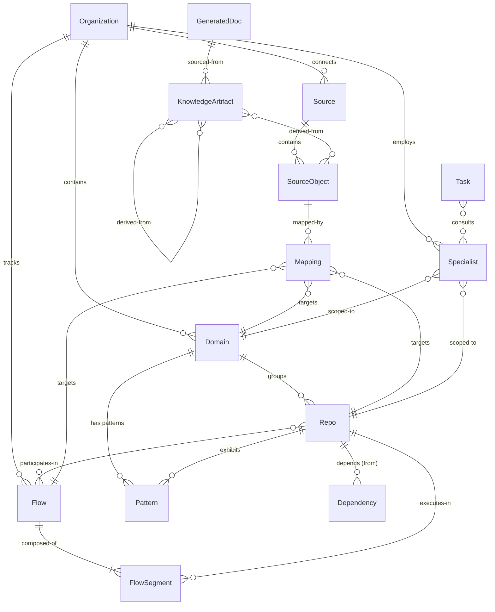
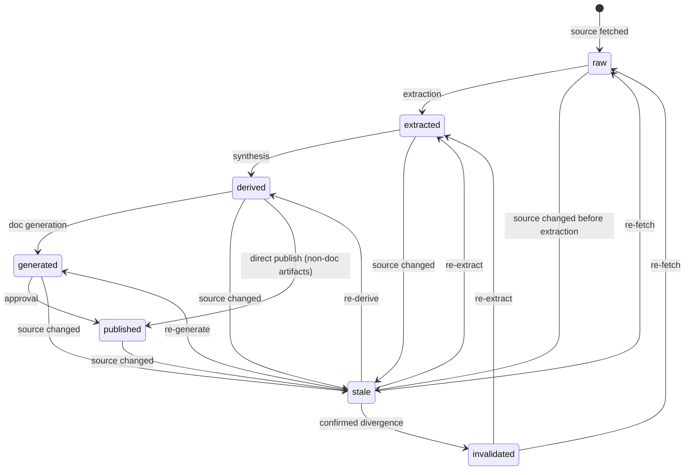
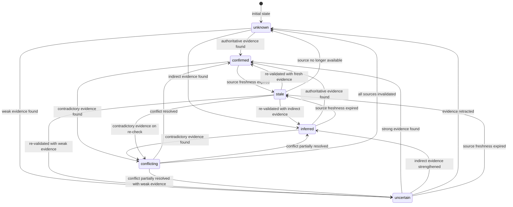

# F1 -- Bifrost Glossary and Conceptual Model

**Spec ID:** F1

> **Status:** Living document — canonical vocabulary reference for all Bifrost specs.

---

## 1. Purpose and Scope

This document defines the foundational vocabulary, entity model, relationship taxonomy, knowledge tier system, and identity conventions used throughout every Bifrost specification. Any term used in a Bifrost spec that carries domain-specific meaning MUST be defined here or explicitly reference this document.

The goals of this glossary are:

1. **Eliminate ambiguity** — every spec author and implementer shares one definition per term.
2. **Enable traceability** — every entity and concept links back to the requirements it supports.
3. **Provide a conceptual model** — not just words, but the structural relationships among them, expressed with enough precision to drive schema and API design.
4. **Serve as the single source of truth** — if this document and another spec disagree, this document wins until explicitly superseded by a later revision with rationale.

### What this document is NOT

- It is not an API specification (see `api.md`).
- It is not a data-model DDL (see `data-model.md`).
- It is not an architecture document (see `architecture.md`).
- It does not prescribe implementation — it prescribes meaning.

---

## 2. Requirements Traceability

This glossary provides vocabulary that spans the entire requirements surface. The table below maps each major entity or concept area to the requirement sections it most directly supports.

| Concept Area | Primary Requirement Sections | Notes |
|---|---|---|
| Source, SourceObject | §6 (Sources), §2.1, §2.3 | Plug-and-play source model |
| Repo | §5.1, §12, §13, §22.5 | Unit of code-level scope |
| Domain | §5.2, §14.2, §22.5 | Configured grouping of repos |
| Organization | §5.3, §22.5 | Top-level scope |
| Flow, FlowSegment | §9, §2.4, §3.1, §17 | First-class flow model |
| Dependency | §10, §3.4, §16 | Typed dependency graph |
| Pattern | §11, §3.3, §7.1 | Recurring implementation discovery |
| KnowledgeArtifact | §7, §12, §16 | Metadata-enveloped knowledge |
| Mapping | §7.1 (broad mappings), §6.4 | Tier-0 lightweight pointers |
| Specialist (Agent) | §14, §15 | Scoped AI workers |
| Task | §15, §18.4, §20 | Unit of work with lifecycle |
| GeneratedDoc | §8, §3.5 | Human-readable outputs |
| Knowledge Tiers | §7.1, §7.3 | Broad-to-deep knowledge model |
| Knowledge States | §7.2, §12, §16 | Freshness and lifecycle |
| Confidence Levels | §16, §7.2 | Explicit uncertainty model |
| Scope Hierarchy | §5, §22.5 | source-object < repo < domain < org |
| Identity / Naming | §6.2, §10, §9 | Cross-system canonical IDs |

---

## 3. Design Goals and Non-Goals

### Design Goals

| # | Goal | Rationale |
|---|---|---|
| G1 | Every entity has a single canonical definition | Prevents semantic drift across specs |
| G2 | Entities carry enough attributes to drive schema design | Glossary doubles as a lightweight conceptual data model |
| G3 | Relationships are typed, directional, and carry cardinality | Enables graph reasoning, query design, and invalidation propagation |
| G4 | Knowledge tiers and states are formally defined with valid transitions | Prevents ad-hoc status fields; enables state-machine enforcement |
| G5 | Identity conventions are specified once | All specs share one URN scheme |
| G6 | The model accommodates V1 constraints (§23) without sacrificing extensibility | Terms defined here must still apply when scope grows to org-wide |

### Non-Goals

| # | Non-Goal | Reason |
|---|---|---|
| NG1 | Prescribe storage technology | That belongs in `data-model.md` / `architecture.md` |
| NG2 | Define API contracts or wire formats | That belongs in `api.md` |
| NG3 | Specify agent implementation details | That belongs in `agents.md` |
| NG4 | Define UI layout or interaction patterns | That belongs in `ui.md` |
| NG5 | Lock down exhaustive enum values (e.g., all possible source types) | The model must be extensible; initial enums are illustrative |

---

## 4. Core Entities

### 4.1 Source

A **Source** is an external system or service containing engineering knowledge that Bifrost connects to via a source adapter. Sources are not owned by Bifrost; Bifrost reads from them (and in future, may write to some).

| Attribute | Type | Required | Description |
|---|---|---|---|
| `id` | URN | Yes | `bifrost:org:{orgId}:source:{sourceId}` |
| `name` | string | Yes | Human-readable label (e.g., "GitHub — acme-org") |
| `type` | SourceType enum | Yes | Category of source (see §6.3 of requirements) |
| `adapter` | string | Yes | Identifier of the adapter plugin used to connect |
| `connectionConfig` | opaque | Yes | Adapter-specific connection parameters (encrypted at rest) |
| `status` | enum | Yes | `active`, `degraded`, `disconnected`, `archived` |
| `permissionModel` | enum | Yes | How permissions are enforced: `passthrough`, `service-account`, `hybrid` |
| `lastSyncAt` | timestamp | No | Last successful sync/poll completion |
| `createdAt` | timestamp | Yes | When the source was registered |

**SourceType** (illustrative, extensible):

`code-host` | `work-tracker` | `design-doc` | `communication` | `config-store` | `schema-registry` | `observability` | `deployment` | `service-catalog` | `internal-tool`

**Key invariant:** A Source exists exactly once per external system connection. Multiple connections to the same external system (e.g., two GitHub orgs) are modeled as separate Sources.

---

### 4.2 SourceObject

A **SourceObject** is a discrete, addressable unit of content within a Source. It is the finest-grained thing Bifrost tracks for freshness, mapping, and retrieval.

| Attribute | Type | Required | Description |
|---|---|---|---|
| `id` | URN | Yes | `bifrost:org:{orgId}:source-object:{sourceObjectId}` |
| `sourceId` | URN | Yes | Parent Source |
| `externalId` | string | Yes | The identifier in the external system (e.g., file path, ticket key, message ID) |
| `objectType` | string | Yes | Source-specific type (e.g., `file`, `pull-request`, `ticket`, `message`, `trace`, `config-key`, `schema`) |
| `revision` | string | No | External revision marker (commit SHA, version, updated-at) |
| `lastFetchedAt` | timestamp | No | When Bifrost last retrieved content |
| `lastFetchedRevision` | string | No | Revision at time of last fetch |
| `metadata` | map | No | Adapter-extracted metadata (author, labels, timestamps) |

**Key invariant:** `(sourceId, externalId)` is unique. A SourceObject's identity is stable across revisions; the revision changes, the identity does not.

---

### 4.3 Repo

A **Repo** is a code repository tracked by Bifrost. It is the primary unit of code-level scope.

| Attribute | Type | Required | Description |
|---|---|---|---|
| `id` | URN | Yes | `bifrost:org:{orgId}:repo:{repoId}` |
| `name` | string | Yes | Short name (e.g., `webhook-api`) |
| `sourceId` | URN | Yes | The code-host Source this repo lives in |
| `externalId` | string | Yes | External identifier (e.g., `acme-org/webhook-api`) |
| `domainId` | URN | No | Domain this repo belongs to (null if unassigned) |
| `defaultBranch` | string | Yes | Remote default branch name |
| `lastKnownRemoteRevision` | string | No | Latest observed HEAD of default branch |
| `lastIndexedRevision` | string | No | Revision at which Bifrost last indexed |
| `languages` | string[] | No | Detected primary languages |
| `status` | enum | Yes | `active`, `archived`, `removed` |
| `createdAt` | timestamp | Yes | When Bifrost started tracking |

**Key invariant:** A Repo always maps to exactly one code-host Source. A Repo belongs to at most one Domain (or is unassigned).

---

### 4.4 Domain

A **Domain** is a configured grouping of related repositories representing a business or technical area. Domains are the primary organizational unit between individual repos and the org-wide view.

| Attribute | Type | Required | Description |
|---|---|---|---|
| `id` | URN | Yes | `bifrost:org:{orgId}:domain:{domainId}` |
| `name` | string | Yes | Human-readable name (e.g., "Delivery", "Platform") |
| `description` | string | No | Purpose and scope description |
| `repos` | URN[] | Yes | Ordered list of repo IDs belonging to this domain |
| `ownerId` | string | No | Responsible person or team |
| `tags` | string[] | No | Classification tags (e.g., `core`, `platform`, `migration-active`) |
| `status` | enum | Yes | `active`, `archived` |
| `createdAt` | timestamp | Yes | When the domain was created |

**Key design decision:** Domains are **configured, not emergent**. A human (or bootstrap process) explicitly assigns repos to domains. The system may **suggest** groupings based on dependency analysis, but the domain boundary is always an explicit configuration choice. See section 11 (Key Decisions) for rationale.

---

### 4.5 Organization

An **Organization** is the top-level scope containing all domains, repos, sources, and knowledge within a single Bifrost deployment.

| Attribute | Type | Required | Description |
|---|---|---|---|
| `id` | URN | Yes | `bifrost:org:{orgId}` |
| `name` | string | Yes | Organization name |
| `defaultConfig` | object | No | Org-wide default settings (freshness thresholds, confidence policies) |
| `createdAt` | timestamp | Yes | When the org was created |

**Key invariant:** All other entities are scoped under exactly one Organization. Multi-org deployments are modeled as separate Bifrost instances (V1 assumption — see Open Questions).

---

### 4.6 Flow

A **Flow** is an end-to-end path through services, repos, and systems representing a business or technical process. Flows are modeled as directed acyclic graphs (DAGs) of FlowSegments.

| Attribute | Type | Required | Description |
|---|---|---|---|
| `id` | URN | Yes | `bifrost:org:{orgId}:flow:{flowId}` |
| `name` | string | Yes | Human-readable name (e.g., "Webhook Delivery") |
| `description` | string | No | What this flow accomplishes |
| `registration` | enum | Yes | `registered` (important, named, human-curated) or `discovered` (ad-hoc, system-inferred) |
| `segments` | FlowSegment[] | Yes | Ordered/structured list of segments forming the DAG |
| `entryPoints` | URN[] | Yes | SourceObject or Repo URNs where the flow begins |
| `repos` | URN[] | Yes | All repos that participate in this flow |
| `domains` | URN[] | No | Domains this flow crosses |
| `confidence` | ConfidenceLevel | Yes | Overall confidence in the flow model's accuracy |
| `evidenceBasis` | URN[] | No | SourceObjects and KnowledgeArtifacts that support this flow model |
| `lastValidatedAt` | timestamp | No | Last time the flow was checked against sources |
| `status` | enum | Yes | `active`, `deprecated`, `draft` |

**Key design decision:** Flows can be both **registered** (explicitly important, human-named) and **discovered** (system-inferred from code analysis, traces, or dependency walking). Registered flows are durable and tracked; discovered flows may be ephemeral and are promoted to registered when a human confirms importance. See section 11 for rationale.

---

### 4.7 FlowSegment

A **FlowSegment** is a discrete step within a Flow. Each segment represents one meaningful boundary in the execution path.

| Attribute | Type | Required | Description |
|---|---|---|---|
| `id` | URN | Yes | `bifrost:org:{orgId}:flow:{flowId}:segment:{segmentId}` |
| `flowId` | URN | Yes | Parent Flow |
| `segmentType` | FlowSegmentType | Yes | Type of step (see enum below) |
| `repoId` | URN | No | Repo this segment executes in (if applicable) |
| `sourceObjectRefs` | URN[] | No | SourceObjects that define or evidence this segment |
| `description` | string | No | What this segment does |
| `predecessors` | URN[] | No | Segment IDs that precede this one in the DAG |
| `successors` | URN[] | No | Segment IDs that follow this one in the DAG |
| `metadata` | map | No | Segment-specific data (endpoint URL, queue name, condition expression) |
| `confidence` | ConfidenceLevel | Yes | Confidence in this segment's accuracy |

**FlowSegmentType** enum:

| Value | Meaning |
|---|---|
| `entry-point` | Where the flow begins (HTTP endpoint, CLI command, scheduled trigger) |
| `service-hop` | Synchronous call from one service to another |
| `async-boundary` | Asynchronous handoff (queue, event bus, callback) |
| `branch` | Conditional fork in the flow |
| `retry` | Retry logic around a segment |
| `fallback` | Fallback/degraded path |
| `side-effect` | Non-primary effect (logging, analytics, notification) |
| `external-call` | Call to a system outside the org boundary |
| `data-access` | Database or cache read/write |
| `transform` | Data transformation or mapping step |

---

### 4.8 Dependency

A **Dependency** is a typed, directional relationship where one entity relies on another. Dependencies are the backbone of blast-radius analysis, invalidation propagation, and impact assessment.

| Attribute | Type | Required | Description |
|---|---|---|---|
| `id` | URN | Yes | `bifrost:org:{orgId}:dependency:{dependencyId}` |
| `fromEntity` | URN | Yes | The entity that depends (the dependent) |
| `toEntity` | URN | Yes | The entity depended upon (the dependency) |
| `dependencyType` | DependencyType | Yes | Classification (see enum below) |
| `direction` | enum | Yes | `direct` or `indirect` (transitive) |
| `confidence` | ConfidenceLevel | Yes | How certain Bifrost is that this dependency exists |
| `evidenceBasis` | URN[] | No | SourceObjects that evidence this dependency |
| `lastValidatedAt` | timestamp | No | Last time this dependency was checked |
| `metadata` | map | No | Type-specific data (package version, API path, schema name) |

**DependencyType** enum (from §10.2):

| Value | Meaning | Example |
|---|---|---|
| `code` | Source code import/link | PyPI package, Go module, shared library |
| `api-interface` | API contract dependency | REST endpoint, gRPC service, GraphQL schema |
| `schema` | Shared data schema | Database table, Protobuf definition, Avro schema |
| `config` | Configuration dependency | Shared config keys, feature flags |
| `event` | Event-driven coupling | Kafka topic producer/consumer, webhook |
| `runtime` | Observed runtime dependency | Service A calls Service B (seen in traces) |
| `ownership` | Organizational/ownership coupling | Same team owns both, shared on-call |
| `migration` | Temporal coupling during migration | Old system and new system coexist |
| `inferred-hidden` | Dependency inferred but not directly evidenced | Bifrost suspects coupling from indirect signals |

---

### 4.9 Pattern

A **Pattern** is a recurring implementation approach discovered across repos or domains. Patterns enable reuse guidance and consistency validation.

| Attribute | Type | Required | Description |
|---|---|---|---|
| `id` | URN | Yes | `bifrost:org:{orgId}:pattern:{patternId}` |
| `name` | string | Yes | Descriptive name (e.g., "Retry with exponential backoff") |
| `description` | string | No | What this pattern does and when to use it |
| `scope` | enum | Yes | `repo`, `domain`, `org` |
| `scopeRef` | URN | No | The repo or domain where this pattern is scoped (null for org-wide) |
| `classification` | enum | Yes | `convention`, `template`, `anti-pattern`, `emerging` |
| `exemplars` | URN[] | No | SourceObjects that best demonstrate this pattern |
| `occurrences` | integer | No | Approximate count of instances found |
| `confidence` | ConfidenceLevel | Yes | How certain the classification is |
| `lastDiscoveredAt` | timestamp | No | When this pattern was last observed |

---

### 4.10 KnowledgeArtifact

A **KnowledgeArtifact** is any piece of stored knowledge carrying a metadata envelope. It is the universal wrapper for everything Bifrost knows — from a raw mapping to a synthesized flow model to a generated document.

| Attribute | Type | Required | Description |
|---|---|---|---|
| `id` | URN | Yes | `bifrost:org:{orgId}:artifact:{artifactId}` |
| `tier` | KnowledgeTier | Yes | 0, 1, 2, or 3 (see section 6) |
| `state` | KnowledgeState | Yes | Current lifecycle state (see section 7) |
| `artifactType` | string | Yes | Specific type (e.g., `mapping`, `entity-extraction`, `flow-model`, `dependency-graph`, `generated-doc`, `pattern-classification`) |
| `scope` | URN | Yes | Entity this artifact is about (repo, domain, flow, etc.) |
| `content` | opaque | Yes | The knowledge payload (structure varies by artifactType) |
| `sourceBasis` | URN[] | Yes | SourceObjects and other artifacts this was derived from |
| `confidence` | ConfidenceLevel | Yes | Overall confidence |
| `knownGaps` | string[] | No | Explicit list of things this artifact does not cover |
| `freshness` | FreshnessEnvelope | Yes | See below |
| `relationships` | Relationship[] | No | Typed links to other artifacts (see section 5) |
| `createdAt` | timestamp | Yes | When this artifact was first created |
| `updatedAt` | timestamp | Yes | When this artifact was last updated |
| `createdBy` | URN | Yes | Specialist or system that produced this artifact |

**FreshnessEnvelope** (embedded):

| Field | Type | Description |
|---|---|---|
| `sourceStateAt` | timestamp | The source revision timestamp this artifact reflects |
| `derivedAt` | timestamp | When Bifrost produced this artifact |
| `lastCheckedAt` | timestamp | Last freshness check against source |
| `lagIndicator` | enum | `current`, `slightly-behind`, `stale`, `unknown` |

---

### 4.11 Mapping

A **Mapping** is a lightweight Tier-0 pointer from a SourceObject to one or more repos, domains, concepts, or flows. Mappings are the broadest, cheapest form of knowledge — "where truth lives" — and form the foundation for deeper extraction.

| Attribute | Type | Required | Description |
|---|---|---|---|
| `id` | URN | Yes | `bifrost:org:{orgId}:mapping:{mappingId}` |
| `sourceObjectId` | URN | Yes | The SourceObject being mapped |
| `targets` | MappingTarget[] | Yes | What this source object maps to |
| `relevance` | enum | Yes | `primary`, `supporting`, `peripheral` |
| `confidence` | ConfidenceLevel | Yes | How certain the mapping is |
| `createdBy` | enum | Yes | `adapter`, `specialist`, `human`, `bootstrap` |
| `lastValidatedAt` | timestamp | No | Last validation check |

**MappingTarget** (embedded):

| Field | Type | Description |
|---|---|---|
| `targetType` | enum | `repo`, `domain`, `concept`, `flow`, `dependency` |
| `targetRef` | URN | The target entity URN |
| `role` | string | How the source object relates (e.g., "defines", "evidences", "configures") |

---

### 4.12 Specialist (Agent)

**Deprecated:** The term 'Specialist' has been replaced by 'Agent' throughout the spec suite. RepoAgent, TaskCoordinator, and ExtractionAgent are the canonical V1 agent types. See §4.X Agent.

A **Specialist** is an AI worker scoped to a particular knowledge domain. Specialists are the units of the Bifrost agent workforce.

| Attribute | Type | Required | Description |
|---|---|---|---|
| `id` | URN | Yes | `bifrost:org:{orgId}:specialist:{specialistId}` |
| `name` | string | Yes | Human-readable label |
| `scopeType` | enum | Yes | `repo-source`, `repo`, `domain`, `org`, `task-coordinator` |
| `scopeRef` | URN | No | The entity this specialist is scoped to |
| `sources` | URN[] | No | Sources this specialist is attached to |
| `capabilities` | string[] | Yes | What this specialist can contribute (e.g., `flow-analysis`, `dependency-mapping`, `pattern-discovery`) |
| `knowledgeFreshness` | FreshnessEnvelope | No | How fresh this specialist's knowledge is |
| `status` | enum | Yes | `active`, `idle`, `degraded`, `retired` |
| `lastConsultedAt` | timestamp | No | Last time this specialist was invoked |

**Runtime implementation note:** In Track A (V1), a Specialist is implemented as a Python class (inheriting from an ABC) with an async agent loop that calls the Anthropic Messages API directly. In Track B (future), a Specialist is implemented as an Anthropic Managed Agent Session — the Agent Definition captures the specialist's model, system prompt, and tools, and each invocation creates a new Session. The `AgentRuntime` ABC is the same regardless of track; only the underlying implementation changes. See section 13 (Runtime Model Primitives) for details.

**Local/cloud state note:** In Track A, a Specialist's state (configs, extracted knowledge text, freshness metadata) is persisted in PostgreSQL tables on customer infrastructure. In Track B, state is persisted in Anthropic Memory Stores (cloud-hosted, shared across all machines via the Anthropic API).

---

### 4.13 Task

A **Task** is a unit of work requested by a user or agent, with a full lifecycle from request through synthesis to completion.

| Attribute | Type | Required | Description |
|---|---|---|---|
| `id` | URN | Yes | `bifrost:org:{orgId}:task:{taskId}` |
| `requestedBy` | string | Yes | User ID or agent URN |
| `requestType` | enum | Yes | `question`, `plan`, `validate`, `generate-doc`, `refresh`, `execute` |
| `scope` | URN | Yes | Primary scope entity (repo, domain, flow, org) |
| `query` | string | Yes | The original request text or structured query |
| `status` | TaskStatus | Yes | See lifecycle below |
| `specialists` | URN[] | No | Specialists consulted during this task |
| `evidenceSummary` | object | No | Sources, artifacts, and freshness used |
| `freshnessContext` | FreshnessEnvelope | No | What freshness state the task operated under |
| `options` | TaskOption[] | No | Options presented (for plan/execute tasks) |
| `conflicts` | Conflict[] | No | Detected conflicts |
| `gaps` | string[] | No | Known gaps in the answer |
| `synthesis` | string | No | Final synthesized answer or plan |
| `createdAt` | timestamp | Yes | When the task was created |
| `completedAt` | timestamp | No | When the task finished |

**TaskStatus** enum: `pending` | `scoping` | `consulting` | `synthesizing` | `awaiting-review` | `completed` | `failed` | `cancelled`

---

### 4.14 Agent Registry

An **Agent Registry** is the lookup and instantiation registry that maps agent type identifiers to their configuration and runtime handles. Bifrost consults the Agent Registry when selecting which specialists to invoke for a given task scope.

**Track A (V1):** An in-memory/PostgreSQL registry of agent type → instantiation config. On startup, each agent type (RepoAgent, TaskCoordinator, etc.) is registered with its model, system prompt template, and capability set. The registry instantiates agents as Python class instances within the Bifrost process.

**Track B (future):** The Anthropic Managed Agents API (`/v1/agents`) serves as the Agent Registry. Each agent type maps to a persisted Agent Definition resource (created once, referenced by ID). Invoking an agent type means creating a new Session from that Agent Definition.

---

### 4.15 GeneratedDoc

A **GeneratedDoc** is a human-readable document produced by Bifrost from knowledge artifacts. It is a Tier-3 output.

| Attribute | Type | Required | Description |
|---|---|---|---|
| `id` | URN | Yes | `bifrost:org:{orgId}:doc:{docId}` |
| `title` | string | Yes | Document title |
| `docType` | enum | Yes | `repo-overview`, `onboarding`, `flow-doc`, `domain-summary`, `playbook`, `migration-guide`, `dependency-doc` |
| `scope` | URN | Yes | Entity this doc is about |
| `content` | string | Yes | The document body (Markdown) |
| `sourceBasis` | URN[] | Yes | KnowledgeArtifacts and SourceObjects used |
| `confidence` | ConfidenceLevel | Yes | Overall confidence in accuracy |
| `knownGaps` | string[] | No | What this doc does not cover |
| `freshness` | FreshnessEnvelope | Yes | Freshness metadata |
| `publicationState` | enum | Yes | `draft`, `internal`, `published`, `stale`, `withdrawn` |
| `generatedBy` | URN | Yes | Specialist or system that produced it |
| `createdAt` | timestamp | Yes | First generation time |
| `updatedAt` | timestamp | Yes | Last regeneration time |

---

## 5. Relationship Taxonomy

All relationships between entities in Bifrost are typed, directional, and carry cardinality. The following relationship types form the complete taxonomy.

| Relationship | From | To | Cardinality | Description |
|---|---|---|---|---|
| `participates-in` | Repo | Flow | M:N | A repo participates in one or more flows; a flow spans one or more repos |
| `depends-on` | Entity | Entity | M:N | One entity depends on another (see Dependency entity for type) |
| `derived-from` | KnowledgeArtifact | KnowledgeArtifact or SourceObject | M:N | An artifact is derived from source objects or lower-tier artifacts |
| `scoped-to` | Entity | Repo, Domain, or Org | M:1 | An entity is scoped to a particular level of the hierarchy |
| `authoritative-for` | Source | fact-type | M:N | A source is authoritative for certain kinds of facts |
| `invalidated-by` | KnowledgeArtifact | SourceObject change | M:N | An artifact is invalidated when its source basis changes |

### Relationship Detail

**participates-in**
- Direction: Repo --> Flow
- Cardinality: Many repos to many flows
- Semantics: The repo contains code that executes as part of the flow. The `FlowSegment.repoId` field encodes which segments belong to which repo.

**depends-on**
- Direction: Dependent --> Dependency
- Cardinality: Many to many
- Semantics: Fully described by the Dependency entity (§4.8). The `dependencyType` qualifies the nature of the relationship.

**derived-from**
- Direction: Higher-tier artifact --> Lower-tier artifact or SourceObject
- Cardinality: Many to many
- Semantics: Forms the **provenance chain**. Every KnowledgeArtifact at Tier 1+ MUST have at least one `derived-from` link. This chain enables invalidation propagation: when a source object changes, all artifacts derived from it can be marked stale.

**scoped-to**
- Direction: Entity --> Scope container
- Cardinality: Many to one
- Semantics: Every entity belongs to exactly one scope level. Cross-cutting entities (Flows, Patterns) may reference multiple scope levels but have a primary scope.

**authoritative-for**
- Direction: Source --> Fact type
- Cardinality: Many to many
- Semantics: Encodes §2.3 — different sources are primary for different fact types. For example, a code-host Source is authoritative for code truth; an observability Source is authoritative for runtime behavior.

**invalidated-by**
- Direction: KnowledgeArtifact --> Change event
- Cardinality: Many to many
- Semantics: When a SourceObject's revision changes, all Mappings and KnowledgeArtifacts whose `sourceBasis` includes that SourceObject are candidates for invalidation. The invalidation may be immediate (state --> `stale`) or deferred (state --> `stale` after a freshness check confirms divergence).

### Entity Relationship Diagram



---

## 6. Knowledge Tiers

Knowledge in Bifrost is organized into four tiers, ordered by cost-to-produce, depth, and fragility. Lower tiers are broad and cheap; higher tiers are deep and expensive.

| Tier | Name | Description | Examples | Cost | Coverage | Freshness Sensitivity |
|---|---|---|---|---|---|---|
| **0** | Source Mappings | Broad, lightweight pointers — "where truth lives" | Mapping of a Jira ticket to a repo; mapping of a config file to a domain | Very low | Very broad | Low (pointers rarely change even when content does) |
| **1** | Extracted Lightweight Knowledge | Entities, relationships, and hints extracted from source content | Entity list from a repo, dependency hints from imports, flow hints from call graphs | Low-medium | Broad | Medium (changes when source content changes) |
| **2** | Derived/Synthesized Knowledge | Composite knowledge assembled from multiple Tier-1 artifacts | Flow models, dependency graphs, pattern classifications, cross-repo analysis | Medium-high | Selective | High (invalidated when any input artifact changes) |
| **3** | Generated Human Artifacts | Documents, playbooks, summaries for human consumption | Repo overview doc, onboarding guide, flow documentation, migration playbook | High | Narrow (high-value only) | Very high (must reflect current derived knowledge) |

### Tier Relationships

```
Tier 0 (Mappings)
  |
  v  extraction
Tier 1 (Extracted knowledge)
  |
  v  synthesis / derivation
Tier 2 (Derived knowledge)
  |
  v  generation
Tier 3 (Generated docs)
```

**Key properties:**

1. **Each tier depends on the tier below it.** A Tier-2 artifact is always derived from Tier-1 artifacts, which are always extracted from SourceObjects discovered via Tier-0 Mappings.
2. **Invalidation propagates upward.** When a SourceObject changes, Tier-0 mappings are checked, then Tier-1 extractions, then Tier-2 derivations, then Tier-3 docs.
3. **Coverage narrows as tier increases.** Tier 0 should cover everything; Tier 3 covers only high-value surfaces.
4. **Cost increases as tier increases.** Generating a doc is far more expensive than creating a mapping.

---

## 7. Knowledge States

Every KnowledgeArtifact and GeneratedDoc has a lifecycle state. The following state machine defines valid states and transitions.

### State Definitions

| State | Meaning | Entry Condition |
|---|---|---|
| `raw` | Source content has been fetched but not processed | SourceObject fetched; no extraction performed |
| `extracted` | Lightweight knowledge has been pulled from source content | Tier-1 extraction completed |
| `derived` | Knowledge has been synthesized from multiple extracted artifacts | Tier-2 derivation completed |
| `generated` | Human artifact has been produced from derived knowledge | Tier-3 generation completed |
| `published` | Artifact has been reviewed/approved and made available | Human or automated approval |
| `stale` | Artifact's source basis has changed; artifact may be inaccurate | Source revision changed since last derivation |
| `invalidated` | Artifact has been confirmed inaccurate and must be regenerated | Freshness check confirmed divergence, or manual invalidation |

### Valid State Transitions



### Transition Rules

1. **Forward transitions** (raw --> extracted --> derived --> generated --> published) require the producing agent to complete its work and attach a FreshnessEnvelope.
2. **Staleness transitions** can happen to any non-raw state when the upstream SourceObject revision changes. Staleness is a **suspicion**, not a confirmation.
3. **Invalidation** is an explicit confirmation that the artifact is no longer accurate. It requires either a freshness check or manual action.
4. **Recovery from stale/invalidated** always goes back to the appropriate tier level (re-fetch for raw, re-extract for extracted, etc.).
5. An artifact in `stale` state **may still be served** with a staleness warning. An artifact in `invalidated` state **must not be served** without warning.

---

## 8. Confidence Levels

> **Canonical definition location:** The canonical set of confidence levels is defined here (F1). The detailed scoring policy, transition triggers, and serving rules for each level are specified in S3. If S3 and F1 conflict on the set of valid levels, F1 wins.

Every knowledge artifact, dependency, flow, and mapping carries a confidence level. Confidence is not a numeric score — it is a categorical assessment with precise boundary conditions.

**Canonical set:** `confirmed | inferred | stale | uncertain | unknown | conflicting`

| Level | Meaning | Boundary Condition |
|---|---|---|
| `confirmed` | Backed by direct, fresh evidence from an authoritative source | At least one authoritative source agrees; source is fresh (within configured threshold); no conflicting evidence |
| `inferred` | Logically derived from indirect evidence; no direct authoritative source | Evidence exists but is indirect (e.g., call-graph analysis, naming convention match); or source is authoritative but not for this specific fact type |
| `stale` | Was confirmed or inferred, but source basis is no longer fresh | Source revision has changed since last validation; confidence was previously higher |
| `uncertain` | Best-effort extraction attempted but evidence is weak or sparse | Extraction ran and produced a result, but evidence quality is low (e.g., heuristic match, single weak signal, low-coverage source). Distinct from `unknown`: Bifrost has an answer but holds it with low confidence. Use `uncertain` when you can say something; use `unknown` when you cannot. |
| `unknown` | No evidence found; Bifrost has not been able to determine the fact | No relevant source objects mapped; or extraction produced no result; explicitly flagged as a gap |
| `conflicting` | Multiple sources disagree on the fact | Two or more authoritative sources provide contradictory evidence; or static analysis contradicts runtime observation |

### Confidence Transitions



### Conflict Types (from §16.2)

When confidence is `conflicting`, the conflict is further classified:

| Conflict Type | Description |
|---|---|
| `source-conflict` | Two sources of the same type disagree |
| `stale-vs-current` | Old evidence contradicts new evidence |
| `runtime-vs-static` | Runtime observation contradicts code analysis |
| `intent-vs-implementation` | Design docs/tickets contradict code |
| `dependency-disagreement` | Different analyses produce different dependency graphs |
| `ownership-disagreement` | Multiple sources claim different ownership |

---

## 9. Scope Hierarchy

Bifrost's scope model is a strict hierarchy for containment, with cross-cutting concerns (Flows) that span levels.

### Containment Hierarchy

```
Organization
  └── Domain
        └── Repo
              └── SourceObject (via Source)
```

Every entity is scoped to exactly one level of this hierarchy. The scope determines:
- **Visibility defaults** — a repo-scoped artifact is visible within its domain and org
- **Invalidation boundaries** — a repo-level refresh invalidates repo-scoped artifacts
- **Specialist assignment** — specialists are scoped to one level
- **Query routing** — questions are routed to the narrowest sufficient scope

### Cross-Cutting: Flows

Flows **cross** the containment hierarchy. A single Flow may span multiple repos across multiple domains. The Flow entity carries references to all participating repos and domains, and its segments link back into the containment hierarchy via `repoId`.

```
Organization
  ├── Domain A
  │     ├── Repo 1  ──────┐
  │     └── Repo 2  ──┐   │
  └── Domain B        │   │
        ├── Repo 3  ──┤   │
        └── Repo 4    │   │
                       │   │
  Flow X ─────────────[1, 2, 3]  (crosses Domain A and B)
  Flow Y ─────────────[2, 4]     (crosses Domain A and B)
```

### Scope Resolution Rules

1. A question about a repo is handled at repo scope first, escalating to domain scope only if cross-repo knowledge is needed.
2. A question about a flow always operates at the scope of the flow's widest extent — if it crosses domains, it is org-scoped.
3. Freshness, invalidation, and refresh can be triggered at any scope level and cascade downward (org refresh triggers domain refresh triggers repo refresh).

---

## 10. Naming and Identity Conventions

### Canonical Identifier Scheme

**This section (F1) defines the canonical URN format. S1, S2, and all other Bifrost specs MUST use this format. Any conflicting format in another spec is superseded by this definition.**

All Bifrost entities use a URN-style identifier scheme:

```
bifrost:{scope}:{type}:{id}
```

Where:
- `{scope}` = the org/domain/repo identifier (e.g., `org`, `delivery`, `repo:webhook-api`)
- `{type}` = entity type (e.g., `component`, `flow`, `dependency`, `artifact`)
- `{id}` = slug or UUID, unique within the scope+type combination

**Source-layer URNs** (emitted by adapters for objects that originate in external systems) use the sub-scheme:

```
bifrost:source:{adapter}:{instance}:{type}:{id}
```

Where:
- `{adapter}` = adapter identifier (e.g., `github`, `jira`, `slack`)
- `{instance}` = adapter instance name (e.g., `acme-org`, `main`)
- `{type}` = source object type (e.g., `repo`, `pull-request`, `ticket`)
- `{id}` = identifier within the adapter instance

Source-layer URNs are normalized to Bifrost canonical URNs during ingestion. After normalization, only canonical URNs appear in Knowledge Store entities, relationships, and API responses.

### Full URN Patterns

| Entity | URN Pattern | Example |
|---|---|---|
| Organization | `bifrost:org:{orgId}` | `bifrost:org:acme` |
| Source | `bifrost:org:{orgId}:source:{sourceId}` | `bifrost:org:acme:source:github-main` |
| SourceObject | `bifrost:org:{orgId}:source-object:{sourceObjectId}` | `bifrost:org:acme:source-object:a1b2c3d4` |
| Repo | `bifrost:org:{orgId}:repo:{repoId}` | `bifrost:org:acme:repo:webhook-api` |
| Domain | `bifrost:org:{orgId}:domain:{domainId}` | `bifrost:org:acme:domain:delivery` |
| Flow | `bifrost:org:{orgId}:flow:{flowId}` | `bifrost:org:acme:flow:webhook-delivery` |
| FlowSegment | `bifrost:org:{orgId}:flow:{flowId}:segment:{segmentId}` | `bifrost:org:acme:flow:webhook-delivery:segment:sign-payload` |
| Dependency | `bifrost:org:{orgId}:dependency:{dependencyId}` | `bifrost:org:acme:dependency:d7e8f9` |
| Pattern | `bifrost:org:{orgId}:pattern:{patternId}` | `bifrost:org:acme:pattern:retry-backoff` |
| KnowledgeArtifact | `bifrost:org:{orgId}:artifact:{artifactId}` | `bifrost:org:acme:artifact:k1m2n3` |
| Mapping | `bifrost:org:{orgId}:mapping:{mappingId}` | `bifrost:org:acme:mapping:m4p5q6` |
| Specialist | `bifrost:org:{orgId}:specialist:{specialistId}` | `bifrost:org:acme:specialist:webhook-api-repo` |
| Task | `bifrost:org:{orgId}:task:{taskId}` | `bifrost:org:acme:task:t7u8v9` |
| GeneratedDoc | `bifrost:org:{orgId}:doc:{docId}` | `bifrost:org:acme:doc:delivery-overview` |

### Identity Rules

1. **Stability:** An entity's URN MUST NOT change over its lifetime. If a repo is renamed in the external system, the Bifrost URN remains the same; the `externalId` field is updated.
2. **Uniqueness:** URNs are globally unique within a Bifrost deployment.
3. **Parseability:** URNs can be parsed to extract scope, type, and ID without external lookup.
4. **Human-readability:** The `{id}` segment SHOULD be human-readable where possible (e.g., `webhook-api` rather than a UUID), but MAY fall back to system-generated IDs for entities without stable human names.
5. **External reference:** SourceObjects carry both a Bifrost URN and an `externalId` that is the identifier in the origin system. The mapping between them is maintained by the source adapter.

---

## 11. Key Decisions and Rationale

### KD-1: Domain is configured, not emergent

**Decision:** Domains are explicitly configured by a human or bootstrap process. Repos are assigned to domains by explicit configuration.

**Rationale:** Emergent clustering (e.g., grouping repos by dependency density) is useful as a *suggestion* mechanism, but organizational boundaries often reflect business structure, team ownership, and cognitive groupings that do not perfectly align with code coupling. An emergent-only model would:
- Produce unstable boundaries that shift with every dependency change
- Miss organizational intent (e.g., two loosely coupled repos owned by the same team)
- Create confusion when cluster membership disagrees with team mental models

**Compromise:** Bifrost MAY suggest domain groupings based on dependency analysis, co-change frequency, and ownership patterns. These suggestions are surfaced to the user but require explicit acceptance to take effect.

### KD-2: Flows can be both registered and discovered

**Decision:** Flows have a `registration` field that is either `registered` (important, named, human-curated) or `discovered` (system-inferred, potentially ephemeral).

**Rationale:** Important business flows (e.g., "Webhook Delivery") should be durable first-class objects with names, descriptions, and tracked freshness. But Bifrost should also be able to discover flows ad-hoc during task execution (e.g., tracing a call graph to answer "what happens when X is called?"). Requiring all flows to be pre-registered would cripple ad-hoc investigation; making all flows permanent would flood the system with noise.

**Lifecycle:** Discovered flows begin as ephemeral (associated with a Task, garbage-collected after a TTL). A user or specialist can **promote** a discovered flow to registered status, giving it a name and making it durable.

### KD-3: URN-style identifiers

**Decision:** All entities use `bifrost:{scope}:{type}:{id}` URNs.

**Rationale:**
- URNs are self-describing — you can parse type and scope without a lookup.
- URNs are stable — they do not encode mutable state (no branch names, no revision hashes).
- URNs are system-independent — they do not embed external system URLs.
- URNs support hierarchical scoping — `bifrost:org:acme:flow:webhook-delivery:segment:sign-payload` clearly nests a segment within a flow within an org.
- URNs avoid collision — the type segment prevents ID collision between entities of different types.

### KD-4: Knowledge Tiers are a cost/coverage tradeoff, not a quality ranking

**Decision:** Tier 0 is not "worse" than Tier 3 — it serves a different purpose. The system should maintain Tier 0 everywhere and reserve Tier 3 for high-value areas.

**Rationale:** §7.3 requires "broad but lightweight coverage everywhere" and "deeper curated knowledge in important places." The tier model encodes this explicitly. A system that tries to maintain Tier 3 for everything will be perpetually stale and expensive. A system that only has Tier 3 for a few areas and nothing elsewhere provides no broad coverage.

### KD-5: Confidence is categorical, not numeric

**Decision:** Confidence uses six levels (`confirmed`, `inferred`, `stale`, `uncertain`, `unknown`, `conflicting`) rather than a 0-1 score.

**Rationale:** Numeric confidence scores create a false sense of precision. The difference between 0.72 and 0.74 is meaningless in practice, but the difference between "confirmed by authoritative source" and "inferred from indirect evidence" is actionable. Categorical confidence also maps cleanly to user-facing language and decision rules (e.g., "warn on stale", "block on conflicting").

---

## 12. Open Questions

| # | Question | Context | Impact |
|---|---|---|---|
| OQ-1 | Should multi-org deployments be supported, or is one org per deployment sufficient? | §5.3, §22.5 | Affects top-level scoping and identity scheme |
| OQ-2 | What is the TTL for discovered (non-registered) flows? | KD-2 | Affects storage cost and garbage collection design |
| OQ-3 | Should Patterns carry version history, or is "latest observed" sufficient? | §11.1, §7.2 | Affects whether pattern drift is trackable |
| OQ-4 | How are permissions modeled across sources with different auth models? | §21.1, §6.2 | Affects whether Bifrost can share artifacts derived from restricted sources |
| OQ-5 | Should KnowledgeArtifact content be stored inline or as a reference to blob storage? | §13.2, §13.3 | Affects storage architecture; inline is simpler but may not scale for large artifacts |
| OQ-6 | What is the freshness threshold boundary between `current` and `slightly-behind` lag indicators? | §12.1, §7.2 | Needs to be configurable per org/domain; requires a policy model |
| OQ-7 | Should `inferred-hidden` dependencies have a separate promotion workflow? | §10.2 | An inferred dependency is high-risk to act on; may need human confirmation before Tier-2 use |
| OQ-8 | How should local workspace state be represented in the scope hierarchy? | §12.7 | Local state is neither repo (remote) nor a full scope level; needs a clear model |
| OQ-9 | Should the GeneratedDoc entity support diff-based incremental updates, or is full regeneration the only path? | §8.4, §8.5 | Affects performance and review experience for large docs |
| OQ-10 | What is the conflict resolution protocol when `conflicting` confidence is detected? | §16.2 | Needs a defined workflow: auto-resolve heuristics vs. always-escalate-to-human |

---

## 13. Runtime Model Primitives

This section defines terms related to how Bifrost agents are executed and how their state is persisted. Bifrost is designed with a **dual-track runtime strategy**: a custom implementation (Track A, V1) and a Managed Agents implementation (Track B, future). All terms here apply to both tracks unless marked otherwise.

See `architecture-overview.md` ADR-008 for the full rationale behind the dual-track approach.

---

### AgentRuntime

The **AgentRuntime** is the execution environment that hosts and runs Bifrost agents. It is the abstraction that isolates business logic (what an agent does) from infrastructure (how an agent runs).

**ABC interface (common to both tracks):**
- `initialize(agentType, config)` — provision a new agent instance from its type and config
- `execute(agentId, task)` — run the agent on a task; returns a streaming or resolved result
- `getState(agentId, path)` — read state from the agent's state backend
- `setState(agentId, path, content)` — write state to the agent's state backend

**Track A (V1 implementation):** A Python class (extending the `AgentRuntime` ABC) that implements the async agent loop directly: receives a task, calls the Anthropic Messages API with the agent's system prompt and tool definitions, executes tool calls, iterates until completion, and returns the response. Runs in-process within the Bifrost API Server.

**Track B (future implementation):** Anthropic Managed Agent Sessions. The `AgentRuntime` creates and monitors Sessions against pre-registered Agent Definitions. SSE event streams from Sessions replace the in-process loop.

The `AgentRuntime` ABC is the same regardless of track. Swapping tracks requires changing one runtime config flag, not rewriting business logic.

---

### Agent Definition (Track B)

An **Agent Definition** is a saved Managed Agents API resource (available in Track B only) that captures a fixed configuration for one type of agent. Created once and referenced by ID across all sessions of that agent type.

An Agent Definition contains:
- Model identifier (e.g., `claude-sonnet-4-6`)
- System prompt
- Tool list
- MCP server references
- Callable agent IDs (for multi-agent coordination)

In Track A, the equivalent concept is the agent's instantiation config stored in the in-memory/PostgreSQL Agent Registry.

---

### Session (Track B)

A **Session** is a single execution of an Agent Definition in an Anthropic-hosted container (Track B only). Each Session:
- Is created via the Managed Agents API from an Agent Definition
- Runs in an isolated Anthropic container
- Produces a Server-Sent Events (SSE) stream of execution events
- Terminates on task completion

In Track A, the equivalent is a single invocation of the in-process Python async agent loop. Sessions are the Track B counterpart to in-process agent loop executions. Sessions in the Managed Agents Research Preview have a finite duration ceiling (estimated 10–30 minutes); tasks that require longer extraction windows must checkpoint progress to a Memory Store and resume in a subsequent Session (L5: Session Duration Limits).

---

### Memory Store (Track B)

A **Memory Store** is an Anthropic-hosted persistent text document store (Track B only). Memory Stores:
- Persist across Sessions (survive session termination)
- Are shared across all machines via the Anthropic API (no per-machine state)
- Support up to 8 stores per session
- Store up to 100KB per document
- Are versioned

Memory Stores replace PostgreSQL-backed state tables for agent-side persistence in Track B. In Track A, the equivalent is PostgreSQL tables (`agent_configs`, `freshness`, `knowledge_text_cache`). All Track B state that must survive between tasks must be explicitly written to a Memory Store before the Session ends (L2: Ephemeral Sessions); Memory Store reads and writes also contribute to per-session cost in ways that are not directly visible in LLM token counts (L8: Cost Opacity).

---

### AgentStateBackend

The **AgentStateBackend** is the persistence layer for agent state: configs, freshness metadata, and extracted knowledge text. It is an abstraction with two concrete implementations depending on track.

**ABC interface (common to both tracks):**
- `read(path)` — retrieve a state document at the given path
- `write(path, content)` — store a state document at the given path
- `list(prefix)` — list all state documents under the given path prefix

**Track A (V1 implementation):** PostgreSQL tables on customer infrastructure. Three primary tables: `agent_configs` (agent type configuration and capability declarations), `freshness` (per-repo freshness metadata and last-indexed revisions), `knowledge_text_cache` (extracted knowledge text blobs per repo, used for LLM context assembly).

**Track B (future implementation):** Anthropic Memory Stores. Each logical state category maps to one Memory Store (within the 8-store-per-session limit).

The `AgentStateBackend` ABC is the same regardless of track. Business logic reads and writes state through this ABC; the backing store is swappable without changing agent logic.

---

### Session Thread (Track B)

A **Session Thread** is a context-isolated event stream for a single callable agent within a multi-agent Managed Agents Session (Track B only). When a TaskCoordinator Session calls multiple RepoAgent Sessions in parallel, each RepoAgent runs in its own Session Thread.

Key constraint: **only one level of delegation is supported.** A TaskCoordinator can call RepoAgents as Session Threads, but those RepoAgents cannot in turn call further sub-agents. The agent hierarchy is strictly 2 levels: `TaskCoordinator → RepoAgents`. This single-level cap is a Managed Agents Research Preview constraint (L1: No Recursive Delegation); the number of RepoAgent Session Threads that can run in parallel is also bounded by the platform's concurrency ceiling (L7: Session Concurrency Limits), which Bifrost must respect when planning multi-repo tasks.

In Track A, the equivalent is an `asyncio.gather()` over multiple parallel in-process async agent loop invocations orchestrated by the Bifrost control plane.

---

### MCP Server (Track B)

An **MCP Server** (Model Context Protocol server) is an external tool provider attached to a Managed Agents Session (Track B only). MCP servers expose tools to agents via the MCP protocol. They are registered in an Agent Definition and provisioned automatically when a Session is created.

In Track B, source adapters (GitHub adapter, Jira adapter, etc.) are implemented as MCP servers rather than Python plugins.

In Track A (V1), source adapters are Python plugin classes within the Bifrost package and registered via the `SourceAdapter` port ABC (see ADR-007 in `architecture-overview.md`). No external MCP protocol is used.

MCP Servers are sidecar processes attached to a Session; they expose registered tools but cannot execute arbitrary code on behalf of an agent (L4: MCP Tools Are Sidecar Processes). Bifrost source adapters in Track B must confine all extraction logic to the APIs exposed by the MCP protocol, and any capability that requires direct filesystem access inside an Anthropic container must be handled via Git MCP operations rather than native filesystem calls (L3: No Direct Filesystem Access in Track B).

---

### §13.5 Managed Agents Research Preview — Known Limitations

This subsection catalogs the known constraints of the Anthropic Managed Agents Research Preview as they apply to Bifrost's Track B runtime design. Each limitation is assigned a stable code (L1–L8) used throughout the glossary and architecture documents to link terms to the constraints that affect them.

| Code | Name | Description | Bifrost Mitigation |
|------|------|-------------|--------------------|
| L1 | No Recursive Delegation | Managed Agents supports a maximum of one level of delegation: a top-level Session (e.g., TaskCoordinator) may call sub-agents (e.g., RepoAgents) as Session Threads, but those sub-agents cannot themselves spawn further sub-agents. This limits agent hierarchy depth to exactly two levels: `TaskCoordinator → RepoAgents`. | Bifrost's canonical multi-agent topology is deliberately flat: TaskCoordinator orchestrates RepoAgents and does not require deeper nesting. All decomposition logic is expressed as a breadth-first fan-out, not a recursive tree, matching this ceiling by design. |
| L2 | Ephemeral Sessions | All in-memory agent state is lost when a Session terminates. There is no implicit continuity between Sessions; any value that must be available in a future Session must be explicitly persisted before the current Session ends. | All durable agent state (configs, freshness envelopes, extracted knowledge text) is written to the AgentStateBackend (Memory Stores in Track B) before a Session completes. The AgentStateBackend abstraction enforces this discipline uniformly across agent types. |
| L3 | No Direct Filesystem Access in Track B | Agents running in Anthropic-hosted containers cannot read or write arbitrary local filesystem paths. Repository source code cannot be cloned into a container and traversed with standard filesystem tools. | Track B source adapters access repository content exclusively through Git MCP sidecar operations (clone-to-temp, file read via MCP tool calls). The `SourceAdapter` ABC abstracts filesystem vs. MCP access so business logic is unchanged between tracks. |
| L4 | MCP Tools Are Sidecar Processes | MCP Servers are attached to a Session as external sidecar processes communicating over the MCP protocol. They can only expose tool endpoints; they cannot execute arbitrary code, hold long-lived connections on behalf of the agent, or share in-process memory with the agent. | Bifrost MCP server adapters are stateless request-response services. State that must persist between tool calls is stored in Memory Stores, not in the MCP server process. MCP servers are designed to be restartable without data loss. |
| L5 | Session Duration Limits | Research Preview Sessions have an estimated maximum lifetime of 10–30 minutes. Tasks that require more wall-clock time than this ceiling (e.g., extracting knowledge from a very large repository) cannot be completed in a single Session. | Long extraction tasks use a checkpoint-and-resume pattern: progress is written to Memory Store at regular intervals, and a subsequent Session resumes from the last checkpoint. The `FreshnessEnvelope` tracks partial-extraction state to support this pattern. |
| L6 | No Direct Inter-Agent Communication | Agents cannot send messages directly to one another. All information exchange between agents must flow through shared Memory Stores: one agent writes, another reads. There is no pub/sub or direct RPC channel between Sessions. | The TaskCoordinator writes task assignments to Memory Store and RepoAgents read their assignments from Memory Store. Results are written back to Memory Store by each RepoAgent and aggregated by the TaskCoordinator in a subsequent read pass. |
| L7 | Session Concurrency Limits | The Research Preview supports an estimated maximum of 3–5 concurrent Sessions. Bifrost workflows that fan out across many repos simultaneously (e.g., org-wide re-indexing) will exceed this ceiling if not rate-limited. | The TaskCoordinator enforces a configurable `maxConcurrentRepoAgents` cap (defaulting conservatively to 3) and uses a queue-based dispatch model. Repo indexing tasks are serialized or batched to stay within the platform concurrency ceiling. |
| L8 | Cost Opacity | The total cost of a Track B workflow includes LLM token costs, Session overhead charges, MCP tool call overhead, and Memory Store read/write operation costs. These are billed separately and are not surfaced in a unified cost metric during the Research Preview. | Bifrost's `UsageMetrics` schema (see §12) captures LLM token counts per Session. Memory Store operation counts are tracked as a separate metric dimension. Cost estimation tooling treats these as additive line items rather than a single unified figure, with explicit documentation that the total is a lower bound. |
