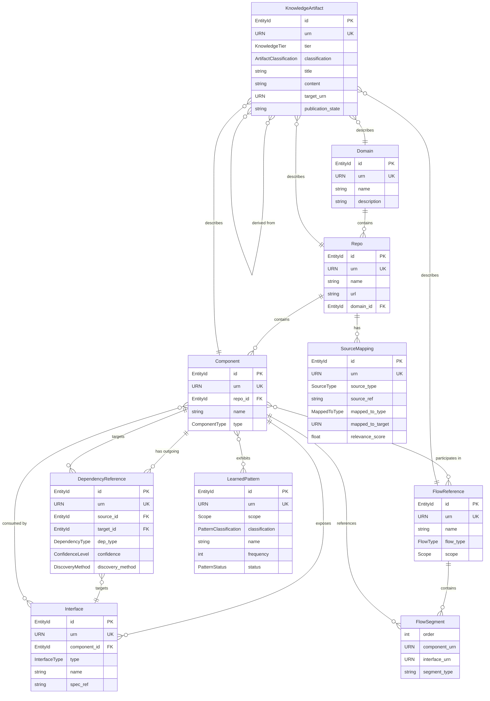

# S1 -- Knowledge Model Specification

**Spec ID:** S1
**Subsystem:** S1 -- Knowledge Model
**Status:** Draft

---

## 1. Purpose and Scope

The Knowledge Model is the core data model of the entire Bifrost system. Every other subsystem -- source adapters, freshness tracking, storage, orchestration, query, documentation generation -- reads from or writes to structures defined here.

Knowledge entities are stored in two complementary layers: PostgreSQL (structured graph, queryable) and AgentStateBackend (text documents for agent context loading, path-organized). This spec defines both layers.

This specification defines:

- The canonical entity types that represent engineering knowledge
- The relationships between those entities
- The metadata envelope that every knowledge artifact carries
- The knowledge tier system that distinguishes raw mappings from derived insight
- The versioning, query, indexing, and lifecycle models
- The composition rules that allow repo-level knowledge to roll up into domain and org views
- The storage layer mapping for each entity type (PostgreSQL vs AgentStateBackend)

This specification does NOT define:

- How knowledge is extracted (that is the Source Adapter spec, S2)
- How freshness is computed (that is the Freshness spec, S3)
- How knowledge is persisted on disk (that is the Storage spec, S4)
- How agents interact with knowledge (that is the Orchestration spec)

---

## 2. Glossary References

This specification uses terms defined in the Bifrost Glossary (doc F1). The following are load-bearing:

| Term | Definition |
|------|-----------|
| **KnowledgeArtifact** | Any stored knowledge with a metadata envelope containing source-basis, freshness, confidence, scope, and known-gaps. |
| **Knowledge Tiers** | T0 (source mappings) -> T1 (extracted facts) -> T2 (derived knowledge) -> T3 (generated artifacts). |
| **Confidence Levels** | `confirmed`, `inferred`, `stale`, `unknown`, `conflicting`. |
| **Scopes** | `source-object` < `repo` < `domain` < `org`. Hierarchical, composable. |
| **URN** | Uniform Resource Name. Bifrost-internal identifier for cross-repo entities. Format: `bifrost:{scope}:{type}:{id}`. |
| **Source Mapping** | A T0 artifact that records where authoritative truth lives for a given concept, repo, domain, or flow. |
| **Metadata Envelope** | The standard set of quality fields every KnowledgeArtifact carries. |

---

## 3. Requirements Traceability

### From S5 -- Scope Requirements

| Requirement | Coverage |
|---|---|
| S5.1 Repo-level: modules, interfaces, flows, dependencies, sources, patterns, freshness | Repo, Component, Interface, FlowReference, DependencyReference, SourceMapping, LearnedPattern entities |
| S5.2 Domain-level: repo membership, cross-repo flows, shared patterns, migrations, cross-repo deps | Domain entity with repos[], cross-repo FlowReference, DependencyReference with cross-repo scope |
| S5.3 Org-level: domain connections, platform deps, global patterns, risk surfaces | Scope hierarchy (repo < domain < org), Cross-Scope Composition (S13) |

### From S7 -- Knowledge Requirements

| Requirement | Coverage |
|---|---|
| S7.1 Broad mappings | T0 tier, SourceMapping entity |
| S7.1 Lightweight extracted knowledge | T1 tier, Component/Interface/FlowReference/DependencyReference entities |
| S7.1 Generated human docs | T3 tier, KnowledgeArtifact with tier=3 |
| S7.1 Learned local patterns | LearnedPattern entity |
| S7.1 Task and decision history | KnowledgeArtifact with appropriate classification (out of V1 scope for full history) |
| S7.2 Every artifact carries source basis, freshness, confidence, gaps, scope, relationships | MetadataEnvelope on every KnowledgeArtifact |
| S7.3 Broad lightweight + deeper curated + graceful degradation | Tier system: T0 everywhere, T1/T2/T3 where warranted |

---

## 4. Design Goals and Non-Goals

### Goals

1. **Source-grounded**: Every fact traces back to one or more source references. No orphan knowledge.
2. **Confidence-aware**: Every artifact carries explicit confidence. Consumers never guess whether something is confirmed or inferred.
3. **Composable**: Repo-level knowledge composes into domain views; domain views compose into org views. The model supports this without duplication.
4. **Evolvable**: New entity types, relationship types, and metadata fields can be added without breaking existing data. Schema evolution is a first-class concern.
5. **Query-efficient**: The model supports the query patterns in section 10 with bounded cost. Common queries do not require full graph traversal.
6. **Tier-separated**: T0/T1 (close to source) and T2/T3 (derived/generated) have different write patterns, validation rules, and staleness characteristics. The model makes this explicit.

### Non-Goals

1. **Not a source-of-truth for raw content**: Bifrost stores extracted knowledge and references, not full copies of source files, tickets, or logs.
2. **Not a general-purpose graph database**: The model is a labeled property graph with specific types and constraints, not an open-ended triple store.
3. **Not a runtime observability platform**: Runtime observations are ingested as source evidence, not stored as time-series data.
4. **Not a documentation CMS**: T3 generated docs are stored as artifacts with metadata, not as a full publishing pipeline.

---

## 5. Entity Schema

All entities use Python/Pydantic v2 class definitions. Every entity that represents stored knowledge extends `KnowledgeArtifact`. Infrastructure entities (Repo, Domain) carry metadata but are not themselves tiered knowledge artifacts -- they are the scaffolding that knowledge attaches to.

### 5.1 Common Types

```python
from __future__ import annotations
from datetime import datetime
from enum import Enum
from typing import Literal, NewType
from uuid import UUID
from pydantic import BaseModel, Field

# Bifrost-internal identifier. Format: bifrost:{scope}:{type}:{id}
URN = NewType("URN", str)

# ISO-8601 timestamp
Timestamp = NewType("Timestamp", datetime)

# Unique identifier (UUID v7 for time-ordering)
EntityId = NewType("EntityId", UUID)

Scope = Literal["source-object", "repo", "domain", "org"]

# ConfidenceLevel — canonical definition is in S3 (freshness-confidence.md)
# Values: 'confirmed' | 'inferred' | 'stale' | 'uncertain' | 'unknown' | 'conflicting'
# Do NOT redefine here.
# Numeric scores (0.0–1.0) are stored in PostgreSQL as supplementary signals for ranking
# but the enum is the primary user-facing representation. See S3 for canonical semantics
# and score thresholds.

KnowledgeTier = Literal[0, 1, 2, 3]


class FreshnessInfo(BaseModel):
    indexed_at: Timestamp
    source_revision: str | None
    last_checked_at: datetime  # ISO timestamp of most recent freshness validation
    lag_indicator: Literal["current", "slightly-behind", "stale", "critically-stale", "unknown"]
    # human-readable freshness bucket, synced from repo_freshness table


class ConfidenceInfo(BaseModel):
    level: ConfidenceLevel  # from S3
    score: float = Field(ge=0.0, le=1.0)  # 0.0 - 1.0
    basis: str  # human-readable explanation of why this confidence


class MetadataEnvelope(BaseModel):
    source_basis: list[SourceReference]
    freshness: FreshnessInfo
    confidence: ConfidenceInfo
    scope: Scope
    known_gaps: list[KnownGap]
    relationships: list[RelationshipRef]


class SourceReference(BaseModel):
    source_type: str  # e.g. 'git', 'jira', 'confluence', 'api-spec'
    source_ref: str   # URI or identifier within the source system
    relevance: float = Field(ge=0.0, le=1.0)
    last_checked: Timestamp


class KnownGap(BaseModel):
    description: str
    severity: Literal["critical", "moderate", "minor"]
    suggested_source: str | None


class RelationshipRef(BaseModel):
    target_urn: URN
    relationship_type: str
    direction: Literal["outgoing", "incoming"]
```

### 5.2 Repo

Repos are top-level organizational containers. They are not tiered knowledge artifacts themselves but carry freshness state and serve as the primary anchor for all repo-scoped knowledge.

```python
class RepoFreshnessState(BaseModel):
    latest_remote_revision: str | None = None
    latest_indexed_revision: str | None = None
    latest_derived_at: Timestamp | None = None
    latest_doc_refresh_at: Timestamp | None = None
    lag_seconds: int | None = None  # computed: remote vs indexed


class Repo(BaseModel):
    id: EntityId
    urn: URN  # bifrost:org:repo:{id}
    name: str
    url: str  # remote git URL or equivalent
    domain_id: EntityId | None = None  # FK to Domain
    description: str | None = None
    source_mappings: list[EntityId] = Field(default_factory=list)  # FK[] to SourceMapping
    freshness_state: RepoFreshnessState
    created_at: Timestamp
    updated_at: Timestamp
```

| Attribute | Type | Required | Description |
|-----------|------|----------|-------------|
| id | EntityId | yes | Primary key (UUID v7) |
| urn | URN | yes | Globally unique Bifrost URN |
| name | string | yes | Human-readable repo name |
| url | string | yes | Remote URL for the repository |
| domain_id | EntityId | no | Parent domain, if assigned |
| description | string | no | Brief purpose description |
| source_mappings | EntityId[] | yes | Connected source mappings (may be empty) |
| freshness_state | RepoFreshnessState | yes | Current freshness tracking |
| created_at | Timestamp | yes | When Bifrost first indexed this repo |
| updated_at | Timestamp | yes | Last mutation timestamp |

### 5.3 Domain

Domains group repos that work together to serve a business or technical area.

```python
class Domain(BaseModel):
    id: EntityId
    urn: URN  # bifrost:org:domain:{id}
    name: str
    repos: list[EntityId] = Field(default_factory=list)  # FK[] to Repo
    description: str | None = None
    cross_repo_flows: list[EntityId] = Field(default_factory=list)  # FK[] to FlowReference with scope >= domain
    created_at: Timestamp
    updated_at: Timestamp
```

| Attribute | Type | Required | Description |
|-----------|------|----------|-------------|
| id | EntityId | yes | Primary key |
| urn | URN | yes | Globally unique Bifrost URN |
| name | string | yes | Human-readable domain name |
| repos | EntityId[] | yes | Repos belonging to this domain |
| description | string | no | Purpose and boundaries of this domain |
| cross_repo_flows | EntityId[] | yes | Flows that span multiple repos within the domain |
| created_at | Timestamp | yes | Creation timestamp |
| updated_at | Timestamp | yes | Last mutation timestamp |

### 5.4 Component

A component is a meaningful structural unit within a repo: a module, service, library, or package.

```python
ComponentType = Literal["module", "service", "library", "package"]


class Component(BaseModel):
    id: EntityId
    urn: URN  # bifrost:repo:{repo_id}:component:{id}
    repo_id: EntityId  # FK to Repo
    name: str
    type: ComponentType
    interfaces: list[EntityId] = Field(default_factory=list)  # FK[] to Interface
    dependencies: list[EntityId] = Field(default_factory=list)  # FK[] to DependencyReference
    metadata: MetadataEnvelope
    created_at: Timestamp
    updated_at: Timestamp
```

| Attribute | Type | Required | Description |
|-----------|------|----------|-------------|
| id | EntityId | yes | Primary key |
| urn | URN | yes | Scoped URN within repo |
| repo_id | EntityId | yes | Parent repo |
| name | string | yes | Component name |
| type | ComponentType | yes | Structural classification |
| interfaces | EntityId[] | yes | Exposed interfaces (may be empty) |
| dependencies | EntityId[] | yes | Outgoing dependency references |
| metadata | MetadataEnvelope | yes | Source basis, confidence, freshness |
| created_at | Timestamp | yes | Creation timestamp |
| updated_at | Timestamp | yes | Last mutation timestamp |

#### AgentStateBackend Text Document (Component)

Path: `/repo/{repo-id}/components/{component-name}.md`

(Track A: PostgreSQL `knowledge_text_cache` at this path. Track B: Anthropic Memory Store at `/repo/{id}/components/{name}`.)

Example content:

```
---
entity_type: component
entity_id: {uuid}
confidence: confirmed
freshness: fresh
source_revision: abc123def
updated_at: 2025-01-15T10:00:00Z
---

# OrderService

**Type:** service
**Language:** TypeScript
**Files:** src/services/OrderService.ts, src/services/OrderService.test.ts

## Purpose
Handles order processing including placement, cancellation, and amendment workflows.
Integrates with a carrier API and the internal inventory service.

## Public Interfaces
- placeOrder(items: OrderItem[], method: ShippingMethod): Promise<OrderResult>
- cancelOrder(orderId: string, reason?: string): Promise<CancelResult>
- getOrderHistory(userId: string, options: PaginationOptions): Promise<Order[]>

## Key Dependencies
- carrier-sdk (external, confirmed)
- InventoryService (internal, confirmed)
- NotificationService (internal, inferred)

## Known Gaps
- Async dispute webhook handling not fully traced
- Integration with fraud detection service not confirmed
```

### 5.5 Interface

An interface is a contract surface exposed by a component: an API endpoint, event topic, schema definition, or configuration contract.

```python
InterfaceType = Literal["api", "event", "schema", "config"]


class Interface(BaseModel):
    id: EntityId
    urn: URN  # bifrost:repo:{repo_id}:interface:{id}
    component_id: EntityId  # FK to Component
    type: InterfaceType
    name: str
    spec_ref: str | None = None  # pointer to OpenAPI spec, protobuf, Avro schema, etc.
    consumers: list[EntityId] = Field(default_factory=list)  # FK[] to Component (cross-repo via URN)
    metadata: MetadataEnvelope
    created_at: Timestamp
    updated_at: Timestamp
```

| Attribute | Type | Required | Description |
|-----------|------|----------|-------------|
| id | EntityId | yes | Primary key |
| urn | URN | yes | Scoped URN |
| component_id | EntityId | yes | Owning component |
| type | InterfaceType | yes | Contract type |
| name | string | yes | Interface name |
| spec_ref | string | no | External spec reference (URL or path) |
| consumers | EntityId[] | yes | Known consumers (may be empty or incomplete) |
| metadata | MetadataEnvelope | yes | Source basis, confidence, freshness |
| created_at | Timestamp | yes | Creation timestamp |
| updated_at | Timestamp | yes | Last mutation timestamp |

### 5.6 FlowReference

A flow reference models an end-to-end path through the system. Flows are first-class objects (req S9.1). A flow is composed of ordered segments, each of which references a component or interface.

```python
FlowType = Literal[
    "request-response",
    "event-driven",
    "batch",
    "saga",
    "pipeline",
    "mixed",
]

SegmentType = Literal[
    "sync-call", "async-message", "db-read", "db-write",
    "cache-read", "cache-write", "external-api",
]


class FlowSegment(BaseModel):
    order: int
    component_urn: URN  # component participating in this segment
    interface_urn: URN | None = None  # interface used, if known
    repo_id: EntityId
    description: str | None = None
    segment_type: SegmentType


class FlowReference(BaseModel):
    id: EntityId
    urn: URN  # bifrost:{scope}:flow:{id}
    name: str
    flow_type: FlowType
    segments: list[FlowSegment]
    scope: Scope  # repo | domain | org
    source_basis: list[SourceReference]  # direct field, also in metadata
    metadata: MetadataEnvelope
    created_at: Timestamp
    updated_at: Timestamp
```

| Attribute | Type | Required | Description |
|-----------|------|----------|-------------|
| id | EntityId | yes | Primary key |
| urn | URN | yes | Scoped URN |
| name | string | yes | Human-readable flow name |
| flow_type | FlowType | yes | Classification of the flow |
| segments | FlowSegment[] | yes | Ordered list of participating components/interfaces |
| scope | Scope | yes | Broadest scope this flow spans |
| source_basis | SourceReference[] | yes | Sources that evidence this flow |
| metadata | MetadataEnvelope | yes | Full metadata envelope |
| created_at | Timestamp | yes | Creation timestamp |
| updated_at | Timestamp | yes | Last mutation timestamp |

#### AgentStateBackend Text Document (Flow)

Path: `/repo/{repo-id}/flows/{flow-id}.md`

(Track A: PostgreSQL `knowledge_text_cache` at this path. Track B: Anthropic Memory Store at `/repo/{id}/flows/{flow-id}`.)

Example content:

```
---
entity_type: flow
entity_id: {uuid}
confidence: inferred
freshness: stale
source_revision: abc123def
updated_at: 2025-01-15T10:00:00Z
stale_reason: 3 commits since last index
---

# Checkout Flow

**Scope:** cross-repo (orders, cart, notifications)
**Entry point:** POST /api/v2/checkout

## Segments
1. cart-service: validate cart contents (confirmed)
2. orders-service: place order (confirmed)
3. inventory-service: decrement stock (confirmed, async)
4. notifications-service: send confirmation email (confirmed, async)
5. analytics-service: track conversion event (inferred, fire-and-forget)

## Known Gaps
- Error recovery path between step 2 failure and step 3 rollback not confirmed
- Analytics failure behavior unknown (silent? blocking?)
```

### 5.7 DependencyReference

A dependency reference records a typed, directional dependency between two entities. Nine dependency types are supported per req S10.2.

```python
DependencyType = Literal[
    "code", "api", "schema", "config", "event",
    "runtime", "ownership", "migration", "inferred-hidden",
]

DiscoveryMethod = Literal[
    "static-analysis", "spec-parsing", "runtime-observation",
    "manual", "inferred",
]


class DependencyReference(BaseModel):
    id: EntityId
    urn: URN
    source_id: EntityId  # FK to Component, Interface, or Repo
    source_urn: URN
    target_id: EntityId  # FK to Component, Interface, or Repo
    target_urn: URN
    dep_type: DependencyType
    confidence: ConfidenceLevel
    discovery_method: DiscoveryMethod
    metadata: MetadataEnvelope
    created_at: Timestamp
    updated_at: Timestamp
```

| Attribute | Type | Required | Description |
|-----------|------|----------|-------------|
| id | EntityId | yes | Primary key |
| urn | URN | yes | Unique identifier |
| source_id | EntityId | yes | Entity that depends |
| source_urn | URN | yes | URN of the depending entity |
| target_id | EntityId | yes | Entity depended upon |
| target_urn | URN | yes | URN of the depended-upon entity |
| dep_type | DependencyType | yes | One of nine dependency types |
| confidence | ConfidenceLevel | yes | How certain we are this dependency exists |
| discovery_method | DiscoveryMethod | yes | How this dependency was found |
| metadata | MetadataEnvelope | yes | Full metadata envelope |
| created_at | Timestamp | yes | Creation timestamp |
| updated_at | Timestamp | yes | Last mutation timestamp |

#### AgentStateBackend Text Document (Dependency)

Path: `/repo/{repo-id}/dependencies/{dep-id}.md`

(Track A: PostgreSQL `knowledge_text_cache` at this path. Track B: Anthropic Memory Store at `/repo/{id}/dependencies/{dep-id}`.)

Key fields surfaced in document:

```
from: {source_urn}
to: {target_urn}
type: {dep_type}        # e.g. api, code, event
confidence: {level}    # confirmed | inferred | stale | unknown | conflicting
freshness: {state}     # fresh | stale
discovery_method: {method}
```

#### Memory Store Entity Pagination

Problem: A repo with 200 components would generate ~200 × 2KB = 400KB of component documents. Memory Store has a 100KB per-document limit.

Solution: Paginate entity collections using a manifest + page pattern:

Manifest path: `/repo/{id}/components/manifest.md`

```markdown
---
total_count: 200
page_count: 4
pages:
  - path: /repo/{id}/components/page-001.md
    count: 50
    created_at: 2025-01-15T10:00:00Z
  - path: /repo/{id}/components/page-002.md
    count: 50
    ...
---
```

Page documents: `/repo/{id}/components/page-{N}.md` — contains up to 50 entity serializations per page, total ≤ 90KB.

Reading convention: agents always read manifest first, then fetch pages as needed. Agents MUST NOT assume all entities fit in a single document.

#### Memory Store Version Tracking

Every write to Memory Store returns a version token (opaque string). Any code that reads then writes a document must use optimistic concurrency:

```python
class VersionedDocument(BaseModel):
    content: str
    version: str  # opaque token from last write, must be echoed on next write


# AgentStateBackend write signature (Track B):
# async def write(self, path: str, content: str, expected_version: str | None = None) -> VersionedDocument:
#     ...  # If expected_version is provided and doesn't match current version: raises ConflictError
```

For entity writes during extraction: use `expectedVersion` to prevent two concurrent sessions from both writing component page-001 simultaneously (last-write-wins without this would silently lose data).

### 5.8 SourceMapping

Source mappings are T0 knowledge: broad, lightweight pointers to where authoritative truth lives. They are the foundation layer that all higher tiers build on.

```python
SourceType = Literal[
    "git-repo", "git-branch", "git-file", "git-commit-range",
    "jira-project", "jira-issue", "confluence-page",
    "api-spec", "schema-registry", "k8s-manifest",
    "ci-pipeline", "slack-channel", "service-catalog", "custom",
]

MappedToType = Literal["repo", "domain", "concept", "flow", "component", "interface"]


class MappedTo(BaseModel):
    type: MappedToType
    target_urn: URN


class SourceMapping(BaseModel):
    id: EntityId
    urn: URN
    source_type: SourceType
    source_ref: str  # URI identifying the source object
    mapped_to: MappedTo
    relevance_score: float = Field(ge=0.0, le=1.0)
    metadata: MetadataEnvelope
    created_at: Timestamp
    updated_at: Timestamp
```

| Attribute | Type | Required | Description |
|-----------|------|----------|-------------|
| id | EntityId | yes | Primary key |
| urn | URN | yes | Unique identifier |
| source_type | SourceType | yes | Classification of the source system |
| source_ref | string | yes | URI or identifier within the source system |
| mapped_to | object | yes | What Bifrost concept this source maps to |
| relevance_score | number | yes | How relevant this source is (0.0 to 1.0) |
| metadata | MetadataEnvelope | yes | Full metadata envelope |
| created_at | Timestamp | yes | Creation timestamp |
| updated_at | Timestamp | yes | Last mutation timestamp |

### 5.9 KnowledgeArtifact

The general-purpose container for any piece of stored knowledge that does not fit one of the specific entity types above. Used primarily for T2 derived syntheses and T3 generated documents.

```python
ArtifactClassification = Literal[
    "repo-overview", "domain-summary", "flow-documentation",
    "onboarding-guide", "implementation-playbook", "migration-guide",
    "dependency-analysis", "risk-assessment", "pattern-analysis",
    "decision-record", "custom",
]

ContentFormat = Literal["markdown", "json", "structured"]
PublicationState = Literal["draft", "internal", "generated", "published"]


class KnowledgeArtifact(BaseModel):
    id: EntityId
    urn: URN
    tier: KnowledgeTier  # 0 | 1 | 2 | 3
    classification: ArtifactClassification
    title: str
    content: str  # markdown for T3, structured JSON for T2
    content_format: ContentFormat
    target_urn: URN  # what entity this artifact is about
    metadata: MetadataEnvelope
    publication_state: PublicationState
    created_at: Timestamp
    updated_at: Timestamp
```

| Attribute | Type | Required | Description |
|-----------|------|----------|-------------|
| id | EntityId | yes | Primary key |
| urn | URN | yes | Unique identifier |
| tier | KnowledgeTier | yes | Which knowledge tier (0-3) |
| classification | ArtifactClassification | yes | What kind of artifact |
| title | string | yes | Human-readable title |
| content | string | yes | The artifact body |
| content_format | string | yes | Format of the content field |
| target_urn | URN | yes | The entity this artifact describes |
| metadata | MetadataEnvelope | yes | Full metadata envelope |
| publication_state | string | yes | Lifecycle state for doc publishing |
| created_at | Timestamp | yes | Creation timestamp |
| updated_at | Timestamp | yes | Last mutation timestamp |

### 5.10 LearnedPattern

Patterns discovered through repeated observation across repos or within a single repo. These are T2 artifacts with special structure.

```python
PatternClassification = Literal[
    "architectural", "implementation", "naming-convention",
    "error-handling", "testing", "deployment",
    "api-design", "data-access", "custom",
]

PatternStatus = Literal["candidate", "confirmed", "deprecated", "superseded"]


class PatternExample(BaseModel):
    location_urn: URN  # component or file where this pattern appears
    snippet_ref: str   # pointer to source, not full content
    description: str


class LearnedPattern(BaseModel):
    id: EntityId
    urn: URN
    scope: Scope  # repo | domain | org
    classification: PatternClassification
    name: str
    description: str
    frequency: int  # how many times observed
    examples: list[PatternExample]
    status: PatternStatus
    metadata: MetadataEnvelope
    created_at: Timestamp
    updated_at: Timestamp
```

| Attribute | Type | Required | Description |
|-----------|------|----------|-------------|
| id | EntityId | yes | Primary key |
| urn | URN | yes | Unique identifier |
| scope | Scope | yes | Broadest scope where this pattern applies |
| classification | PatternClassification | yes | Category of pattern |
| name | string | yes | Human-readable pattern name |
| description | string | yes | What the pattern is and when to use it |
| frequency | number | yes | Observation count |
| examples | PatternExample[] | yes | Where this pattern has been seen |
| status | PatternStatus | yes | Lifecycle state |
| metadata | MetadataEnvelope | yes | Full metadata envelope |
| created_at | Timestamp | yes | Creation timestamp |
| updated_at | Timestamp | yes | Last mutation timestamp |

### 5.11 GapReport

A GapReport captures a knowledge gap discovered during a query. It is a T1 entity extracted from user interactions and persisted like any other extracted fact.

```python
GapType = Literal[
    "missing-component",       # component not in knowledge store
    "missing-interface",       # interface definition absent
    "missing-flow",            # flow not traced
    "stale-dependency",        # dependency outdated
    "unknown-technology",      # tech stack not indexed
    "missing-cross-repo-link", # cross-repo relationship unknown
    "insufficient-evidence",   # entity exists but evidence too weak to answer
]

GapSeverity = Literal["blocking", "partial", "minor"]


# T1 entity: captures a knowledge gap discovered during a query
class GapReport(BaseModel):
    id: str  # bifrost:gap-report:{scope}:{id}
    entity_type: Literal["gap_report"] = "gap_report"

    discovered_during: str  # task_id that discovered this gap
    scope: AgentScope       # which repo/domain was queried
    query_summary: str      # brief description of what was being asked
    missing_knowledge: str  # what knowledge was needed but absent
    gap_type: GapType
    severity: GapSeverity
    suggested_action: str   # e.g., "Extract from orders-service/src/processor.ts"

    metadata: MetadataEnvelope
```

**Storage:** PostgreSQL (`gap_reports` table) + AgentStateBackend at `/repo/{id}/gaps/{gap-id}.md`. Written exclusively by the TaskCoordinator (not RepoAgents); no concurrent write concern applies.

### 5.12 Correction

A Correction records a correction to existing knowledge, reported by a user, agent, or validation stage.

```python
CorrectionType = Literal[
    "wrong-component-purpose",
    "wrong-interface-type",
    "wrong-dependency",
    "stale-flow",
    "wrong-confidence",
    "hallucinated-entity",
]

ReportedBy = Literal["user", "agent", "validation_stage"]


# T1 entity: a correction to existing knowledge
class Correction(BaseModel):
    id: str  # bifrost:correction:{scope}:{id}
    entity_type: Literal["correction"] = "correction"

    target_entity_id: str  # ID of the entity being corrected
    correction_type: CorrectionType
    original_value: Any    # the wrong value
    corrected_value: Any   # the right value
    reported_by: ReportedBy
    confidence: ConfidenceLevel  # confidence in this correction
    evidence: str  # explanation of why this is correct

    metadata: MetadataEnvelope
```

**Storage:** PostgreSQL (`corrections` table) + AgentStateBackend at `/repo/{id}/corrections/{correction-id}.md`. Written exclusively by the TaskCoordinator (not RepoAgents); no concurrent write concern applies.

### §5.13 MigrationState

Tracks the status of in-flight or recently completed system migrations (database schema upgrades, API version changes, deployment rollouts, data backfills). Referenced by the architect and on-call personas.

```python
MigrationType = Literal["database", "config", "deployment", "api-version", "data"]
MigrationStatus = Literal["pending", "in_progress", "complete", "failed", "rolled_back"]


class MigrationState(BaseModel):
    id: str  # URN: bifrost:org:migration:{id}
    migration_name: str  # e.g., "postgres_v2_schema_upgrade"
    migration_type: MigrationType
    status: MigrationStatus
    affected_components: list[EntityRef]  # Components being migrated
    started_at: datetime | None = None    # ISO 8601 timestamp
    completed_at: datetime | None = None
    target_state: str  # Human-readable description of post-migration state
    rollback_plan: str | None = None  # Brief rollback procedure
    confidence: ConfidenceLevel  # how certain we are about this state
    evidence: list[EvidenceRef]  # source references (commit hashes, PR links, Jira tickets)
    metadata: MetadataEnvelope
```

**Knowledge tier:** T1 (structured entity, extracted from PRs, commit messages, Jira migration tickets, and deployment configs)
**Source authority:** Git PRs and Jira tickets (confirmed); commit messages (inferred)
**AgentStateBackend path (Track B):** `/repo/{id}/migrations/{migration_id}.md`
**V1 scope:** Extracted from PR descriptions and commit messages that mention "migration", "schema change", "rollout", "deploy". Not extracted from runtime telemetry (V2).

---

## 6. Relationship Schema

All relationships are typed, directed edges in a labeled property graph. The table below defines every valid relationship type, its source/target entity constraints, and cardinality.

| Relationship Type | Source Entity | Target Entity | Cardinality | Description |
|---|---|---|---|---|
| `belongs_to_domain` | Repo | Domain | N:1 | A repo belongs to at most one domain |
| `contains_component` | Repo | Component | 1:N | A repo contains many components |
| `exposes_interface` | Component | Interface | 1:N | A component exposes many interfaces |
| `consumes_interface` | Component | Interface | N:M | Many components can consume many interfaces |
| `has_dependency` | Component | DependencyReference | 1:N | A component has many outgoing dependencies |
| `is_depended_on_by` | Component | DependencyReference | 1:N | A component is the target of many dependencies |
| `participates_in_flow` | Component | FlowReference | N:M | Components participate in many flows |
| `has_source_mapping` | Repo / Domain / Component / Interface | SourceMapping | 1:N | Any entity can have source mappings |
| `described_by_artifact` | Repo / Domain / Component / FlowReference | KnowledgeArtifact | 1:N | Any major entity can have knowledge artifacts |
| `exhibits_pattern` | Repo / Domain / Component | LearnedPattern | N:M | Entities exhibit patterns; patterns span entities |
| `flow_contains_segment` | FlowReference | Component | 1:N (ordered) | A flow contains ordered component references |
| `dep_source` | DependencyReference | Component / Interface / Repo | N:1 | The entity that depends |
| `dep_target` | DependencyReference | Component / Interface / Repo | N:1 | The entity depended upon |
| `derived_from` | KnowledgeArtifact (T2/T3) | KnowledgeArtifact (T0/T1) | N:M | Higher-tier artifacts trace to lower-tier sources |
| `cross_repo_link` | Component / Interface | Component / Interface | N:M | Cross-repo entity references via URN |

---

## 7. Metadata Envelope

Every knowledge-bearing entity in Bifrost carries a `MetadataEnvelope`. This is the mechanism that makes confidence, freshness, and traceability explicit throughout the system (req S7.2, S16.1).

```python
class MetadataEnvelope(BaseModel):
    """Full metadata envelope — see §5.1 for field types."""

    # Sources that back this knowledge. Never empty for confirmed facts.
    source_basis: list[SourceReference]

    # When this knowledge was last indexed and what source revision it reflects.
    freshness: FreshnessInfo

    # How confident we are in this knowledge.
    confidence: ConfidenceInfo

    # The broadest scope at which this knowledge is valid.
    scope: Scope

    # What we know we do not know.
    known_gaps: list[KnownGap]

    # Links to related knowledge artifacts.
    relationships: list[RelationshipRef]
```

### Confidence Score Interpretation

| Score Range | Typical Level | Meaning |
|---|---|---|
| 0.9 -- 1.0 | confirmed | Directly extracted from authoritative source, recently verified |
| 0.7 -- 0.89 | confirmed / inferred | Strong evidence, minor staleness or inference gap |
| 0.5 -- 0.69 | inferred | Reasonable inference from multiple supporting sources |
| 0.3 -- 0.49 | stale / inferred | Weak evidence or known staleness |
| 0.1 -- 0.29 | unknown | Minimal evidence, placeholder knowledge |
| 0.0 -- 0.09 | conflicting | Contradictory sources, requires resolution |

### Staleness Rules

When the Freshness subsystem (S3) detects that a source has changed since `indexed_at`:

1. The confidence level is downgraded to `stale`
2. The confidence score is reduced by a configurable decay factor
3. A known gap is added: `{ description: "Source changed since last index", severity: "moderate" }`
4. The entity is flagged for re-indexing

---

## 8. Knowledge Tiers

The tier system is the backbone of Bifrost's approach to balancing breadth with depth. Lower tiers are cheap and broad; higher tiers are expensive and curated.

### T0: Source Mappings

**Purpose:** Record where truth lives, not what it says.

- **Entities:** SourceMapping
- **Write pattern:** Created by source adapters during discovery sweeps
- **Validation:** Schema-on-write. Must have valid source_type, source_ref, mapped_to
- **Freshness:** Checked against source system revision/timestamp
- **Cost:** Very low. A T0 mapping is a few hundred bytes.
- **Coverage goal:** Every known source object for every connected repo
- **Storage:** PostgreSQL only. Simple lookup tables; no text document representation needed. High-frequency keyed lookups do not benefit from agent-readable document format.

**Example:** "The OpenAPI spec for the orders service lives at `git://orders-repo/api/openapi.yaml` and maps to the `orders-api` interface."

### T1: Extracted Facts

**Purpose:** Structured facts pulled from sources -- entities, relationships, hints.

- **Entities:** Component, Interface, FlowReference (partial), DependencyReference, LearnedPattern (candidate), GapReport, Correction
- **Write pattern:** Created by source adapters and extraction agents analyzing source content. GapReport and Correction are created from user interactions during query time — they are a source like any other.
- **Validation:** Schema-on-write. Must reference valid T0 source mappings in metadata.source_basis
- **Freshness:** Tied to source_revision in metadata; invalidated when source changes
- **Cost:** Moderate. Requires source content analysis.
- **Coverage goal:** All repos actively managed; depth varies by importance
- **Storage:** PostgreSQL (entity tables with typed fields) + AgentStateBackend (text documents per entity). Paths: `/repo/{id}/components/{name}.md`, `/repo/{id}/flows/{flow-id}.md`, `/repo/{id}/dependencies/{dep-id}.md`, `/repo/{id}/gaps/{gap-id}.md`, `/repo/{id}/corrections/{correction-id}.md`. See entity schema sections above for document format details.

**Example:** "The orders-repo contains an `OrderProcessor` component (module) that exposes a `placeOrder` API interface and depends on the `inventory-service` via an API dependency."

### T2: Derived Knowledge

**Purpose:** Synthesized understanding built from T1 facts -- flow models, dependency graphs, pattern classifications, risk assessments.

- **Entities:** FlowReference (complete), DependencyReference (transitive/inferred), LearnedPattern (confirmed), KnowledgeArtifact (tier=2)
- **Write pattern:** Created by analysis agents composing T1 facts
- **Validation:** Schema-on-read. Structure varies by classification. Must trace to T1 sources via `derived_from` relationships.
- **Freshness:** Invalidated when any contributing T1 fact is invalidated
- **Cost:** Higher. Requires cross-entity reasoning.
- **Coverage goal:** High-value areas: critical flows, important domains, frequently-queried repos
- **Storage:** PostgreSQL (derived entity tables) + AgentStateBackend (domain synthesis documents). Path: `/domain/{id}/synthesis.md`. The synthesis document provides a single loadable context for agents reasoning about a domain.

**Example:** "The order-to-delivery end-to-end flow traverses 4 repos, involves 7 components, has 2 async hops, and has a hidden dependency on the carrier-gateway that is only visible at runtime."

### T3: Generated Artifacts

**Purpose:** Human-readable documents and playbooks produced from T2 knowledge.

- **Entities:** KnowledgeArtifact (tier=3)
- **Write pattern:** Created by documentation agents from T2 knowledge
- **Validation:** Schema-on-read. Content is markdown. Must reference T2 sources.
- **Freshness:** Stale when any contributing T2 knowledge is invalidated. Publication state tracked separately.
- **Cost:** Highest. Requires generation, review, and sometimes human approval.
- **Coverage goal:** Explicitly requested or high-value surfaces only (req S8.2)
- **Storage:** AgentStateBackend primary (path: `/docs/{type}/{target}.md`). PostgreSQL tracks metadata only: path, version, status, publication state. The document body lives in AgentStateBackend; PostgreSQL holds the envelope for querying and lifecycle management.

**Example:** "Onboarding guide for the Orders domain, generated from T2 flow models and dependency graphs, last refreshed 2 days ago, currently reflects source state as of commit `abc123`."

### Tier Dependency Chain

```
T0 (Source Mappings)
 |
 v
T1 (Extracted Facts)  -- invalidation propagates upward
 |
 v
T2 (Derived Knowledge)
 |
 v
T3 (Generated Artifacts)
```

When a T0 mapping is invalidated, all T1 facts that depend on it are marked stale. When T1 facts are stale, all T2 derived knowledge that references them is marked stale. When T2 is stale, all T3 artifacts that were generated from it are marked stale.

### Source Authority Configuration

For each fact type, operators can configure which source adapters are most authoritative. This affects confidence computation: a fact extracted from a higher-authority source gets a higher base confidence than the same fact from a lower-authority source.

**Configuration structure:**

```python
# Stored in agent_configs table, scope: 'org'
FactType = Literal["component", "interface", "flow", "dependency", "convention"]
AdapterName = Literal["git", "jira", "confluence", "github-pr"]
AuthorityLevel = Literal["primary", "secondary", "supplemental"]


class AuthorityRanking(BaseModel):
    adapter: AdapterName
    authority: AuthorityLevel


class SourceAuthorityConfig(BaseModel):
    fact_type: FactType
    rankings: list[AuthorityRanking]


# Default configuration (V1)
DEFAULT_AUTHORITY: list[SourceAuthorityConfig] = [
    SourceAuthorityConfig(fact_type="component",  rankings=[AuthorityRanking(adapter="git", authority="primary")]),
    SourceAuthorityConfig(fact_type="interface",   rankings=[AuthorityRanking(adapter="git", authority="primary"), AuthorityRanking(adapter="github-pr", authority="secondary")]),
    SourceAuthorityConfig(fact_type="flow",        rankings=[AuthorityRanking(adapter="git", authority="primary"), AuthorityRanking(adapter="confluence", authority="secondary")]),
    SourceAuthorityConfig(fact_type="dependency",  rankings=[AuthorityRanking(adapter="git", authority="primary")]),
    SourceAuthorityConfig(fact_type="convention",  rankings=[AuthorityRanking(adapter="confluence", authority="primary"), AuthorityRanking(adapter="git", authority="secondary")]),
]
```

**Effect on confidence:**

| Authority level | Confidence modifier |
|----------------|-------------------|
| primary | Base confidence as-is |
| secondary | Base confidence × 0.90 |
| supplemental | Base confidence × 0.75 |

**Conflict resolution:** When two sources disagree on the same fact, the higher-authority source wins unless both are `primary` (in which case confidence is set to `conflicting`). See S3 for full conflict resolution.

---

## 9. Versioning Model

### Append-Only Event Log

All mutations to the knowledge model are recorded as immutable events in an append-only log. The current state of any entity is a projection (fold) over its event history.

```python
EventType = Literal[
    "entity_created", "entity_updated", "entity_invalidated",
    "entity_refreshed", "entity_archived",
    "relationship_added", "relationship_removed",
    "confidence_changed", "freshness_changed",
]


class KnowledgeEvent(BaseModel):
    event_id: EntityId  # UUID v7, time-ordered
    event_type: EventType
    entity_urn: URN     # the entity affected
    timestamp: Timestamp
    actor: str          # agent ID, user ID, or system
    payload: dict[str, Any]  # event-type-specific data
    causation_id: EntityId | None = None  # what event caused this one
    correlation_id: EntityId | None = None  # task or pipeline this belongs to
```

### Current State Projection

The current state of any entity is computed by replaying its events in order. In practice, a materialized view is maintained and updated incrementally on each new event. The event log is the source of truth; the materialized view is a performance optimization.

### Schema Evolution Strategy

1. **Additive changes** (new optional fields, new entity types): Deploy new code, backfill if needed. No migration required.
2. **Type changes** (field type modification): Dual-write during transition period, then migrate.
3. **Breaking changes** (field removal, semantic change): New event version with explicit migration function. Old events are never modified.
4. **Entity type additions**: Register new entity type in schema registry. Existing events and entities are unaffected.

---

## 10. Query Model

The knowledge model must support these query patterns efficiently. Each pattern maps to one or more requirements from S5, S7, S9, S10.

| Query Pattern | Description | Primary Entities | Req |
|---|---|---|---|
| **by-repo** | All knowledge for a given repo: components, interfaces, flows, deps, artifacts | Repo -> Component, Interface, FlowReference, DependencyReference, KnowledgeArtifact | S5.1 |
| **by-domain** | All repos, cross-repo flows, shared patterns, domain-level artifacts | Domain -> Repo[], FlowReference, LearnedPattern, KnowledgeArtifact | S5.2 |
| **by-flow** | Trace a flow end-to-end: all segments, participating components, repos, deps | FlowReference -> FlowSegment[] -> Component, Repo | S9.3 |
| **by-concept** | Find all entities related to a keyword or concept | SourceMapping (mapped_to concept), full-text search on names/descriptions | S3.1 |
| **by-dependency** | Direct and transitive dependencies of a given entity, with confidence | DependencyReference graph traversal from source entity | S10.3 |
| **by-staleness** | All entities where freshness.indexed_at is older than threshold or confidence is stale | Scan on freshness.indexed_at, filter confidence.level = 'stale' | S12.1 |
| **by-confidence-below-threshold** | All entities where confidence.score < threshold | Scan on confidence.score | S16.1 |
| **by-source-mapping** | What Bifrost entities does a given source object map to | SourceMapping filtered by source_ref | S6.4 |
| **blast-radius** | Given an entity, find all direct and indirect dependents | Reverse DependencyReference traversal + flow participation | S10.3 |
| **similar-implementation** | Given a component or pattern, find similar ones | LearnedPattern matching, component attribute similarity | S11.1 |

---

## 11. Indexing Strategy

### Primary Keys

Every entity is keyed by `id` (UUID v7) and uniquely identified by `urn`.

| Index | Type | Covers |
|---|---|---|
| `pk_entity_id` | B-tree, unique | All entities by `id` |
| `uk_entity_urn` | B-tree, unique | All entities by `urn` |

### Secondary Indices

| Index | Entity | Columns | Supports Query Pattern |
|---|---|---|---|
| `idx_component_repo` | Component | `repo_id` | by-repo |
| `idx_interface_component` | Interface | `component_id` | by-repo, by-flow |
| `idx_flow_scope` | FlowReference | `scope` | by-domain, by-flow |
| `idx_dep_source` | DependencyReference | `source_id` | by-dependency |
| `idx_dep_target` | DependencyReference | `target_id` | blast-radius (reverse lookup) |
| `idx_dep_type` | DependencyReference | `dep_type` | by-dependency filtered by type |
| `idx_mapping_source_ref` | SourceMapping | `source_ref` | by-source-mapping |
| `idx_mapping_target_urn` | SourceMapping | `mapped_to.target_urn` | by-repo, by-concept |
| `idx_artifact_target` | KnowledgeArtifact | `target_urn` | described_by_artifact |
| `idx_artifact_tier` | KnowledgeArtifact | `tier` | tier-specific queries |
| `idx_freshness_indexed` | All with metadata | `metadata.freshness.indexed_at` | by-staleness |
| `idx_confidence_score` | All with metadata | `metadata.confidence.score` | by-confidence-below-threshold |
| `idx_pattern_scope` | LearnedPattern | `scope, classification` | similar-implementation |
| `idx_repo_domain` | Repo | `domain_id` | by-domain |

### Full-Text Search

A full-text index covers:

- `Repo.name`, `Repo.description`
- `Domain.name`, `Domain.description`
- `Component.name`
- `Interface.name`
- `FlowReference.name`
- `KnowledgeArtifact.title`, `KnowledgeArtifact.content`
- `LearnedPattern.name`, `LearnedPattern.description`

This supports the by-concept query pattern and general keyword search.

---

## 12. Knowledge Lifecycle

Every piece of knowledge in Bifrost follows this lifecycle:

```
Creation --> Validation --> Storage --> Query --> Invalidation --> Refresh --> Archival
                                         ^                          |
                                         |                          |
                                         +--------------------------+
                                              (re-enters Query)
```

### Stage Definitions

| Stage | Trigger | Action | Next |
|---|---|---|---|
| **Creation** | Source adapter discovers new source object, extraction agent produces new fact, analysis agent derives new knowledge | Entity created, event emitted (`entity_created`) | Validation |
| **Validation** | Creation event | Schema validation (T0/T1: schema-on-write), referential integrity check, duplicate detection | Storage (if valid), rejected (if invalid) |
| **Storage** | Validation passes | Entity persisted, indices updated, materialized views updated | Query |
| **Query** | User or agent requests knowledge | Entity returned with full metadata envelope; confidence and freshness are evaluated at read time | (no state change) |
| **Invalidation** | Freshness subsystem detects source change, upstream dependency invalidated, manual invalidation | Confidence downgraded to `stale`, known_gap added, event emitted (`entity_invalidated`), downstream dependents notified | Refresh or Archival |
| **Refresh** | Invalidation triggers re-extraction, user requests refresh, scheduled reconciliation | Entity re-created from current source state, new event emitted (`entity_refreshed`), replaces stale version | Validation |
| **Archival** | Entity no longer relevant (source removed, repo disconnected), superseded by newer version | Entity marked archived, removed from active indices, retained in event log | Terminal |

---

## 13. Cross-Scope Composition

Knowledge composes upward through the scope hierarchy: `source-object` < `repo` < `domain` < `org`.

### Repo-Level Composition

A repo's knowledge view is the union of:

- All Components where `repo_id` = this repo
- All Interfaces exposed by those components
- All DependencyReferences sourced from those components
- All FlowReferences where any segment references a component in this repo
- All SourceMappings where `mapped_to.target_urn` references this repo or its children
- All KnowledgeArtifacts where `target_urn` references this repo or its children
- All LearnedPatterns where scope = `repo` and examples reference this repo

### Domain-Level Composition

A domain's knowledge view is the union of:

- All Repos in `domain.repos`
- All repo-level knowledge for each repo (above)
- All FlowReferences with scope = `domain` (cross-repo flows)
- All DependencyReferences that cross repo boundaries within the domain
- All LearnedPatterns with scope = `domain`
- All KnowledgeArtifacts with target_urn pointing to the domain

Domain-level confidence is the minimum confidence of its constituent repo-level knowledge. Domain-level freshness is the oldest freshness of its constituent repos.

### Org-Level Composition

Org-level views follow the same pattern, composing domain views:

- All Domains
- All cross-domain FlowReferences (scope = `org`)
- All cross-domain DependencyReferences
- All LearnedPatterns with scope = `org`
- Platform-wide KnowledgeArtifacts

### Composition Rules

1. **No duplication**: Higher-scope views reference lower-scope entities by URN; they do not copy them.
2. **Confidence rolls up conservatively**: A domain's confidence in a flow is bounded by the lowest-confidence segment in that flow.
3. **Freshness rolls up conservatively**: A domain's freshness is the oldest `indexed_at` among its repos.
4. **Gaps aggregate**: Known gaps from all constituent entities are surfaced in the higher-scope view.

---

## 14. Interface Contracts

The Knowledge Model subsystem exposes the following interfaces to other Bifrost subsystems.

### CRUD Operations

| Operation | Endpoint Pattern | Description |
|---|---|---|
| Create entity | `POST /knowledge/{entity_type}` | Create a new entity. Emits `entity_created` event. |
| Read entity | `GET /knowledge/{entity_type}/{id}` | Read a single entity with full metadata. |
| Update entity | `PATCH /knowledge/{entity_type}/{id}` | Partial update. Emits `entity_updated` event. |
| Archive entity | `DELETE /knowledge/{entity_type}/{id}` | Soft-delete (archive). Emits `entity_archived` event. |
| Bulk create | `POST /knowledge/{entity_type}/bulk` | Batch create for source adapter ingestion. |

### Query Endpoints

| Endpoint | Description |
|---|---|
| `GET /knowledge/repo/{repo_id}/view` | Full repo knowledge view (composed) |
| `GET /knowledge/domain/{domain_id}/view` | Full domain knowledge view (composed) |
| `GET /knowledge/flow/{flow_id}/trace` | End-to-end flow trace with all segments |
| `GET /knowledge/entity/{urn}/dependencies` | Direct and transitive dependencies |
| `GET /knowledge/entity/{urn}/dependents` | Reverse: what depends on this entity (blast radius) |
| `GET /knowledge/search?q={query}` | Full-text concept search |
| `GET /knowledge/stale?threshold={seconds}` | All stale entities beyond threshold |
| `GET /knowledge/low-confidence?threshold={score}` | All entities below confidence threshold |

### Event Emissions

The knowledge model emits events to a message bus for consumption by other subsystems:

| Event | Consumers | Purpose |
|---|---|---|
| `entity_created` | Freshness (S3), Storage (S4) | New knowledge available |
| `entity_updated` | Freshness (S3), Storage (S4), dependent entities | Knowledge changed |
| `entity_invalidated` | Downstream entities, Doc generation | Knowledge is stale |
| `entity_refreshed` | Downstream entities, Doc generation | Stale knowledge replaced |
| `entity_archived` | Storage (S4), Freshness (S3) | Knowledge removed from active set |

---

## 15. Dependencies on Other Subsystems

| Subsystem | Dependency Direction | What It Provides |
|---|---|---|
| **Source Adapters (S2)** | S2 writes to S1 | Source discovery, T0 mappings, T1 extracted facts. S2 is the primary writer of T0 and T1 data. |
| **Freshness (S3)** | S3 reads from and writes to S1 | Reads `metadata.freshness` to detect staleness. Writes invalidation events and updated freshness state. |
| **Storage (S4)** | S1 defines schema, S4 provides persistence | S4 implements the physical storage for S1's logical model. S1 does not know about storage internals. |
| **Orchestration (S5)** | S5 reads from S1 | Agents query the knowledge model to answer user questions. Orchestration coordinates multi-agent queries. |
| **Doc Generation** | Reads T2, writes T3 | Consumes derived knowledge to produce generated documents. |

---

## 16. Key Decisions

### D1: Property Graph Model

**Decision:** Use a labeled property graph with typed edges.

**Rationale:** Engineering knowledge is inherently graph-shaped: components connect to interfaces, interfaces connect to consumers, flows traverse components across repos. A property graph allows typed nodes and edges with arbitrary properties, which maps directly to our entity and relationship schema. This is more natural than a relational model for traversal-heavy queries (dependency graphs, flow tracing, blast radius) while still supporting efficient indexed lookups.

### D2: Event-Sourced Mutations

**Decision:** All mutations are recorded as immutable events in an append-only log. Current state is a materialized projection.

**Rationale:** Event sourcing provides full audit history (req S20), enables time-travel queries ("what did we know at time T"), supports reliable invalidation cascades (replaying events to recompute state), and makes debugging straightforward. The cost is slightly more complex write path, which is acceptable given that reads vastly outnumber writes.

### D3: Schema-on-Write for T0/T1, Schema-on-Read for T2/T3

**Decision:** T0 and T1 entities have strict schemas validated at write time. T2 and T3 entities have flexible content validated at read time.

**Rationale:** T0/T1 are close to source and have predictable structure (components, interfaces, dependencies). Strict validation prevents garbage data from polluting the knowledge base. T2/T3 are derived and generated, with structure that varies by classification and evolves as analysis capabilities grow. Schema-on-read allows T2/T3 to evolve without migration overhead.

### D4: Cross-Repo Entities Use URN Identifiers

**Decision:** All cross-repo references use URN identifiers from the Bifrost URN scheme, never raw foreign keys.

**Rationale:** Cross-repo references are fundamental to Bifrost's value proposition (req S2.4, S2.5). Using URNs makes these references location-independent, resolvable across storage boundaries, and stable across repo moves or renames. URN format: `bifrost:{scope}:{type}:{id}`.

### D5: UUID v7 for Entity IDs

**Decision:** Use UUID v7 (time-ordered) for all entity IDs.

**Rationale:** Time-ordered UUIDs enable efficient range scans on creation time, natural ordering in event logs, and K-sortability for distributed systems. They are globally unique without coordination.

---

## 17. V1 Scope

### Included in V1

| Entity | V1 Support |
|---|---|
| Repo | Full |
| Domain | Full |
| Component | Full |
| Interface | Full |
| FlowReference | Repo-scoped flows. Domain-scoped flows as stretch goal. |
| DependencyReference | `code`, `api`, `schema`, `config`, `event` types. Other types deferred. |
| SourceMapping | `git-repo`, `git-file`, `jira-issue`, `api-spec` source types. Others deferred. |
| KnowledgeArtifact | T0, T1, T2. T3 (generated docs) as stretch goal. |
| LearnedPattern | Deferred to V2. |

### V1 Constraints

- One domain, bounded repo set (per req S23)
- Source adapters for Git and Jira only
- No runtime observation ingestion
- No org-level composition (single domain)
- Event log stored in local persistent store (not distributed)
- Full-text search via simple substring/trigram matching (no dedicated search engine)

### Deferred to V2+

- LearnedPattern entity and pattern discovery
- Runtime observation as a source type
- Org-level cross-domain composition
- Distributed event log
- Advanced full-text search with semantic similarity
- T3 document generation pipeline
- `runtime`, `ownership`, `migration`, `inferred-hidden` dependency types

---

## 18. Future Evolution

1. **Runtime observation tier**: Introduce a T1.5 tier or tag for runtime-derived facts that sit between extracted and derived knowledge, with separate freshness tracking (req S17).
2. **Semantic search**: Replace substring matching with embedding-based similarity for by-concept queries and similar-implementation discovery.
3. **Temporal queries**: Leverage the event log to answer "what did we know at time T" and "how has this flow changed over the last month."
4. **Knowledge lineage visualization**: Use the `derived_from` relationship chain to show how a T3 document traces back through T2 analysis to T1 facts to T0 source mappings.
5. **Confidence decay model**: Replace the current binary stale/fresh model with a continuous decay function based on source volatility history.
6. **Multi-tenant support**: Extend URN scheme and storage model to support multiple organizations with isolated knowledge graphs.
7. **Federated knowledge**: Support knowledge graphs that span multiple Bifrost instances, with cross-instance URN resolution.

---

## 19. Open Questions

| # | Question | Impact | Status |
|---|---|---|---|
| 1 | Should the event log be the persistence layer (true event sourcing) or should it be a sidecar to a primary store? True event sourcing simplifies the model but complicates queries. | Storage (S4) design | Open |
| 2 | What is the right granularity for Components? A "module" in a monorepo may be very large. Should we support nested components? | Entity schema, V1 scope | Open |
| 3 | How should FlowReference handle flows that are partially known? A flow where only 3 of 5 segments are discovered needs clear representation. | FlowReference schema | Open -- current design uses known_gaps in metadata, but may need explicit segment-level confidence |
| 4 | Should DependencyReference support weighted edges (e.g., "this dependency is called 10,000 times per day") or is that runtime observation data? | DependencyReference schema | Open -- deferred to runtime integration |
| 5 | What is the retention policy for archived entities and old events? Unbounded retention is simple but expensive. | Storage (S4) | Open |
| 6 | Should cross-repo interfaces (same interface consumed by 50 components across 10 repos) be modeled as one Interface entity with many consumers, or replicated per-repo? | Interface schema, cross-scope composition | Open -- current design uses single entity with consumer list |
| 7 | How should the model handle conflicting knowledge from two equally authoritative sources? The current confidence level `conflicting` flags it, but resolution workflow is undefined. | MetadataEnvelope, Orchestration | Open |
| 8 | Is the `relevance_score` on SourceMapping truly needed at V1, or can it be deferred until we have enough data to calibrate it? | V1 scope | Open |
| 9 | How is knowledge extracted from source files and written into the knowledge model? | Extraction pipeline design | **Resolved:** ExtractionAgent (Python async service in Track A, Managed Agent Session in Track B) analyzes code files and writes to both PostgreSQL and AgentStateBackend. The agent clones the repo locally for analysis, processes file-by-file (or by changed-file set for smart reconciliation), and upserts entities into both layers atomically. See S14 for extraction pipeline details. |

---

## Appendix A: Entity-Relationship Diagram


