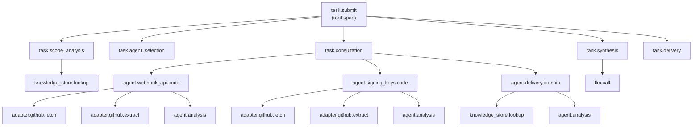

# S12 -- Bifrost Observability and Audit Specification

**Spec ID:** S12

## 1. Purpose and Scope

This specification defines how the Bifrost platform observes itself: how it logs, measures, traces, audits, and alerts on its own behavior. Every subsystem in Bifrost -- task orchestration, agent workforce, knowledge pipeline, source adapters, freshness tracking, and API surface -- is within scope.

The goal is to make Bifrost's internal behavior transparent, debuggable, and accountable. Engineers operating Bifrost must be able to answer: what happened, when, why, how long it took, what it cost, and whether the platform is healthy.

This specification covers structured logging, metrics collection, distributed tracing, audit trails, alerting, and dashboards. It defines what is built in V1 (minimal viable observability) and what is deferred to V2 and beyond.

---

## 2. Glossary References

| Term | Definition |
|------|-----------|
| **Trace** | A complete record of a task's execution path through the system, composed of spans. |
| **Span** | A single unit of work within a trace (e.g., one agent consultation, one adapter fetch). |
| **Correlation ID** | A unique identifier (`trace_id`) assigned at task submission that propagates through all related log entries, spans, and audit events. |
| **Staleness** | The degree to which stored knowledge has drifted from the current state of its upstream source. |
| **Lag** | The measured time difference between the latest known source state and the latest indexed/derived knowledge state. |
| **Knowledge tier** | Classification of knowledge depth: T0 (broad mapping), T1 (extracted entities/relationships), T2 (generated docs), T3 (learned patterns/history). |
| **Hot/Warm/Cold storage** | Retention tiers based on access frequency: hot (immediate query), warm (queryable with higher latency), cold (archival, restore-on-demand). |

---

## 3. Requirements Traceability

This specification directly addresses the following requirements sections:

| Requirement | Section | Coverage |
|-------------|---------|----------|
| **Task logs** | SS5 Logging Framework, SS9 Audit Trail | Task logging with requester, time, scope, agents, freshness, outcome |
| **Decision logs** | SS5 Logging Framework | Options considered, evidence, confidence, selected path, unresolved issues |
| **Knowledge update logs** | SS5 Logging Framework, SS9 Audit Trail | Changes, invalidations, regenerations, stale items, publications |
| **Agent activity logs** | SS5 Logging Framework | Agent participation, consultations, failures, retries, stale warnings |
| **Platform observability** | SS6 Metrics, SS7 Tracing, SS10 Dashboards | Freshness health, lag, agent health, task performance, update failures, cache effectiveness |
| **Orchestration logging** | SS5 Logging Framework | Participating agents, consultation order/mode, evidence, conflicts, synthesis |
| **Workforce visibility** | SS6 Metrics (workforce) | Agent existence, scope, source attachment, freshness, consultation history |
| **Permission-aware behavior** | SS9 Audit Trail | Authentication and authorization event auditing |
| **Controlled action support** | SS9 Audit Trail | Auditability of all actions |
| **Storage visibility** | SS5 Logging Framework | Cache hit/miss logging, stale cache indicators |

---

## 4. Design Goals and Non-Goals

### Goals

- **Complete task traceability.** Every task that enters Bifrost produces a traceable chain of logs, metrics, and audit events from submission to delivery.
- **Operational transparency.** Platform operators can determine system health, identify bottlenecks, and diagnose failures without reading application code.
- **Freshness visibility.** Staleness and lag are observable as first-class metrics, not buried in application logic.
- **Vendor neutrality.** Instrumentation uses OpenTelemetry standards so that backends (Prometheus, Jaeger, Grafana, Datadog) are interchangeable.
- **Audit compliance.** All security-relevant events are recorded in an append-only, tamper-evident store with defined retention.
- **Low overhead.** Observability must not meaningfully degrade task latency or throughput.

### Non-Goals

- **Business analytics.** User behavior analytics, funnel analysis, and product metrics are out of scope. This specification covers platform operational observability only.
- **Log aggregation infrastructure.** This specification defines what is emitted, not how log aggregation clusters are provisioned or managed.
- **Real-time anomaly detection in V1.** Automated anomaly detection and ML-based alerting are deferred to future evolution.
- **Source system monitoring.** Bifrost observes its own interactions with source systems but does not monitor the health of those source systems themselves.

---

## 5. Logging Framework

### 5.1 Structured JSON Format

Every log entry emitted by Bifrost MUST be a single-line JSON object written to stdout, following 12-factor app conventions. Bifrost uses **structlog** (D7 from tech-stack-adr) as its logging library.

**structlog Configuration (application startup):**

```python
import structlog

structlog.configure(
    processors=[
        structlog.contextvars.merge_contextvars,       # Merge correlation_id, component from context
        structlog.processors.add_log_level,            # Add "level" field
        structlog.processors.TimeStamper(fmt="iso", utc=True),  # ISO 8601 timestamps
        structlog.processors.StackInfoRenderer(),      # Stack traces on errors
        structlog.processors.format_exc_info,          # Format exception info
        structlog.processors.JSONRenderer(),           # Single-line JSON to stdout
    ],
    wrapper_class=structlog.make_filtering_bound_logger(logging.INFO),
    context_class=dict,
    logger_factory=structlog.PrintLoggerFactory(),
    cache_logger_on_first_use=True,
)

# Usage throughout codebase:
logger = structlog.get_logger()
logger.info("Task started", task_id="task_01JQXYZ", component="orchestrator")
```

**Required fields on every log entry:**

| Field | Type | Description |
|-------|------|-------------|
| `timestamp` | string (ISO 8601) | Time the log entry was created, with millisecond precision. |
| `level` | string | One of: `debug`, `info`, `warn`, `error`. |
| `correlation_id` | string (UUID) | The `trace_id` of the originating task, or a system correlation ID for non-task logs. |
| `component` | string | The subsystem emitting the log (e.g., `orchestrator`, `agent.code_analyst`, `adapter.github`, `freshness`). |
| `message` | string | Human-readable summary of the event. |
| `metadata` | object | Structured key-value pairs specific to the log category. |

### 5.2 Log Levels

| Level | Usage |
|-------|-------|
| `debug` | Detailed internal state useful only during development or deep debugging. Disabled in production by default. |
| `info` | Normal operational events: task started, agent consulted, knowledge updated, adapter fetch completed. |
| `warn` | Degraded conditions that do not prevent task completion: stale cache used, adapter retry triggered, confidence below threshold. |
| `error` | Failures that prevent normal operation: adapter failure, agent timeout, task failure, unrecoverable errors. |

### 5.3 Log Categories

#### 5.3.1 Task Logs

Emitted by the orchestrator at task lifecycle boundaries.

**Example -- task started:**
```json
{
  "timestamp": "2025-01-15T14:23:01.442Z",
  "level": "info",
  "correlation_id": "00000000-0000-0000-0000-000000000001",
  "component": "orchestrator",
  "message": "Task started",
  "metadata": {
    "task_id": "task_01JQXYZ",
    "requester": { "type": "user", "id": "user_42", "name": "jdoe" },
    "scope": { "repos": ["webhook-api", "signing-keys"], "domain": "delivery" },
    "task_type": "flow_analysis",
    "query": "How does the retry flow work end-to-end?"
  }
}
```

**Example -- task completed:**
```json
{
  "timestamp": "2025-01-15T14:23:08.917Z",
  "level": "info",
  "correlation_id": "00000000-0000-0000-0000-000000000001",
  "component": "orchestrator",
  "message": "Task completed",
  "metadata": {
    "task_id": "task_01JQXYZ",
    "duration_ms": 7475,
    "agents_consulted": ["agent.webhook_api.code", "agent.signing_keys.code", "agent.delivery.domain"],
    "freshness_summary": { "freshest_source_lag_s": 120, "stalest_source_lag_s": 86400 },
    "outcome": "success",
    "confidence": "high",
    "llm_tokens_used": 14200,
    "cache_hits": 3,
    "cache_misses": 2
  }
}
```

#### 5.3.2 Decision Logs

Emitted by the orchestrator or task master when making routing or synthesis decisions.

**Example:**
```json
{
  "timestamp": "2025-01-15T14:23:02.103Z",
  "level": "info",
  "correlation_id": "00000000-0000-0000-0000-000000000001",
  "component": "orchestrator.decision",
  "message": "Scope analysis complete",
  "metadata": {
    "task_id": "task_01JQXYZ",
    "decision_type": "scope_analysis",
    "options_considered": [
      { "scope": "webhook-api only", "reason": "keyword match", "rejected_because": "flow crosses repo boundary" },
      { "scope": "webhook-api + signing-keys", "reason": "dependency trace", "selected": true }
    ],
    "evidence_used": ["dependency_graph.webhook_api", "flow_hint.retry_policy"],
    "confidence": "high",
    "unresolved_issues": []
  }
}
```

#### 5.3.3 Knowledge Update Logs

Emitted by the knowledge pipeline when knowledge artifacts change state.

**Example:**
```json
{
  "timestamp": "2025-01-15T15:00:12.331Z",
  "level": "info",
  "correlation_id": "sys_refresh_20250115_150000",
  "component": "knowledge_pipeline",
  "message": "Knowledge update cycle completed",
  "metadata": {
    "trigger": "scheduled_refresh",
    "repo": "webhook-api",
    "changed": ["component:RetryController", "flow:retry_policy"],
    "invalidated": ["doc:retry_overview", "dep_view:webhook_api.signing_keys"],
    "regenerated": ["component:RetryController"],
    "remains_stale": ["doc:retry_overview"],
    "published": [],
    "source_revision": "abc123f"
  }
}
```

#### 5.3.4 Agent Activity Logs

Emitted by agents during consultation.

**Example:**
```json
{
  "timestamp": "2025-01-15T14:23:03.885Z",
  "level": "info",
  "correlation_id": "00000000-0000-0000-0000-000000000001",
  "component": "agent.webhook_api.code",
  "message": "Consultation completed",
  "metadata": {
    "task_id": "task_01JQXYZ",
    "agent_type": "repo_code_analyst",
    "repo": "webhook-api",
    "request_type": "flow_segment_analysis",
    "duration_ms": 1240,
    "sources_accessed": ["github:webhook-api:src/controllers/retry.ts", "github:webhook-api:src/services/retry.ts"],
    "freshness": { "source_lag_s": 120 },
    "stale_knowledge_warnings": [],
    "outcome": "success",
    "confidence": "high"
  }
}
```

**Example -- agent failure with retry:**
```json
{
  "timestamp": "2025-01-15T14:23:04.102Z",
  "level": "warn",
  "correlation_id": "00000000-0000-0000-0000-000000000001",
  "component": "agent.signing_keys.code",
  "message": "Consultation failed, retrying",
  "metadata": {
    "task_id": "task_01JQXYZ",
    "agent_type": "repo_code_analyst",
    "repo": "signing-keys",
    "attempt": 1,
    "max_attempts": 3,
    "error": "adapter.github: rate limit exceeded",
    "retry_after_ms": 2000
  }
}
```

### 5.4 Correlation

Every task submitted to Bifrost is assigned a `trace_id` (UUID v4) at the point of submission. This ID:

- Propagates through all log entries related to the task.
- Is attached to all OpenTelemetry spans for the task.
- Is recorded in all audit trail events for the task.
- Is returned to the caller in the task response.

System-initiated operations (scheduled refreshes, background reconciliation) receive a system-generated correlation ID with the prefix `sys_`.

**FastAPI correlation middleware (structlog contextvars):**

```python
import uuid

import structlog
from starlette.middleware.base import BaseHTTPMiddleware, RequestResponseEndpoint
from starlette.requests import Request
from starlette.responses import Response


class CorrelationMiddleware(BaseHTTPMiddleware):
    """Inject correlation_id into structlog context for every request."""

    async def dispatch(self, request: Request, call_next: RequestResponseEndpoint) -> Response:
        correlation_id = request.headers.get("X-Correlation-ID", str(uuid.uuid4()))
        structlog.contextvars.clear_contextvars()
        structlog.contextvars.bind_contextvars(correlation_id=correlation_id)

        response = await call_next(request)
        response.headers["X-Correlation-ID"] = correlation_id
        return response
```

### 5.5 Storage

| Phase | Destination | Details |
|-------|------------|---------|
| **V1** | stdout | Structured JSON logs written to process stdout. Container orchestration or deployment tooling is responsible for collection. |
| **V2** | Indexable log store | Logs shipped to a queryable store (e.g., Elasticsearch, Loki, CloudWatch Logs) for search, filter, and aggregation. |

### 5.6 Retention

| Tier | Duration | Access Pattern | Configurable |
|------|----------|---------------|-------------|
| Hot | 30 days | Immediate full-text query | Yes |
| Warm | 90 days | Queryable with higher latency | Yes |
| Cold | 1 year | Archive, restore-on-demand | Yes |

Retention durations are configurable per deployment via environment variables. The defaults above apply when no override is specified.

---

## 5.7 Agent Session Events

Every agent execution (Track A or Track B) produces structured events for observability.

### Track A Events (custom)

Bifrost emits events via its internal `asyncio.Queue`-based event bus (see S9 — D9). These map to OpenTelemetry spans.

| Event | When | Data |
|-------|------|------|
| `agent.session.started` | Agent execution begins | `agent_type`, `repo_id`, `task_id` |
| `agent.state.read` | Agent reads from AgentStateBackend | `path`, `cache_hit` (bool), `latency_ms` |
| `agent.llm.called` | LLM API call initiated | `model`, `prompt_tokens`, `task_id` |
| `agent.llm.completed` | LLM API call returned | `completion_tokens`, `total_tokens`, `cost_usd`, `latency_ms` |
| `agent.state.written` | Agent writes to AgentStateBackend | `path`, `bytes`, `entity_type` |
| `agent.session.completed` | Agent execution ends | `duration_ms`, `tokens_used`, `cost_usd`, `findings_count` |
| `extraction.batch.started` | ExtractionAgent batch begins | `repo_id`, `batch_start`, `batch_size` |
| `extraction.batch.completed` | ExtractionAgent batch done | `repo_id`, `components_indexed`, `cost_usd` |
| `extraction.checkpointed` | Freshness state updated | `repo_id`, `component_cursor`, `commit_sha` |

### Track B Events (Managed Agents)

When Track B is active, Bifrost also captures events from the Managed Agents API:

- Managed Agents session events streamed to Bifrost are captured and stored.
- Session thread events (`thread_created`, `thread_idle`) are mapped to `agent.session` events.
- Memory store operations (via agent `tool_use` events) are mapped to `agent.state` events.

Track B events carry two additional fields: `session_id` (Anthropic session ID) and `thread_id` for cross-referencing with Anthropic's session logs.

---

## 6. Metrics

All metrics MUST be OpenTelemetry-compatible and exposed in Prometheus exposition format at the `/metrics` endpoint.

### 6.1 Platform Health Metrics

| Metric Name | Type | Labels | Description |
|-------------|------|--------|-------------|
| `bifrost_api_request_duration_seconds` | Histogram | `endpoint`, `method`, `status` | API latency distribution. Report p50, p95, p99. |
| `bifrost_task_completion_duration_seconds` | Histogram | `task_type`, `outcome` | End-to-end task completion time. |
| `bifrost_agent_invocation_duration_seconds` | Histogram | `agent_type`, `repo`, `outcome` | Per-agent consultation latency. |
| `bifrost_component_errors_total` | Counter | `component`, `error_type` | Error count per component. |
| `bifrost_tasks_active` | Gauge | `task_type` | Currently executing tasks. |
| `bifrost_tasks_queued` | Gauge | `task_type` | Tasks waiting for execution. |

### 6.2 Freshness Health Metrics

| Metric Name | Type | Labels | Description |
|-------------|------|--------|-------------|
| `bifrost_staleness_seconds` | Histogram | `repo`, `source_type` | Distribution of staleness across knowledge artifacts per repo. |
| `bifrost_source_lag_seconds` | Gauge | `repo`, `source_type` | Current lag between source state and indexed state per source. Report p50, p95, p99 via recording rules. |
| `bifrost_last_refresh_timestamp_seconds` | Gauge | `repo`, `source_type` | Unix timestamp of the most recent successful refresh. |
| `bifrost_stale_artifacts_count` | Gauge | `repo`, `artifact_type` | Count of knowledge artifacts currently marked stale. |

### 6.3 Coverage Metrics

| Metric Name | Type | Labels | Description |
|-------------|------|--------|-------------|
| `bifrost_entities_total` | Gauge | `repo`, `entity_type` | Count of discovered entities (components, flows, dependencies) per repo. |
| `bifrost_source_coverage` | Gauge | `repo`, `source_type` | Binary (0/1) or percentage indicating whether a source type is connected for a repo. |
| `bifrost_knowledge_tier_count` | Gauge | `repo`, `tier` | Count of knowledge artifacts at each tier (T0, T1, T2, T3). |

### 6.4 Usage Metrics

| Metric Name | Type | Labels | Description |
|-------------|------|--------|-------------|
| `bifrost_tasks_total` | Counter | `task_type`, `outcome` | Total tasks processed. |
| `bifrost_query_type_total` | Counter | `query_type` | Distribution of query types (flow analysis, dependency check, etc.). |
| `bifrost_cache_requests_total` | Counter | `result` (`hit`, `miss`) | Cache hit/miss counts. |
| `bifrost_llm_tokens_total` | Counter | `model`, `direction` (`input`, `output`) | LLM token consumption. |
| `bifrost_llm_cost_dollars` | Counter | `model`, `task_type` | Estimated LLM cost in dollars. |

### 6.5 Workforce Metrics

| Metric Name | Type | Labels | Description |
|-------------|------|--------|-------------|
| `bifrost_agents_count` | Gauge | `agent_type`, `status` (`active`, `idle`, `error`) | Current agent count by type and status. |
| `bifrost_agent_consultations_total` | Counter | `agent_type`, `repo` | Total consultations per agent. |
| `bifrost_agent_response_duration_seconds` | Histogram | `agent_type` | Agent response time distribution. |

---

## 6.6 Track B-Specific Metrics

When Managed Agents is active, the following additional metrics are collected. These address two known limitations: session concurrency opacity (L7) and Track B cost opacity (L8).

```
# Session pool metrics
bifrost_session_pool_active_total{agent_type}       # Current active sessions
bifrost_session_pool_queued_total                   # Tasks waiting for session slot
bifrost_session_pool_utilization_ratio              # active / max_concurrent

# Session lifecycle metrics
bifrost_session_duration_seconds{agent_type, outcome}  # histogram: completed/timed_out/failed
bifrost_session_timeout_total{agent_type}           # counter: sessions that hit duration limit
bifrost_session_respawn_total{agent_type}           # counter: sessions re-spawned after timeout
bifrost_session_checkpoint_writes_total             # counter: checkpoint writes to Memory Store

# Memory Store metrics
bifrost_memory_store_read_bytes_total{agent_type}   # bytes read from Memory Store
bifrost_memory_store_write_bytes_total{agent_type}  # bytes written to Memory Store
bifrost_memory_store_write_failures_total           # failed writes (critical — state loss risk)

# MCP tool metrics
bifrost_mcp_tool_calls_total{server_name, tool_name, outcome}   # success/failure
bifrost_mcp_tool_latency_seconds{server_name, tool_name}        # histogram

# Track B cost metrics
bifrost_track_b_session_overhead_usd_total{agent_type}  # cumulative session overhead cost
bifrost_track_b_total_cost_usd_total                     # all Track B costs combined
```

---

## 6.7 LLM Cost Tracking

**Requirement:** LLM cost per query is unestimated and potentially ruinous. Bifrost MUST track and alert on LLM costs from day 1 (V1).

### Cost Collection

After every LLM call, record:

- Model used (e.g., `claude-haiku-4-5` vs `claude-sonnet-4-6`)
- `prompt_tokens`, `completion_tokens`
- `estimated_cost_usd` (computed from token counts times published pricing)
- `task_id`, `agent_type`, `task_type`

Stored in PostgreSQL:

```sql
CREATE TABLE llm_cost_log (
    id                   UUID            PRIMARY KEY DEFAULT gen_random_uuid(),
    task_id              UUID            REFERENCES tasks(id),
    agent_type           TEXT,
    task_type            TEXT,
    model                TEXT,
    prompt_tokens        INT,
    completion_tokens    INT,
    estimated_cost_usd   NUMERIC(10,6),
    -- Track B overhead costs tracked separately from LLM costs for accurate comparison.
    track_b_session_overhead_usd REAL    DEFAULT 0,
    track_b_mcp_calls            INTEGER DEFAULT 0,
    timestamp            TIMESTAMPTZ     NOT NULL DEFAULT NOW()
);
```

### Cost Alerting

- **Daily cap:** Sum `estimated_cost_usd` per day. If daily total exceeds `daily_spend_limit` (default: $50), alert ops team.
- **Per-task:** If a single task's total cost exceeds $2.00, emit a `WARN` log with full task details.
- **Weekly report:** Cost breakdown by `task_type`, average cost per query type, week-over-week trend.

Cost alerting runs in V1. Alert delivery (Slack / on-call pager) is wired in V2 when the alerting infrastructure is provisioned.

#### Track B-Specific Alerts

- **`BifrostTrackBSessionOverheadHigh`** — Fires when `track_b_session_overhead_usd` exceeds 20% of `estimated_cost_usd` for the same task. This indicates MCP or session overhead is unexpectedly high. Expected baseline is 5–10%; values above 20% suggest runaway MCP tool usage or session leaks.

- **`BifrostMemoryStoreWriteFailure`** — Fires on any increment of `bifrost_memory_store_write_failures_total`. Highest severity: a failed checkpoint write means agent state is lost and the task may produce incorrect or incomplete output. Requires immediate investigation.

- **`BifrostSessionPoolSaturated`** — Fires when `bifrost_session_pool_utilization_ratio` > 0.8. Indicates the session pool is near capacity and tasks will begin queueing. Remediation: increase `max_concurrent_sessions` configuration or upgrade from Research Preview tier to a higher session limit.

### Reference Cost Estimates (V1, claude-sonnet-4-6)

| Task type | Avg LLM calls | Avg cost / query |
|-----------|---------------|-----------------|
| Simple repo question | 2-3 calls | $0.05-0.15 |
| Cross-repo flow trace (5 repos) | 6-8 calls | $0.15-0.50 |
| Impact assessment (10 repos) | 11-15 calls | $0.30-1.00 |
| Cold-start extraction (200 files) | 20-40 calls | $0.50-2.00 |

Track B adds container compute cost (rate TBD during beta). Monitor separately via `bifrost.session.container_seconds`.

---

## 7. Distributed Tracing

### 7.1 Tracing Standard

Bifrost uses OpenTelemetry for distributed tracing. Traces are propagated using W3C Trace Context headers internally.

### 7.2 Span Hierarchy

Every task execution produces a trace with the following span structure:

```
task.submit (root span)
  |
  +-- task.scope_analysis
  |     +-- knowledge_store.lookup
  |
  +-- task.agent_selection
  |
  +-- task.consultation (one per agent, parallel where applicable)
  |     +-- agent.webhook_api.code
  |     |     +-- adapter.github.fetch (per source access)
  |     |     +-- adapter.github.extract
  |     |     +-- agent.analysis
  |     |
  |     +-- agent.signing_keys.code
  |     |     +-- adapter.github.fetch
  |     |     +-- adapter.github.extract
  |     |     +-- agent.analysis
  |     |
  |     +-- agent.delivery.domain
  |           +-- knowledge_store.lookup
  |           +-- agent.analysis
  |
  +-- task.synthesis
  |     +-- llm.call
  |
  +-- task.delivery
```



### 7.3 Span Attributes

Every span MUST include:

| Attribute | Description |
|-----------|-------------|
| `bifrost.task_id` | The task this span belongs to. |
| `bifrost.component` | The subsystem executing this span. |
| `bifrost.repo` | Repository in scope (where applicable). |
| `bifrost.agent_type` | Agent type (on agent spans). |
| `bifrost.adapter` | Adapter name (on adapter spans). |

### 7.4 Trace-to-Task Correlation

Every trace root span is tagged with `bifrost.task_id`. The task response returned to the caller includes the `trace_id`, enabling operators to look up the full trace for any task.

### 7.5 Sampling

| Condition | Sample Rate |
|-----------|-------------|
| Error or failure | 100% (always sampled) |
| Latency exceeds p99 threshold | 100% |
| Successful, normal latency | Configurable; default 10% |

Sampling decisions are made at the root span and propagated to all child spans.

---

## 8. Alerting (V2)

Alerting is deferred to V2. This section defines the target design.

### 8.1 Alert Definitions

| Alert | Condition | Severity |
|-------|-----------|----------|
| Repo staleness exceeded | `bifrost_source_lag_seconds{repo=X}` > configured threshold (default 24h) for > 30 minutes | Warning |
| Adapter failure rate | `rate(bifrost_component_errors_total{component=~"adapter.*"}[5m])` > 0.1 | Critical |
| Agent failure rate | `rate(bifrost_component_errors_total{component=~"agent.*"}[5m])` > 0.05 | Warning |
| Task failure rate spike | `rate(bifrost_tasks_total{outcome="error"}[5m]) / rate(bifrost_tasks_total[5m])` > 0.1 | Critical |
| LLM cost budget exceeded | `sum(bifrost_llm_cost_dollars)` over rolling 24h window exceeds configured budget | Warning |
| Task queue depth | `bifrost_tasks_queued` > configured threshold for > 5 minutes | Warning |

### 8.2 Alert Routing

Alerts are delivered via webhook to configurable destinations:

- **Slack** (default for Warning severity)
- **On-call pager** (default for Critical severity)
- **Generic webhook** (for custom integrations)

Alert routing rules are defined in platform configuration and support per-alert overrides.

---

## 9. Audit Trail

### 9.1 Purpose

The audit trail provides a tamper-resistant, append-only record of all security-relevant and operationally significant events in Bifrost. It serves compliance, debugging, and forensic analysis needs.

### 9.2 Audited Event Categories

| Category | Events |
|----------|--------|
| **Authentication** | Login, logout, token refresh, failed authentication attempt |
| **Authorization** | Permission check with subject, resource, action, and outcome (allow/deny) |
| **Source access** | Source system fetch: what was fetched, by which agent, for which task, when |
| **Task execution** | Full lifecycle per the task logs (section 5.3.1): submission, scope, agents consulted, freshness used, outcome |
| **Knowledge mutations** | Creates, updates, invalidations, regenerations of knowledge artifacts |
| **Configuration changes** | Repo registration, repo deregistration, domain configuration changes, adapter configuration changes, platform setting changes |

### 9.3 Audit Event Schema

Every audit event is stored as a row in an append-only PostgreSQL table.

```sql
CREATE TABLE audit_log (
    id              BIGSERIAL       PRIMARY KEY,
    event_id        UUID            NOT NULL DEFAULT gen_random_uuid(),
    timestamp       TIMESTAMPTZ     NOT NULL DEFAULT now(),
    correlation_id  UUID,
    event_category  VARCHAR(50)     NOT NULL,
    event_type      VARCHAR(100)    NOT NULL,
    actor           JSONB           NOT NULL,  -- { type, id, name }
    resource        JSONB,                     -- { type, id, details }
    action          VARCHAR(100)    NOT NULL,
    outcome         VARCHAR(20)     NOT NULL,  -- success, failure, denied
    metadata        JSONB           NOT NULL DEFAULT '{}',
    client_ip       INET,
    user_agent      VARCHAR(500),
    
    CONSTRAINT audit_log_no_update CHECK (false) -- enforced via trigger, see below
);

CREATE INDEX idx_audit_log_timestamp ON audit_log (timestamp);
CREATE INDEX idx_audit_log_correlation ON audit_log (correlation_id);
CREATE INDEX idx_audit_log_category ON audit_log (event_category, event_type);
CREATE INDEX idx_audit_log_actor ON audit_log ((actor->>'id'));
CREATE INDEX idx_audit_log_resource ON audit_log ((resource->>'type'), (resource->>'id'));
```

**Append-only enforcement:** A database trigger prevents UPDATE and DELETE operations on the `audit_log` table. Only INSERT is permitted.

```sql
CREATE OR REPLACE FUNCTION prevent_audit_mutation()
RETURNS TRIGGER AS $$
BEGIN
    RAISE EXCEPTION 'audit_log table is append-only: % operations are not permitted', TG_OP;
END;
$$ LANGUAGE plpgsql;

CREATE TRIGGER audit_log_immutable
    BEFORE UPDATE OR DELETE ON audit_log
    FOR EACH ROW EXECUTE FUNCTION prevent_audit_mutation();
```

**SQLAlchemy Model (Python):**

```python
from datetime import datetime
from uuid import uuid4

from sqlalchemy import Column, BigInteger, String, DateTime, text
from sqlalchemy.dialects.postgresql import INET, JSONB, UUID

from bifrost.db.base import Base


class AuditLog(Base):
    __tablename__ = "audit_log"

    id = Column(BigInteger, primary_key=True, autoincrement=True)
    event_id = Column(UUID(as_uuid=True), nullable=False, default=uuid4)
    timestamp = Column(DateTime(timezone=True), nullable=False, server_default=text("now()"))
    correlation_id = Column(UUID(as_uuid=True), nullable=True)
    event_category = Column(String(50), nullable=False)
    event_type = Column(String(100), nullable=False)
    actor = Column(JSONB, nullable=False)          # { type, id, name }
    resource = Column(JSONB, nullable=True)         # { type, id, details }
    action = Column(String(100), nullable=False)
    outcome = Column(String(20), nullable=False)    # success, failure, denied
    metadata_ = Column("metadata", JSONB, nullable=False, server_default=text("'{}'"))
    client_ip = Column(INET, nullable=True)
    user_agent = Column(String(500), nullable=True)
```

### 9.4 Audit Event Examples

**Authentication event:**
```json
{
  "event_id": "00000000-0000-0000-0000-000000000002",
  "timestamp": "2025-01-15T14:22:59.100Z",
  "correlation_id": null,
  "event_category": "authentication",
  "event_type": "login",
  "actor": { "type": "user", "id": "user_42", "name": "jdoe" },
  "resource": null,
  "action": "authenticate",
  "outcome": "success",
  "metadata": { "method": "api_key", "scopes": ["read", "task"] },
  "client_ip": "10.0.1.42",
  "user_agent": "bifrost-cli/0.1.0"
}
```

**Source access event:**
```json
{
  "event_id": "00000000-0000-0000-0000-000000000003",
  "timestamp": "2025-01-15T14:23:03.900Z",
  "correlation_id": "00000000-0000-0000-0000-000000000001",
  "event_category": "source_access",
  "event_type": "fetch",
  "actor": { "type": "agent", "id": "agent.webhook_api.code", "name": "webhook-api code analyst" },
  "resource": { "type": "github_file", "id": "webhook-api:src/controllers/retry.ts", "details": { "repo": "webhook-api", "ref": "main", "sha": "abc123f" } },
  "action": "read",
  "outcome": "success",
  "metadata": { "task_id": "task_01JQXYZ", "adapter": "github", "bytes_fetched": 4200, "cached": false }
}
```

**Knowledge mutation event:**
```json
{
  "event_id": "00000000-0000-0000-0000-000000000004",
  "timestamp": "2025-01-15T15:00:12.350Z",
  "correlation_id": "sys_refresh_20250115_150000",
  "event_category": "knowledge_mutation",
  "event_type": "invalidate",
  "actor": { "type": "system", "id": "knowledge_pipeline", "name": "scheduled refresh" },
  "resource": { "type": "document", "id": "doc:retry_overview", "details": { "repo": "webhook-api", "artifact_tier": "T2" } },
  "action": "invalidate",
  "outcome": "success",
  "metadata": { "reason": "upstream_source_changed", "source_revision_old": "def456a", "source_revision_new": "abc123f" }
}
```

### 9.5 Access Control

- The `audit_log` table is readable only by users with the `admin` role.
- The audit log query API (see SS11) enforces the same restriction.
- No application-level code other than the audit writer has INSERT permissions.

### 9.6 Retention

- **Minimum retention:** 1 year.
- **Default retention:** 1 year, with configurable extension.
- **Sensitive query logs:** 90 days (reduced from 1 year -- see section 9.7 below).
- Partition the table by month (`audit_log_YYYY_MM`) to enable efficient retention management and archival.

### 9.7 Knowledge Update Audit

Every write to AgentStateBackend is logged at the audit layer:

- **Track A:** `INSERT` into `knowledge_audit_log(path, operation, prev_hash, new_hash, agent_type, task_id, timestamp)` after every state write.
- **Track B:** Anthropic Memory Store version history provides the primary audit trail automatically (every mutation creates an immutable memory version with actor, timestamp, `content_sha256`). Bifrost supplements this with its own log entry for cross-referencing with internal task IDs.

### 9.8 Sensitive Query Handling in Audit Logs

**Risk:** Query text may contain sensitive information (e.g., a user asking about a specific customer ID, account number, or PII). Audit logs that retain full query text for 1 year are a liability.

Queries are classified as sensitive based on content scanning:

```python
import re
from dataclasses import dataclass


SENSITIVE_QUERY_PATTERNS: list[re.Pattern[str]] = [
    re.compile(r"credential|password|secret|token|api.?key", re.IGNORECASE),
    re.compile(r"who has access|permission|authorization", re.IGNORECASE),
    re.compile(r"salary|compensation|performance review", re.IGNORECASE),
    re.compile(r"pii|personal data|gdpr|ccpa", re.IGNORECASE),
]


@dataclass(frozen=True)
class QueryClassification:
    sensitive: bool
    reason: str | None = None


def classify_query(query_text: str) -> QueryClassification:
    for pattern in SENSITIVE_QUERY_PATTERNS:
        if pattern.search(query_text):
            return QueryClassification(sensitive=True, reason=pattern.pattern)
    return QueryClassification(sensitive=False)
```

**Retention by sensitivity:**

| Query type | Retained | Content stored |
|-----------|---------|---------------|
| Standard query | 1 year | Full query text |
| Sensitive query | 90 days | Query hash only (SHA256), reason flag |
| Admin query | 1 year | Full query text |

**Access control:**
- Sensitive query audit records: admin-only access
- Standard records: accessible to org admins
- All retention managed by automated expiry job (see §9.8 SQL below)

**Mitigations:**

- Query text is classified via `classify_query()` before logging; sensitive queries store only a SHA256 hash of the query text plus a reason flag, never the raw text.
- Retention for sensitive query logs is 90 days (not the standard 1 year) to limit exposure window.
- Access to the query log requires the `admin` role; the audit log query API enforces this.
- **Track B:** Use `memory_versions.redact()` to remove sensitive content from memory store version history if a redaction request is received.

```sql
-- Audit log retention: partition by month, sensitive rows identified by metadata flag
-- Sensitive row expiry job: DELETE FROM audit_log_YYYY_MM WHERE metadata->>'sensitive' = 'true'
--   AND timestamp < NOW() - INTERVAL '90 days';
```

---

## 10. Dashboards (V2)

Dashboards are deferred to V2. This section defines the target design.

### 10.1 Dashboard Definitions

| Dashboard | Purpose | Key Panels |
|-----------|---------|-----------|
| **Platform Health** | Overall system operational status | API latency (p50/p95/p99), error rates by component, task throughput, active/queued tasks |
| **Freshness** | Knowledge currency across the platform | Staleness heatmap by repo, lag trend lines by source type, time-since-last-refresh table, stale artifact count by repo |
| **Workforce** | Agent health and utilization | Agent count by type/status, consultation frequency, agent response time percentiles, failure/retry rates |
| **Task** | Task execution patterns and costs | Task volume over time, task type distribution, completion rate, duration percentiles, LLM token usage, cost per task type |

### 10.2 Technology

- **Dashboard engine:** Grafana
- **Metrics data source:** Prometheus (scraping `/metrics` endpoint)
- **Audit/log data source:** PostgreSQL (direct query for audit trail), log store (V2) for log search
- **Provisioning:** Dashboard definitions stored as Grafana JSON models in version control, deployed via Grafana provisioning API

---

## 11. Interface Contracts

### 11.1 Metrics Endpoint

```
GET /metrics
Content-Type: text/plain; version=0.0.4; charset=utf-8
```

Returns all Bifrost metrics in Prometheus exposition format. No authentication required (intended for internal network scraping only; network-level access control applies).

### 11.2 Health Check Endpoint

```
GET /health
Content-Type: application/json
```

**Response (healthy):**
```json
{
  "status": "healthy",
  "timestamp": "2025-01-15T14:30:00.000Z",
  "version": "0.1.0",
  "checks": {
    "database": { "status": "healthy", "latency_ms": 2 },
    "knowledge_store": { "status": "healthy", "latency_ms": 5 }
  }
}
```

**Response (degraded):**
```json
{
  "status": "degraded",
  "timestamp": "2025-01-15T14:30:00.000Z",
  "version": "0.1.0",
  "checks": {
    "database": { "status": "healthy", "latency_ms": 2 },
    "knowledge_store": { "status": "unhealthy", "latency_ms": null, "error": "connection timeout" }
  }
}
```

HTTP status: 200 for healthy, 200 for degraded (still serving), 503 for unhealthy (not serving).

### 11.3 Audit Log Query API

```
GET /api/v1/admin/audit
Authorization: Bearer <bft_ admin token or OIDC JWT>
Content-Type: application/json
```

**Query parameters:**

| Parameter | Type | Description |
|-----------|------|-------------|
| `event_type_prefix` | string | Dotted-namespace prefix, for example `admin.` or `admin.access.denied` |
| `actor` | string | Filter by actor |
| `since` | ISO 8601 | Only rows at or after this time |
| `limit` | integer | Max results, 1 to 500 (default 100) |

**Response:** the most recent entries first.
```json
{
  "entries": [
    { "id": "...", "timestamp": "...", "event_type": "...", "actor": "..." }
  ],
  "total_returned": 100
}
```

Access restricted to admin role. Returns 403 for non-admin callers.

---

## 12. Dependencies

This specification observes all other Bifrost subsystems. It has dependencies on:

| Subsystem | Dependency Type |
|-----------|----------------|
| **Task Orchestrator** | Emits task logs, decision logs; provides trace_id |
| **Agent Workforce** | Emits agent activity logs; reports agent metrics |
| **Knowledge Pipeline** | Emits knowledge update logs; reports freshness and coverage metrics |
| **Source Adapters** | Emits adapter access logs; reports adapter latency and error metrics |
| **Freshness Tracker** | Provides staleness and lag data for metrics |
| **API Layer** | Exposes /metrics, /health, /api/v1/admin/audit endpoints |
| **PostgreSQL** | Stores audit_log table |
| **Authentication/Authorization** | Provides actor identity for audit events; gates audit API access |

---

## 13. Key Decisions

| Decision | Rationale |
|----------|-----------|
| **OpenTelemetry for traces and metrics** | Vendor-neutral standard. Allows swapping backends (Prometheus, Jaeger, Datadog, Grafana Cloud) without changing instrumentation code. |
| **Structured JSON logs to stdout** | 12-factor app convention. Decouples log emission from log routing/storage. Works with any container orchestration log collector. |
| **Audit log in PostgreSQL** | Queryable with standard SQL. Transactional guarantees. Append-only enforcement via triggers. Avoids introducing a separate audit-specific database in V1. |
| **Prometheus exposition format for metrics** | Industry standard for pull-based metrics. Compatible with Grafana, Alertmanager, and most monitoring stacks. |
| **Append-only audit table with trigger enforcement** | Stronger tamper resistance than application-level enforcement alone. Database-level constraint prevents accidental or malicious mutation. |
| **Correlation ID propagation via trace_id** | Single identifier connects logs, traces, audit events, and task responses. Simplifies cross-cutting debugging. |

---

## 14. V1 Scope

V1 delivers the minimum observability required to operate and debug Bifrost in a development and early-production environment.

V1 implements Track A observability: structured JSON logs (Pino), OpenTelemetry spans for all agent operations, LLM cost tracking per call (PostgreSQL `llm_cost_log` table), and cost alerting thresholds. Track B event capture (session events, memory store audit) is the V1.5 addition when Managed Agents is enabled.

### V1 Includes

| Capability | Details |
|------------|---------|
| **Structured logging to stdout** | All four log categories (task, decision, knowledge update, agent activity) in JSON format via Pino. |
| **Agent session events** | Track A event bus events (section 5.7): `agent.session.*`, `agent.state.*`, `agent.llm.*`, `extraction.*`. |
| **Basic task audit log** | Audit events for task execution and knowledge mutations written to PostgreSQL `audit_log` table. |
| **Knowledge update audit** | Per-write entries in `knowledge_audit_log` for every AgentStateBackend mutation (section 9.7). |
| **LLM cost tracking** | Per-call cost logging to `llm_cost_log` PostgreSQL table. Daily spend cap alerting at $50/day. Per-task warn at $2.00. |
| **`/health` endpoint** | Health check with database and knowledge store connectivity verification. |
| **Basic metrics** | `bifrost_tasks_total`, `bifrost_task_completion_duration_seconds`, `bifrost_component_errors_total`, `bifrost_cache_requests_total`, `bifrost_llm_tokens_total`, `bifrost_llm_cost_dollars` exposed at `/metrics`. |
| **Correlation ID propagation** | `trace_id` assigned at task submission and propagated through all logs and audit events. |
| **Sensitive query log handling** | Query text flagged `"sensitive": true` in audit metadata; 90-day retention (section 9.8). |

### V1 Defers

| Capability | Target Phase |
|------------|-------------|
| Distributed tracing (OpenTelemetry spans) | V2 |
| Grafana dashboards | V2 |
| Alerting delivery (Slack / on-call pager) | V2 (cost threshold logic runs in V1; delivery wired in V2) |
| Advanced freshness, coverage, and workforce metrics | V2 |
| Indexable log store | V2 |
| Audit log query API | V2 |
| Log retention management (hot/warm/cold tiers) | V2 |
| Track B event capture (session events, memory store audit) | V1.5 (when Managed Agents enabled) |
| Track B-specific metrics (section 6.6) | V1.5 |

---

## 15. Future Evolution

| Phase | Capability |
|-------|-----------|
| **V2** | Grafana dashboards provisioned from version-controlled JSON. Prometheus + Alertmanager for alerting with Slack and on-call pager routing. Full OpenTelemetry tracing. All metric categories. Audit log query API. |
| **V3+** | Anomaly detection on task latency and error rate trends. Cost optimization insights (identifying expensive task patterns, suggesting caching improvements). SLA tracking and reporting. Compliance report generation from audit trail. |
| **Future** | On-call pager escalation policies integrated with on-call rotations. Custom metric dimensions for per-tenant observability in multi-tenant deployments. Audit log streaming to external SIEM systems. |

---

## 16. Open Questions

| # | Question | Impact | Status |
|---|----------|--------|--------|
| OQ-1 | Should the audit log use a separate PostgreSQL database or schema from the main application database to provide stronger isolation? | Affects deployment topology and backup strategy. | Open |
| OQ-2 | What is the right default sampling rate for successful traces? 10% may be too low for early debugging, too high for scale. | Affects storage cost and debugging capability. | Open -- start at 100% in V1 development, reduce as volume grows. |
| OQ-3 | Should LLM cost tracking be based on estimated token pricing or actual billing API integration? | Affects accuracy of cost metrics. | Open -- use estimated pricing in V1, integrate billing APIs when available. |
| OQ-4 | How should audit log partitioning be managed -- automated via pg_partman or manual DDL? | Affects operational complexity. | Open |
| OQ-5 | Should per-repo freshness metrics be bounded (e.g., top 100 repos) to prevent metric cardinality explosion? | Affects Prometheus performance at scale. | Open -- use bounded label sets with configurable limits. |
| OQ-6 | What retention policy should apply to distributed traces? Same as logs, or shorter? | Affects storage cost. Traces are larger than logs. | Open |
