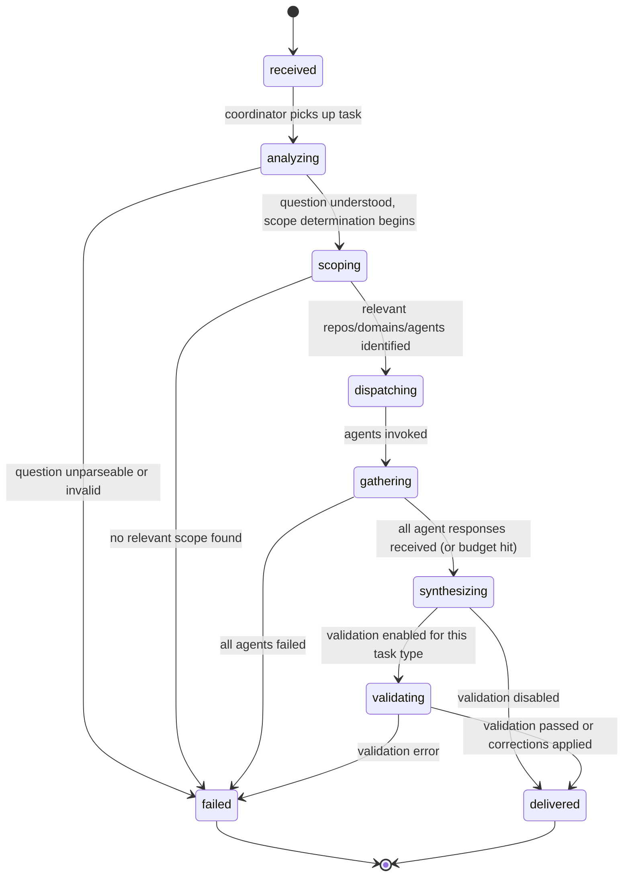
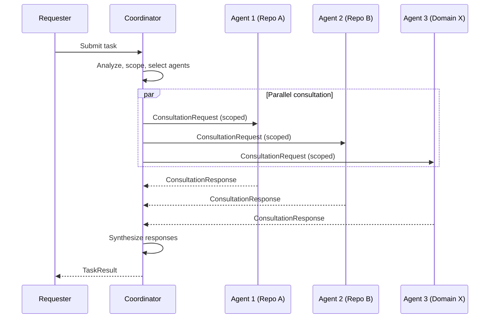
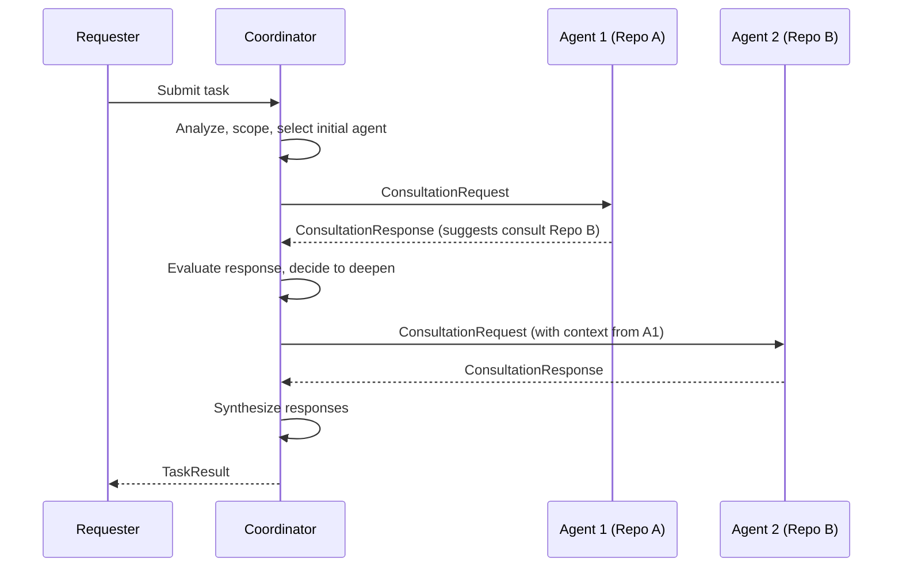
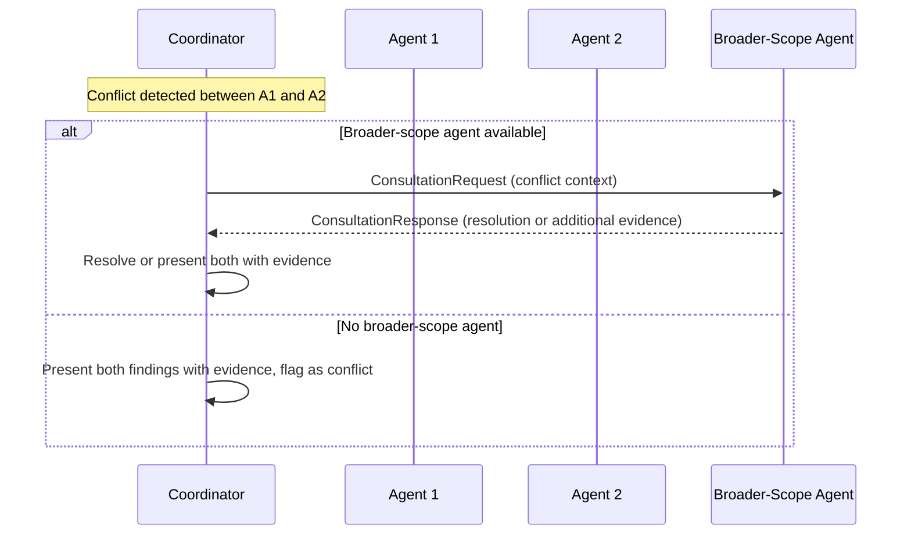
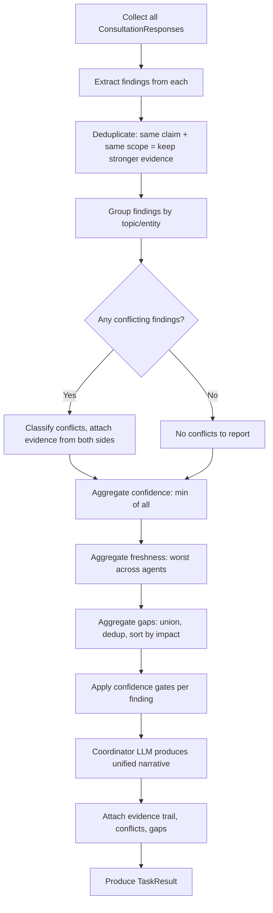

# S9 — Orchestration and Task Coordination Specification

**Status:** Draft
**Spec ID:** S9
**Depends on:** S8 (Agent Workforce), S3 (Freshness and Lag)
**Requirements traceability:** Primarily section 15; also sections 2.5, 3.1–3.6, 4.2, 7.2, 14.2–14.3, 16, 20

---

## 1. Purpose and Scope

This specification defines how tasks are received, decomposed, dispatched to specialist agents, and synthesized into unified answers. It is the conductor of the orchestra — it decides who plays, when, and how the parts combine into a coherent whole.

This document is distinct from S8 (Agent Workforce), which defines what agents are, what they know, and how they operate individually. This document defines how agents coordinate.

Orchestration is implemented across two tracks. Track A (V1): TaskCoordinator Python class, parallel RepoAgent calls via asyncio.gather, in-process synthesis, custom SSE streaming. Track B (future): TaskCoordinator as Managed Agent Session, session threads for parallel consultation, built-in SSE streaming. The orchestration LOGIC (scope determination, agent selection, synthesis strategy) is identical between tracks. Only the execution mechanism differs.

Scope includes:
- The task model and lifecycle
- The coordinator (Task Master) that routes and synthesizes
- Consultation patterns between coordinator and agents
- Inter-agent communication protocol
- Synthesis of multi-agent responses
- Budget management
- Audit logging of orchestration decisions

Scope excludes:
- Agent internals (S8)
- Source adapter mechanics (S2)
- Freshness computation internals (S3)
- Storage layer details (S4)
- Knowledge graph structure (S1)

---

## 2. Glossary References

| Term | Definition |
|------|-----------|
| **Task** | A unit of work submitted to Bifrost — a question, analysis request, or action request with defined scope and budget. |
| **Specialist / Agent** | A scoped worker with expertise over a particular repo, domain, source type, or cross-cutting concern. Defined in S8. |
| **Flow** | An end-to-end path through one or more repos and services representing a business or technical operation. |
| **Dependency** | A relationship where one entity relies on another — code, API, schema, event, runtime, or inferred. |
| **KnowledgeArtifact** | Any stored unit of knowledge — mapping, extracted entity, generated doc, learned pattern, or task output — carrying source basis, freshness, and confidence metadata. |
| **Consultation** | A single request-response interaction between the coordinator and an agent during task execution. |
| **Synthesis** | The process of merging findings from multiple consultations into one coherent response. |

---

## 3. Requirements Traceability

| Requirement | Addressed in |
|-------------|-------------|
| 15.1 — Avoid rigid over-orchestration and uncontrolled swarm | Section 4 (Design Goals), Section 7 (Coordinator depth decision) |
| 15.2 — Task master requirement | Section 7 (Task Master / Coordinator) |
| 15.3 — Consultation requirements | Section 8 (Consultation Patterns) |
| 15.4 — Structured communication | Section 9 (Inter-Agent Communication Protocol) |
| 15.5 — Logging requirements for orchestration | Section 12 (Consultation Logging) |
| 2.5 — Multi-repo, multi-source questions | Section 7 (scope determination), Section 8 (parallel gather) |
| 4.2 — AI user requirements | Section 5 (Task model requester), Section 13 (API contracts) |
| 7.2 — Knowledge quality (source, freshness, confidence, gaps) | Section 9 (response schema), Section 10 (synthesis model) |
| 16 — Confidence, uncertainty, conflict | Section 10 (conflict detection, confidence aggregation) |
| 20 — Logging and audit | Section 12 (consultation logging) |

---

## 4. Design Goals

The orchestration layer must navigate between two failure modes:

**Over-orchestration** — a rigid, rule-heavy coordinator that requires explicit routing for every question type, breaks on novel queries, and adds latency through unnecessary ceremony. This is the heavyweight workflow engine anti-pattern.

**Uncontrolled swarm** — agents consulting each other freely with no budget, no termination condition, and no structured output. This produces unpredictable cost, latency, and contradictory results.

The design goals are:

1. **LLM-backed flexibility.** The coordinator uses an LLM to understand diverse queries rather than hard-coded routing rules. New question types do not require new orchestration code.
2. **Parallel-first.** Default to parallel consultation to minimize latency. Sequential deepening is a secondary pattern for focused investigation.
3. **Budget-aware.** Every task has a budget (LLM calls, wall time, agent count). The coordinator tracks consumption and terminates gracefully when budget is exhausted.
4. **Structured communication.** All agent interactions use typed schemas. No freeform text dumps between agents.
5. **Full audit trail.** Every consultation is logged — who was asked, what was returned, what was synthesized, and why.
6. **Graceful degradation.** When agents disagree, coverage is incomplete, or confidence is low, the system reports this transparently rather than guessing.

---

## 5. Task Model

### 5.1 Core Types

```python
class TaskType(str, Enum):
    UNDERSTAND = "understand"        # explain what something is or how it works
    PLAN = "plan"                    # produce an implementation or migration plan
    VALIDATE = "validate"            # check a proposal against existing state
    COMPARE = "compare"              # compare implementations, flows, or options
    TRACE_FLOW = "trace_flow"        # trace an end-to-end flow
    ASSESS_IMPACT = "assess_impact"  # determine blast radius of a change
    GENERATE_DOC = "generate_doc"    # produce or refresh documentation
    REFRESH = "refresh"              # refresh stale knowledge for a scope

class TaskStatus(str, Enum):
    RECEIVED = "received"            # task accepted, not yet analyzed
    ANALYZING = "analyzing"          # coordinator understanding the question
    SCOPING = "scoping"              # determining relevant repos/domains/sources
    DISPATCHING = "dispatching"      # selecting and invoking agents
    GATHERING = "gathering"          # collecting agent responses
    SYNTHESIZING = "synthesizing"    # merging responses into unified answer
    VALIDATING = "validating"        # adversarial skeptic reviewing synthesis (optional stage)
    DELIVERED = "delivered"          # final result available
    FAILED = "failed"                # unrecoverable error

class Task(BaseModel):
    id: str
    type: TaskType
    query: str                           # natural language question or structured request
    scope: TaskScope
    requester: RequesterInfo
    freshness_requirement: FreshnessRequirement
    budget: TaskBudget
    status: TaskStatus
    result: TaskResult | None = None
    log: TaskLog | None = None
    created_at: datetime
    updated_at: datetime
```

### 5.2 Supporting Types

```python
class ScopeLevel(str, Enum):
    REPO = "repo"
    DOMAIN = "domain"
    ORG = "org"
    FLOW = "flow"
    SPECIFIC = "specific"

class TaskScope(BaseModel):
    level: ScopeLevel
    repo_ids: list[str] | None = None
    domain_ids: list[str] | None = None
    flow_ids: list[str] | None = None
    entity_refs: list[str] | None = None  # specific files, services, endpoints, etc.

class RequesterType(str, Enum):
    HUMAN = "human"
    AI_AGENT = "ai_agent"

class RequesterInfo(BaseModel):
    type: RequesterType
    id: str
    context: str | None = None           # optional context about what the requester is doing

class FreshnessRequirement(BaseModel):
    max_staleness_ms: int | None = None  # None = use system default
    require_live_fetch: bool             # force live source fetch, bypass cache

class TaskBudget(BaseModel):
    max_llm_calls: int
    max_wall_time_ms: int
    max_agents_consulted: int

class CoverageLevel(str, Enum):
    FULL = "full"          # all relevant repos have fresh T1/T2 knowledge
    PARTIAL = "partial"    # some repos have partial or T0-only knowledge
    MINIMAL = "minimal"    # only T0 mappings available (no deep extraction yet)
    NONE = "none"          # no relevant knowledge found, answer is speculative

class RepoCoverage(str, Enum):
    FRESH = "fresh"
    STALE = "stale"
    PARTIAL = "partial"
    NOT_INDEXED = "not-indexed"

class CoverageDetail(BaseModel):
    repo_id: str
    coverage: RepoCoverage

class TaskResult(BaseModel):
    findings: list[Finding]
    evidence: list[EvidenceRef]
    confidence: ConfidenceLevel
    freshness: FreshnessReport
    conflicts: list[Conflict]
    gaps: list[Gap]
    synthesis_notes: str                 # coordinator's rationale for the final answer
    coverage_level: CoverageLevel
    coverage_details: list[CoverageDetail] | None = None

class EffortLevel(str, Enum):
    LOW = "low"
    MEDIUM = "medium"
    HIGH = "high"
    UNKNOWN = "unknown"

# Plan-specific task result (task_type: 'plan')
class PlanTaskResult(BaseTaskResult):
    task_type: str = "plan"
    options: list[TaskOption]
    recommendation: str  # which option is recommended and why

class TaskOption(BaseModel):
    id: str
    title: str
    description: str
    confidence: ConfidenceLevel  # from S3
    effort: EffortLevel
    risks: list[str]
    blast_radius: BlastRadiusEstimate
    dependencies_affected: list[str]  # component IDs
    flows_affected: list[str]         # flow IDs

class BlastRadiusEstimate(BaseModel):
    direct_components: int
    transitive_components: int   # blast radius graph traversal result
    confidence: ConfidenceLevel
    warning: str | None = None   # e.g., "blast radius capped at depth limit"
```

---

## 6. Task Lifecycle

A task moves through the following states in order. Backward transitions are not permitted; failure at any state moves the task to `failed` with partial results preserved.

```
received -> analyzing -> scoping -> dispatching -> gathering -> synthesizing -> [validating] -> delivered
                                                                                                    |
              (any state) --------------------------------------------------------------------------+-> failed
```

The `validating` stage is optional. It is inserted between `synthesizing` and `delivered` when adversarial validation is enabled for the task type (see Section 10.7).

### 6.0 State-to-Track Mapping

```
Task Lifecycle

State: received → analyzed → scoped → dispatched → gathered → synthesized → delivered

Track A implementation:
  received:    Bifrost API receives user query, creates task record in PostgreSQL
  analyzed:    TaskCoordinator LLM call: parse intent, identify task type (trace-flow, assess-impact, etc.)
  scoped:      TaskCoordinator queries PostgreSQL to determine relevant repos (5-10 for typical query)
  dispatched:  await asyncio.gather(repo_agent1.execute(task), repo_agent2.execute(task), ...)
  gathered:    await all coroutines, collect list[AgentResponse]
  synthesized: LLM call with all agent responses to produce unified answer
  delivered:   stream synthesis response to user via SSE; write findings to AgentStateBackend

Track B implementation:
  received:    Bifrost API receives user query
  analyzed:    TaskCoordinator Session created; coordinator's first LLM turn parses intent
  scoped:      Coordinator queries knowledge graph via MCP tools, determines relevant repos
  dispatched:  Coordinator invokes RepoAgent session threads (session.thread_created events emitted)
  gathered:    Coordinator waits for session.thread_idle events from all threads
  synthesized: Coordinator synthesizes thread responses in its own context
  delivered:   Session SSE events stream to user; coordinator writes summary to memory store
```

#### Track B Session Error Recovery

Track B sessions are subject to infrastructure constraints that require explicit recovery strategies:

- `session_timeout`: Session exceeded duration limit mid-task. Recovery: write current progress to Memory Store checkpoint path (`/task/{task_id}/checkpoint.md`). Re-spawn session with `resume: true` flag. New session reads checkpoint and continues from last completed file. Max 3 re-spawns per task; if exceeded, return partial result with `coverage_level: 'partial'`.

- `session_spawn_failed`: Managed Agents infrastructure unavailable. Fallback: if `TRACK_B_FALLBACK_TO_A=true` env var set, retry using Track A Messages API. Otherwise return `503 Service Unavailable` with `retry_after: 60`.

- `mcp_tool_failure`: MCP sidecar not responding. Recovery: 3 retries with 1s/2s/4s backoff (same as S2 adapter retry policy). After 3 failures, mark tool as unavailable and reduce task scope accordingly.

- `memory_store_write_failure`: Cannot persist checkpoint. Recovery: log error, continue execution. On session end, attempt one final write. If still failing, return result with warning flag `state_persistence_failed: true`.

### 6.1 State Machine



### 6.2 State Descriptions

| State | What happens | Outputs |
|-------|-------------|---------|
| **received** | Task is accepted and queued. Validate schema, assign ID, record timestamp. | Task ID returned to requester. |
| **analyzing** | Coordinator LLM parses the query. Determines task type, extracts key entities, identifies ambiguity. | Parsed intent, extracted keywords, identified entities. |
| **scoping** | Coordinator looks up knowledge store: keyword-to-repo mappings, domain memberships, flow participation. Determines which repos, domains, and source types are relevant. | Resolved scope: list of repos, domains, flows, agents to consult. |
| **dispatching** | Coordinator queries agent registry for agents matching the resolved scope. Selects agents based on scope overlap and capability match. Constructs consultation requests. | Agent consultation plan (which agents, what to ask each). |
| **gathering** | Consultation requests sent to agents (parallel or sequential per chosen pattern). Responses collected. Budget tracked. | Raw agent responses. |
| **synthesizing** | Coordinator merges agent responses. Detects conflicts. Aggregates confidence and freshness. Identifies gaps. Produces unified result. | TaskResult with findings, evidence, confidence, conflicts, gaps. |
| **validating** | Optional. Fresh adversarial agent reviews synthesis output against raw evidence. Checks for unsupported claims, contradictions, and overreach. Corrections applied before delivery. | ValidationResult with passed flag and any corrections. |
| **delivered** | Result stored and returned to requester. Task log finalized. | Final response to requester. |
| **failed** | Error recorded. Partial results preserved if any. | Error reason, partial results if available. |

---

## 7. Task Master / Coordinator

### 7.0 TaskCoordinator

Purpose: Receives a user task, determines scope, consults relevant agents, synthesizes response.

Track A Implementation:
  Class: TaskCoordinator implements AgentRuntime
  Scope determination: PostgreSQL query (JOIN repos, domains, entities WHERE relevant to task)
  Consultation: await asyncio.gather(*(RepoAgent(repo).execute(subtask) for repo in relevant_repos))
  Synthesis: one LLM call with all agent responses (max 2,000 tokens per agent response to stay in window)
  Streaming: AsyncGenerator yields text chunks to Bifrost API → proxied as SSE to user
  State: reads from AgentStateBackend to get domain context; writes task findings on completion

Track B Implementation:
  Agent Definition: callable_agents=[list of RepoAgent Definition IDs in scope]
  Session creation: POST /v1/sessions with coordinator agent + environment + memory stores
  Scope determination: MCP tool call to knowledge graph API
  Consultation: coordinator invokes N RepoAgent threads (automatically spawned)
  Synthesis: coordinator's LLM context receives all thread final messages and synthesizes
  Streaming: GET /v1/sessions/{id}/stream (SSE events natively)
  State: writes synthesis summary to domain memory store on session completion

### 7.1 Architecture

The coordinator is an LLM-backed component. It does not use hard-coded routing tables. Instead, it uses an LLM to:

1. **Understand the question** — parse intent, extract entities, determine task type.
2. **Determine scope** — decide which repos, domains, and sources are relevant.
3. **Select agents** — choose which specialists to consult.
4. **Decide depth** — determine whether a single agent suffices or multiple are needed.
5. **Synthesize** — merge agent responses into a unified answer.

The coordinator itself is not a specialist. It does not hold domain knowledge. It knows how to ask, who to ask, and how to combine answers.

### 7.2 Scope Determination

Scope determination follows this sequence:

1. **Keyword extraction.** The coordinator LLM extracts key terms, entity names, repo names, service names, flow names, and domain references from the query.
2. **Knowledge store lookup.** Extracted terms are matched against the knowledge store — entity-to-repo mappings, domain memberships, flow registrations, keyword indices.
3. **Scope resolution.** Matched entities are expanded to their containing repos and domains. If a flow is referenced, all participating repos are included. If a domain is referenced, all repos in that domain are included.
4. **Agent identification.** The agent registry is queried for agents covering the resolved repos, domains, and source types.

#### Bootstrapping State

When the system has repos registered but no T1/T2 knowledge extracted, queries must not fail silently. The TaskCoordinator follows this flow:

```
1. Scope resolver queries keyword→repo mappings
2. If ZERO matches found:
   a. Check if any repos are registered (SELECT count FROM repositories)
   b. If repos exist but no knowledge: return "bootstrapping" TaskResult
   c. If no repos registered: return "empty" TaskResult with setup instructions

3. "Bootstrapping" TaskResult:
   {
     status: 'bootstrapping',
     message: 'Knowledge is being indexed for your repos. Estimated ready time: {time}',
     repos_registered: N,
     repos_indexed: M,
     next_step: 'extraction_triggered'
   }
   HTTP: 202 Accepted (not 200 or 404)

4. Trigger minimum bootstrap for all registered repos (T0+):
   - Parse README, manifests, top-level structure (no LLM)
   - Creates basic keyword→repo mappings
   - Enables at least T0 routing for next query
```

**Minimum T0+ bootstrap** (runs during repo registration, no LLM):
- Read `package.json` / `go.mod` / `pom.xml` / `Cargo.toml` — extract name, description, dependencies
- Read first 1KB of `README.md` — extract keywords
- List top-level directory names as tags
- Write to `repo_metadata` table for scope resolution
- This enables basic routing before deep T1 extraction

### 7.3 Agent Selection

Given a resolved scope and agent registry:

1. Query the registry for agents whose `scope` overlaps with the task's resolved scope.
2. Rank by relevance: prefer agents whose scope is a closer match (repo-level agent over domain-level for a repo-specific question).
3. Apply budget constraint: if more agents match than the budget allows, prefer higher-relevance agents.
4. For cross-domain questions, include at least one agent per relevant domain.

### 7.4 Depth Decision

The coordinator decides how many agents to involve:

| Signal | Decision |
|--------|----------|
| Question targets a single repo with a single-scope agent available | Single agent consultation |
| Question spans multiple repos within one domain | Multiple repo agents + domain agent |
| Question spans multiple domains | Domain agents in parallel |
| Question is ambiguous or scope is unclear | Start narrow (best-match agent), widen if response indicates gaps |
| Agent response suggests consulting another agent | Sequential deepening (V2) |

**Minimum consultation rules:**
- Single-repo question: minimum 1 RepoAgent, always consulted
- If only RepoAgent's knowledge has confidence < 'inferred': widen to check adjacent repos
- If TaskCoordinator confidence < 0.5 after synthesis: trigger 1 additional RepoAgent for verification
- Domain question: minimum 2 RepoAgents (even if single-repo scope — always cross-check)

### 7.5 Synthesis Responsibility

After gathering, the coordinator LLM:

1. Reads all agent responses.
2. Identifies overlapping findings and deduplicates.
3. Detects conflicts (same fact, different values from different agents).
4. Aggregates confidence (see Section 10).
5. Aggregates freshness (see Section 10).
6. Collects all reported gaps into a union set.
7. Produces a unified answer with evidence trail.

---

## 8. Consultation Patterns

### 8.1 Parallel Gather (Default)

All relevant agents are consulted simultaneously. Responses are collected and merged.

**When to use:** Broad questions, cross-domain questions, questions where multiple independent perspectives are needed.



**Parallel Gather — implementation per track:**

Track A:
```python
responses = await asyncio.gather(*(
    RepoAgent(repo, state_backend, source_adapters).execute(
        subtask, max_tokens=2000, timeout=30.0
    )
    for repo in relevant_repos
))
synthesis = await coordinator_llm.synthesize(responses)
```

Track B:
  Coordinator invokes callable agents (session threads automatically spawned in parallel).
  Events: session.thread_created × N, then session.thread_idle × N as each completes.
  Coordinator reads final messages from all threads and synthesizes in its own context.

Key constraint (Track B): Only RepoAgents in callable_agents[] can be consulted.
  TaskCoordinator must be created with the relevant repo agents pre-declared.
  Dynamically adding agents to a session is not supported in Track B.
  Solution: create TaskCoordinator definitions per domain (one per domain, listing that domain's repos).

### 8.2 Sequential Deepening

Start with a single agent. Use its response to decide whether and where to consult next.

**When to use:** Focused investigation where the first answer determines the next question. Tracing a flow step by step. Following a dependency chain.



**Sequential Deepening — implementation per track:**

Track A:
  Initial gather (parallel) → identify most relevant repo → call that RepoAgent again with deeper question.

Track B:
  Coordinator sends follow-up message to a specific thread (threads persist for session duration).
  Thread recalls its previous context and provides deeper analysis without repeating initial work.
  Advantage of Track B: persistent thread context makes follow-up more efficient.

### 8.3 Conflict Resolution

When two agents provide contradictory findings for the same fact.

**When to use:** Automatically triggered during synthesis when conflicts are detected.



### 8.4 Escalation

When confidence remains too low after consultation, the coordinator reports uncertainty rather than guessing.

**When to use:** When all consulted agents report low confidence, or when significant gaps remain.

The coordinator does NOT fabricate answers to fill gaps. It reports:
- What is known (with evidence and confidence).
- What is unknown (with specific gap descriptions).
- What additional sources or actions might resolve the unknowns.

### 8.5 Pattern Selection Heuristic

```
if question is broad or cross-domain:
    parallel gather at domain level
    within each domain: parallel gather at repo level
elif question is focused on a single entity or flow:
    sequential deepening starting from most relevant agent
elif question targets multiple repos in one domain:
    parallel gather across repo agents
else:
    parallel gather (default)
```

V1 simplification: always use parallel gather. Sequential deepening is deferred.

### 8.6 Persistent Intermediate Results

Multi-agent queries accumulate consultation results in memory. If the orchestrator process crashes, context compresses, or the query takes long enough that context limits apply, these results can be lost. For multi-agent queries, the TaskCoordinator writes each agent's consultation result to persistent storage immediately upon receipt, before synthesis.

#### Storage

```python
class ConsultationLog(BaseModel):
    """Written to PostgreSQL task_consultation_log table."""
    task_id: str
    agent_id: str        # which RepoAgent or agent type
    repo_id: str
    requested_at: str    # ISO timestamp
    completed_at: str

    # Full consultation result — persisted, not just in-memory
    findings: list[Finding]
    evidence: list[EvidenceRef]
    confidence: ConfidenceLevel
    gaps: list[KnowledgeGap]
    usage: UsageInfo

class UsageInfo(BaseModel):
    model: str
    input_tokens: int
    output_tokens: int
    cost_estimate_usd: float
```

```sql
CREATE TABLE task_consultation_log (
  id UUID PRIMARY KEY DEFAULT gen_random_uuid(),
  task_id UUID NOT NULL REFERENCES tasks(id),
  agent_id TEXT NOT NULL,
  repo_id TEXT,
  requested_at TIMESTAMPTZ NOT NULL,
  completed_at TIMESTAMPTZ,
  result_json JSONB,                  -- full ConsultationLog
  created_at TIMESTAMPTZ DEFAULT NOW()
);
CREATE INDEX idx_tcl_task_id ON task_consultation_log(task_id);
```

**Recovery:** If synthesis fails after consultations have been logged, the TaskCoordinator can re-read consultation results from the DB and retry synthesis without re-consulting agents. This is especially important for multi-agent queries that take 10-30 seconds total.

**Track B:** In Track B, consultation results are written to the TaskCoordinator's Memory Store at `/task/{task_id}/consultations/{agent_id}.md` — survives session context compression automatically.

---

## 9. Inter-Agent Communication Protocol

All communication between the coordinator and agents uses typed schemas. No freeform text dumps.

### 9.1 Consultation Request

```python
class DepthHint(str, Enum):
    SHALLOW = "shallow"
    STANDARD = "standard"
    DEEP = "deep"

class ConsultationRequest(BaseModel):
    task_id: str
    consultation_id: str
    query: str                           # scoped question for this agent
    scope: TaskScope                     # narrowed scope for this consultation
    depth_hint: DepthHint
    freshness_requirement: FreshnessRequirement
    context_from_prior_agents: list[PriorContext]  # findings from earlier consultations (sequential pattern)
    budget_remaining: BudgetRemaining    # how much budget the agent may consume

class PriorContext(BaseModel):
    agent_id: str
    summary: str                         # brief summary of prior agent's findings
    relevant_findings: list[Finding]     # specific findings that inform this consultation

class BudgetRemaining(BaseModel):
    max_llm_calls: int
    max_wall_time_ms: int
```

### 9.2 Consultation Response

```python
class FindingType(str, Enum):
    FACT = "fact"
    INFERENCE = "inference"
    OBSERVATION = "observation"

class ConfidenceLevel(str, Enum):
    CONFIRMED = "confirmed"
    INFERRED = "inferred"
    STALE = "stale"
    UNCERTAIN = "uncertain"
    UNKNOWN = "unknown"
    CONFLICTING = "conflicting"

class ConflictType(str, Enum):
    SOURCE_CONFLICT = "source_conflict"
    STALE_VS_CURRENT = "stale_vs_current"
    RUNTIME_VS_STATIC = "runtime_vs_static"
    INTENT_VS_IMPLEMENTATION = "intent_vs_implementation"
    DEPENDENCY_DISAGREEMENT = "dependency_disagreement"

class GapImpact(str, Enum):
    BLOCKS_ANSWER = "blocks_answer"
    REDUCES_CONFIDENCE = "reduces_confidence"
    MINOR = "minor"

class ConsultationResponse(BaseModel):
    consultation_id: str
    agent_id: str
    findings: list[Finding]
    evidence: list[EvidenceRef]
    confidence: ConfidenceLevel
    freshness: FreshnessReport
    gaps: list[Gap]
    conflicts: list[Conflict]
    suggested_consults: list[AgentRef]   # agents this agent recommends consulting next
    budget_consumed: BudgetConsumed

class Finding(BaseModel):
    id: str
    statement: str                       # the factual claim
    type: FindingType
    confidence: ConfidenceLevel
    evidence_refs: list[str]             # references into the evidence array
    scope: str                           # what repo/domain/flow this applies to

class EvidenceRef(BaseModel):
    id: str
    source_type: str                     # 'code' | 'config' | 'api_spec' | 'jira' | 'doc' | 'runtime' | etc.
    source_id: str                       # identifier in the source system
    location: str                        # file path, URL, or reference
    snippet: str | None = None           # relevant excerpt
    freshness: datetime                  # when this evidence was last verified

class FreshnessReport(BaseModel):
    oldest_evidence: datetime
    newest_evidence: datetime
    any_stale: bool
    stale_sources: list[str]

class Gap(BaseModel):
    description: str                     # what is missing
    likely_source: str                   # where the answer might be found
    impact: GapImpact

class Conflict(BaseModel):
    description: str
    finding_a: str                       # finding ID from one agent
    finding_b: str                       # finding ID from another agent (or same agent, different evidence)
    conflict_type: ConflictType

class AgentRef(BaseModel):
    agent_id: str
    reason: str                          # why this agent should be consulted

class BudgetConsumed(BaseModel):
    llm_calls: int
    wall_time_ms: int
```

All fields in `ConsultationResponse` are required. An agent that has no conflicts returns an empty list, not an omitted field. An agent that cannot determine freshness returns explicit `unknown` markers, not omissions.

---

## 10. Synthesis Model

### 10.1 Merge Process

The coordinator merges findings from all consulted agents:

1. **Collect** all findings from all responses.
2. **Deduplicate** findings that make the same claim about the same scope, keeping the one with stronger evidence.
3. **Group** findings by topic or entity for coherent presentation.
4. **Detect conflicts** — two findings that assert contradictory facts about the same entity or relationship.
5. **Surface conflicts** explicitly in the result rather than silently picking a winner.

### 10.2 Conflict Detection

A conflict exists when:
- Two findings reference the same entity or relationship.
- They assert different values or states.
- Both have non-trivial evidence.

Conflicts are classified using the `conflict_type` enum and included in the `TaskResult.conflicts` list with references to both findings and their evidence.

### 10.3 Confidence Aggregation

For V1:

```
overall_confidence = min(individual_confidences)
```

Rationale: the weakest link determines the reliability of the overall answer. If one critical agent reports low confidence, the overall answer cannot be high confidence.

Future versions may use weighted confidence based on how central each finding is to the answer.

### 10.4 Freshness Aggregation

```
overall_freshness.oldest_evidence = min(all agent oldest_evidence timestamps)
overall_freshness.newest_evidence = max(all agent newest_evidence timestamps)
overall_freshness.any_stale = any(agent reports stale)
overall_freshness.stale_sources = union(all agent stale_sources)
```

The worst freshness across all consulted agents determines the overall freshness posture.

### 10.5 Gap Aggregation

All gaps reported by all agents are collected into a union set, deduplicated by description similarity, and sorted by impact (blocks_answer first).

### 10.6 Confidence Gate Behavior

For every finding in a synthesis pass, the TaskCoordinator applies confidence gates before including findings in the response:

| ConfidenceLevel | Gate behavior |
|----------------|--------------|
| `confirmed` | Pass through. High prominence in response. |
| `inferred` | Include with visible "inferred" label. Slightly lower prominence. Note evidence basis. |
| `stale` | Attempt re-extraction before inclusion. If re-extraction succeeds: include with updated confidence. If re-extraction fails: include with explicit staleness warning and age. |
| `uncertain` | Include with "uncertain" label. Flag that additional evidence would improve this. Suggest user verify. |
| `unknown` | Exclude from synthesis. Record as a KnowledgeGap in the response's `gaps` field. |
| `conflicting` | Do NOT merge. Halt synthesis for that entity. Present both interpretations side-by-side with source attribution for each. Set overall response `has_conflicts: true`. |

**Implementation:**

```python
class ConfidenceGateResult(BaseModel):
    included: list[Finding]
    gaps: list[KnowledgeGap]
    has_conflicts: bool

def apply_confidence_gate(
    findings: list[Finding],
    gate: ConfidenceGateConfig,
) -> ConfidenceGateResult:
    included: list[Finding] = []
    gaps: list[KnowledgeGap] = []
    has_conflicts = False

    for finding in findings:
        match finding.confidence:
            case ConfidenceLevel.CONFIRMED | ConfidenceLevel.INFERRED | ConfidenceLevel.UNCERTAIN:
                included.append(finding)  # all pass, with prominence weight
            case ConfidenceLevel.STALE:
                # attempt refresh — included either way but with staleness note
                included.append(finding.model_copy(update={"stale_warning": True}))
            case ConfidenceLevel.UNKNOWN:
                gaps.append(KnowledgeGap(entity=finding.entity_ref, reason="no_knowledge"))
            case ConfidenceLevel.CONFLICTING:
                has_conflicts = True
                included.append(finding.model_copy(update={"is_conflict": True}))

    return ConfidenceGateResult(included=included, gaps=gaps, has_conflicts=has_conflicts)
```

`TaskResult` includes `has_conflicts: bool` and `stale_warnings: int` to reflect gate outcomes.

### 10.7 Validation Stage (Adversarial Skeptic)

An optional stage between `synthesizing` and `delivered`. When enabled for a task type, a fresh agent (no shared context with the synthesis agent) reviews the synthesis output against raw evidence.

**What the adversarial agent checks:**
1. Are all claims in the synthesis grounded in `evidence_refs`?
2. Do any findings contradict each other?
3. Are any findings more specific than the evidence supports?

**Configuration (per TaskType):**

```python
class ModelTier(str, Enum):
    HAIKU = "haiku"
    SONNET = "sonnet"

class ValidationConfig(BaseModel):
    enabled: bool
    # Which task types trigger adversarial validation
    # Default: on for 'assess_impact', 'plan', 'trace_flow'
    # Default: off for 'understand', 'generate_doc', 'refresh'
    task_types: list[TaskType]
    model: ModelTier  # Sonnet sufficient — doesn't need Opus reasoning
```

**Implementation (Track A):**

```python
async def validate_synthesis(
    synthesis: TaskResult,
    evidence: list[EvidenceRef],
    config: ValidationConfig,
) -> ValidationResult:
    if not config.enabled or synthesis.task_type not in config.task_types:
        return ValidationResult(passed=True, corrections=[])

    validation_prompt = build_validation_prompt(synthesis, evidence)
    # Fresh LLM call — no prior context, no agent state loaded
    response = await llm.messages(
        model="claude-sonnet-4-6",
        system="You are a skeptical reviewer. Find unsupported claims, contradictions, or overreach.",
        messages=[{"role": "user", "content": validation_prompt}],
    )

    return parse_validation_response(response)
```

**Cost:** One additional Sonnet call per validated task (~$0.015). Negligible for high-stakes queries.

### 10.8 Synthesis Flowchart



---

## 11. Budget Management

### 11.0 Dual-Track Budget Controls

Track A budget controls:
  max_agents: maximum RepoAgents to consult in parallel (default: 5, configurable)
  max_tokens_per_agent: cap on agent response length (default: 2,000 tokens)
  max_synthesis_tokens: cap on synthesis response (default: 4,000 tokens)
  timeout_ms: wall clock limit per agent call (default: 30,000ms), enforced via `asyncio.wait_for(agent.execute(...), timeout=timeout_ms/1000)`

  Cost estimation (Track A):
    - RepoAgent call: ~$0.01-0.05 (haiku) or $0.05-0.20 (sonnet) per call
    - Synthesis call: ~$0.05-0.20
    - 5 parallel agents + synthesis: ~$0.10-$1.00 per query

  Cost alerting:
    - Log estimated cost per task type after completion
    - Alert if single task exceeds $1.00
    - Alert if daily spend exceeds configurable threshold (default: $50/day)

Track B budget controls (additional):
  max_threads: number of simultaneous session threads (default: 5)
  max_session_duration_minutes: wall clock limit for entire coordinator session
  Container compute: additional cost dimension (time × container tier rate)

  Model routing strategy (both tracks):
    - Intent parsing / scope determination: claude-haiku-4-5 (fast, cheap)
    - Agent consultation dispatch: claude-haiku-4-5 (routing decision)
    - Per-repo extraction analysis (within RepoAgent): claude-sonnet-4-6
    - Final synthesis (combining findings across all agents): claude-opus-4-6
    - Adversarial validation stage: claude-sonnet-4-6 (sufficient for consistency checking)

  Rationale: The synthesis step is the highest-leverage call — it produces the final user-facing answer. Opus at synthesis, Sonnet at extraction, Haiku at routing reduces total query cost ~30% vs all-Sonnet while improving final output quality.

#### Track B Cost Model

Track B per-query cost components:
1. Session initialization: ~$0.001-0.005 per session (orchestration overhead)
2. MCP tool calls: ~$0.0001 per call (sidecar overhead)
3. Memory Store reads: ~$0.00001 per KB read
4. Memory Store writes: ~$0.00002 per KB written
5. LLM calls: same as Track A (model-dependent)

For a trace-flow query (3 RepoAgent sessions):
  - Session overhead: 3 × $0.003 = $0.009
  - MCP tool calls: ~50 calls × $0.0001 = $0.005
  - Memory Store: ~500KB total = $0.015
  - LLM calls: same as Track A (~$0.13-0.50)
  - Total Track B overhead vs Track A: +$0.03-0.05 per query

Track B cost alerting: add `track_b_overhead_usd` to llm_cost_log rows (separate from lm_cost_usd).
Alert threshold: `LLM_COST_BUDGET_USD` applies to TOTAL cost including Track B overhead.

### 11.1 Per-Task Budget

Every task carries a budget:

```python
class TaskBudget(BaseModel):
    max_llm_calls: int          # total LLM invocations across coordinator + all agents
    max_wall_time_ms: int       # wall-clock time from received to delivered
    max_agents_consulted: int   # maximum number of distinct agents to consult
```

V1 defaults:
- `max_llm_calls`: 20
- `max_wall_time_ms`: 30000 (30 seconds)
- `max_agents_consulted`: 5

### 11.2 Budget Tracking

The coordinator maintains a running tally:

```python
class BudgetTracker(BaseModel):
    llm_calls_used: int
    wall_time_elapsed_ms: int
    agents_consulted: int
    budget: TaskBudget
```

Each agent reports `budget_consumed` in its response. The coordinator updates the tracker after each consultation.

### 11.3 Early Termination

When any budget dimension is exceeded:

1. The coordinator stops dispatching new consultations.
2. Outstanding consultations are allowed to complete (up to a grace period of 5 seconds).
3. Available responses are synthesized into a partial result.
4. The result includes a `budget_exhausted` flag and indicates which agents were not consulted due to budget.

```python
class TaskResult(BaseModel):
    # ... existing fields ...
    budget_exhausted: bool
    budget_exhausted_detail: str | None = None  # e.g., "wall time exceeded; agents C and D were not consulted"
```

### 11.4 Latency Targets

| Scenario | p50 Target | p95 Target | p99 Target |
|----------|------------|------------|------------|
| Cache hit (fresh T1/T2, single-repo question) | <1s | <2s | <5s |
| Simple multi-agent (3 RepoAgents, fresh knowledge) | <5s | <12s | <20s |
| Complex multi-agent (5 RepoAgents, some stale) | <10s | <20s | <30s |
| Incremental extraction triggered | <60s | <2min | <5min |
| Cold start extraction (small repo, then query) | <5min | <12min | <20min |

Budget default (MAX_TASK_BUDGET_SECONDS): 30 seconds for query-only; 10 minutes for extraction-triggered queries.

### 11.5 Budget Degradation Behavior

For each budget dimension, three thresholds govern coordinator behavior:

```python
class BudgetAction(str, Enum):
    LOG = "log"
    WARN_USER = "warn_user"
    REDUCE_SCOPE = "reduce_scope"
    STOP_GRACEFULLY = "stop_gracefully"
    ERROR = "error"

class FailureModeAction(str, Enum):
    STOP = "stop"
    RETRY_WITH_SMALLER_SCOPE = "retry_with_smaller_scope"

class FailureModeConfig(BaseModel):
    # If the last N agent consultations produced zero new findings, stop expanding
    no_progress_threshold: int  # default: 3
    # Action when failure mode detected
    action: FailureModeAction

class BudgetBehavior(BaseModel):
    at_80_percent: BudgetAction
    at_100_percent: BudgetAction
    failure_mode_detection: FailureModeConfig
```

**Default behavior:**

| Threshold | Action |
|-----------|--------|
| 80% of `max_llm_calls` | Log warning. Continue. |
| 80% of `max_wall_time_ms` | Log warning. If not yet in synthesis: begin synthesis with current results. |
| 100% of `max_llm_calls` | Stop gracefully. Return best-available results. Set `coverage_level: 'partial'`. Include `"Response incomplete — budget reached"` in response. |
| 100% of `max_wall_time_ms` | Same as 100% LLM calls. |
| 3 consecutive consultations with zero new findings | Stop. Do not expand scope further. This is a failure-mode indicator that additional consultation will not help. |

**Failure-mode detection — implementation:**

```python
# In consultation loop
no_progress_runs = 0
for agent in agents_to_consult:
    result = await consult_agent(agent, task)
    new_findings = findings_not_in(result.findings, existing_findings)

    if len(new_findings) == 0:
        no_progress_runs += 1
        if no_progress_runs >= config.failure_mode_detection.no_progress_threshold:
            logger.warning("Failure mode: no progress after 3 consultations. Stopping.")
            break
    else:
        no_progress_runs = 0  # reset on any progress

    existing_findings.extend(new_findings)
```

**Track B session concurrency constraint:** Track B sessions additionally constrain `maxConsultations` to `min(maxConsultations, sessionPoolConfig.maxConcurrentSessions)`. The effective maximum is `3` in Research Preview, regardless of task budget setting.

---

## 12. Consultation Logging

Every task produces an audit log stored in the knowledge store.

### 12.1 Task Log Schema

```python
class ConsultationPattern(str, Enum):
    PARALLEL = "parallel"
    SEQUENTIAL = "sequential"

class TaskLog(BaseModel):
    task_id: str
    task_type: TaskType
    query: str
    scope_resolved: TaskScope
    consultations: list[ConsultationLogEntry]
    synthesis_decisions: list[SynthesisDecision]
    total_llm_calls: int
    total_wall_time_ms: int
    total_agents_consulted: int
    budget_exhausted: bool
    final_confidence: ConfidenceLevel
    conflict_count: int
    gap_count: int
    created_at: datetime
    completed_at: datetime

class ConsultationLogEntry(BaseModel):
    consultation_id: str
    agent_id: str
    agent_scope: str
    request_summary: str
    response_confidence: ConfidenceLevel
    findings_count: int
    evidence_count: int
    conflicts_reported: int
    gaps_reported: int
    budget_consumed: BudgetConsumed
    wall_time_ms: int
    order: int                           # consultation order (1-based)
    pattern: ConsultationPattern

class SynthesisDecision(BaseModel):
    decision: str                        # what the coordinator decided
    reason: str                          # why
    evidence_refs: list[str]             # what evidence supported this decision
```

### 12.2 Storage and Queryability

Task logs are stored as knowledge artifacts in the knowledge store (S4). They are queryable by:
- Task ID
- Time range
- Agents involved
- Task type
- Scope (repo, domain)
- Confidence level
- Presence of conflicts or gaps

This supports later analysis of orchestration quality, agent effectiveness, and common failure modes.

---

## 13. Interface Contracts

### 13.1 Task Submission API

```
POST /tasks
```

Request body: `Task` (without `id`, `status`, `result`, `log`, `created_at`, `updated_at` — these are server-assigned).

Response: `{ task_id: string, status: 'received' }`

### 13.2 Task Status API

```
GET /tasks/:task_id/status
```

Response: `{ task_id: string, status: TaskStatus, updated_at: timestamp }`

### 13.3 Task Result API

```
GET /tasks/:task_id/result
```

Response: `TaskResult` (available when status is `delivered` or `failed`).

Returns 404 if task does not exist. Returns 202 if task is still in progress.

### 13.4 Task Log API

```
GET /tasks/:task_id/log
```

Response: `TaskLog` (available when status is `delivered` or `failed`).

### 13.5 Task Search API

```
GET /tasks?type=...&scope_repo=...&scope_domain=...&from=...&to=...&confidence=...&has_conflicts=...
```

Response: paginated list of task summaries.

---

## 13.6 Streaming Architecture

Track A:
  1. User connects to GET /bifrost/v1/tasks/{id}/stream (Bifrost API)
  2. Bifrost API creates TaskCoordinator instance
  3. TaskCoordinator.execute() returns AsyncGenerator[AgentEvent]
  4. Bifrost API proxy: async for event in coordinator.execute(task): response.write(sse_format(event))
  5. Events include: status updates, partial text, agent consultation start/end, final answer
  6. No custom streaming infrastructure beyond Python async response stream

Track B:
  1. User connects to GET /bifrost/v1/tasks/{id}/stream (Bifrost API)
  2. Bifrost API creates TaskCoordinator Session (POST /v1/sessions)
  3. Bifrost API subscribes to session event stream (GET /v1/sessions/{id}/stream)
  4. Bifrost API proxies filtered events to user SSE stream
  5. Filtered events: agent.message (text chunks), session.thread_created (status),
     session.thread_idle (status), session.complete
  6. No custom SSE implementation beyond proxying Anthropic session stream

---

## 13.7 Tool Confirmation Routing (Track B only)

When a sub-agent session thread needs permission to run an always_ask tool:
1. Event surfaces on primary session stream with type: user.tool_confirmation_request
2. Event includes session_thread_id field indicating which thread is waiting
3. Bifrost control plane auto-approves known-safe tools:
   - git clone (to container filesystem only)
   - file reads (read-only tools)
   - MCP server calls for configured source systems (GitHub, Jira)
4. Bifrost escalates to user for unknown/dangerous tools
5. Confirmation response must include same session_thread_id to route back correctly

---

## 13.8 Track B Limitations

L1. **1-LEVEL MAX**: TaskCoordinator → RepoAgents is the deepest you can go in session threads.
L2. **RESEARCH PREVIEW GATING**: Track A is primary until access granted.
L3. **CONTEXT ISOLATION**: Thread agents don't share LLM context. Knowledge sharing via attached memory stores.
L4. **NO COORDINATOR VISIBILITY INTO THREAD INTERNALS**: Coordinator sees thread start/end and final message — not tool call traces inside the thread.
L5. **BUDGET ACROSS THREADS**: Parallel threads run simultaneously — N threads = N× compute cost simultaneously.
L6. **TOOL CONFIRMATIONS FROM THREADS**: Must route confirmations back with session_thread_id.
L7. **SYNTHESIS CONTEXT LIMITS**: N agent responses synthesized in coordinator context. Cap agent responses at 2,000 tokens each to stay within limits.
L8. **STREAMING DIFFERENCE**: Track A streams incrementally per agent. Track B streams session events.

---

## 14. Dependencies

| Dependency | What this spec needs from it |
|-----------|---------------------------|
| **S8 — Agent Workforce** | Agent registry: list of agents, their scopes, capabilities, and health. Agents must implement the `ConsultationRequest` / `ConsultationResponse` protocol defined in Section 9. |
| **S3 — Freshness and Lag** | Freshness metadata for source objects, repos, domains. Used by the coordinator to evaluate whether cached knowledge meets the task's freshness requirement, and by agents to report evidence freshness. |
| **S4 — Storage** | Persistent store for task results and task logs. Knowledge store for scope determination lookups (keyword-to-repo, domain membership, flow participation). |
| **S1 — Knowledge Model** | Entity and relationship data used during scope determination to expand keywords into repos, domains, and flows. |

---

## 15. Key Decisions

| Decision | Rationale |
|----------|-----------|
| **LLM-backed coordinator, not rule-based** | Rigid routing breaks on novel queries. An LLM can understand diverse natural-language questions and determine scope without maintaining a routing table for every permutation. Requirement 15.1 demands avoiding over-orchestration. |
| **Parallel-first consultation** | Minimizes latency. Most questions benefit from gathering independent perspectives simultaneously. Sequential deepening adds latency and is only justified for focused investigations. |
| **Budget-aware execution** | Prevents runaway cost and latency. Every task has explicit bounds. The system terminates gracefully with partial results rather than consuming unbounded resources. |
| **Structured communication protocol** | Requirement 15.4 demands structured communication. Typed schemas ensure agents return machine-parseable responses that the coordinator can merge deterministically. Eliminates ambiguity in inter-agent communication. |
| **Full audit logging** | Requirement 15.5 demands logging of participating specialists, consultation order, evidence, conflicts, and synthesis. Every orchestration decision is traceable after the fact. |
| **min() for confidence aggregation in V1** | Conservative and simple. The weakest link determines overall reliability. More sophisticated weighted aggregation is deferred to V2. |
| **Conflicts surfaced, not silently resolved** | Requirement 16.2 demands conflict detection. Automatically picking a winner without evidence is antithetical to Bifrost's design. Present both sides with evidence and let the consumer decide or investigate further. |

---

## 16. V1 Scope

V1 implements Track A orchestration: TaskCoordinator Python class, parallel RepoAgent calls via asyncio.gather, in-process synthesis, custom SSE streaming in Bifrost API. Max parallel agents: 5. Budget tracking and cost alerting implemented from day 1. Track B (session threads) is designed into all interfaces — migration requires adding callable_agents to coordinator Agent Definition and switching streaming to session stream proxy. No business logic changes needed.

### What V1 includes

- **Scope determination:** keyword extraction and knowledge store lookup (PostgreSQL). No semantic understanding of novel terms — if the keyword is not in the index, it will not resolve.
- **Consultation pattern:** parallel gather only via asyncio.gather. All selected agents are consulted simultaneously.
- **Synthesis:** basic merge with deduplication, conflict detection, min-confidence aggregation, gap union. No multi-round refinement.
- **Budget:** max 5 agents, 30-second wall time per agent, 20 LLM calls. Fixed defaults; per-task override supported. Cost alerting at $1.00/task and $50/day thresholds.
- **Logging:** full task log with all consultation entries and synthesis decisions.
- **API:** task submission, status, result, log, and stream endpoints.
- **Streaming:** custom SSE via AsyncGenerator from TaskCoordinator.

### What V1 defers

- **Track B (Managed Agent Sessions).** All V1 orchestration is in-process Python. Session threads are deferred pending research preview access.
- **Sequential deepening.** All V1 consultations are parallel. No multi-round investigation.
- **Sophisticated conflict resolution.** V1 surfaces conflicts but does not attempt automated resolution (e.g., consulting a broader-scope agent to break ties).
- **Cross-domain coordination.** V1 supports multi-repo within one domain. Cross-domain orchestration (coordinating domain-level agents across domain boundaries) is deferred.
- **Agent-suggested follow-up.** The `suggested_consults` field is populated by agents but not acted on by the V1 coordinator.
- **Semantic scope expansion.** V1 uses literal keyword matching. Semantic similarity (e.g., understanding that "retry scheduling" relates to the "delivery" domain even if that exact phrase is not indexed) is deferred.
- **Task decomposition.** V1 treats each task as a single unit. Automatic decomposition of complex tasks into subtasks is deferred.

---

## 17. Future Evolution

### 17.1 Multi-Round Consultation

The coordinator gains the ability to run multiple rounds: consult agents, evaluate responses, identify gaps, consult additional agents to fill gaps, and iterate until confidence meets a threshold or budget is exhausted.

### 17.2 Agent-Suggested Follow-Up

Agents return `suggested_consults` indicating which other agents might have relevant information. The coordinator uses these suggestions to expand consultation dynamically.

### 17.3 Automated Task Decomposition

Complex tasks (e.g., "plan a migration of service X from framework A to framework B") are automatically decomposed into subtasks:
- Understand current implementation (understand)
- Identify dependencies (trace_flow, assess_impact)
- Find similar migrations (compare)
- Produce plan (plan)

Each subtask runs through the full orchestration lifecycle. Results are assembled into a composite response.

### 17.4 Weighted Confidence Aggregation

Replace min() with a weighted model where confidence is proportional to how central each finding is to the answer. A low-confidence peripheral finding should not drag down the overall confidence of a well-supported core answer.

### 17.5 Learning from Orchestration History

Analyze task logs to improve future orchestration: which agents are commonly consulted together, which consultation patterns produce higher-confidence results, which scoping decisions frequently miss relevant agents.

---

## 18. Open Questions

1. **Coordinator LLM model selection.** Should the coordinator use the same LLM as agents, or a different (potentially faster/cheaper) model optimized for routing and synthesis rather than deep domain analysis?

2. **Budget allocation strategy.** When consulting N agents in parallel, should each agent receive 1/N of the remaining LLM budget, or should the coordinator hold a reserve for synthesis?

3. **Timeout behavior for slow agents.** If one agent in a parallel gather is slow, should the coordinator wait for it (up to budget), proceed without it, or set a per-agent timeout shorter than the task timeout?

4. **Conflict resolution priority.** When V2 adds automated conflict resolution, what heuristic determines which agent's finding takes precedence — scope specificity, evidence freshness, evidence count, or agent confidence?

5. **Task priority and queuing.** Should tasks have priority levels? Should human-initiated tasks preempt AI-agent-initiated tasks? What queuing model should be used when the system is under load?

6. **Partial result streaming.** Should the coordinator stream partial results to the requester as agent responses arrive, or only deliver a complete result after synthesis? Streaming improves perceived latency but complicates the API contract.

7. **Coordinator state.** Is the coordinator stateless (reconstructs context from the task and knowledge store each time) or stateful (maintains in-memory state for active tasks)? Stateless is simpler but may require redundant LLM calls.
