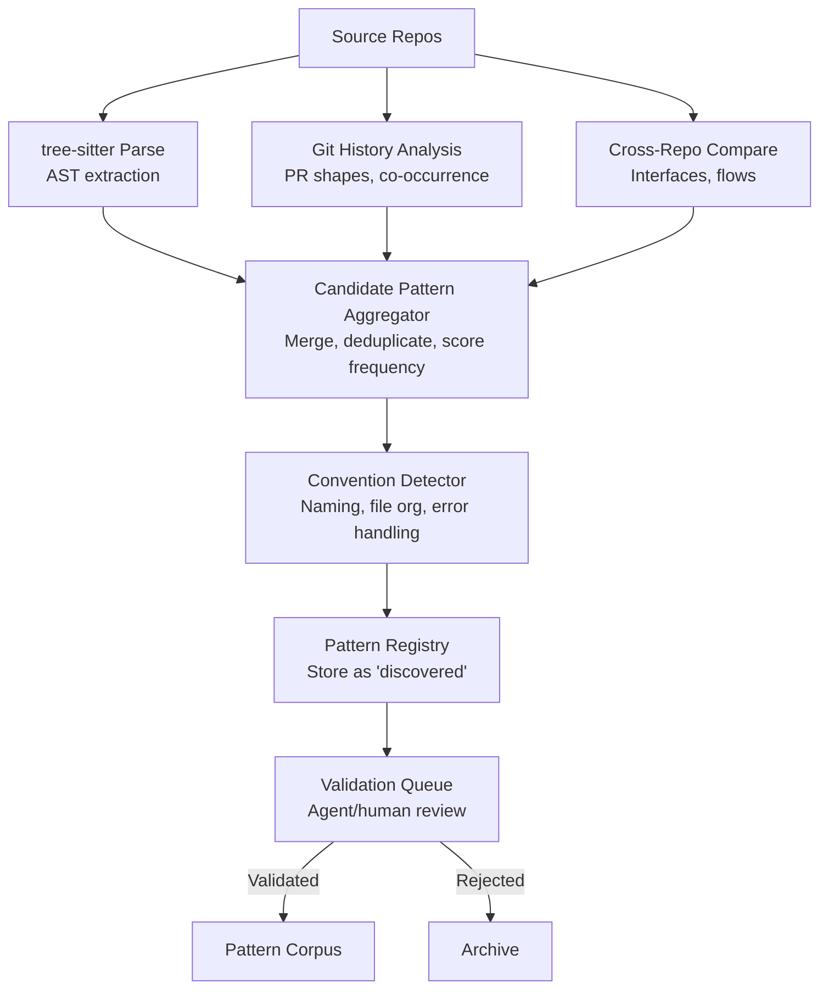
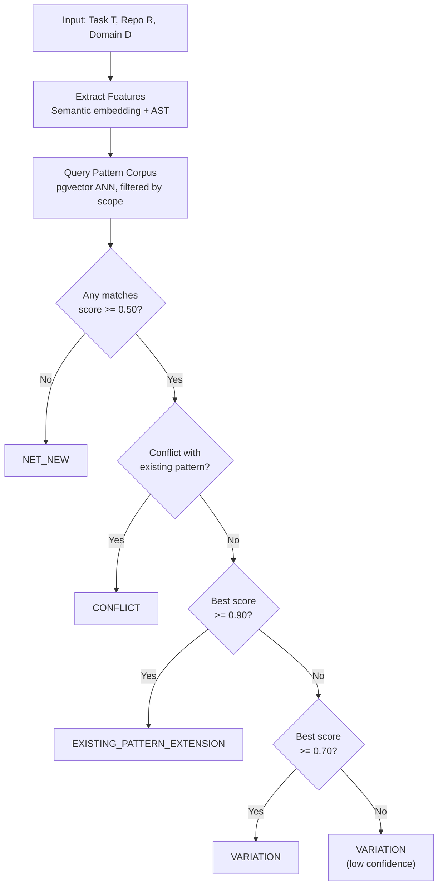
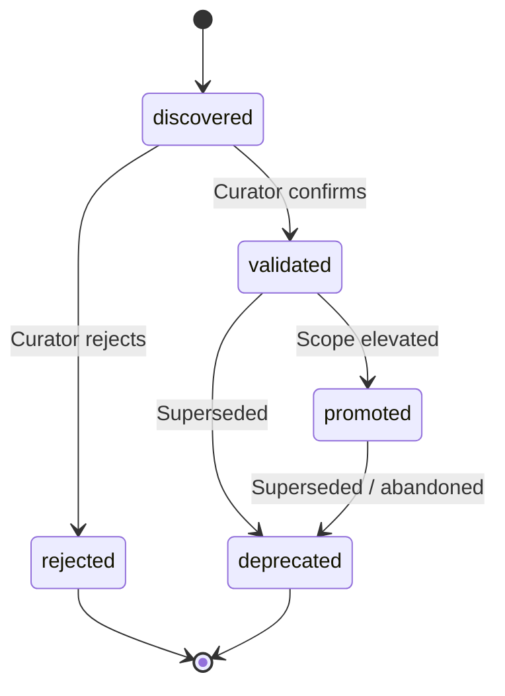

# S7 -- Pattern and Reuse Engine Specification

**Spec ID:** S7
**Status:** Draft
**Priority:** V2 (V1 will ship a manual pattern registry stub)

---

## 1. Purpose and Scope

The Pattern and Reuse Engine is the Bifrost subsystem responsible for discovering, storing, matching, and surfacing recurring engineering patterns across repositories, domains, and the organization. Its purpose is to enable humans and agents to:

- Find existing implementations that match or resemble a proposed task.
- Distinguish between work that extends an existing pattern, varies from one, is net-new, or conflicts with established patterns.
- Receive actionable reuse recommendations grounded in real, source-backed examples.
- Promote consistency and reduce redundant engineering effort.

**In scope:** pattern entity model, discovery pipelines, similarity engine, new-vs-existing classification, reuse recommendations, pattern lifecycle management, and the interface contracts that expose these capabilities.

**Out of scope:** code generation or automated refactoring, enforcement of patterns (patterns are advisory), and runtime behavior analysis (handled by the Runtime Correlation subsystem).

---

## 2. Glossary References

| Term | Definition |
|---|---|
| **Pattern** | A recurring structural, behavioral, integration, or conventional approach observed across one or more repositories. |
| **Repo** | A source code repository tracked by Bifrost. |
| **Domain** | A logical grouping of repos that together serve a coherent business or technical purpose. |
| **KnowledgeArtifact** | Any unit of derived knowledge stored by Bifrost, carrying source basis, freshness, confidence, and scope metadata (defined in the Knowledge Model spec, S1). |

---

## 3. Requirements Traceability

This spec addresses requirements from section 11 of `docs/prd.md`:

| Requirement | Section | Coverage |
|---|---|---|
| Identify similar implementations | 11.1 | Pattern Discovery (S6), Similarity Engine (S7) |
| Identify recurring patterns | 11.1 | Pattern Discovery (S6), Pattern Entity Model (S5) |
| Identify common extensions | 11.1 | Pattern Discovery (S6), New vs Existing Classification (S8) |
| Identify repo-specific conventions | 11.1 | Convention Detection (S6.4) |
| Identify domain-specific templates | 11.1 | Cross-repo Comparison (S6.3), Pattern scope `domain_wide` |
| Classify as existing pattern extension | 11.2 | New vs Existing Classification (S8) |
| Classify as variation of existing pattern | 11.2 | New vs Existing Classification (S8) |
| Classify as net-new implementation | 11.2 | New vs Existing Classification (S8) |
| Classify as likely conflict | 11.2 | New vs Existing Classification (S8) |
| Provide similar examples | 11.3 | Reuse Recommendations (S9) |
| Provide reusable pieces | 11.3 | Reuse Recommendations (S9) |
| Provide expected repos/sources | 11.3 | Reuse Recommendations (S9) |
| Provide likely steps | 11.3 | Reuse Recommendations (S9) |
| Provide likely risks | 11.3 | Reuse Recommendations (S9) |
| Provide likely missing information | 11.3 | Reuse Recommendations (S9) |

Supporting requirements from other sections:

| Requirement | Section | Relevance |
|---|---|---|
| Broad mappings including pattern hints | 7.1 | Patterns stored as knowledge artifacts |
| Learned local patterns and conventions | 7.1 | Repo/domain-local pattern storage |
| Selective invalidation of learned patterns | 12.5 | Pattern freshness lifecycle |
| Which patterns are common in this repo | 5.1 | Per-repo pattern queries |
| What shared patterns exist (domain) | 5.2 | Domain-scoped pattern queries |
| What global patterns recur (org) | 5.3 | Org-wide pattern queries |
| Compare implementations across repos | 4.1 | Cross-repo pattern comparison |

---

## 4. Design Goals and Non-Goals

### Goals

- **Grounded in evidence.** Every pattern must link to concrete code examples with source references. No hallucinated or assumed patterns.
- **Multi-scope.** Patterns exist at repo, domain, and org scope. The engine must support all three and allow promotion between them.
- **Hybrid detection.** Combine structural (AST) and semantic (embedding) approaches for robust similarity matching.
- **Freshness-aware.** Pattern examples must carry freshness metadata. Stale examples must be flagged, not silently served.
- **Incrementally adoptable.** V1 ships a manual registry stub. Automated discovery layers on top without replacing the manual path.
- **Language-agnostic foundation.** Use tree-sitter for AST parsing to support any language with a grammar.

### Non-Goals

- **Enforcement.** The engine surfaces patterns; it does not block builds or PRs that deviate from them.
- **Code generation.** The engine recommends patterns and examples; it does not generate implementation code.
- **Real-time streaming.** Pattern discovery runs as batch or on-demand pipelines, not as a live stream processor.
- **Cross-organization sharing.** V1 and V2 are single-org. Cross-org pattern sharing is future work.

---

## 5. Pattern Entity Model

### 5.1 Pattern

ConfidenceLevel is defined canonically in S3 (freshness-confidence.md). This spec uses that definition: `'confirmed' | 'inferred' | 'stale' | 'unknown' | 'conflicting'`. The `confidence` field below uses a numeric score [0,1] for pattern scoring; ConfidenceLevel applies to pattern freshness state and metadata envelopes.

| Field | Type | Description |
|---|---|---|
| `id` | `uuid` | Unique identifier. |
| `name` | `str` | Human-readable pattern name. |
| `description` | `text` | What the pattern does, when it applies, and why it exists. |
| `scope` | `enum` | `repo_local`, `domain_wide`, `org_wide`. |
| `classification` | `enum` | `structural`, `behavioral`, `integration`, `convention`. |
| `frequency` | `integer` | Number of known occurrences across tracked examples. |
| `confidence` | `float [0,1]` | Confidence that this is a real, intentional pattern (not coincidence). |
| `examples` | `list[PatternExample]` | Concrete code examples demonstrating the pattern. |
| `status` | `enum` | `discovered`, `validated`, `promoted`, `deprecated`. |
| `tags` | `list[str]` | Freeform tags for search and filtering. |
| `created_at` | `timestamp` | When the pattern was first recorded. |
| `updated_at` | `timestamp` | Last modification time. |
| `created_by` | `str` | Agent or user that created the record. |
| `embedding` | `vector(1536)` | Semantic embedding of the pattern description and representative code, stored in pgvector. |

**Classification definitions:**

- **structural** -- Recurring code shapes: class hierarchies, module layouts, function signatures, file organization.
- **behavioral** -- Recurring runtime or logical behaviors: retry strategies, error propagation, event handling sequences.
- **integration** -- Recurring approaches to connecting systems: API call patterns, message publishing, schema wiring.
- **convention** -- Naming, formatting, file placement, or configuration conventions specific to a repo or domain.

### 5.2 PatternExample

| Field | Type | Description |
|---|---|---|
| `id` | `uuid` | Unique identifier. |
| `pattern_id` | `uuid` | FK to Pattern. |
| `repo_id` | `uuid` | Which repository this example comes from. |
| `file_paths` | `list[str]` | Relevant file paths within the repo. |
| `code_refs` | `list[CodeRef]` | Specific locations (file, start line, end line, commit SHA). |
| `description` | `text` | What this example demonstrates and any notable context. |
| `freshness_state` | `FreshnessMetadata` | Current freshness of the referenced code (from S3). |
| `created_at` | `timestamp` | When this example was added. |

### 5.3 PatternMatch

| Field | Type | Description |
|---|---|---|
| `id` | `uuid` | Unique identifier. |
| `pattern_id` | `uuid` | FK to Pattern that was matched. |
| `candidate_code_ref` | `CodeRef` | The code or task description being matched against. |
| `similarity_score` | `float [0,1]` | Combined similarity score (see Similarity Engine). |
| `structural_score` | `float [0,1]` | AST-based structural similarity component. |
| `semantic_score` | `float [0,1]` | Embedding-based semantic similarity component. |
| `match_type` | `enum` | `exact`, `variation`, `partial`. |
| `matched_at` | `timestamp` | When the match was computed. |

### 5.4 CodeRef

| Field | Type | Description |
|---|---|---|
| `repo_id` | `uuid` | Repository. |
| `file_path` | `str` | Path within the repo. |
| `start_line` | `integer` | Start line (1-indexed). |
| `end_line` | `integer` | End line (1-indexed). |
| `commit_sha` | `str` | Commit at which the reference was captured. |
| `branch` | `str` | Branch (default: remote default branch). |

---

## 6. Pattern Discovery

Pattern discovery is the process of identifying new patterns from code, history, and cross-repo analysis. In V2 this is automated; V1 uses manual curation only (see S14).

### 6.1 AST-Based Structural Similarity (V2)

1. **Parse:** Use tree-sitter to parse source files into ASTs for each supported language.
2. **Extract structural features:** For each function, class, module, or file-level block, extract a feature vector encoding:
   - Node type distribution (e.g., counts of if/else, try/catch, function calls).
   - Tree depth and branching factor.
   - Subtree shapes (hashed subtree signatures for common subtrees).
3. **Cluster:** Apply clustering (e.g., locality-sensitive hashing on structural feature vectors) to group structurally similar code blocks within and across repos.
4. **Candidate patterns:** Clusters above a frequency threshold become candidate patterns for validation.

### 6.2 Historical Analysis (V2)

1. **PR shape analysis:** Identify PRs that follow similar file-creation and file-modification patterns (e.g., "every time a new endpoint is added, these 4 files are touched in this order").
2. **Commit co-occurrence:** Track which files are frequently modified together and in what structural relationship.
3. **Repeated scaffolding:** Detect repeated directory or file creation patterns that suggest templates or conventions.

### 6.3 Cross-Repo Comparison (V2)

1. **Interface matching:** Find repos that implement similar interfaces (e.g., same gRPC service definition, same event handler signature).
2. **Flow segment matching:** Identify repos that participate in similar flow segments but implement them differently.
3. **Dependency pattern matching:** Find repos that depend on the same libraries and use them in structurally similar ways.

### 6.4 Convention Detection (V2)

1. **Naming patterns:** Detect consistent naming conventions (e.g., `*Service`, `*Repository`, `*Handler`, `use*` hooks) within a repo or domain.
2. **File organization patterns:** Detect directory structures that repeat (e.g., `src/modules/<name>/index.ts + types.ts + tests/`).
3. **Error handling patterns:** Detect consistent error handling approaches (e.g., always wrapping in a `Result` type, always using a specific error middleware).
4. **Configuration patterns:** Detect repeated config file structures or environment variable naming schemes.

### 6.5 Curator-Defined Patterns

Users or agents can manually define patterns by:
1. Providing a name and description.
2. Linking one or more PatternExamples with concrete code references.
3. Setting scope and classification.
4. The pattern enters the lifecycle at `validated` status (bypassing `discovered`).

### 6.6 Discovery Pipeline Diagram



---

## 7. Similarity Engine (V2)

The similarity engine computes how closely a given piece of code (or a task description) matches known patterns. This section specifies the V2 implementation; V1 does not run similarity scoring (see §14).

### 7.1 Feature Extraction

**AST features (structural):**
- Tree-sitter parses the candidate code into an AST.
- Extract: node type histogram, tree depth, branching factor, hashed subtree signatures.
- Produce a fixed-length structural feature vector `F_ast`.

**Semantic features (embedding-based):**
- Pass the candidate code (or task description) through a code embedding model (e.g., a fine-tuned model producing 1536-dimensional vectors).
- Produce a semantic embedding vector `F_sem`.

### 7.2 Scoring

The combined similarity score between a candidate `C` and a pattern `P` is:

```
score(C, P) = alpha * sim_structural(C, P) + (1 - alpha) * sim_semantic(C, P)
```

Where:

- `sim_structural(C, P) = 1 - (normalized_tree_edit_distance(AST_C, AST_P))` -- Tree edit distance between the candidate AST and the closest pattern example AST, normalized to `[0, 1]`.
- `sim_semantic(C, P) = cosine_similarity(F_sem_C, F_sem_P)` -- Cosine similarity between the candidate embedding and the pattern embedding, naturally in `[-1, 1]`, clamped to `[0, 1]`.
- `alpha` -- Weighting factor, default `0.4`. Tunable per classification: structural patterns favor higher alpha; behavioral and integration patterns favor lower alpha.

**Match type thresholds:**

| Match Type | Score Range |
|---|---|
| `exact` | >= 0.90 |
| `variation` | >= 0.70 and < 0.90 |
| `partial` | >= 0.50 and < 0.70 |
| No match | < 0.50 |

These thresholds are configurable per organization.

### 7.3 Ranking

When multiple patterns match, rank by:

1. **Relevance:** Combined similarity score (primary sort).
2. **Freshness:** Prefer patterns whose examples were recently validated as current. Penalize patterns whose examples are stale (freshness penalty from S3).
3. **Frequency:** Prefer patterns with more known occurrences (higher confidence that the pattern is intentional).
4. **Scope proximity:** Prefer patterns at the narrowest applicable scope (repo_local > domain_wide > org_wide) when the query is repo-scoped.

### 7.4 Technology

| Component | Technology | Rationale |
|---|---|---|
| AST parsing | tree-sitter | Multi-language support, fast incremental parsing, mature grammars. |
| Embedding storage and ANN search | pgvector | Integrates with PostgreSQL (Bifrost's primary store), supports cosine similarity search, HNSW indexes. |
| Embedding model | Code embedding model (e.g., voyage-code-3 or equivalent) | Produces high-quality code embeddings; 1536-dimensional vectors. |
| Structural comparison | Custom tree edit distance | Computed on-demand for top-N candidates after initial ANN filtering. |

---

## 8. New vs Existing Classification

Given a task or implementation request, the classification engine determines how the task relates to the existing pattern corpus.

### 8.1 Classification Categories

| Category | Definition | Action Implication |
|---|---|---|
| **Existing pattern extension** | Task matches a known validated/promoted pattern with score >= 0.90. | Apply the pattern directly. Surface examples. |
| **Variation** | Task is similar to a known pattern (score 0.70-0.89) but with meaningful differences. | Surface the base pattern and highlight differences. |
| **Net-new** | No pattern matches above 0.50. | Flag as novel. Recommend broader search. After implementation, consider as candidate pattern. |
| **Conflict** | Task would contradict an existing validated/promoted pattern in the same scope, or would produce incompatible behavior with an existing implementation in a shared flow. | Surface the conflict. Require explicit acknowledgement before proceeding. |

### 8.2 Classification Decision Tree

```
Input: task description T, target repo R, target domain D

1. Extract features from T:
   - Semantic embedding F_sem_T
   - If code is provided: AST features F_ast_T

2. Query pattern corpus:
   - Retrieve top-K patterns by embedding similarity (pgvector ANN search)
     filtered to scope in {repo_local(R), domain_wide(D), org_wide}

3. For each candidate pattern P_i:
   - Compute full score(T, P_i) using the scoring formula (S7.2)
   - Record match_type per threshold table

4. Check for conflicts:
   - For each high-scoring match (>= 0.70):
     - If the task intent contradicts the pattern intent
       (e.g., different error handling strategy in same flow,
        incompatible interface change):
       -> Mark as CONFLICT

5. Decision:
   - If any CONFLICT found:
     -> Return classification = "conflict"
        with conflicting_patterns[] and explanation

   - If best match score >= 0.90 and match is non-conflicting:
     -> Return classification = "existing_pattern_extension"
        with matched_pattern and examples

   - If best match score >= 0.70 and < 0.90:
     -> Return classification = "variation"
        with base_pattern, differences[], and examples

   - If best match score < 0.50 (or no matches):
     -> Return classification = "net_new"
        with nearest_patterns[] (for reference, if any above 0.30)

   - If best match score >= 0.50 and < 0.70:
     -> Return classification = "variation"
        with low_confidence flag
        (borderline -- could be net-new or loose variation)

6. Attach confidence:
   - classification_confidence = f(best_score, pattern.confidence,
     example_freshness, number_of_matching_patterns)
```

**Visual decision tree:**



### 8.3 Conflict Detection

Conflict detection compares the task intent against existing patterns and implementations:

- **Structural conflict:** Task would create a structure that contradicts an established structural pattern (e.g., adding a God class in a repo that consistently uses single-responsibility decomposition).
- **Behavioral conflict:** Task would implement behavior that conflicts with an established behavioral pattern (e.g., synchronous error handling in a repo that uses async error propagation).
- **Integration conflict:** Task would wire integrations in a way that conflicts with established integration patterns (e.g., direct DB access in a repo that mandates API-based access).
- **Convention conflict:** Task would violate established naming, file organization, or configuration conventions.

Conflict detection requires pattern status to be `validated` or `promoted` -- `discovered` patterns do not trigger conflicts.

---

## 9. Reuse Recommendations

For any implementation task, the engine produces a reuse recommendation containing:

### 9.1 Recommendation Structure

```python
class ReuseRecommendation(BaseModel):
    classification: Classification       # from S8
    classification_confidence: float     # [0, 1]

    matching_patterns: list[PatternMatchResult]
    # Sorted by ranking (S7.3), each containing:
    #   pattern: Pattern
    #   score: float
    #   match_type: "exact" | "variation" | "partial"
    #   best_examples: list[PatternExample]  (top 3, freshness-checked)
    #   how_to_apply: str              # generated guidance
    #   known_variations: list[str]    # known deviations from the pattern
    #   freshness_warnings: list[str]  # if any examples are stale

    conflicts: list[ConflictDetail]
    # If classification is "conflict", details of each conflict

    gaps: list[str]
    # Missing information that would improve classification confidence

    suggested_repos: list[str]
    # Repos likely involved based on pattern scope and flow analysis

    suggested_steps: list[str]
    # High-level implementation steps derived from pattern examples
```

### 9.2 Freshness Check

Before surfacing a pattern example in a recommendation:

1. Query the Freshness subsystem (S3) for each `PatternExample.code_refs[]`.
2. If any code ref is stale (underlying file has changed since `commit_sha`):
   - Mark the example with a freshness warning.
   - If all examples for a pattern are stale, demote the pattern in ranking.
   - If a pattern has no fresh examples, flag it for re-validation.
3. Include `freshness_warnings` in the recommendation so consumers can decide how much to trust the examples.

### 9.3 Recommendation Triggers

Recommendations can be requested:

- **Explicitly:** Via the pattern search API or CLI.
- **During planning:** The orchestration layer requests classification and recommendations when assembling a task plan.
- **During review:** A review agent can request pattern matching against proposed changes to detect conflicts or missed reuse.

---

## 10. Pattern Lifecycle



### 10.1 States

| State | Meaning | Who Transitions |
|---|---|---|
| `discovered` | Automatically identified by a discovery pipeline. Not yet verified as intentional. | Discovery pipeline (automated). |
| `validated` | Confirmed as a real, intentional pattern by an agent or human curator. | Agent or human curator. |
| `promoted` | Elevated to a wider scope (e.g., from repo_local to domain_wide). Treated as a standard. | Domain lead, architect, or promotion workflow. |
| `deprecated` | No longer recommended. Existing usages may remain, but new work should not follow this pattern. | Curator, architect, or automated detection of replacement pattern. |

### 10.2 Transitions

- **discovered -> validated:** A curator or validation agent reviews the pattern, confirms it is intentional, and optionally refines the description and examples.
- **discovered -> (rejected):** A curator reviews and determines it is coincidental or undesirable. The record is soft-deleted or archived.
- **validated -> promoted:** A domain lead or architect determines the pattern should be recommended across a wider scope. Scope field is updated.
- **validated/promoted -> deprecated:** The pattern is superseded, or the team decides to move away from it. A deprecation note and optional replacement pattern link are added.

### 10.3 Automated Lifecycle Signals

- If a discovered pattern's frequency drops to zero (all examples are deleted or refactored away), flag for deprecation review.
- If a validated pattern accumulates new examples in other repos, suggest promotion to wider scope.
- If all examples of a pattern become stale beyond a configurable threshold, flag for re-validation.

---

## 11. Interface Contracts

### 11.1 Pattern Search API

This endpoint returns `501 Not Implemented` in V1. Implementation deferred to V2.

```
POST /api/v1/patterns/search

Request:
{
  "query": str,                 // Natural language or code snippet
  "scope": {
    "repo_id": uuid | None,    // Restrict to repo scope
    "domain_id": uuid | None,  // Restrict to domain scope
    "org_wide": bool            // Include org-wide patterns
  },
  "classification_filter": list[str] | None,  // e.g., ["structural", "behavioral"]
  "status_filter": list[str] | None,          // e.g., ["validated", "promoted"]
  "limit": int,                // Max results (default 10)
  "include_examples": bool     // Whether to inline examples (default true)
}

Response:
{
  "results": list[PatternMatchResult],
  "total_count": int,
  "query_embedding_used": bool,
  "search_time_ms": int
}
```

### 11.2 Pattern CRUD

```
POST   /api/v1/patterns              -- Create a new pattern (curator-defined)
GET    /api/v1/patterns/:id          -- Get pattern by ID
PUT    /api/v1/patterns/:id          -- Update pattern metadata
DELETE /api/v1/patterns/:id          -- Soft-delete / archive
POST   /api/v1/patterns/:id/examples -- Add an example to a pattern
DELETE /api/v1/patterns/:id/examples/:eid -- Remove an example
POST   /api/v1/patterns/:id/transition -- Transition lifecycle state
```

### 11.3 New-vs-Existing Classification API

This endpoint returns `501 Not Implemented` in V1. Implementation deferred to V2.

```
POST /api/v1/patterns/classify

Request:
{
  "task_description": str,            // Natural language description of the task
  "code_snippet": str | None,         // Optional code to classify
  "target_repo_id": uuid,             // Repo where the task would be implemented
  "target_domain_id": uuid | None     // Domain context
}

Response:
{
  "classification": "existing_pattern_extension" | "variation" | "net_new" | "conflict",
  "classification_confidence": float,
  "matched_patterns": list[PatternMatchResult],
  "conflicts": list[ConflictDetail],
  "gaps": list[str],
  "suggested_repos": list[str],
  "suggested_steps": list[str]
}
```

### 11.4 Reuse Recommendation API

This endpoint returns `501 Not Implemented` in V1. Implementation deferred to V2.

```
POST /api/v1/patterns/recommend

Request:
{
  "task_description": str,
  "code_snippet": str | None,
  "target_repo_id": uuid,
  "target_domain_id": uuid | None,
  "max_patterns": int,                // Default 5
  "freshness_required": bool          // Default true; if true, stale examples are flagged
}

Response: ReuseRecommendation   // As defined in S9.1
```

---

## 12. Dependencies

| Dependency | Spec | What This Spec Needs |
|---|---|---|
| Knowledge Model | S1 | Entity storage for Pattern, PatternExample, PatternMatch. Patterns are stored as T2 knowledge artifacts with full metadata. |
| Freshness Engine | S3 | Freshness metadata for pattern examples. Query freshness state of code refs before surfacing recommendations. Invalidation signals when source code changes. |
| Source Adapters | S2 | Access to source code for AST parsing and embedding generation. Git history for historical analysis. |
| Flow Engine | S5 | Flow segment data for cross-repo comparison and integration pattern detection. |
| Orchestration | S9 | Orchestrator invokes classification and recommendation APIs during task planning. |

---

## 13. Key Decisions

| Decision | Rationale |
|---|---|
| **Hybrid embedding + AST approach for similarity.** | Embeddings capture semantic intent (what the code does); ASTs capture structural form (how it is shaped). Neither alone is sufficient. Behavioral patterns are better caught by embeddings; structural patterns by ASTs. The weighted combination covers both. |
| **pgvector for embedding storage.** | Bifrost uses PostgreSQL as its primary data store. pgvector avoids introducing a separate vector database, reduces operational complexity, and supports HNSW indexes for fast approximate nearest neighbor search. |
| **tree-sitter for multi-language AST parsing.** | tree-sitter has grammars for 100+ languages, is fast, supports incremental parsing, and has mature bindings for Python. It is the standard choice for multi-language tooling. |
| **Patterns stored as T2 knowledge artifacts.** | Patterns are derived knowledge (not raw source). Storing them as knowledge artifacts gives them freshness metadata, confidence, source basis tracking, and relationship mapping for free. |
| **V1 stub: manual pattern registry without automated discovery.** | Automated discovery requires AST infrastructure, embedding pipelines, and clustering -- all substantial effort. V1 ships CRUD and manual curation so the data model and APIs stabilize before automation is added. |
| **Conflict detection limited to validated/promoted patterns.** | Discovered (unvalidated) patterns may be coincidental. Raising conflicts against unverified patterns would create noise. |
| **Default alpha = 0.4 (structural weight).** | Most patterns encountered in practice are behavioral or integration patterns where semantic similarity is more informative than structural shape. Alpha is tunable per classification to allow structural patterns to weight AST more heavily. |

---

## 14. V1 Scope

V1 provides a stub implementation only. The `/patterns` API endpoints return HTTP 501 Not Implemented (not 200 with empty results). The pattern entity schema is defined here for V2 implementation but no pattern discovery or classification runs in V1. V1 supports manually registered patterns via admin API only.

The goal of the V1 stub is to establish the data model in PostgreSQL and the admin CRUD API so that curators and agents can begin recording patterns immediately, and so consuming systems (orchestrator, planning agents) can integrate against stable API contracts before V2 automation is added.

### V1 Includes

- Pattern entity model (§5) fully implemented in PostgreSQL.
- Admin pattern CRUD API (§11.2) — available to admin users/agents only.
- Manual pattern creation with curator-defined examples.
- Pattern lifecycle management (§10) — manual transitions only.
- PatternExample storage with code refs.

### V1 Defers (V2 Features)

- Automated pattern discovery pipelines (§6.1 through §6.4): AST-based structural similarity, historical analysis, cross-repo comparison, convention detection. These are V2 features, not V1.
- Embedding generation and pgvector similarity search (§7): V2 only.
- AST parsing and structural similarity (§7.1, §7.2): V2 only.
- New-vs-existing classification API (§11.3): returns HTTP 501 in V1.
- Reuse recommendation API (§11.4): returns HTTP 501 in V1.
- Pattern search API (§11.1): returns HTTP 501 in V1 (admin CRUD is available; general search is not).
- Automated lifecycle signals (§10.3): V2 only.

### V1 Stub Behavior

All `/api/v1/patterns/search`, `/api/v1/patterns/classify`, and `/api/v1/patterns/recommend` endpoints return HTTP 501 Not Implemented with the body:

```json
{
  "error": "not_implemented",
  "message": "Pattern discovery and classification are V2 features. Use the admin pattern registry to manually register patterns.",
  "docs": "See S7 (pattern-reuse spec) §14 for V1 scope."
}
```

In V2, discovered patterns are stored in AgentStateBackend at `/repo/{id}/patterns/{pattern-id}.md`. V1 uses PostgreSQL only for manually-registered patterns.

### Track B Relevance

Track B relevance: Pattern discovery in Track B would require cross-repo Memory Store reads spanning multiple agent scopes. This is a Track B V2 capability (after Track B is production-stable). V1: 501 for both Track A and B.

---

## 15. Future Evolution

### Automated Discovery Pipeline (V2)

- tree-sitter AST parsing integrated into source indexing.
- Embedding generation on code ingestion.
- Clustering pipeline runs on schedule and on significant source changes.
- Discovered patterns flow into validation queue.

### Cross-Org Pattern Sharing (V3+)

- Anonymized or abstracted pattern definitions shared across organizations.
- Community pattern libraries for common frameworks and architectures.

### Pattern Templates (V3+)

- Promote validated patterns to executable templates (scaffolding generators).
- "Apply this pattern" action that generates boilerplate from a pattern definition.

### Active Pattern Monitoring

- Continuous monitoring for pattern drift: detect when implementations start deviating from established patterns.
- Proactive alerts when a PR would break a pattern.

### Feedback Loop

- Track which recommendations were followed vs ignored.
- Use acceptance/rejection signals to improve pattern confidence and similarity scoring weights.

---

## 16. Open Questions

| # | Question | Impact | Status |
|---|---|---|---|
| 1 | What embedding model should we use for code? Options include voyage-code-3, OpenAI code embeddings, or a self-hosted model. | Affects embedding dimensions, quality, cost, and latency. | Open |
| 2 | Should discovered patterns auto-expire if not validated within N days? | Affects noise in the pattern registry. | Open |
| 3 | What is the right frequency threshold for a cluster to become a candidate pattern? | Too low creates noise; too high misses real patterns. | Open -- needs empirical tuning |
| 4 | How should we handle patterns that span multiple languages (e.g., a frontend+backend integration pattern)? | Affects AST feature extraction and similarity scoring. | Open |
| 5 | Should pattern matching operate on function-level, file-level, or module-level granularity? | Affects performance and match quality. Likely needs to support multiple. | Open -- start with function-level |
| 6 | How do we weight structural vs semantic similarity for convention-type patterns (which are more about naming than code shape)? | May need a separate scoring path for conventions. | Open |
| 7 | What is the conflict detection mechanism for behavioral conflicts that require understanding runtime semantics? | May need integration with the Runtime Correlation subsystem. | Open -- V2+ concern |
| 8 | How large can the pattern corpus grow before pgvector ANN search degrades, and do we need sharding or a dedicated vector store? | Affects infrastructure decisions at scale. | Open -- measure at V2 |
