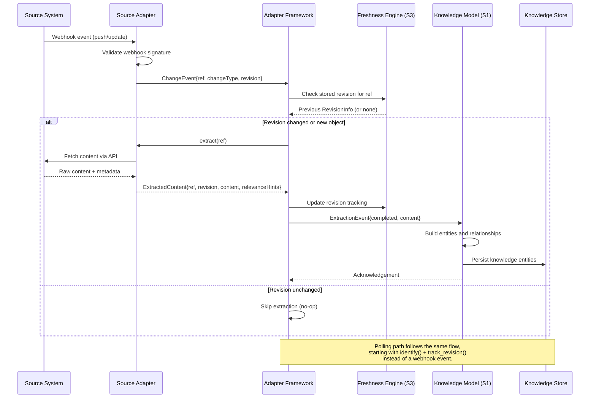

# S2 -- Source Adapter Framework Specification

**Status:** Draft
**Spec ID:** S2
**Dependencies:** S1 (Knowledge Model), S3 (Freshness Engine)

---

## 1. Purpose and Scope

The Source Adapter Framework is Bifrost's sensory layer -- the plugin architecture through which the platform connects to external source systems, discovers their contents, extracts knowledge-relevant content, and tracks changes over time.

Every piece of knowledge in Bifrost originates from a source system. The adapter framework defines the uniform contract that all source integrations must satisfy so that the rest of the platform -- the knowledge model, the freshness engine, the specialist agents -- can operate against any source without coupling to its implementation details.

Source adapters are implemented across two tracks. Track A (V1): Python classes running in-process within Bifrost. Track B (future): MCP servers exposing the same capabilities via the Model Context Protocol. The adapter capability interface is identical between tracks. Switching from Track A to Track B is a packaging change, not a logic change.

This specification covers:

- The programmatic interface that every adapter must implement.
- The object model that adapters produce (source objects, references, revisions).
- The lifecycle of an adapter from registration through decommission.
- The change detection, error handling, rate limiting, and testing contracts.
- The V1 scope (Git and Jira adapters) and the deferred roadmap.

It does **not** cover:

- How extracted content is transformed into knowledge entities (that is S1).
- How freshness and lag are computed from revision data (that is S3).
- How specialist agents consume extracted content (that is the Agent Framework spec).

---

## 2. Glossary References

| Term | Definition |
|------|-----------|
| **Source** | An external system that contains engineering-relevant information (e.g., GitHub, Jira, Confluence, Slack). |
| **SourceObject** | A discrete, identifiable unit of content within a source (e.g., a file, a ticket, a message). |
| **SourceObjectRef** | A stable, globally unique reference to a SourceObject, encoded as a URN. |
| **Mapping** | A declared relationship between a SourceObject and a Bifrost concept (repo, domain, flow, concept). |
| **Repo** | A code repository that Bifrost tracks. The primary unit of code-level organization. |
| **Domain** | A logical grouping of repos and sources that together serve a coherent engineering area. |
| **Adapter** | A plugin that implements the `SourceAdapter` interface for a specific source system. |
| **AdapterScope** | A filter that narrows adapter operations to a specific repo, domain, path prefix, project, or other boundary. |
| **Extraction** | The act of retrieving structured content and metadata from a SourceObject. |
| **Revision** | A version marker (commit SHA, modification timestamp, ETag, sequence number) that identifies a specific state of a SourceObject. |

---

## 3. Requirements Traceability

This spec addresses requirements from Section 6 of `docs/prd.md`.

| Requirement | Section | How Addressed |
|------------|---------|---------------|
| Source-agnostic, plug-and-play addition | 6.1 | Uniform `SourceAdapter` interface; adapters are registered dynamically |
| Source discovery | 6.2 | `discover()` and `identify()` methods |
| Identity and scoping of source objects | 6.2 | URN-based `SourceObjectRef`, `AdapterScope` |
| Metadata extraction | 6.2 | `extract()` returns `ExtractedContent` with metadata envelope |
| Freshness or revision tracking | 6.2 | `track_revision()` returns `RevisionInfo` consumed by S3 |
| Relevance mapping to repos/domains/concepts/flows | 6.2, 6.4 | Relevance Mapping Protocol (Section 13) |
| Selective retrieval of exact units | 6.2 | `extract()` operates on individual `SourceObjectRef` |
| Source-specific interpretation support | 6.2 | `AdapterCapabilities` declares type-specific features |
| Permission-aware access | 6.2 | `check_permission()` method |
| Source categories (code, design, work, etc.) | 6.3 | Source Categories and Semantic Contracts (Section 7) |
| Source-to-repo/domain/concept/flow mapping | 6.4 | Relevance Mapping Protocol; `RelevanceHint` in extraction results |

Additionally supports:

| Requirement | Section | How Addressed |
|------------|---------|---------------|
| New sources must be easy to add | 22.3 | Adapter interface + registration API + testing harness |
| Permission-aware behavior | 21.1 | `check_permission()` per-object access check |
| Freshness must be explicit | 12.1 | Every extraction carries `RevisionInfo` |
| Update triggers from source changes | 12.4 | Webhook-first change detection with polling fallback |
| Selective invalidation | 12.5 | Revision-based change detection enables scoped invalidation |

---

## 4. Design Goals and Non-Goals

### Goals

1. **Uniform interface.** Every source system, regardless of protocol or data model, is accessed through the same adapter contract.
2. **Capability-based declaration.** Adapters declare what they can do. The platform never assumes capabilities that are not declared.
3. **Incremental by default.** After initial bootstrap, adapters operate incrementally via revision tracking.
4. **Resilient to source failure.** The platform degrades gracefully when a source is slow, down, or rate-limited.
5. **Testable in isolation.** Every adapter can be validated against a standard test harness without requiring a live source.
6. **Scope-aware.** Adapters can be scoped to specific repos, domains, projects, or path prefixes.
7. **Streaming for large traversals.** Discovery of large source trees uses `AsyncIterator` to avoid unbounded memory.

### Non-Goals

1. **Transformation into knowledge entities.** Adapters extract raw structured content. The Knowledge Model (S1) transforms it into entities and relationships.
2. **Cross-source joins.** Adapters do not correlate across sources. That is the responsibility of the orchestration and knowledge layers.
3. **Source write-back.** V1 adapters are read-only. Write-back (e.g., creating a Jira ticket) is a future capability.
4. **UI for adapter management.** V1 adapters are configured via code/config. A management UI is deferred.
5. **Real-time streaming of source content.** Adapters support change notification, not continuous streaming of raw data.
---

## 5. Adapter Interface Contract

### 5.1 Core Interfaces

```python
from abc import ABC, abstractmethod
from collections.abc import AsyncIterator
from datetime import datetime
from typing import Callable, Awaitable, Literal

from pydantic import BaseModel


class SourceAdapter(ABC):
    """The primary contract that every source adapter must implement.

    Adapters are the sensory boundary between Bifrost and external systems.
    """

    @property
    @abstractmethod
    def adapter_id(self) -> str:
        """Unique identifier for this adapter type (e.g., 'github', 'jira', 'confluence')."""
        ...

    @abstractmethod
    async def discover(self, scope: "AdapterScope") -> AsyncIterator["SourceObject"]:
        """Walk a source scope and yield every discoverable SourceObject.

        Used during initial bootstrap and full reconciliation.
        Returns an AsyncIterator to support large source trees without unbounded memory.
        """
        ...

    @abstractmethod
    async def identify(self, scope: "AdapterScope") -> list["SourceObjectRef"]:
        """Return a lightweight list of SourceObjectRefs within the given scope
        without fetching full content. Used for inventory and change comparison.
        """
        ...

    @abstractmethod
    async def extract(self, ref: "SourceObjectRef") -> "ExtractedContent":
        """Extract structured content and metadata for a single source object.

        This is the primary content retrieval method.
        """
        ...

    @abstractmethod
    async def track_revision(self, ref: "SourceObjectRef") -> "RevisionInfo":
        """Return the current revision information for a source object.

        Used by the Freshness Engine (S3) to detect changes without full extraction.
        """
        ...

    @abstractmethod
    async def check_permission(
        self, user: "UserContext", ref: "SourceObjectRef"
    ) -> "PermissionResult":
        """Check whether a given user has access to the referenced source object.

        Adapters must respect the source system's native permission model.
        """
        ...

    async def watch(
        self, scope: "AdapterScope", callback: "ChangeCallback"
    ) -> "Subscription":
        """Optional: subscribe to real-time change events from the source.

        Adapters that support webhooks or event streams implement this.
        Returns a Subscription handle for lifecycle management.
        """
        raise NotImplementedError("This adapter does not support watch()")

    @abstractmethod
    def get_capabilities(self) -> "AdapterCapabilities":
        """Declare the capabilities this adapter supports.

        The platform uses this to determine what operations are valid.
        """
        ...

    @abstractmethod
    async def health_check(self) -> "HealthStatus":
        """Check the health of the connection to the source system.

        Returns status, latency, and any degradation information.
        """
        ...

    #
    # -- Rate Limit Absorption (Required) --
    # The extract() and discover() methods MUST absorb rate limit errors
    # internally. Adapters must NOT surface HTTP 429 / rate limit errors to
    # callers. Retry policy: exponential backoff with up to 3 retries
    # (1s, 2s, 4s delays). If all retries exhausted: raise AdapterError with
    # code 'RATE_LIMITED_EXHAUSTED' (not a 429 passthrough).
    #
    # -- Content Size Validation (Required) --
    # The extract() method MUST validate returned content against token budget
    # limits before returning. See AdapterContentPolicy below.
    #


class AdapterContentPolicy(BaseModel):
    """Policy controlling content size limits for adapter extraction."""

    max_content_tokens: int
    """Maximum content size in tokens before overflow strategy is applied. Default: 50_000."""

    overflow_strategy: Literal["truncate", "summarize", "reject"]
    """What to do when extracted content exceeds max_content_tokens:
      'truncate'  -- return the first max_content_tokens tokens of raw_content
      'summarize' -- return a structural description instead of raw content
      'reject'    -- raise ContentTooLargeError
    """


# Default policy -- adapters use this unless overridden in their config.
DEFAULT_CONTENT_POLICY = AdapterContentPolicy(
    max_content_tokens=50_000,   # ~200 KB of code
    overflow_strategy="summarize",
)
```

### Implementation Packaging

Track A -- Python Class:
```python
class GitHubAdapter(SourceAdapter):
    def __init__(self, config: "GitHubAdapterConfig") -> None:
        self._config = config

    async def discover(self, scope) -> AsyncIterator[SourceObject]:
        ...

    async def extract(self, ref) -> ExtractedContent:
        ...

    # ... other methods


# Used by agents directly:
adapter = GitHubAdapter(config)
content = await adapter.extract(ref)
```

Track B -- MCP Server Wrapper:
```python
# Same GitHubAdapter class, wrapped in MCP protocol layer
server = McpServer(
    name="github",
    version="1.0.0",
    tools=[
        {"name": "discover",       "handler": lambda args: adapter.discover(args)},
        {"name": "extract",        "handler": lambda args: adapter.extract(args["ref"])},
        {"name": "track_revision", "handler": lambda args: adapter.track_revision(args["ref"])},
        # ... other tools
    ],
)
server.listen(8081)  # bifrost-git-mcp on canonical port

# Agent invokes via MCP protocol:
# use_mcp_tool("github", "extract", { ref: { repo_id: "...", path: "..." } })
```

### 5.3 Adapter Implementation Requirements

#### Rate Limit Absorption

All adapters must absorb rate limit signals from their source system and never surface HTTP 429 / rate-limit errors directly to callers. The required retry pattern:

```python
import asyncio


# Required retry pattern -- all adapters must implement this or an equivalent.
async def with_retry(
    fn: Callable[[], Awaitable],
    max_retries: int = 3,
):
    """Retry a coroutine with exponential backoff on rate-limit errors."""
    delays = [1.0, 2.0, 4.0]
    last_error: Exception | None = None

    for attempt in range(max_retries + 1):
        try:
            return await fn()
        except Exception as err:
            if is_rate_limit(err) and attempt < max_retries:
                await asyncio.sleep(delays[attempt])
                last_error = err
                continue
            raise  # non-429 errors: reraise immediately

    raise AdapterError(
        "RATE_LIMITED_EXHAUSTED",
        f"All {max_retries} retries failed",
        last_error,
    )


def is_rate_limit(err: Exception) -> bool:
    status = getattr(err, "status", None) or getattr(err, "status_code", None)
    code = getattr(err, "code", None)
    message = str(err)
    return (
        status == 429
        or code == "RATE_LIMITED"
        or "rate limit" in message.lower()
    )
```

Adapters wrap their `extract()` and `discover()` source API calls in `with_retry`. The error code `'RATE_LIMITED_EXHAUSTED'` is machine-readable so callers can distinguish it from logic errors.

#### Content Size Validation

Before returning `ExtractedContent`, adapters must validate that content fits within the token budget defined by `AdapterContentPolicy`. This prevents the extraction agent from receiving files so large they exhaust the entire LLM context window.

```python
import math


def validate_content_size(
    content: "ExtractedContent",
    policy: AdapterContentPolicy = DEFAULT_CONTENT_POLICY,
) -> "ExtractedContent":
    """Validate extracted content against the token budget and apply overflow strategy."""
    raw_text = extract_raw_text(content.content)
    estimated_tokens = estimate_tokens(raw_text)

    if estimated_tokens <= policy.max_content_tokens:
        return content  # within budget, return as-is

    if policy.overflow_strategy == "truncate":
        return content.model_copy(
            update={
                "content": ContentBody(kind="text", text=truncate_to_tokens(raw_text, policy.max_content_tokens)),
                "truncated": True,
                "original_token_estimate": estimated_tokens,
            }
        )

    elif policy.overflow_strategy == "summarize":
        # Return a structural description instead of raw content.
        # Example summary for a source file:
        #   "File: delivery/dispatcher.py (1,247 lines)
        #    Exports: dispatch_webhook, validate_payload, retry_policy
        #    Imports: signing_client, rate_limiter, audit_log
        #    Classes: WebhookDispatcher, RetryPolicy
        #    [Content exceeded 50K token limit -- structural summary only]"
        return content.model_copy(
            update={
                "content": ContentBody(kind="text", text=build_structural_summary(content)),
                "is_summary": True,
                "original_token_estimate": estimated_tokens,
            }
        )

    elif policy.overflow_strategy == "reject":
        raise ContentTooLargeError(
            content.ref.object_id, estimated_tokens, policy.max_content_tokens
        )


def estimate_tokens(text: str) -> int:
    """Estimate token count from text length (~4 chars per token for English/code)."""
    return math.ceil(len(text) / 4)
```

The `extract()` implementation in every adapter must call `validate_content_size()` on the assembled `ExtractedContent` before returning it. Adapters may override `DEFAULT_CONTENT_POLICY` per object type (e.g., stricter limits for log entries, looser limits for design docs).

### 5.2 Supporting Types

```python
from __future__ import annotations

from enum import Enum
from datetime import datetime
from typing import Any, Literal

from pydantic import BaseModel


# ---------------------------------------------------------------------------
# Scope and Identity
# ---------------------------------------------------------------------------

class AdapterScope(BaseModel):
    """Narrows adapter operations to a specific boundary within the source."""

    repo_id: str | None = None
    """The Bifrost repo this scope is associated with, if any."""

    domain_id: str | None = None
    """The Bifrost domain this scope is associated with, if any."""

    source_scope: dict[str, Any]
    """Source-specific scope parameters (e.g., GitHub org/repo, Jira project key)."""

    filter: ScopeFilter | None = None
    """Optional path prefix or object-type filter within the source."""


class ScopeFilter(BaseModel):
    """Filter criteria for narrowing adapter scope."""

    path_pattern: str | None = None
    """Glob or prefix pattern for path-based sources (e.g., 'src/services/**')."""

    object_types: list[SourceObjectType] | None = None
    """Restrict to specific SourceObject types."""

    modified_after: datetime | None = None
    """Only objects modified after this timestamp."""

    modified_before: datetime | None = None
    """Only objects modified before this timestamp."""


class SourceObjectType(str, Enum):
    """Enumeration of source object types across all adapter categories.

    Each adapter uses a relevant subset.
    """

    # Code Truth
    FILE = "file"
    COMMIT = "commit"
    BRANCH = "branch"
    PULL_REQUEST = "pull-request"
    REVIEW = "review"
    REVIEW_COMMENT = "review-comment"
    # Work Intent
    ISSUE = "issue"
    EPIC = "epic"
    SPRINT = "sprint"
    ISSUE_COMMENT = "issue-comment"
    BOARD = "board"
    # Design Intent
    ADR = "adr"
    DESIGN_DOC = "design-doc"
    CONFLUENCE_PAGE = "confluence-page"
    # Communication Context
    SLACK_MESSAGE = "slack-message"
    SLACK_THREAD = "slack-thread"
    SLACK_CHANNEL = "slack-channel"
    # Config / Schema Truth
    CONFIG_FILE = "config-file"
    SCHEMA = "schema"
    API_SPEC = "api-spec"
    # Runtime Observation
    LOG_ENTRY = "log-entry"
    TRACE = "trace"
    METRIC = "metric"
    SPAN = "span"
    # Deployment State
    K8S_MANIFEST = "k8s-manifest"
    PIPELINE = "pipeline"
    RELEASE = "release"
    # Ownership Metadata
    SERVICE_ENTRY = "service-entry"
    TEAM_MAPPING = "team-mapping"


class SourceObjectRef(BaseModel):
    """Globally unique reference to a source object, encoded as a URN.

    Format: bifrost:<adapter-id>:<source-instance>:<object-type>:<object-path-or-id>
    Example: bifrost:github:acme-org/webhook-api:file:src/handlers/sign.py
    Example: bifrost:jira:acme:issue:DLVR-1234
    """

    urn: str
    """The full URN string."""

    adapter_id: str
    """The adapter that owns this reference."""

    source_instance: str
    """The source instance (e.g., 'acme-org/webhook-api' for GitHub)."""

    object_type: SourceObjectType
    """The type of source object."""

    object_id: str
    """The object-specific identifier within the source (e.g., file path, ticket key)."""


# ---------------------------------------------------------------------------
# Source Object and Extracted Content
# ---------------------------------------------------------------------------

class SourceCategory(str, Enum):
    """Category of source system."""

    CODE_TRUTH = "code-truth"
    WORK_INTENT = "work-intent"
    DESIGN_INTENT = "design-intent"
    COMMUNICATION_CONTEXT = "communication-context"
    CONFIG_SCHEMA_TRUTH = "config-schema-truth"
    RUNTIME_OBSERVATION = "runtime-observation"
    DEPLOYMENT_STATE = "deployment-state"
    OWNERSHIP_METADATA = "ownership-metadata"


class SourceMetadata(BaseModel):
    """Metadata about a source object."""

    created_at: datetime | None = None
    """When the object was created in the source system."""

    modified_at: datetime | None = None
    """When the object was last modified in the source system."""

    author: str | None = None
    """Who created or last modified the object."""

    size_bytes: int | None = None
    """Size in bytes, if applicable."""

    content_type: str | None = None
    """MIME type or source-specific content type."""

    extra: dict[str, Any] | None = None
    """Source-specific additional metadata."""


class RelevanceHint(BaseModel):
    """Hint about how a source object relates to a Bifrost entity."""

    target_kind: Literal["repo", "domain", "concept", "flow", "dependency"]
    """What kind of Bifrost entity this object is relevant to."""

    target_id: str
    """The identifier of the target entity (repo ID, domain ID, concept name, flow name)."""

    confidence: Literal["high", "medium", "low"]
    """How confident the adapter is in this relevance mapping."""

    basis: Literal[
        "explicit-config",
        "path-convention",
        "content-reference",
        "label-match",
        "inferred",
    ]
    """How the adapter determined this relevance."""


class SourceObject(BaseModel):
    """A discovered source object with its metadata but not necessarily its full content."""

    ref: SourceObjectRef
    name: str
    """Human-readable name or title."""

    category: SourceCategory
    """The source category this object belongs to."""

    metadata: SourceMetadata
    """Metadata from the source (timestamps, author, size, etc.)."""

    relevance_hints: list[RelevanceHint] | None = None
    """Relevance hints that the adapter can infer from source structure."""


class ContentBody(BaseModel):
    """Content may take several forms depending on the source object type.

    Discriminated on the 'kind' field.
    """

    kind: Literal["text", "structured", "binary-ref", "composite"]
    text: str | None = None
    encoding: str | None = None
    data: dict[str, Any] | None = None
    location: str | None = None
    size_bytes: int | None = None
    parts: list[ContentBody] | None = None


class ExtractedContent(BaseModel):
    """The full extracted content for a source object."""

    ref: SourceObjectRef
    revision: RevisionInfo
    """The revision at the time of extraction."""

    content: ContentBody
    """The raw or lightly structured content."""

    metadata: SourceMetadata
    """Metadata envelope."""

    relevance_hints: list[RelevanceHint]
    """Relevance hints inferred during extraction."""

    extracted_at: datetime
    """Timestamp of this extraction."""

    truncated: bool | None = None
    """Set to True when content was truncated to fit within the token budget.
    The returned content is the leading max_content_tokens tokens of the original.
    """

    is_summary: bool | None = None
    """Set to True when content was replaced with a structural summary because
    the original exceeded the token budget (overflow_strategy: 'summarize').
    """

    original_token_estimate: int | None = None
    """Estimated token count of the original (pre-overflow) content.
    Present whenever truncated or is_summary is True.
    """


# ---------------------------------------------------------------------------
# Revisions and Freshness
# ---------------------------------------------------------------------------

class RevisionInfo(BaseModel):
    """Revision information used by the Freshness Engine (S3) to detect changes."""

    ref: SourceObjectRef
    revision_token: str
    """The opaque revision token (commit SHA, timestamp, ETag, sequence number)."""

    revision_timestamp: datetime
    """When this revision was created in the source system."""

    parent_revision_token: str | None = None
    """Optional parent revision for lineage tracking."""

    change_summary: str | None = None
    """Summary of what changed, if the adapter can provide it."""


# ---------------------------------------------------------------------------
# Permissions
# ---------------------------------------------------------------------------

class UserContext(BaseModel):
    """Context about the user making a request."""

    user_id: str
    """Bifrost user ID."""

    source_identity: dict[str, Any] | None = None
    """Source-system-specific credentials or identity token."""


class PermissionResult(BaseModel):
    """Result of a permission check."""

    can_read: bool
    """Whether the user has read access."""

    determined: bool
    """Whether permission could be determined."""

    reason: str | None = None
    """Reason if access is denied or indeterminate."""


# ---------------------------------------------------------------------------
# Change Detection
# ---------------------------------------------------------------------------

# Callback invoked when a source change is detected via watch().
ChangeCallback = Callable[["ChangeEvent"], None]


class ChangeEvent(BaseModel):
    """Event emitted when a source change is detected."""

    ref: SourceObjectRef
    """The affected source object."""

    change_type: Literal["created", "updated", "deleted"]
    """The type of change."""

    revision: RevisionInfo | None = None
    """New revision info, if available."""

    timestamp: datetime
    """Timestamp of the event."""

    payload: dict[str, Any] | None = None
    """Source-specific event payload."""


class Subscription(BaseModel):
    """Handle for managing a watch subscription."""

    id: str
    """Unique subscription ID."""

    async def unsubscribe(self) -> None:
        """Stop receiving events and clean up resources."""
        raise NotImplementedError

    def is_active(self) -> bool:
        """Whether this subscription is currently active."""
        raise NotImplementedError


# ---------------------------------------------------------------------------
# Capabilities and Health
# ---------------------------------------------------------------------------

class AdapterCapabilities(BaseModel):
    """Adapters declare their capabilities. The platform never assumes
    a capability that is not explicitly declared.
    """

    supports_watch: bool
    """Whether the adapter supports the watch() method for real-time events."""

    supports_incremental_identify: bool
    """Whether the adapter supports incremental identification (modified_after filter)."""

    supports_change_summary: bool
    """Whether the adapter can provide change_summary in RevisionInfo."""

    supports_permission_check: bool
    """Whether the adapter supports permission checks."""

    supported_object_types: list[SourceObjectType]
    """The source object types this adapter can produce."""

    source_category: SourceCategory
    """The source category this adapter serves."""

    max_concurrent_extractions: int
    """Maximum recommended concurrency for extract() calls."""

    supports_partial_extraction: bool
    """Whether the adapter can handle partial/filtered extraction."""


class QuotaInfo(BaseModel):
    """Remaining API quota information."""

    remaining: int
    """Remaining requests in the current window."""

    limit: int
    """Total allowed in the current window."""

    resets_at: datetime
    """When the window resets."""


class HealthStatus(BaseModel):
    """Health check result for an adapter."""

    status: Literal["healthy", "degraded", "unhealthy"]
    latency_ms: float
    """Round-trip latency to the source system in milliseconds."""

    message: str | None = None
    """Human-readable message."""

    checked_at: datetime
    """When this health check was performed."""

    remaining_quota: QuotaInfo | None = None
    """Remaining API quota, if the source system exposes it."""
```

---

## 6. Source Object Model

### 6.1 URN Scheme

Every source object in Bifrost is identified by a URN (Uniform Resource Name) with the following structure:

```
bifrost:<adapter-id>:<source-instance>:<object-type>:<object-id>
```

| Segment | Description | Examples |
|---------|-------------|---------|
| `adapter-id` | The adapter type | `github`, `jira`, `confluence`, `slack` |
| `source-instance` | The specific source installation or project | `acme-org/webhook-api`, `acme`, `acme-workspace` |
| `object-type` | The SourceObjectType | `file`, `commit`, `issue`, `slack-message` |
| `object-id` | The path or identifier within the source | `src/handlers/sign.ts`, `abc123`, `DLVR-1234` |

**Examples:**

```
bifrost:github:acme-org/webhook-api:file:src/handlers/sign.ts
bifrost:github:acme-org/webhook-api:commit:a1b2c3d
bifrost:github:acme-org/webhook-api:pull-request:142
bifrost:jira:acme:issue:DLVR-1234
bifrost:jira:acme:epic:DLVR-100
bifrost:confluence:acme:confluence-page:12345678
bifrost:slack:acme-workspace:slack-message:C01ABC/1680000000.000001
```

### 6.2 Object Typing

Each source object carries a `SourceObjectType` that determines:

- What fields in `ExtractedContent.content` are expected.
- What relevance hints are meaningful.
- What downstream knowledge entities (S1) can be derived from it.

Adapters must only produce objects with types listed in their `supportedObjectTypes` capability.

### 6.3 Versioning

Source objects are versioned through `RevisionInfo`. The `revisionToken` is opaque to the platform -- it can be a commit SHA, an ISO timestamp, an ETag, or a monotonic sequence number. The only requirement is that two different revisions of the same object produce different tokens, and that the token is stable (requesting the same state produces the same token).

### 6.4 Reference Stability

A `SourceObjectRef.urn` must remain stable across adapter restarts and platform deployments. If a source object is moved or renamed, the adapter must either:

- Emit a `deleted` event for the old URN and a `created` event for the new one.
- Or treat the rename as an `updated` event with a new `revisionToken` and include the old path in `changeSummary`.

---

## 7. Source Categories and Semantic Contracts

Each source category carries a semantic contract that describes what kinds of objects it produces and what knowledge they contribute. Adapters must declare their category via `AdapterCapabilities.sourceCategory`.

### 7.1 Code Truth

**Sources:** Git hosting platforms (GitHub, GitLab, Bitbucket).

| Object Type | Content | Knowledge Contribution |
|------------|---------|----------------------|
| `file` | File content at a revision | Implementation facts, patterns, interfaces, dependencies |
| `commit` | Commit message, diff stats, author, timestamp | Change history, authorship, change rationale |
| `branch` | Branch name, head ref, tracking info | Active work streams, feature development state |
| `pull-request` | Title, description, diff, status, reviewers | Change proposals, review state, merge decisions |
| `review` | Review body, verdict (approve/request-changes) | Review outcomes, review quality signals |
| `review-comment` | Inline comment on a specific line/file | Design rationale, code concerns, context |

### 7.2 Work Intent

**Sources:** Issue trackers (Jira, Linear, GitHub Issues).

| Object Type | Content | Knowledge Contribution |
|------------|---------|----------------------|
| `issue` | Summary, description, status, assignee, labels, links | Work intent, task scope, acceptance criteria |
| `epic` | Epic summary, child issues, progress | Feature scope, decomposition, progress |
| `sprint` | Sprint name, dates, issue set | Delivery cadence, planned work |
| `issue-comment` | Comment body, author, timestamp | Discussion, decisions, clarifications |
| `board` | Board configuration, columns, WIP limits | Workflow model, process conventions |

### 7.3 Design Intent

**Sources:** ADR repositories, Confluence, Google Docs, Notion.

| Object Type | Content | Knowledge Contribution |
|------------|---------|----------------------|
| `adr` | Decision record (status, context, decision, consequences) | Architectural decisions, rationale, trade-offs |
| `design-doc` | Design document content | Proposed architecture, requirements, alternatives |
| `confluence-page` | Page content, labels, parent hierarchy | Documentation, runbooks, guidelines |

### 7.4 Communication Context

**Sources:** Slack, Teams, Discord.

| Object Type | Content | Knowledge Contribution |
|------------|---------|----------------------|
| `slack-message` | Message text, author, channel, timestamp | Decisions made in conversation, context, tribal knowledge |
| `slack-thread` | Thread root + replies | Discussion chains, resolved questions |
| `slack-channel` | Channel topic, purpose, membership | Team communication structure |

### 7.5 Config / Schema Truth

**Sources:** Config repositories, schema registries, API spec repositories.

| Object Type | Content | Knowledge Contribution |
|------------|---------|----------------------|
| `config-file` | Configuration content (YAML, JSON, TOML, etc.) | Runtime configuration, feature flags, environment settings |
| `schema` | Database schemas, protobuf, Avro, JSON Schema | Data contracts, field definitions, evolution history |
| `api-spec` | OpenAPI, GraphQL SDL, gRPC proto | Interface contracts, endpoint definitions |

### 7.6 Runtime Observation

**Sources:** Logging platforms, APM tools, metrics systems.

| Object Type | Content | Knowledge Contribution |
|------------|---------|----------------------|
| `log-entry` | Structured or unstructured log line | Runtime behavior evidence |
| `trace` | Distributed trace with spans | Observed flow paths, latency, errors |
| `metric` | Time-series metric data | Performance baselines, anomaly signals |
| `span` | Individual span within a trace | Service call detail, timing |

### 7.7 Deployment State

**Sources:** Kubernetes clusters, CI/CD platforms, release management tools.

| Object Type | Content | Knowledge Contribution |
|------------|---------|----------------------|
| `k8s-manifest` | Deployment, Service, ConfigMap, etc. | Deployed configuration, resource allocation |
| `pipeline` | CI/CD pipeline definition and run history | Build/deploy process, test gates |
| `release` | Release metadata (version, timestamp, changelog) | Deployment history, rollback points |

### 7.8 Ownership Metadata

**Sources:** Service catalogs (Backstage, OpsLevel), team directories.

| Object Type | Content | Knowledge Contribution |
|------------|---------|----------------------|
| `service-entry` | Service name, owner, tier, dependencies | Service ownership, SLO expectations, criticality |
| `team-mapping` | Team name, members, owned services/repos | Escalation paths, code ownership |

---

## 8. Adapter Lifecycle

An adapter moves through the following states:

```
registered --> configured --> health-checking --> active --> degraded --> decommissioned
                                  ^                |           |
                                  |                v           |
                                  +--- active <--- degraded ---+
```

| State | Description |
|-------|-------------|
| **registered** | Adapter code is loaded and registered with the framework. No configuration yet. |
| **configured** | Adapter has received its `AdapterConfig` and validated it. Not yet connected to source. |
| **health-checking** | Initial health check in progress. Verifying connectivity, credentials, and quota. |
| **active** | Adapter is operational. Discovery, extraction, and change detection are available. |
| **degraded** | Adapter is experiencing issues (high latency, partial failures, approaching quota limits). Operations may succeed but with reduced reliability. |
| **decommissioned** | Adapter is shut down. No operations are accepted. Subscriptions are unsubscribed. Cached data may be retained for reference with a stale marker. |

**Transitions:**

- `registered -> configured`: On receiving valid `AdapterConfig`.
- `configured -> health-checking`: On explicit `activate()` call from the platform.
- `health-checking -> active`: On successful health check.
- `health-checking -> degraded`: On partial health check success (e.g., reachable but slow).
- `active -> degraded`: On repeated failures, high latency, or quota exhaustion.
- `degraded -> active`: On successful health check after recovery.
- `active | degraded -> decommissioned`: On explicit decommission request.

---

## 9. Adapter Configuration Model

Each adapter declares a JSON Schema for its configuration. The platform validates configuration against this schema before transitioning the adapter to `configured`.

```python
class AdapterConfig(BaseModel):
    """Configuration for an adapter instance."""

    instance_id: str
    """Unique instance ID for this adapter deployment."""

    adapter_id: str
    """The adapter type (must match a registered adapter_id)."""

    label: str
    """Human-readable label."""

    repo_scope: list[str]
    """Which repos this adapter instance serves. Empty means all."""

    domain_scope: list[str]
    """Which domains this adapter instance serves. Empty means all."""

    source_config: dict[str, Any]
    """Adapter-specific configuration (validated against adapter's JSON Schema)."""

    polling_interval_seconds: int | None = None
    """Polling interval in seconds, if polling is used."""

    rate_limits: RateLimitConfig | None = None
    """Rate limit configuration."""

    enabled: bool
    """Whether this adapter instance is enabled."""
```

**Example: Git adapter configuration**

```json
{
  "instanceId": "github-acme-delivery",
  "adapterId": "github",
  "label": "AcmeCo Delivery GitHub",
  "repoScope": ["webhook-api", "dispatcher"],
  "domainScope": ["delivery"],
  "sourceConfig": {
    "org": "acme-org",
    "repos": ["webhook-api", "dispatcher"],
    "auth": { "type": "github-app", "appId": "12345", "installationId": "67890" },
    "defaultBranch": "main",
    "cloneDepth": 1
  },
  "pollingIntervalSeconds": 300,
  "rateLimits": {
    "maxRequestsPerMinute": 60,
    "maxConcurrentRequests": 5
  },
  "enabled": true
}
```

**Example: Jira adapter configuration**

```json
{
  "instanceId": "jira-acme-delivery",
  "adapterId": "jira",
  "label": "AcmeCo Delivery Jira",
  "repoScope": [],
  "domainScope": ["delivery"],
  "sourceConfig": {
    "baseUrl": "https://acme.atlassian.net",
    "projectKeys": ["DLVR", "DLVRINFRA"],
    "auth": { "type": "api-token", "email": "bifrost@acme.com" },
    "includeSubtasks": true,
    "includeComments": true
  },
  "pollingIntervalSeconds": 120,
  "enabled": true
}
```

---

## 10. Change Detection Strategy

Adapters support three change detection modes, selected per adapter instance via configuration and capability.

### 10.1 Webhook-First (Preferred)

The source system pushes change events to Bifrost via webhooks. The adapter's `watch()` method registers the webhook and routes incoming events to the `ChangeCallback`.

**Advantages:** Low latency, no wasted API calls, near-real-time awareness.

**Requirements:**
- The source system must support webhooks (GitHub, Jira, Slack all do).
- Bifrost must expose an HTTPS endpoint for receiving webhook payloads.
- The adapter must validate webhook signatures to prevent spoofing.

### 10.2 Polling Fallback

When webhooks are unavailable or unreliable, the adapter polls the source on a configurable schedule. Each poll calls `identify()` with `modifiedAfter` set to the last poll timestamp, then compares revision tokens.

**Advantages:** Works with any source. No inbound network requirement.

**Requirements:**
- The adapter must support `supportsIncrementalIdentify` for efficient polling.
- The platform schedules polls at `pollingIntervalSeconds`.
- Each poll compares current revision tokens against stored tokens from the last cycle.

### 10.3 Hybrid (Recommended for Production)

Webhooks are primary, but periodic reconciliation polls run at a longer interval (e.g., every 30 minutes) to catch missed webhook events, verify consistency, and recover from transient failures.

This is the recommended mode for all production adapter instances.

---

## 11. Error Handling and Degradation

### 11.1 Failure Modes

| Failure Mode | Detection | Response |
|-------------|-----------|----------|
| **Source unreachable** | `health_check()` returns `unhealthy`; connection errors on extract/identify | Transition to `degraded`. Serve stale cached data with staleness marker. Retry with exponential backoff. |
| **Source slow** | `health_check()` returns `degraded`; latency exceeds threshold | Transition to `degraded`. Increase timeouts. Reduce concurrency. |
| **Permission denied** | `extract()` or `check_permission()` returns 401/403 | Mark specific objects as permission-denied. Do not retry. Surface in health status. |
| **Rate limited** | 429 response or quota exhaustion detected | Pause requests. Wait for quota reset. Apply backoff. |
| **Partial results** | Source returns truncated or paginated data | Continue paginating. Track completeness in extraction metadata. |
| **Malformed response** | Source returns unparseable data | Log error with payload sample. Skip object. Mark as extraction-failed. |

### 11.2 Circuit Breaker Pattern

Each adapter instance maintains a circuit breaker with three states:
- **Closed** (normal): Requests flow through. Failure counter increments on errors.
- **Open** (tripped): All requests short-circuit with a cached or error response. No calls to the source. Checked periodically to see if source recovered.
- **Half-open** (probing): A single request is allowed through. If it succeeds, circuit closes. If it fails, circuit reopens.

**Thresholds (configurable per adapter):**

| Parameter | Default |
|-----------|---------|
| Failure threshold to open | 5 consecutive failures |
| Open duration before half-open | 60 seconds |
| Success threshold to close from half-open | 2 consecutive successes |

### 11.3 Adapter Failure Handling

**Atomicity:** Adapter extractions are NOT atomic. Partial extractions are allowed and persisted with `coverage_level: 'partial'`. A failure during batch N does not roll back batches 1..N-1.

**Error classification:**

| Error type | Recovery | Action |
|-----------|---------|--------|
| Rate limit (429) | Retryable | Exponential backoff (1s, 2s, 4s, 8s, max 30s). After 5 retries: mark adapter as `throttled`, continue with other adapters. |
| Auth failure (401/403) | Non-retryable | Mark adapter as `auth_failed`, emit `adapter.auth_failed` event, surface in /api/v1/repos/{id}/status |
| Network timeout | Retryable | 3 retries with 5s delay. After 3 failures: mark adapter as `unreachable`. |
| Not found (404) | Non-retryable | Source object no longer exists -- mark entity as `stale`, do not fail extraction. |
| Server error (5xx) | Retryable | Same as network timeout. |

**Adapter health in freshness API:**

```python
# Added to GET /api/v1/repos/{id}/status response
adapter_health: dict[str, Literal["healthy", "throttled", "auth_failed", "unreachable"]]
# e.g. {"git": "healthy", "jira": "throttled"}
```

**Steady-state adapter failures during incremental updates:**
- If Git adapter fails during webhook-triggered refresh: queue the update, retry in 5 minutes, then 15 minutes, then mark as `stale`
- If failure persists 24 hours: mark repo freshness as `stale`, surface warning in UI

---

## 12. Rate Limiting and Quotas

### 12.1 Per-Adapter Throttling

```python
class RateLimitConfig(BaseModel):
    """Rate limit configuration for an adapter instance."""

    max_requests_per_minute: int
    """Maximum requests per minute to the source system."""

    max_concurrent_requests: int
    """Maximum concurrent in-flight requests."""

    max_requests_per_hour: int | None = None
    """Maximum requests per hour (optional secondary limit)."""
```

The framework enforces these limits using a token-bucket algorithm. Requests that exceed the rate are queued, not dropped.

### 12.2 Backoff Strategies

When the source returns a rate-limit signal (HTTP 429, Retry-After header, etc.):

1. **Respect source-provided backoff.** If a `Retry-After` header is present, wait that duration.
2. **Exponential backoff.** Starting at 1 second, doubling up to a 5-minute cap.
3. **Jitter.** Random jitter of +/-25% to prevent thundering herd.

### 12.3 Quota Tracking

The `HealthStatus.remaining_quota` field exposes current quota state. When remaining quota drops below 20% of the limit, the adapter transitions to `degraded` and the platform reduces non-essential operations (e.g., defers full reconciliation polls).

### 12.4 Rate Limiting in Track B (MCP Servers)

In Track B, MCP servers handle their own rate limiting internally. If an MCP server is throttled, the agent receives an error tool result and can retry at the application level. MCP server implementations MUST implement rate limiting internally (Token Bucket or similar) and return appropriate error responses when limits are hit, rather than propagating exceptions to the agent context. The error response format must be machine-readable so the agent can distinguish a rate-limit error from a logic error and apply the correct retry strategy.

---

## 13. Relevance Mapping Protocol

Adapters signal how their source objects relate to Bifrost's knowledge model through `RelevanceHint` objects attached to `SourceObject` and `ExtractedContent`.

```python
class RelevanceHint(BaseModel):
    """Hint about how a source object relates to a Bifrost entity."""

    target_kind: Literal["repo", "domain", "concept", "flow", "dependency"]
    """What kind of Bifrost entity this object is relevant to."""

    target_id: str
    """The identifier of the target entity (repo ID, domain ID, concept name, flow name)."""

    confidence: Literal["high", "medium", "low"]
    """How confident the adapter is in this relevance mapping."""

    basis: Literal[
        "explicit-config",
        "path-convention",
        "content-reference",
        "label-match",
        "inferred",
    ]
    """How the adapter determined this relevance."""
```

**How adapters produce relevance hints:**

| Method | Example |
|--------|---------|
| **Explicit config** | Adapter config maps Jira project DLVR to domain "delivery". |
| **Path convention** | File `src/services/delivery/sign.ts` maps to repo "webhook-api" and concept "sign". |
| **Content reference** | A Jira ticket description mentions repo name or file path. |
| **Label match** | A Confluence page is labeled "delivery" and "api". |
| **Inferred** | A PR links to a Jira issue via commit message pattern (e.g., "DLVR-1234"). |

The knowledge layer (S1) consumes these hints to build the entity-relationship graph. Hints with `low` confidence are treated as suggestions and may be discarded if they conflict with higher-confidence data.

---

## 14. Incremental vs Full Sync

### 14.1 Initial Bootstrap (Full Scan)

When an adapter is first activated for a scope, it performs a full scan:

1. `discover(scope)` yields all source objects in the scope.
2. For each discovered object, `extract(ref)` retrieves full content.
3. `track_revision(ref)` records the baseline revision for future comparison.
4. All revision tokens are stored by the Freshness Engine (S3).

This is an expensive operation. For large sources (e.g., a Git repo with thousands of files), the `AsyncIterator` pattern allows backpressure-aware processing -- the platform controls how fast it consumes objects.

### 14.2 Ongoing Incremental Sync

**Track A:** Incremental sync is triggered by webhook events. The webhook payload updates the revision state stored in PostgreSQL. A background ExtractionAgent job then processes only the changed files: it calls `identify(scope, { modifiedAfter: last_indexed_at })` to get the diff set, then `extract(ref)` for each changed object.

**Track B:** Incremental sync is triggered by webhook events received by the Bifrost control plane. The control plane creates a new ExtractionAgent Session scoped to the changed objects. The session's Git adapter fetches the diff since `last_commit_indexed` (via `GET /repos/{owner}/{repo}/compare/{base}...{head}`), and the agent processes only the changed files within the managed container.

After bootstrap, changes are detected via:

1. **Webhooks** (if `watch()` is active): Each `ChangeEvent` triggers selective `extract()` for the affected object.
2. **Polling**: `identify(scope)` with `modifiedAfter` returns changed refs. For each, `track_revision(ref)` is compared against stored tokens. Changed objects are re-extracted.

### 14.3 Periodic Reconciliation

Even with webhooks, a full `identify(scope)` is run periodically (default: every 30 minutes) to catch:

- Missed webhook events.
- Objects deleted in the source (which some webhook implementations do not reliably report).
- Revision drift from source system quirks.

### 14.4 Selective Re-extraction

Not every change requires full re-extraction. The platform may use `track_revision()` to detect a change and defer extraction until the knowledge is actually needed (lazy extraction). This is especially useful for low-priority source objects.

---

## 15. Adapter Testing Contract

### 15.1 Validation Harness

Every adapter must pass a standard validation harness that verifies:

| Test Category | What Is Verified |
|--------------|-----------------|
| **Capability declaration** | `get_capabilities()` returns a valid `AdapterCapabilities` object. Declared `supportedObjectTypes` are non-empty. |
| **Discovery** | `discover(scope)` yields at least one `SourceObject` for a known-populated scope. All yielded objects have valid URNs. |
| **Identification** | `identify(scope)` returns a non-empty `list[SourceObjectRef]`. All refs are valid URNs. |
| **Extraction** | `extract(ref)` returns valid `ExtractedContent` for each discovered ref. Content is non-empty. Revision info is present. |
| **Revision tracking** | `track_revision(ref)` returns a `RevisionInfo` with a non-empty `revision_token`. Calling it twice on unchanged content returns the same token. |
| **Health check** | `health_check()` returns a valid `HealthStatus`. |
| **Idempotency** | Extracting the same ref at the same revision produces identical content. |
| **Error handling** | Extracting a non-existent ref produces a well-formed error, not a crash. |

### 15.2 Mock Source Adapter

The framework ships with a `MockSourceAdapter` that:

- Implements the full `SourceAdapter` interface.
- Operates against an in-memory fixture of configurable source objects.
- Supports simulated failures (latency injection, error injection, quota exhaustion).
- Supports simulated change events via a programmatic trigger.
- Is used in all platform integration tests that need source data without live external systems.

### 15.3 Capability Verification Tests

For adapters that declare optional capabilities:

- If `supportsWatch` is true, the harness verifies that `watch()` is implemented and that a simulated webhook triggers the callback.
- If `supportsIncrementalIdentify` is true, the harness verifies that the `modifiedAfter` filter works.
- If `supportsPermissionCheck` is true, the harness verifies that `check_permission()` returns a valid result.

---

## 16. Interface Contracts (Platform APIs)

### 16.1 Adapter Registration API

**Track A -- In-process registry:** The registry is an in-memory dict (`dict[str, SourceAdapter]`) populated at startup from config. Adapter instances are created once and reused across all agent calls within the process.

**Track B -- Session-scoped registry:** The registry is declared in the Managed Agent Session creation request's `mcp_servers` array. Each session knows which MCP servers are available as named tool namespaces. Example session creation payload:

```json
{
  "agent": "extraction-agent-id",
  "environment_id": "env-id",
  "mcp_servers": [
    { "name": "github", "url": "http://bifrost-git-mcp:8081" },
    { "name": "jira",   "url": "http://bifrost-jira-mcp:8082" }
  ]
}
```

Agents invoke MCP tools via `use_mcp_tool("github", "extract", {...})`. The session runtime resolves the named MCP server and routes the call.

```python
from abc import ABC, abstractmethod


class AdapterRegistry(ABC):
    """Registry for managing adapter types and instances."""

    @abstractmethod
    def register_adapter_type(self, adapter: SourceAdapter) -> None:
        """Register a new adapter type. Called once per adapter implementation."""
        ...

    @abstractmethod
    async def create_instance(self, config: AdapterConfig) -> "AdapterInstance":
        """Create a configured instance of a registered adapter type."""
        ...

    @abstractmethod
    def list_adapter_types(self) -> list["AdapterTypeInfo"]:
        """List all registered adapter types."""
        ...

    @abstractmethod
    def list_instances(self) -> list["AdapterInstance"]:
        """List all active adapter instances."""
        ...

    @abstractmethod
    def get_instance(self, instance_id: str) -> "AdapterInstance | None":
        """Get a specific instance by ID."""
        ...

    @abstractmethod
    async def decommission(self, instance_id: str) -> None:
        """Decommission an adapter instance."""
        ...


class AdapterTypeInfo(BaseModel):
    """Information about a registered adapter type."""

    adapter_id: str
    capabilities: AdapterCapabilities
    config_schema: dict[str, Any]  # JSON Schema


class AdapterInstance(BaseModel):
    """A running adapter instance with its configuration and state."""

    config: AdapterConfig
    state: Literal[
        "registered",
        "configured",
        "health-checking",
        "active",
        "degraded",
        "decommissioned",
    ]
    adapter: SourceAdapter
    last_health_check: HealthStatus | None = None

    class Config:
        arbitrary_types_allowed = True
```

### 16.2 Adapter Health API

```python
from abc import ABC, abstractmethod


class AdapterHealthAPI(ABC):
    """API for querying adapter health status."""

    @abstractmethod
    async def get_all_health(self) -> dict[str, HealthStatus]:
        """Get health status for all adapter instances."""
        ...

    @abstractmethod
    async def get_health(self, instance_id: str) -> HealthStatus:
        """Get health status for a specific instance."""
        ...

    @abstractmethod
    async def force_health_check(self, instance_id: str) -> HealthStatus:
        """Force a health check (outside the normal schedule)."""
        ...
```

### 16.3 Extraction Event Emissions

When an adapter extracts content, the framework emits events that downstream systems consume:

```python
class ExtractionEvent(BaseModel):
    """Event emitted when an extraction completes, fails, or is skipped."""

    type: Literal["extraction.completed", "extraction.failed", "extraction.skipped"]
    instance_id: str
    ref: SourceObjectRef
    revision: RevisionInfo | None = None
    timestamp: datetime
    duration_ms: float | None = None
    """Duration of the extraction in milliseconds."""

    error: dict[str, str] | None = None
    """Error details if type is 'extraction.failed'. Keys: 'code', 'message'."""
```

These events are consumed by:
- **S1 (Knowledge Model):** To trigger entity extraction and relationship building.
- **S3 (Freshness Engine):** To update revision tracking state.

---

## 17. Dependencies

| Dependency | Direction | Integration Point |
|-----------|-----------|-------------------|
| **S1 -- Knowledge Model** | Downstream consumer | S1 consumes `ExtractedContent` and `RelevanceHint` to build entities. Adapter `SourceObjectType` maps to S1 entity types. |
| **S3 -- Freshness Engine** | Downstream consumer | S3 consumes `RevisionInfo` to track source state and compute lag. S3 triggers re-extraction when staleness exceeds thresholds. |
| **Adapter Registry** | Internal | The registry manages adapter lifecycle and exposes instances to the platform. |
| **Event Bus** | Internal | `ExtractionEvent` and `ChangeEvent` are published to an internal event bus for decoupled consumption. |

---

## 18. Extraction Flow

The following sequence diagram shows the end-to-end flow from a source change event to knowledge store update.



---

## 19. Key Decisions

| # | Decision | Rationale |
|---|----------|-----------|
| 1 | **Adapters as in-process plugins (V1)** with an interface that supports future sidecar extraction. | Simplifies deployment and debugging in V1. The `SourceAdapter` interface is network-boundary-clean (all methods return coroutines or AsyncIterators) so a sidecar wrapper is straightforward later. |
| 2 | **Webhook-first with polling fallback.** | Webhooks give low-latency change detection. Polling is a universal fallback. Hybrid mode catches missed events. |
| 3 | **Capability-based declaration.** | Not all sources support all features. Explicit declaration prevents the platform from making invalid assumptions and allows graceful feature negotiation. |
| 4 | **AsyncIterator for large traversals.** | Git repos can contain tens of thousands of files. Streaming prevents OOM during discovery and allows backpressure. |
| 5 | **URN-based identity.** | A uniform, parseable, globally unique identifier scheme avoids ad-hoc ID management and simplifies cross-adapter references. |
| 6 | **Content extraction is separated from knowledge extraction.** | Adapters return raw structured content. Transformation into knowledge entities is S1's responsibility. This keeps adapters simple and source-focused. |
| 7 | **Circuit breaker per adapter instance.** | Prevents a failing source from cascading into platform-wide degradation. |

---

## 20. V1 Scope

V1 implements Track A: Python source adapter classes running in-process. Git (GitHub) and Jira adapters are fully implemented. Other adapters are stubbed. Track B (MCP servers) migration path is built into the adapter interface design -- each Track A adapter can be wrapped in an MCP server with minimal code changes when Track B is enabled.

### V1 Adapters

| Adapter | Status | Scope |
|---------|--------|-------|
| **Git (GitHub)** | Full implementation | See Section 20.1 |
| **Jira** | Full implementation | See Section 20.2 |
| **Mock** | Full implementation | Testing and development |
| Confluence | Deferred to V2 | |
| Slack | Deferred to V2 | |
| Runtime (logs/traces/metrics) | Deferred to V2+ | |
| Deployment (K8s, CI/CD) | Deferred to V2+ | |
| Service Catalog | Deferred to V2+ | |

### 20.1 Git Adapter (V1)

**Adapter ID:** `github`

**Supported object types:** `file`, `commit`, `branch`, `pull-request`, `review`, `review-comment`

**Capabilities:**
- `supportsWatch`: true (GitHub webhooks)
- `supportsIncrementalIdentify`: true (commits since last known SHA)
- `supportsChangeSummary`: true (commit messages, PR descriptions)
- `supportsPermissionCheck`: true (GitHub API collaborator check)
- `maxConcurrentExtractions`: 10

**Track A vs Track B -- Code Access Model:**

Track A (V1) -- The ExtractionAgent does NOT clone repos. There is no Bash tool or container execution. The Git adapter fetches all file content via the GitHub REST API (using `httpx.AsyncClient`):
- `GET /repos/{owner}/{repo}/contents/{path}` for individual files
- `GET /repos/{owner}/{repo}/git/trees/{sha}?recursive=1` for the full file tree
- This is slower than a local clone but requires no container and has no side-effects.

Track B -- The ExtractionAgent runs in a managed container and CAN clone repos directly via the Bash tool. In Track B, the Git adapter acts as a supplementary source for metadata (PRs, commit history, issue links, branch state) -- not the primary mechanism for reading file content. File content is read from the local clone.

**Operations:**

| Operation | Implementation |
|-----------|---------------|
| **File tree (Track A)** | `discover()` calls `GET /repos/{owner}/{repo}/git/trees/{sha}?recursive=1`. Each file entry is a `SourceObject` with type `file`. No local clone. |
| **File tree (Track B)** | ExtractionAgent clones repo via Bash; Git adapter supplements with PR/commit metadata from the API. |
| **Commit log** | `identify()` with `objectTypes: ['commit']` returns recent commits. `extract()` returns commit message, author, timestamp, and diff stats. |
| **PR list** | `identify()` with `objectTypes: ['pull-request']` returns open and recently closed PRs. `extract()` returns title, description, diff, status, reviewers, and linked issues. |
| **Review comments** | Extracted as part of PR extraction. Each review and inline comment is a separate `SourceObject`. |
| **Branch tracking** | `identify()` with `objectTypes: ['branch']` returns all remote branches. HEAD commit is the revision token. |
| **Webhooks** | `watch()` registers for `push`, `pull_request`, `pull_request_review`, and `pull_request_review_comment` events. |

### 20.2 Jira Adapter (V1)

**Adapter ID:** `jira`

**Supported object types:** `issue`, `epic`, `sprint`, `issue-comment`, `board`

**Capabilities:**
- `supportsWatch`: true (Jira webhooks)
- `supportsIncrementalIdentify`: true (JQL `updated >= "last-poll-time"`)
- `supportsChangeSummary`: true (Jira changelog)
- `supportsPermissionCheck`: true (Jira permission scheme check)
- `maxConcurrentExtractions`: 5

**Operations:**

| Operation | Implementation |
|-----------|---------------|
| **Project/board discovery** | `discover()` enumerates projects and boards within configured project keys. |
| **Issue listing** | `identify()` uses JQL to list issues in scope. Supports `modifiedAfter` via JQL `updated` clause. |
| **Issue extraction** | `extract()` returns summary, description, status, assignee, reporter, labels, components, fix versions, linked issues, and subtasks. |
| **Comment extraction** | Each issue comment is a separate `SourceObject`. Extracted with issue or individually via ref. |
| **Transition history** | Included in issue extraction via the changelog. Each transition is recorded in `metadata.extra`. |
| **Issue links** | Extracted as part of issue content. Links to other issues, PRs (via remote links), and Confluence pages are preserved. |
| **Webhooks** | `watch()` registers for `jira:issue_updated`, `jira:issue_created`, `jira:issue_deleted`, `comment_created`, `comment_updated` events. |

### 20.3 Mock Adapter (V1)

**Adapter ID:** `mock`

**Purpose:** Testing and development.

**Features:**
- Configurable in-memory fixtures for any source category.
- Supports all capabilities (watch, incremental, permissions).
- Programmable latency, errors, and quota exhaustion for resilience testing.
- Change event injection via test API.

---

## 21. MCP Server Deployment (Track B)

When Track B is enabled, source adapters are deployed as MCP HTTP servers. The same adapter implementation code (Python class) is reused; only the protocol wrapper changes.

**Architecture options:**

- **Option 1: Sidecar** -- Run MCP servers as Python processes alongside the Bifrost API server in the same host or compose network.
- **Option 2: Separate services** -- Deploy MCP servers as independent microservices, each with their own scaling policy.
- **Option 3: Anthropic-hosted** -- Use Anthropic's MCP server registry if available for the relevant source type.

**V1.5 recommendation: Sidecar.** Run all MCP servers in the same Docker Compose setup as the Bifrost API server. Each adapter gets its own port:

```
bifrost-api:      port 3000
bifrost-git-mcp:  port 8081
bifrost-jira-mcp: port 8082
slack-mcp:        port 3300  (future)
```

MCP server URLs are set in Bifrost config and injected into session creation requests at runtime. MCP servers authenticate to external APIs using the same credentials as Track A adapters -- the credential management layer is shared.

#### MCP Server Specification for Track B Adapters

Track B agents have no direct filesystem or in-process access. Every git operation must be routed through MCP tools exposed by the adapter's sidecar server. The Git adapter is the reference implementation.

```python
# Git Adapter MCP Server -- exposed tools
GIT_ADAPTER_MCP_TOOLS = [
    {
        "name": "git_clone_or_fetch",
        "description": "Clone a repo to ephemeral workspace or fetch latest on main branch",
        "input_schema": {
            "type": "object",
            "properties": {
                "repo_url": {"type": "string"},
                "workspace_path": {"type": "string", "description": "Path within agent's ephemeral workspace"},
            },
            "required": ["repo_url", "workspace_path"],
        },
    },
    {
        "name": "git_list_files",
        "description": "List all files in the cloned repo matching a pattern",
        "input_schema": {
            "type": "object",
            "properties": {
                "workspace_path": {"type": "string"},
                "pattern": {"type": "string", "default": "**/*.py"},
                "limit": {"type": "number", "default": 500},
            },
            "required": ["workspace_path"],
        },
    },
    {
        "name": "git_read_file",
        "description": "Read contents of a specific file, with size validation",
        "input_schema": {
            "type": "object",
            "properties": {
                "workspace_path": {"type": "string"},
                "file_path": {"type": "string"},
                "max_tokens": {"type": "number", "default": 50000},
            },
            "required": ["workspace_path", "file_path"],
        },
    },
    {
        "name": "git_recent_commits",
        "description": "Get recent commit log for a file or the whole repo",
        "input_schema": {
            "type": "object",
            "properties": {
                "workspace_path": {"type": "string"},
                "file_path": {"type": "string", "description": "Optional: scope to specific file"},
                "limit": {"type": "number", "default": 50},
            },
            "required": ["workspace_path"],
        },
    },
]
```

All other Track B adapters (Jira, Confluence, etc.) must define an equivalent tool set covering the operations their `SourceAdapter` implementation requires. Tool schemas must be registered in the MCP server's `tools/list` response so the session runtime can validate calls before routing them.

#### MCP Server Deployment for Track B

Each adapter's MCP server runs as a separate process alongside the Bifrost API server. Deployment details:

- **Docker Compose services:** `bifrost-git-mcp` on port 8081, `bifrost-jira-mcp` on port 8082.
- **Session injection:** Track B sessions receive MCP server endpoints via `SessionConfig.mcpTools` (from S8). The Bifrost control plane populates this field from the adapter registry at session creation time.
- **Authentication:** MCP servers authenticate Managed Agent sessions via short-lived tokens issued by `SessionCredentialProvider` (from S11). Tokens are scoped to the session lifetime and rotated on renewal. The MCP server validates the token on every request before executing any tool.
- **Protocol:** MCP servers must implement the standard MCP protocol: JSON-RPC 2.0 over HTTP/SSE. The SSE stream is used for long-running tool calls (e.g., `git_clone_or_fetch` on large repos).
- **Health check:** Each MCP server exposes `GET /health`. The Bifrost API checks all configured MCP server health endpoints at startup and on a 30-second polling interval. If any MCP server required for Track B is unhealthy, the API marks Track B as unavailable and falls back to Track A (if configured) or returns a 503 for session creation requests that require Track B adapters.

#### MCP Tool Error Contract

Correct error signalling is critical because managed agents use error type to decide retry strategy.

- **Error surface:** MCP tools MUST return failures as MCP protocol errors (i.e., in the `error` field of the JSON-RPC response), not as content with an error payload. This lets the session runtime and the agent distinguish tool failure from an empty-but-valid result.
- **Rate limit handling:** The MCP server absorbs 429 responses internally using the same `with_retry` logic defined in S2 (3 retries, backoff delays of 1 s / 2 s / 4 s). Rate limit errors are only surfaced to the agent if all retries are exhausted. The surfaced error code must be `RATE_LIMIT_EXHAUSTED` so the agent can apply a longer back-off before retrying the tool call.
- **Timeout:** Each MCP tool call has a 30-second execution timeout enforced by the sidecar. If the tool has not returned within 30 seconds, the sidecar cancels the operation and returns a `TOOL_TIMEOUT` protocol error. The agent is responsible for deciding whether to retry.
- **Data shape invariant:** The `ExtractedContent` type does not change between Track A and Track B. MCP tools that wrap `extract()` serialize the same `ExtractedContent` object as JSON in their response. Agents and downstream consumers use the same deserialization path regardless of track.

---

## 23. Future Evolution

### Sidecar Adapters

The V1 in-process plugin model will evolve to support sidecar adapters -- separate processes that communicate with the framework over gRPC or HTTP. This enables:

- Adapters written in other languages.
- Independent scaling and deployment of adapters.
- Isolation of adapter failures from the core platform.

The current `SourceAdapter` interface is designed to be network-boundary-clean (all methods return coroutines/AsyncIterators, all types are serializable) to make this transition straightforward.

### Adapter Marketplace

A registry of community-contributed and vendor-maintained adapters that can be installed into a Bifrost deployment. Each adapter would ship with:

- The adapter implementation.
- A JSON Schema for configuration.
- A test fixture for validation.
- Documentation of supported object types and capabilities.

### Community Adapters

Open the adapter interface as a public API so that teams can build adapters for internal tools, proprietary systems, and niche source types without modifying the core platform.

---

## 24. Open Questions

| # | Question | Context |
|---|----------|---------|
| 1 | **Should adapters handle authentication token refresh, or should the framework provide a credential manager?** | GitHub Apps require JWT refresh. Jira API tokens expire. A shared credential manager could reduce per-adapter complexity. |
| 2 | **How should binary content (images, compiled artifacts) be handled?** | The `binary-ref` content kind defers storage, but we need a policy for what to extract vs. what to index as metadata-only. |
| 3 | **What is the maximum acceptable latency for `extract()` before the framework should timeout?** | Large files and complex Jira issues may take significant time. Need to balance completeness with responsiveness. |
| 4 | **Should the polling reconciliation interval be globally configured or per-adapter?** | Different sources have different change velocities. Per-adapter may be more efficient but adds configuration complexity. |
| 5 | **How should adapters handle source objects that span multiple repos or domains?** | A Jira epic might span multiple repos. A Confluence page might be relevant to multiple domains. The `RelevanceHint[]` model supports this, but conflict resolution rules are not yet defined. |
| 6 | **Should `discover()` support cancellation via a cancellation token?** | Long-running discovery over large repos may need to be interrupted. AsyncIterator close provides partial support but explicit cancellation may be cleaner. |
| 7 | **What is the adapter versioning strategy?** | When the `SourceAdapter` interface evolves, how do we handle backward compatibility with existing adapter implementations? |
