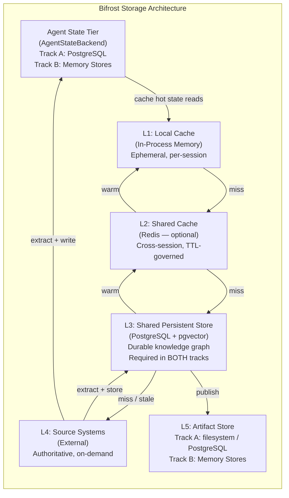
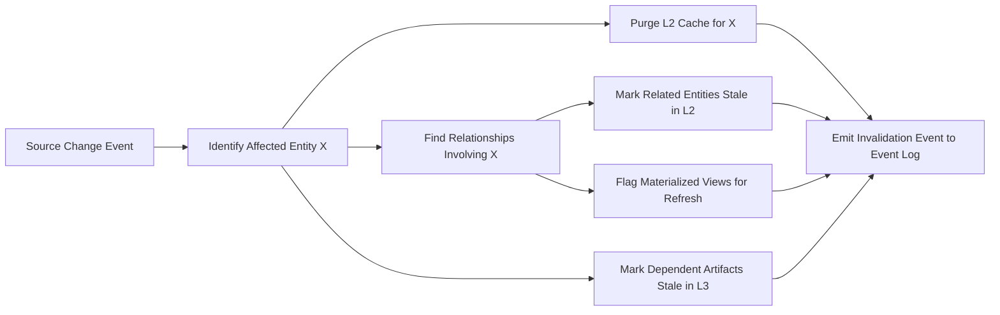

# S4 -- Storage and Caching Architecture

**Spec ID:** S4
**Status:** Draft
**Depends on:** S1 (Knowledge Model), S2 (Source Adapters), S3 (Freshness Engine), S11 (Security and Access Control)

---

## 1. Purpose and Scope

This specification defines how Bifrost stores, caches, retrieves, and retires engineering knowledge. It covers the full data lifecycle from live source fetches through in-process caching, shared caching, persistent storage, and versioned artifact publishing.

This spec defines storage across two tracks. Track A (V1): all storage on customer infrastructure (PostgreSQL + optional Redis). Track B (future): Anthropic Memory Stores handle agent state, PostgreSQL handles structured knowledge graph. Both tracks share the same `AgentStateBackend` interface so storage implementation is swappable.

The scope includes:
- Storage tier definitions and data placement rules
- Physical schema for the shared persistent store
- Cache key design, TTL policies, warming, and invalidation
- Artifact store design for generated documentation
- Data retention, archival, backup, and recovery
- Interface contracts for all storage and cache operations

The scope excludes:
- Knowledge model semantics (see S1)
- Source adapter protocols (see S2)
- Freshness computation logic (see S3)
- Access control enforcement details (see S11)

---

## 2. Glossary References

| Term | Definition |
|------|-----------|
| **Knowledge Tier** | Classification of knowledge by derivation depth: T0 (source mappings), T1 (extracted facts), T2 (derived knowledge), T3 (generated docs) |
| **Storage Tier** | Physical layer where data resides: L1 (local cache), L2 (shared cache), L3 (persistent store), L4 (source systems), L5 (artifact store) |
| **Agent State Tier** | Logical storage tier for persistent agent state (configs, freshness, extracted knowledge text). Track A: PostgreSQL. Track B: Anthropic Memory Stores. Accessed via `AgentStateBackend` interface. |
| **AgentStateBackend** | Python ABC abstracting agent state storage across both tracks. Methods: read, write, list, delete. `PostgresStateBackend` implements Track A; `MemoryStoreBackend` implements Track B. |
| **Track A** | V1 storage model: all persistence on customer infrastructure using PostgreSQL (and optional Redis). Recommended for immediate deployment. |
| **Track B** | Future storage model: Anthropic Memory Stores for agent state + PostgreSQL for knowledge graph. Requires Managed Agents Research Preview access. Enables automatic cross-machine state sharing. |
| **Metadata Envelope** | JSONB structure attached to every knowledge artifact carrying source basis, freshness, confidence, known gaps, and scope |
| **Stale-While-Revalidate** | Cache strategy that serves a stale entry immediately while triggering an asynchronous refresh in the background |
| **Entity** | Any first-class object in the knowledge graph: repo, component, interface, flow, dependency, domain, pattern |
| **Relationship** | A typed, directional edge between two entities with associated metadata |

---

## 3. Requirements Traceability

| Requirement | Section | Coverage |
|-------------|---------|----------|
| 13.1 No full central duplication | L4 source-on-demand design | Storage tiers, data placement policy |
| 13.2 Multiple storage classes | L1--L5 tier definitions + Agent State Tier | Section 5 |
| 13.3 Caching for metadata, snippets, parsed structures, mappings, derived knowledge, task outputs, runtime summaries | L1 + L2 cache design | Sections 6, 9 |
| 13.4 Dependency-aware invalidation, manual refresh, task-scoped refresh, selective refresh, stale marking, local vs shared distinction | Cache invalidation design | Section 10 |
| 13.5 Storage visibility (live, cached, stale, confidence impact) | Cache transparency metadata | Section 11 |
| 7.2 Knowledge quality (source basis, freshness, confidence, gaps, scope, relationships) | Metadata envelope in JSONB | Section 7 |
| 12.1--12.6 Freshness tracking at all levels | Freshness tracking table, repo_freshness table, freshness state doc, cache TTLs | Sections 7, 9 |
| 8.4--8.5 Doc freshness and publication states | Artifact store states | Section 13 |
| 20.1--20.4 Logging and audit | Event log table (append-only) | Section 7 |
| 22.2 Performance through caching | Cache warming, stale-while-revalidate, L1 caching of agent state docs | Sections 9, 12 |
| Cross-machine consistency | Shared PostgreSQL (Track A); Memory Stores (Track B) | Section 13.5, Section 19 |
| AgentStateBackend abstraction | Interface design enables Track A → Track B migration with no business logic changes | Section 5 (Agent State Tier) |

---

## 4. Design Goals and Non-Goals

### Goals

1. **Source of truth stays at the source.** Bifrost never attempts to fully mirror external systems. L4 is authoritative; L3 stores derived knowledge, not raw content.
2. **Fast reads for hot paths.** Interactive queries and agent consultations must hit L1 or L2 in the common case. Target: <50ms for cached reads.
3. **Explicit freshness everywhere.** Every cached or stored artifact carries age, source revision, and confidence impact metadata. Nothing is silently stale.
4. **Single durable store for V1.** PostgreSQL serves as the single persistent store for entities, relationships, knowledge artifacts, and event log. Avoid premature polyglot persistence.
5. **Dependency-aware invalidation.** Invalidating one entity must propagate to all entities that reference it, across cache and persistent tiers.
6. **Docs-as-code artifacts.** Generated documentation is version-controlled with full diff and rollback support.

### Non-Goals

- **Full-text search engine.** V1 does not include Elasticsearch or equivalent. PostgreSQL `tsvector` and `pg_trgm` are sufficient for initial search needs.
- **Multi-region replication.** V1 targets single-region deployment.
- **Real-time streaming.** Event log is append-only in PostgreSQL. Kafka or equivalent is deferred.
- **Object storage for large blobs.** V1 uses local filesystem or Git for artifacts. S3 integration is deferred.
- **Multi-tenant isolation.** V1 assumes single-tenant deployment.

---

## 5. Storage Tiers



### Agent State Tier (AgentStateBackend)

Purpose: Persistent agent state — configs, freshness tracking, extracted knowledge text summaries.
Access pattern: Read at agent session start, write after each extraction batch.

**Track A implementation:** PostgreSQL table `knowledge_text_cache`
- Schema: `(path TEXT PRIMARY KEY, content TEXT, content_hash TEXT, updated_at TIMESTAMPTZ, repo_id UUID)`
- Indexes: idx on `repo_id`, idx on path prefix (`text_pattern_ops`)
- Cross-machine: YES, if all instances share the same PostgreSQL connection string

**Track B implementation:** Anthropic Memory Stores
- One store per repo: `/repo/{id}/knowledge`, `/repo/{id}/freshness`, etc.
- Cross-machine: YES, automatic via Anthropic API

**Interface:** `AgentStateBackend` (read/write/list/delete) — same API regardless of track.

```python
from abc import ABC, abstractmethod
from datetime import datetime

class AgentStateBackend(ABC):
    @abstractmethod
    async def read(self, path: str) -> str | None: ...

    @abstractmethod
    async def write(self, path: str, content: str, *, sha: str | None = None, must_not_exist: bool = False) -> None: ...

    @abstractmethod
    async def list(self, path_prefix: str) -> list[dict]:  # [{"path": str, "updated_at": datetime, "content_hash": str}]
        ...

    @abstractmethod
    async def delete(self, path: str) -> None: ...

# Track A: PostgreSQL implementation
class PostgresStateBackend(AgentStateBackend):
    # uses knowledge_text_cache table
    ...

# Track B implementation — uses Anthropic Memory Stores API
# Only available when BIFROST_TRACK=B and Managed Agents access is granted
class MemoryStoreBackend(AgentStateBackend):
    def __init__(self, client: Anthropic) -> None:
        self._client = client

    async def read(self, path: str) -> str | None:
        # Map path to Memory Store + document name
        store_id, doc_name = self._path_to_store(path)
        try:
            doc = await self._client.beta.memory_stores.documents.retrieve(store_id, doc_name)
            return doc.content
        except NotFoundError:
            return None

    async def write(self, path: str, content: str, *, sha: str | None = None, must_not_exist: bool = False) -> None:
        if len(content) > 100_000:
            raise ValueError(f"Memory Store document exceeds 100KB limit: {path} ({len(content)} bytes)")
        store_id, doc_name = self._path_to_store(path)
        # sha is SHA256 of expected current content (for optimistic concurrency)
        kwargs = {"if_match": sha} if sha else {}
        await self._client.beta.memory_stores.documents.upsert(store_id, doc_name, content=content, **kwargs)

    async def list(self, prefix: str) -> list[dict]:
        # List all documents across relevant stores matching prefix
        # Note: Memory Stores API may not support prefix listing natively — use document naming convention
        store_id, _ = self._path_to_store(prefix)
        docs = await self._client.beta.memory_stores.documents.list(store_id)
        return [
            {"path": self._store_to_path(store_id, d.name), "updated_at": d.updated_at, "content_hash": d.content_hash}
            for d in docs.data
            if self._store_to_path(store_id, d.name).startswith(prefix)
        ]

    async def delete(self, path: str) -> None:
        store_id, doc_name = self._path_to_store(path)
        await self._client.beta.memory_stores.documents.delete(store_id, doc_name)

    def _path_to_store(self, path: str) -> tuple[str, str]:
        # Map /repo/{id}/components/foo.md → (store_id for repo {id}, "components/foo.md")
        # Implementation maps path prefixes to store IDs per agent session config
        raise NotImplementedError("Resolved at session start by AgentRuntime")

    def _store_to_path(self, store_id: str, name: str) -> str:
        raise NotImplementedError("Resolved at session start by AgentRuntime")
```

**Document path conventions:**
```
/repo/{id}/freshness/state.md                    — freshness state
/repo/{id}/config.md                             — agent config
/repo/{id}/components/{component-name}.md        — component knowledge (<=100KB each)
/repo/{id}/flows/{flow-id}.md                    — flow knowledge
/repo/{id}/dependencies/{dep-id}.md              — dependency knowledge
/repo/{id}/index.md                              — index of all indexed entities
```

#### §5.4 Memory Store Cross-Agent Isolation Policy

Each agent session operating against a Memory Store backend MUST respect the following ownership rules to prevent data corruption under L7 (session concurrency):

**Path ownership**
Each agent may only write to paths starting with its own assigned prefix. For example, a `RepoAgent` handling `repo-id-123` may only write to `/repo/123/**`. Writing to another agent's prefix is a runtime error.

**Read-any, write-own**
Agents may READ any path in the Memory Store (required for synthesis operations that aggregate across repos or agents). However, WRITE operations are restricted to the agent's own prefix. This asymmetry enables cross-agent knowledge synthesis without risking unintended mutations.

**Conflict resolution**
Last-write-wins with optimistic concurrency. The `write()` method's `precondition` parameter accepts a SHA256 content hash (version token) returned in the `list()` response (`contentHash` field). If the document has changed since the token was captured, the write is rejected with a `412 Precondition Failed` error. The caller MUST re-read and retry.

**Enforcement: `ScopedMemoryStoreClient`**
A `ScopedMemoryStoreClient` wrapper (following the same pattern as `ScopedStorageClient` in Track A) is instantiated per agent session with the agent's assigned scope path. All write calls are prefixed automatically — the wrapper throws if the caller attempts to write outside the scope. Read calls pass through unmodified.

```python
class ScopedMemoryStoreClient:
    def __init__(self, backend: AgentStateBackend, scope_prefix: str) -> None:
        self._backend = backend
        self._scope_prefix = scope_prefix  # e.g. "/repo/123"

    async def write(self, path: str, content: str, *, sha: str | None = None) -> None:
        if not path.startswith(self._scope_prefix):
            raise PermissionError(f'Write path "{path}" outside agent scope "{self._scope_prefix}"')
        return await self._backend.write(path, content, sha=sha)

    # read/list/delete pass through to backend unchanged
    async def read(self, path: str) -> str | None:
        return await self._backend.read(path)

    async def list(self, prefix: str) -> list[dict]:
        return await self._backend.list(prefix)

    async def delete(self, path: str) -> None:
        return await self._backend.delete(path)
```

#### §5.5 Track B Checkpoint Strategy

To address L2 (ephemeral sessions) and L5 (session duration limits), `ExtractionAgent` MUST write a checkpoint document to Memory Store every 20 files processed.

**Checkpoint path:** `/repo/{id}/checkpoints/extraction-{timestamp}.md`

**Checkpoint document format:**
```
status: in_progress | complete
files_processed: N
total_files: M
last_file: "path/to/file.ts"
entities_extracted:
  components: N
  flows: N
  dependencies: N
```

**Session start behavior:** On session start, the agent checks for an existing checkpoint at `/repo/{id}/checkpoints/` with `status: in_progress`. If found, extraction resumes from the `last_file` recorded in the most recent checkpoint. Already-processed files are skipped.

**Session completion:** When all files are processed, the agent writes a final checkpoint with `status: complete`. In-progress checkpoints for the same repo are superseded (not deleted — they remain for audit).

**Checkpoint frequency:** Every 20 files. If a session terminates between checkpoints, at most 19 files of progress are lost.

#### §5.6 Memory Store Size Limits

**Per-document limit: 100KB**
Enforced in `MemoryStoreBackend.write()` — throws `Error` if `content.length > 100_000`. Documents exceeding this limit must be split across multiple paths (e.g., a large component split into `component/foo-part-1.md`, `component/foo-part-2.md`).

**Per-repo total: no enforced limit in V1**
There is no hard cap on total Memory Store usage per repo. However, the knowledge index (S8 §9.8) imposes practical limits on how much content can be included in a single synthesis context window.

**Entity list pagination**
If listing a path prefix returns more than 100 items, the caller MUST paginate using the cursor returned in the `list()` response. `MemoryStoreBackend.list()` returns a cursor field when results are truncated; pass it as `{ cursor }` on the next call. Callers that do not paginate risk silently missing entities.

---

### L1: Local Cache (In-Process Memory)

- **Technology:** In-process dict / LRU cache (e.g., `cachetools.LRUCache` or `functools.lru_cache`)
- **Lifetime:** Per-session, per-task. Destroyed when the session or task execution ends.
- **Contents:** Hot entities, recent query results, task-scoped working set, adapter response fragments, frequently-read agent state documents.
- **Max size:** Configurable per session; default 256 MB.
- **Eviction:** LRU with TTL floor. Entries never outlive the session.
- **Track notes:** Ephemeral, per-process. Same role in both tracks. Cache frequently-read state docs to reduce API latency (especially for Track B Memory Store reads).

### L2: Shared Cache (Redis)

- **Technology:** Redis 7+, single instance for V1.
- **Lifetime:** TTL-governed; entries expire based on knowledge tier policy.
- **Contents:** Frequently accessed entities, source metadata summaries, parsed structures, cross-session hot data, recent task outputs.
- **Serialization:** MessagePack for compact binary serialization.
- **Max size:** Configurable; default 2 GB, with LRU eviction as backstop.
- **Track notes:** Optional in both tracks. In Track B, can cache hot Memory Store reads to reduce API latency. Redis is NOT required if in-process L1 cache is sufficient.

### L3: Shared Persistent Store (PostgreSQL + pgvector)

- **Technology:** PostgreSQL 16+ with `pgvector` extension for embedding similarity and `pg_trgm` for fuzzy text matching. ORM: SQLAlchemy 2.0 with `AsyncSession` (via `asyncpg` driver). Schema defined as `DeclarativeBase` models using `Mapped[type]` syntax.
- **Lifetime:** Durable. Data persists until explicitly invalidated or archived.
- **Contents:** Full knowledge graph (entities, relationships), knowledge artifacts with metadata envelopes, source mappings, freshness tracking, event log.
- **Schema:** See Section 7. DDL shown as raw SQL; application code accesses via SQLAlchemy ORM models.
- **Track notes:** REQUIRED in BOTH tracks. Track B uses Memory Stores for text knowledge but still requires PostgreSQL for structured graph queries (entities, relationships, traversal) — Memory Stores cannot do graph queries.

### L4: Source Systems (External)

- **Technology:** Varies per source (GitHub API, Jira API, Kubernetes API, etc.)
- **Lifetime:** Authoritative and external. Bifrost does not control retention.
- **Access pattern:** On-demand via source adapters (S2). Results flow into L3 and propagate to L2/L1.
- **Key constraint:** Raw source content is NOT duplicated in L3. Only extracted knowledge, metadata, and mappings are stored.

### L5: Artifact Store

- **Track A (V1):** Local filesystem or PostgreSQL text column. Each generated doc is committed to a local Git directory. Simple, no additional infrastructure.
- **Track B (future):** Anthropic Memory Stores at `/docs/{doc-type}/{target-id}.md`. Publication: Bifrost control plane reads from memory store, pushes to Git or Confluence. Versioning: memory store provides immutable version history.
- **States:** draft, review, published, stale, archived.
- **See:** Section 13 for full artifact store design.

---

## 6. Data Placement Policy

| Data Type | Primary Tier | Also In | TTL (L2) | Rationale |
|-----------|-------------|---------|----------|-----------|
| Source metadata (repo info, file lists, branch state) | L3 | L2, L1 | 1 hr | Changes frequently; short cache to avoid stale reads |
| Source mappings (T0) | L3 | L2 | 1 hr | Foundation layer; must stay fresh to source state |
| Extracted entities (T1: components, interfaces) | L3 | L2, L1 | 4 hr | Moderate churn; good cache hit ratio |
| Extracted relationships (T1) | L3 | L2, L1 | 4 hr | Same cadence as entity extraction |
| Derived knowledge (T2: flow analysis, dep graphs, patterns) | L3 | L2 | 24 hr | Expensive to compute; acceptable staleness window |
| Generated docs (T3) | L5 | L2 (metadata only) | 7 days | Explicitly versioned; metadata cached for quick freshness checks |
| Task outputs (query results, plans) | L3 | L1 | 30 days (L3) | Useful for learning; L1 only for active session |
| Embeddings (entity vectors) | L3 (pgvector) | -- | -- | Stored persistently; updated on entity change |
| Event log entries | L3 | -- | -- | Append-only; never cached |
| Freshness tracking records | L3 | L2 | 5 min | Must be near-real-time; very short cache |
| Raw source content | L4 only | -- | -- | Never duplicated; fetched on-demand |
| Parsed AST / structure fragments | L2 | L1 | 4 hr | Expensive to parse; good reuse across sessions |
| Runtime correlation summaries | L3 | L2 | 1 hr | Runtime state changes frequently |

---

## 7. Shared Store Physical Schema

### 7.1 Entities Table

Polymorphic entity storage. All first-class knowledge graph nodes live here.

```sql
CREATE TABLE entities (
    id              UUID PRIMARY KEY DEFAULT gen_random_uuid(),
    entity_type     TEXT NOT NULL,  -- 'repo', 'component', 'interface', 'flow', 'dependency', 'domain', 'pattern'
    name            TEXT NOT NULL,
    qualified_name  TEXT,           -- fully qualified: domain/repo/component
    scope_repo_id   UUID REFERENCES entities(id),
    scope_domain_id UUID REFERENCES entities(id),
    knowledge_tier  SMALLINT NOT NULL DEFAULT 1,  -- 0=mapping, 1=extracted, 2=derived, 3=generated
    metadata        JSONB NOT NULL DEFAULT '{}',  -- type-specific attributes
    embedding       vector(1536),   -- pgvector for similarity search
    confidence      REAL NOT NULL DEFAULT 0.5,    -- 0.0 to 1.0
    source_basis    JSONB NOT NULL DEFAULT '[]',  -- array of {source_id, revision, timestamp}
    freshness_state TEXT NOT NULL DEFAULT 'fresh', -- 'fresh', 'stale', 'unknown'
    last_refreshed  TIMESTAMPTZ,
    created_at      TIMESTAMPTZ NOT NULL DEFAULT now(),
    updated_at      TIMESTAMPTZ NOT NULL DEFAULT now(),

    CONSTRAINT valid_knowledge_tier CHECK (knowledge_tier BETWEEN 0 AND 3),
    CONSTRAINT valid_confidence CHECK (confidence BETWEEN 0.0 AND 1.0)
);

CREATE INDEX idx_entities_type ON entities (entity_type);
CREATE INDEX idx_entities_scope_repo ON entities (scope_repo_id) WHERE scope_repo_id IS NOT NULL;
CREATE INDEX idx_entities_scope_domain ON entities (scope_domain_id) WHERE scope_domain_id IS NOT NULL;
CREATE INDEX idx_entities_qualified_name ON entities (qualified_name);
CREATE INDEX idx_entities_freshness ON entities (freshness_state, last_refreshed);
CREATE INDEX idx_entities_embedding ON entities USING ivfflat (embedding vector_cosine_ops) WITH (lists = 100);
CREATE INDEX idx_entities_metadata ON entities USING gin (metadata);
```

### 7.2 Relationships Table

Typed directional edges between entities.

```sql
CREATE TABLE relationships (
    id              UUID PRIMARY KEY DEFAULT gen_random_uuid(),
    source_id       UUID NOT NULL REFERENCES entities(id) ON DELETE CASCADE,
    target_id       UUID NOT NULL REFERENCES entities(id) ON DELETE CASCADE,
    rel_type        TEXT NOT NULL,  -- 'contains', 'depends_on', 'calls', 'implements', 'exposes', 'consumes', 'belongs_to', 'relates_to'
    metadata        JSONB NOT NULL DEFAULT '{}',  -- weight, evidence, conditions
    confidence      REAL NOT NULL DEFAULT 0.5,
    source_basis    JSONB NOT NULL DEFAULT '[]',
    freshness_state TEXT NOT NULL DEFAULT 'fresh',
    last_refreshed  TIMESTAMPTZ,
    created_at      TIMESTAMPTZ NOT NULL DEFAULT now(),
    updated_at      TIMESTAMPTZ NOT NULL DEFAULT now(),

    CONSTRAINT no_self_reference CHECK (source_id != target_id),
    CONSTRAINT valid_confidence CHECK (confidence BETWEEN 0.0 AND 1.0)
);

CREATE INDEX idx_rel_source ON relationships (source_id);
CREATE INDEX idx_rel_target ON relationships (target_id);
CREATE INDEX idx_rel_type ON relationships (rel_type);
CREATE INDEX idx_rel_source_type ON relationships (source_id, rel_type);
CREATE UNIQUE INDEX idx_rel_unique_edge ON relationships (source_id, target_id, rel_type);
```

### 7.3 Knowledge Artifacts Table

Tiered knowledge artifacts with full metadata envelope.

```sql
CREATE TABLE knowledge_artifacts (
    id              UUID PRIMARY KEY DEFAULT gen_random_uuid(),
    entity_id       UUID REFERENCES entities(id) ON DELETE SET NULL,
    artifact_type   TEXT NOT NULL,  -- 'overview', 'flow_doc', 'pattern_doc', 'analysis', 'plan', 'migration_guide', 'onboarding'
    knowledge_tier  SMALLINT NOT NULL,
    title           TEXT NOT NULL,
    content         TEXT NOT NULL,
    content_format  TEXT NOT NULL DEFAULT 'markdown',  -- 'markdown', 'json', 'adf'
    metadata_envelope JSONB NOT NULL DEFAULT '{}',
    -- metadata_envelope structure:
    -- {
    --   "source_basis": [{"source_id": "...", "revision": "...", "timestamp": "..."}],
    --   "freshness": {"state": "fresh|stale|unknown", "last_checked": "...", "max_age_ms": ...},
    --   "confidence": {"overall": 0.85, "factors": [...]},
    --   "known_gaps": ["...", "..."],
    --   "scope": {"repos": [...], "domains": [...], "flows": [...]},
    --   "generation_context": {"task_id": "...", "model": "...", "prompt_hash": "..."}
    -- }
    version         INTEGER NOT NULL DEFAULT 1,
    state           TEXT NOT NULL DEFAULT 'draft',  -- 'draft', 'review', 'published', 'stale', 'archived'
    created_at      TIMESTAMPTZ NOT NULL DEFAULT now(),
    updated_at      TIMESTAMPTZ NOT NULL DEFAULT now(),

    CONSTRAINT valid_knowledge_tier CHECK (knowledge_tier BETWEEN 0 AND 3)
);

CREATE INDEX idx_ka_entity ON knowledge_artifacts (entity_id);
CREATE INDEX idx_ka_type ON knowledge_artifacts (artifact_type);
CREATE INDEX idx_ka_state ON knowledge_artifacts (state);
CREATE INDEX idx_ka_tier ON knowledge_artifacts (knowledge_tier);
CREATE INDEX idx_ka_envelope ON knowledge_artifacts USING gin (metadata_envelope);
```

### 7.4 Source Mappings Table

Maps external source objects to Bifrost entities.

```sql
CREATE TABLE source_mappings (
    id              UUID PRIMARY KEY DEFAULT gen_random_uuid(),
    source_type     TEXT NOT NULL,       -- 'github', 'jira', 'confluence', 'kubernetes', 'slack'
    source_id       TEXT NOT NULL,       -- external identifier (repo URL, issue key, etc.)
    source_path     TEXT,                -- path within source (file path, API endpoint)
    entity_id       UUID REFERENCES entities(id) ON DELETE CASCADE,
    mapping_type    TEXT NOT NULL,       -- 'primary', 'supporting', 'reference'
    relevance       REAL NOT NULL DEFAULT 0.5,
    last_known_rev  TEXT,                -- last known revision/hash/version from source
    last_fetched    TIMESTAMPTZ,
    last_changed    TIMESTAMPTZ,         -- last known change at source
    metadata        JSONB NOT NULL DEFAULT '{}',
    created_at      TIMESTAMPTZ NOT NULL DEFAULT now(),
    updated_at      TIMESTAMPTZ NOT NULL DEFAULT now()
);

CREATE INDEX idx_sm_source ON source_mappings (source_type, source_id);
CREATE INDEX idx_sm_entity ON source_mappings (entity_id);
CREATE UNIQUE INDEX idx_sm_unique ON source_mappings (source_type, source_id, source_path, entity_id);
```

### 7.5 Event Log Table

Append-only event log for event sourcing and audit.

```sql
CREATE TABLE event_log (
    id              BIGSERIAL PRIMARY KEY,
    event_type      TEXT NOT NULL,       -- 'source_changed', 'entity_created', 'entity_updated', 'entity_invalidated',
                                         -- 'cache_purged', 'artifact_published', 'task_completed', 'refresh_triggered'
    entity_id       UUID,                -- may be null for system events
    actor_type      TEXT NOT NULL,       -- 'system', 'user', 'agent', 'adapter'
    actor_id        TEXT,
    payload         JSONB NOT NULL DEFAULT '{}',
    scope           JSONB,               -- {"repo_id": "...", "domain_id": "..."}
    created_at      TIMESTAMPTZ NOT NULL DEFAULT now()
);

-- Partitioned by month for efficient retention management
-- In V1, manual partition management; automate later
CREATE INDEX idx_el_type ON event_log (event_type);
CREATE INDEX idx_el_entity ON event_log (entity_id) WHERE entity_id IS NOT NULL;
CREATE INDEX idx_el_created ON event_log (created_at);
CREATE INDEX idx_el_scope ON event_log USING gin (scope) WHERE scope IS NOT NULL;
```

### 7.6 Agent State Tables (Track A)

Track A agent state tables replace Anthropic Memory Stores for all persistence of configs, freshness, and extracted knowledge text.

```sql
-- Track A: Agent state tables (replace memory stores in Track A)

CREATE TABLE knowledge_text_cache (
  path           TEXT PRIMARY KEY,                      -- e.g., /repo/{id}/components/WebhookService.md
  repo_id        UUID REFERENCES repos(id) ON DELETE CASCADE,
  content        TEXT NOT NULL,
  content_hash   TEXT NOT NULL,                         -- SHA256 for optimistic concurrency
  entity_type    TEXT,                                  -- 'component', 'flow', 'dependency', 'convention', 'freshness'
  updated_at     TIMESTAMPTZ NOT NULL DEFAULT NOW()
);
CREATE INDEX idx_knowledge_text_repo ON knowledge_text_cache(repo_id);
CREATE INDEX idx_knowledge_text_path_prefix ON knowledge_text_cache(path text_pattern_ops);

CREATE TABLE agent_configs (
  id             UUID PRIMARY KEY DEFAULT gen_random_uuid(),
  agent_type     TEXT NOT NULL,                         -- 'RepoAgent', 'ExtractionAgent', 'TaskCoordinator'
  scope_id       TEXT NOT NULL,                         -- repo_id or domain_id
  config_json    JSONB NOT NULL,
  track_a_config JSONB,                                 -- Track A specific (model, prompts, adapter configs)
  track_b_config JSONB,                                 -- Track B specific (agent_definition_id, env_id, memory_store_ids)
  created_at     TIMESTAMPTZ NOT NULL DEFAULT NOW(),
  updated_at     TIMESTAMPTZ NOT NULL DEFAULT NOW()
);

CREATE TABLE repo_freshness (
  repo_id              UUID PRIMARY KEY REFERENCES repos(id),
  last_commit_indexed  TEXT,                            -- git SHA
  last_indexed_at      TIMESTAMPTZ,
  index_status         TEXT NOT NULL DEFAULT 'not_started', -- not_started, in_progress, complete, partial, failed
  component_cursor     TEXT,                            -- last component name indexed (for partial resume)
  component_count      INT DEFAULT 0,
  flow_count           INT DEFAULT 0,
  pending_commits      INT DEFAULT 0,
  freshness_state      TEXT NOT NULL DEFAULT 'unknown', -- fresh, stale, indexing, failed, unknown
  stale_reason         TEXT,
  updated_at           TIMESTAMPTZ NOT NULL DEFAULT NOW()
);
```

### 7.7 Freshness Tracking Table

Per-entity, per-source freshness state for fine-grained staleness detection.

```sql
CREATE TABLE freshness_tracking (
    id              UUID PRIMARY KEY DEFAULT gen_random_uuid(),
    entity_id       UUID NOT NULL REFERENCES entities(id) ON DELETE CASCADE,
    source_type     TEXT NOT NULL,
    source_id       TEXT NOT NULL,
    last_known_rev  TEXT,                -- revision hash or version at source
    last_checked_at TIMESTAMPTZ NOT NULL DEFAULT now(),
    last_changed_at TIMESTAMPTZ,         -- when source last changed
    last_synced_at  TIMESTAMPTZ,         -- when Bifrost last synced this source
    lag_ms          BIGINT,              -- computed: last_changed_at - last_synced_at
    state           TEXT NOT NULL DEFAULT 'unknown',  -- 'fresh', 'stale', 'unknown', 'error'
    error_detail    TEXT,
    created_at      TIMESTAMPTZ NOT NULL DEFAULT now(),
    updated_at      TIMESTAMPTZ NOT NULL DEFAULT now(),

    CONSTRAINT unique_entity_source UNIQUE (entity_id, source_type, source_id)
);

CREATE INDEX idx_ft_entity ON freshness_tracking (entity_id);
CREATE INDEX idx_ft_state ON freshness_tracking (state);
CREATE INDEX idx_ft_stale ON freshness_tracking (state, last_checked_at) WHERE state = 'stale';
```

### 7.8 Freshness State Document (AgentStateBackend)

The freshness state for a repo is stored as a structured text document via the `AgentStateBackend` interface (in addition to the structured `repo_freshness` table above, which is always populated in Track A).

```
Path: /repo/{repo-id}/freshness/state.md
(Track A: stored in knowledge_text_cache at this path)
(Track B: stored in Memory Store /repo/{id}/freshness)

Content:
last_commit_indexed: abc123def456
last_indexed_at: 2025-01-15T10:00:00Z
index_status: complete
component_cursor: null
component_count: 47
flow_count: 12
pending_commits: 3
freshness_state: stale
stale_reason: 3 commits since last index
```

Agents read this document at session start to decide whether to use cached knowledge or trigger re-extraction.

**Decision logic:**
- `freshness_state == fresh` AND `pending_commits < 10` → use cached knowledge (skip re-extraction)
- `freshness_state == stale` OR `pending_commits >= 10` → trigger smart reconciliation (re-extract changed files only)
- `index_status == partial` → resume extraction from `component_cursor`

---

## 8. Graph Query Support

The knowledge graph is stored in relational tables but queried as a property graph. Three mechanisms support graph operations over PostgreSQL.

### 8.1 Recursive CTEs for Traversal

Traversals (dependency chains, flow paths, containment hierarchies) use recursive common table expressions.

```sql
-- Example: find all transitive dependencies of an entity, up to depth 5
WITH RECURSIVE dep_graph AS (
    -- Base case: direct dependencies
    SELECT
        r.target_id AS entity_id,
        r.rel_type,
        r.confidence,
        1 AS depth,
        ARRAY[r.source_id, r.target_id] AS path
    FROM relationships r
    WHERE r.source_id = :root_entity_id
      AND r.rel_type IN ('depends_on', 'calls', 'consumes')

    UNION ALL

    -- Recursive case
    SELECT
        r.target_id,
        r.rel_type,
        LEAST(dg.confidence, r.confidence),  -- confidence degrades along path
        dg.depth + 1,
        dg.path || r.target_id
    FROM relationships r
    JOIN dep_graph dg ON r.source_id = dg.entity_id
    WHERE dg.depth < 5
      AND NOT r.target_id = ANY(dg.path)  -- cycle prevention
)
SELECT DISTINCT ON (entity_id)
    dg.entity_id,
    e.entity_type,
    e.name,
    dg.depth,
    dg.confidence,
    dg.path
FROM dep_graph dg
JOIN entities e ON e.id = dg.entity_id
ORDER BY entity_id, depth;
```

### 8.2 pgvector for Similarity Search

Semantic similarity queries use the `embedding` column on the entities table.

```sql
-- Find entities semantically similar to a query embedding
SELECT
    id,
    entity_type,
    name,
    1 - (embedding <=> :query_embedding) AS similarity,
    confidence,
    freshness_state
FROM entities
WHERE entity_type = ANY(:allowed_types)
  AND embedding IS NOT NULL
ORDER BY embedding <=> :query_embedding
LIMIT 20;
```

### 8.3 Materialized Views for Common Patterns

Pre-computed views for frequent access patterns, refreshed on a schedule or after bulk updates.

```sql
-- Materialized view: repo dependency summary
CREATE MATERIALIZED VIEW mv_repo_dependencies AS
SELECT
    e_src.id AS repo_id,
    e_src.name AS repo_name,
    e_tgt.id AS depends_on_repo_id,
    e_tgt.name AS depends_on_repo_name,
    r.rel_type,
    r.confidence,
    COUNT(*) AS edge_count
FROM entities e_src
JOIN relationships r ON r.source_id = e_src.id
JOIN entities e_tgt ON r.target_id = e_tgt.id
WHERE e_src.entity_type = 'repo'
  AND e_tgt.entity_type = 'repo'
  AND r.rel_type IN ('depends_on', 'calls', 'consumes')
GROUP BY e_src.id, e_src.name, e_tgt.id, e_tgt.name, r.rel_type, r.confidence;

CREATE UNIQUE INDEX idx_mv_repo_deps ON mv_repo_dependencies (repo_id, depends_on_repo_id, rel_type);

-- Refresh on demand or scheduled
-- REFRESH MATERIALIZED VIEW CONCURRENTLY mv_repo_dependencies;
```

---

## 9. Cache Design

### 9.1 Cache Key Scheme

All cache keys follow a structured namespace:

```
bifrost:{tier}:{entity_type}:{id}:{version}
```

Examples:
```
bifrost:L2:entity:550e8400-e29b-41d4-a716-446655440000:v3
bifrost:L2:relationship:query:repo-deps:550e8400:latest
bifrost:L2:artifact:meta:doc-overview:550e8400:v1
bifrost:L1:task:result:abc123:latest
bifrost:L2:freshness:entity:550e8400:current
bifrost:L2:source_meta:github:org/repo:latest
```

Conventions:
- `tier` is `L1` or `L2` (L3 is direct database access; L4 and L5 are not cache-keyed).
- `version` is either an explicit version number or `latest`.
- Composite query results use a hash of the query parameters as the key suffix.

### 9.2 TTL Policies by Knowledge Tier

| Knowledge Tier | Description | L2 TTL (default) | L1 TTL | Configurable |
|----------------|-------------|-------------------|--------|-------------|
| T0 | Source mappings | 1 hour | 15 min | Yes |
| T1 | Extracted facts | 4 hours | 30 min | Yes |
| T2 | Derived knowledge | 24 hours | 1 hour | Yes |
| T3 | Generated docs (metadata) | 7 days | 2 hours | Yes |
| -- | Freshness tracking | 5 minutes | 1 min | Yes |
| -- | Task outputs | 1 hour | Session | Yes |
| -- | Parsed structures | 4 hours | 30 min | Yes |

TTLs are configurable per entity type and per repo via the platform configuration.

### 9.3 Cache Warming

Cache warming pre-populates L2 (and optionally L1) to avoid cold-read latency during interactive use.

**On repo registration:**
1. Source adapter performs initial scan.
2. T0 source mappings are written to L3 and warmed into L2.
3. T1 entity extraction results are warmed into L2 as they complete.

**On task start:**
1. Task scope is analyzed (repos, domains, flows involved).
2. All entities and relationships within scope are pre-fetched from L3 into L2.
3. Active session L1 is populated from L2 for the task working set.

**Scheduled warming:**
- A background job refreshes the top-N most accessed entities in L2 before their TTLs expire, based on access frequency counters maintained in Redis.

### 9.4 Stale-While-Revalidate

When a cache entry exists but has passed its TTL:

1. The stale entry is served immediately to the caller.
2. The response is annotated with `cache_status: 'stale-revalidating'` and `cache_age_ms`.
3. An asynchronous revalidation job is enqueued.
4. The revalidation job fetches fresh data from L3 (or L4 if L3 is also stale).
5. On completion, the cache entry is updated and a `cache_refreshed` event is emitted.
6. If revalidation fails, the stale entry remains with `freshness_state: 'stale'` and a degraded confidence value.

The maximum staleness window (beyond which stale entries are NOT served) is configurable per knowledge tier:

| Knowledge Tier | Max Staleness (default) |
|----------------|------------------------|
| T0 | 4 hours |
| T1 | 12 hours |
| T2 | 72 hours |
| T3 | 30 days |

---

## 10. Cache Invalidation

### 10.1 Dependency-Aware Invalidation

When entity X is invalidated:

1. All L2 cache entries for entity X are purged.
2. All relationships where X is `source_id` or `target_id` are identified.
3. Cache entries for all entities on the other end of those relationships are marked stale (not purged -- they trigger stale-while-revalidate on next access).
4. Materialized views that include X are flagged for refresh.
5. Knowledge artifacts whose `source_basis` references X have their `freshness_state` set to `stale`.



### 10.2 Event-Driven Invalidation

Source adapters emit `source_changed` events when they detect upstream changes (webhook, polling, or manual trigger). The invalidation pipeline:

1. `source_changed` event is written to the event log.
2. Source mapping lookup: which entities reference this source?
3. For each affected entity: invalidate per 10.1.
4. If the change affects a flow or dependency graph, propagation continues transitively up to a configurable depth (default: 3).

### 10.3 Manual Invalidation

Users can trigger invalidation at multiple scopes via the API:

| Scope | Effect |
|-------|--------|
| Entity | Purge L1 + L2 for entity; trigger re-extraction from L4 |
| Repo | Invalidate all entities scoped to repo; trigger adapter re-scan |
| Domain | Invalidate all entities scoped to domain |
| Source | Invalidate all entities mapped to a specific source |
| Task-scoped | Invalidate all entities relevant to a specific task scope |

### 10.4 Local vs Shared Cache Distinction

- **L1 invalidation** is session-local. When a session receives a stale notification for a key it holds in L1, the L1 entry is evicted immediately. Cross-session L1 invalidation is not attempted; L1 entries have short TTLs and are scoped to a single session.
- **L2 invalidation** is shared. A Redis key deletion or `DEL` command removes the entry for all consumers. Pub/Sub notifications on the `bifrost:invalidation` channel alert active sessions to evict their L1 entries.

---

## 11. Cache Transparency

Every response that involves cached data includes a `cache_meta` block:

```python
class CacheMeta(BaseModel):
    cache_status: Literal['live', 'cached', 'stale-revalidating']
    cache_age_ms: int                      # 0 for live fetches
    cache_tier: Literal['L1', 'L2', 'L3', 'L4']  # which tier served the data
    confidence_impact: float               # multiplier applied to confidence due to staleness (1.0 = no impact, <1.0 = degraded)
    source_revision: str | None            # revision of source data this cache entry derives from
    revalidation_in_progress: bool
```

**Confidence degradation formula:**

```
effective_confidence = base_confidence * confidence_impact

where:
  confidence_impact = 1.0                         if cache_status == 'live'
  confidence_impact = 1.0                         if cache_status == 'cached' AND age < TTL
  confidence_impact = max(0.5, 1.0 - (age_ms - ttl_ms) / max_staleness_ms * 0.5)
                                                  if cache_status == 'stale-revalidating'
```

This ensures that stale data explicitly reduces confidence, surfacing to users and agents that the answer may be less reliable (requirement 13.5, 16.1).

---

## 12. Cold-Start and Bootstrap

### 12.1 Cold-Start Strategy

Trigger: First time a repo is registered with Bifrost, or when freshness state is absent.

**Track A cold start:**
1. Check PostgreSQL `repo_freshness` for this repo — if absent, start fresh.
2. Spawn ExtractionAgent (TypeScript async function, runs as background job).
3. ExtractionAgent calls Messages API to analyze code files in batches (20 files/batch).
4. After each batch: UPSERT into `knowledge_text_cache`, UPDATE `repo_freshness` (set `component_cursor`).
5. If job restarts: read `repo_freshness.component_cursor` and resume from that component.
6. Completion: set `repo_freshness.index_status = 'complete'`, `freshness_state = 'fresh'`.

**Track B cold start:**
1. Check memory store for `/repo/{id}/freshness/state.md` — if absent, start fresh.
2. Create ExtractionAgent Session (POST /v1/sessions).
3. Session: clone repo into container via Bash tool.
4. Session: analyze files in batches, write to memory store + PostgreSQL after each batch.
5. Checkpoint: write `component_cursor` to `/repo/{id}/freshness/state.md` after each batch.
6. If session interrupted: new session reads cursor and resumes.
7. Completion: update freshness state doc, session terminates.

**Estimated cold-start time (medium repo, ~200 files):**
- Track A: 15--40 min (LLM calls for each file batch at ~2--5 sec/call)
- Track B: similar LLM time + container startup (~30--60 sec one-time)

During bootstrap, queries against the repo return partial results with `freshness_state: 'unknown'` and reduced confidence.

### 12.2 New Repo Bootstrap (Phase Detail)

When a repo is first registered with Bifrost:

| Phase | Actions | Estimated Time | Resources |
|-------|---------|---------------|-----------|
| 1. Source discovery | Adapter scans repo structure, branches, file tree, CI config | 30--120s | 1 adapter instance |
| 2. T0 mapping | Create source mappings for discovered objects; map files to preliminary entity types | 60--300s | 1 adapter + DB writes |
| 3. T1 extraction | Parse key files (entry points, API specs, configs, package manifests); extract entities and relationships | 2--15 min | 1--4 extraction workers |
| 4. Initial T2 derivation | Compute preliminary dependency graph, identify major flows, detect patterns | 5--30 min | 1--2 derivation workers |
| 5. Cache warming | Populate L2 with all extracted entities and relationships | 10--30s | Redis bulk write |

**Total estimated time for a medium repo (50K--200K LOC): 10--45 minutes.**

### 12.3 New Domain Bootstrap

When a domain is registered (aggregating multiple repos):

1. All constituent repos must already be bootstrapped (or are bootstrapped in parallel).
2. Cross-repo relationship discovery: identify shared dependencies, interface contracts, event flows.
3. Domain-level flow assembly: stitch per-repo flow segments into end-to-end domain flows.
4. Estimated additional time: 5--20 minutes beyond per-repo bootstrap.

### 12.4 Incremental Bootstrap

After initial bootstrap, incremental updates are much faster:

- Source change detected -> only affected entities re-extracted (seconds to minutes).
- New file added -> single entity extraction + relationship linkage.
- New repo added to existing domain -> repo bootstrap + cross-repo relationship discovery.

---

## 13. Artifact Store Design

### 13.1 Generated Documentation Storage (T3 Artifacts)

**Track A (V1):**
- Primary: PostgreSQL `doc_artifacts` table (`doc_type`, `target_id`, `content`, `status`, `version`).
- Secondary: local filesystem export for Git push or Confluence sync.
- Versioning: via PostgreSQL row versioning (`version INT` column).

**Track B (future):**
- Primary: Memory Stores at `/docs/{doc-type}/{target-id}.md`.
- Publication: Bifrost control plane reads from memory store, pushes to Git or Confluence.
- Versioning: memory store provides immutable version history (no custom versioning needed).
- Redaction: use `memory_versions.redact()` to remove accidentally published sensitive content.

### 13.2 Git-Backed Versioning (Track A V1)

Generated documents are stored in a dedicated Git repository (or a subdirectory of the Bifrost data directory in V1).

```
artifacts/
  repos/
    {repo_id}/
      overview.md
      onboarding.md
      flows/
        {flow_name}.md
  domains/
    {domain_id}/
      summary.md
      cross-repo-deps.md
      flows/
        {flow_name}.md
```

Each update to a document is a Git commit. The commit message includes:
- Artifact ID
- Trigger (scheduled refresh, manual request, source change)
- Source basis summary (which source revisions informed this version)

### 13.3 Artifact States

| State | Description | Transitions To |
|-------|-------------|---------------|
| `draft` | Generated but not reviewed | `review`, `archived` |
| `review` | Submitted for human review | `published`, `draft`, `archived` |
| `published` | Approved and visible to consumers | `stale`, `archived` |
| `stale` | Published but source knowledge has changed since generation | `draft` (triggers regeneration), `archived` |
| `archived` | Retired; retained for history but not served by default | -- |

### 13.4 Diff and Rollback

- **Diff:** Standard `git diff` between any two versions of an artifact. Exposed via the artifact API as a structured diff (additions, deletions, context).
- **Rollback:** `git revert` to restore a previous version. Creates a new commit (no history rewriting). The rolled-back version enters `draft` state for re-review.

---

### 13.5 Multi-Instance Consistency (Cross-Machine Agent Behavior)

**Problem (V1 without shared storage):** If two engineers run Bifrost locally, each has its own PostgreSQL instance with potentially different agent state — agents behave differently per machine.

**Solution Track A:** Run a SHARED PostgreSQL instance (e.g., cloud-hosted Postgres, or a single company-wide Bifrost server). All Bifrost CLI/API instances connect to the same DB.
- Config: `DATABASE_URL` pointing to shared instance.
- Tradeoff: requires a persistent server; local dev uses local DB with acknowledged divergence.

**Solution Track B (future):** Memory Stores are automatically shared via the Anthropic API key.
- No configuration needed — all machines reading the same key read the same state.
- This is the "agents behave the same on everyone's local machine" requirement.
- Tradeoff: requires Managed Agents Research Preview access.

**Recommendation:** Deploy a shared PostgreSQL instance (simple, cheap — cloud Postgres is ~$20/mo) as the Track A solution. Memory Stores become available as an upgrade when Track B is enabled.

#### Track A → Track B Migration

When an organization gains Managed Agents access and wants to switch to Track B:

**Pre-migration checklist:**
1. Sign DPA with Anthropic (required, see S11 §3)
2. Classify all repos — RESTRICTED repos cannot use Track B
3. Verify `ANTHROPIC_API_KEY` has Managed Agents access

**Migration procedure:**

```python
# Migration job: reads PostgreSQL AgentStateBackend, writes to Anthropic Memory Stores
async def migrate_to_track_b(repo_ids: list[str]) -> None:
    track_a = PostgresStateBackend(db)
    track_b = MemoryStoreBackend(anthropic_client)

    for repo_id in repo_ids:
        # List all documents for this repo
        paths = await track_a.list(f"/repo/{repo_id}/")

        for entry in paths:
            content = await track_a.read(entry["path"])
            if content:
                # Secret scan before sending to Anthropic cloud
                scan = await secret_scan([{"path": entry["path"], "content": content}])
                if scan.blocked:
                    logger.warning(f"Skipping {entry['path']}: contains potential secrets")
                    continue
                await track_b.write(entry["path"], content)
```

**Post-migration:**
1. Set `BIFROST_TRACK=B` in environment
2. Set `TRACK_B_DPA_CONFIRMED=true` in environment
3. Restart application
4. PostgreSQL `knowledge_text_cache` is no longer written to (keep for 30-day rollback window)
5. After 30 days: optionally truncate `knowledge_text_cache` table

**Rollback:** Set `BIFROST_TRACK=A`, restart. PostgreSQL data is preserved.

---

## 14. Data Retention and Archival

| Data Type | Hot Retention | Archival Policy |
|-----------|--------------|-----------------|
| Event log entries | 90 days | Move to compressed cold storage (V1: separate PostgreSQL table partition; future: object storage) |
| Task outputs | 30 days | Delete after retention period |
| Knowledge artifacts (L3) | Indefinite | Retained until explicitly invalidated; stale artifacts marked but not deleted |
| Generated docs (L5) | All versions | All versions retained in Git; old versions accessible via history |
| Source mappings | Indefinite | Deleted only when source is disconnected |
| Freshness tracking | Indefinite | Overwritten in place; historical state available via event log |
| Cache entries (L2) | TTL-governed | Evicted by TTL and LRU; no archival |
| Cache entries (L1) | Session lifetime | Destroyed on session end; no archival |

### Retention Enforcement

A scheduled job runs daily to:
1. Partition or delete event log entries older than 90 days.
2. Delete task output records older than 30 days.
3. Log retention actions to the event log.

---

## 15. Backup and Recovery

### 15.1 PostgreSQL Backup

- **Strategy:** Automated daily base backups with continuous WAL archiving for point-in-time recovery.
- **Tool:** `pg_basebackup` + WAL archiving to local disk (V1) or object storage (future).
- **RPO (Recovery Point Objective):** < 5 minutes (limited by WAL segment size).
- **RTO (Recovery Time Objective):** < 1 hour for full restore.
- **Testing:** Monthly restore test to a staging environment.

### 15.2 Redis Persistence

- **Strategy:** AOF (Append Only File) with `appendfsync everysec` for durability. RDB snapshots every 15 minutes as backup.
- **On failure:** Redis is a cache layer. Full loss of Redis requires only cache warming from L3 -- no data is lost. Recovery time is the cache warming duration (seconds to minutes).
- **V1 approach:** Accept cache loss on Redis restart. L3 is the source of truth for all persistent data.

### 15.3 Artifact Store Backup

- **Strategy:** Git repository is backed up via `git clone --mirror` to a secondary location.
- **Frequency:** Daily.
- **Recovery:** Clone from backup. Full version history is preserved.

### 15.4 Disaster Recovery Summary

| Component | Data Loss Risk on Failure | Recovery Method | Recovery Time |
|-----------|--------------------------|-----------------|---------------|
| PostgreSQL | Minimal (WAL) | Point-in-time restore | < 1 hour |
| Redis | None (cache only) | Warm from L3 | Minutes |
| Artifact Git repo | None if backed up | Clone from mirror | Minutes |
| L1 local cache | None (ephemeral) | Rebuilt on session start | Instant |

---

## 16. Interface Contracts

### 16.1 Storage Read/Write API

```python
class StorageService(ABC):
    # Entity operations
    @abstractmethod
    async def get_entity(self, id: str) -> Entity | None: ...
    @abstractmethod
    async def get_entities_by_type(self, type: EntityType, scope: Scope | None = None) -> list[Entity]: ...
    @abstractmethod
    async def upsert_entity(self, entity: EntityInput) -> Entity: ...
    @abstractmethod
    async def delete_entity(self, id: str) -> None: ...

    # Relationship operations
    @abstractmethod
    async def get_relationships(self, entity_id: str, direction: Literal['outbound', 'inbound', 'both'], rel_types: list[str] | None = None) -> list[Relationship]: ...
    @abstractmethod
    async def upsert_relationship(self, rel: RelationshipInput) -> Relationship: ...
    @abstractmethod
    async def delete_relationship(self, id: str) -> None: ...

    # Graph traversal
    @abstractmethod
    async def traverse_dependencies(self, root_id: str, options: TraversalOptions) -> TraversalResult: ...
    @abstractmethod
    async def find_similar(self, embedding: list[float], options: SimilarityOptions) -> list[SimilarityResult]: ...

    # Knowledge artifacts
    @abstractmethod
    async def get_artifact(self, id: str, version: int | None = None) -> KnowledgeArtifact | None: ...
    @abstractmethod
    async def upsert_artifact(self, artifact: ArtifactInput) -> KnowledgeArtifact: ...

    # Source mappings
    @abstractmethod
    async def get_mappings_for_entity(self, entity_id: str) -> list[SourceMapping]: ...
    @abstractmethod
    async def get_mappings_for_source(self, source_type: str, source_id: str) -> list[SourceMapping]: ...
    @abstractmethod
    async def upsert_mapping(self, mapping: SourceMappingInput) -> SourceMapping: ...

    # Event log
    @abstractmethod
    async def append_event(self, event: EventInput) -> None: ...
    @abstractmethod
    async def query_events(self, filter: EventFilter) -> list[EventLogEntry]: ...

class TraversalOptions(BaseModel):
    max_depth: int = 5            # default: 5
    rel_types: list[str]          # filter by relationship type
    min_confidence: float         # prune low-confidence edges
    include_stale: bool           # include stale entities

class TraversalResult(BaseModel):
    nodes: list[Entity]
    edges: list[Relationship]
    paths: list[EntityPath]
    truncated: bool               # True if max_depth was reached
```

### 16.2 Cache Management API

```python
class CacheService(ABC):
    # Read-through: checks L1 -> L2 -> L3 in order
    @abstractmethod
    async def get(self, key: str) -> CacheResult: ...

    # Write to cache tier
    @abstractmethod
    async def set(self, key: str, value: Any, options: CacheSetOptions) -> None: ...

    # Invalidation
    @abstractmethod
    async def invalidate(self, key: str) -> None: ...
    @abstractmethod
    async def invalidate_pattern(self, pattern: str) -> int: ...  # returns count of invalidated keys
    @abstractmethod
    async def invalidate_entity(self, entity_id: str, cascade: bool) -> InvalidationResult: ...

    # Warming
    @abstractmethod
    async def warm_entity(self, entity_id: str) -> None: ...
    @abstractmethod
    async def warm_scope(self, scope: Scope) -> WarmingResult: ...

    # Inspection
    @abstractmethod
    async def get_cache_meta(self, key: str) -> CacheMeta | None: ...
    @abstractmethod
    async def get_cache_stats(self) -> CacheStats: ...

class CacheResult(BaseModel, Generic[T]):
    value: T | None
    meta: CacheMeta

class CacheSetOptions(BaseModel):
    tier: Literal['L1', 'L2']
    ttl_ms: int
    knowledge_tier: Literal[0, 1, 2, 3] | None = None

class InvalidationResult(BaseModel):
    keys_purged: int
    entities_marked_stale: int
    views_flagged: list[str]
```

### 16.3 Artifact CRUD API

```python
class ArtifactStoreService(ABC):
    # CRUD
    @abstractmethod
    async def create(self, artifact: ArtifactCreateInput) -> Artifact: ...
    @abstractmethod
    async def get(self, id: str, version: int | None = None) -> Artifact | None: ...
    @abstractmethod
    async def update(self, id: str, content: str, metadata: ArtifactMetadata) -> Artifact: ...
    @abstractmethod
    async def archive(self, id: str) -> None: ...

    # State transitions
    @abstractmethod
    async def submit_for_review(self, id: str) -> Artifact: ...
    @abstractmethod
    async def publish(self, id: str) -> Artifact: ...
    @abstractmethod
    async def mark_stale(self, id: str, reason: str) -> Artifact: ...

    # Version management
    @abstractmethod
    async def list_versions(self, id: str) -> list[ArtifactVersionSummary]: ...
    @abstractmethod
    async def diff(self, id: str, from_version: int, to_version: int) -> ArtifactDiff: ...
    @abstractmethod
    async def rollback(self, id: str, to_version: int) -> Artifact: ...

    # Query
    @abstractmethod
    async def list_by_scope(self, scope: Scope, state: ArtifactState | None = None) -> list[ArtifactSummary]: ...
    @abstractmethod
    async def list_stale(self) -> list[ArtifactSummary]: ...

class ArtifactDiff(BaseModel):
    from_version: int
    to_version: int
    additions: int
    deletions: int
    hunks: list[DiffHunk]
```

---

## 17. Dependencies

| Dependency | What It Provides | What This Spec Needs From It |
|------------|-----------------|------------------------------|
| **S1 -- Knowledge Model** | Entity types, relationship types, knowledge tier definitions | Schema field types, valid `entity_type` and `rel_type` values, metadata envelope structure |
| **S2 -- Source Adapters** | Adapter interface, source change events | `source_changed` events to drive invalidation; adapter scan results to populate L3 and Agent State Tier |
| **S3 -- Freshness Engine** | Freshness computation, lag calculation | Freshness state values, staleness thresholds, refresh trigger signals; writes to `repo_freshness` and freshness state doc |
| **S11 -- Security and Access Control** | Permission model, access policies | Row-level security policies for L3 tables, cache key scoping by tenant/user; data residency constraints apply to Track B (memory store content is in Anthropic's cloud) |
| **Anthropic Memory Stores API** | Cloud-hosted text document store (Track B only) | `AgentStateBackend` Track B implementation; requires Research Preview access; 100KB/doc, 8 stores/session limits |

---

## 18. Key Decisions

| Decision | Choice | Rationale | Alternatives Considered |
|----------|--------|-----------|------------------------|
| Primary persistent store | PostgreSQL 16+ with SQLAlchemy 2.0 ORM | Mature, JSONB for flexible metadata, recursive CTEs for graph traversal, pgvector for embeddings, strong transactional guarantees, single technology to operate. SQLAlchemy 2.0 `Mapped[]` syntax with `AsyncSession` for async access via `asyncpg` driver. | Neo4j (operational complexity), DynamoDB (no graph queries), MongoDB (weaker consistency) |
| Agent state backend (V1) | PostgresStateBackend (Track A) | Customer-controlled, no external dependency, works with shared PostgreSQL instance for cross-machine consistency | MemoryStoreBackend (Track B, deferred — requires Research Preview access) |
| Agent state backend (future) | AgentStateBackend ABC | Interface abstracts both tracks; zero business logic changes required when migrating from Track A to Track B | Hardcoding either implementation (prevents migration) |
| Cross-machine agent consistency | Shared PostgreSQL instance | Simple, cheap (~$20/mo cloud Postgres), no new infrastructure | Memory Stores (deferred, Track B); per-engineer local DBs (divergence, not recommended for teams) |
| Shared cache | Redis 7+ | Industry standard for caching, Pub/Sub for invalidation broadcasts, mature client libraries, simple operations model | Memcached (no Pub/Sub, no persistence), Dragonfly (less mature) |
| Artifact versioning | Git-backed (Track A V1) | Docs-as-code philosophy; built-in diff, blame, and rollback; familiar tooling; no additional infrastructure | S3 with versioning (no diff support), Memory Stores (Track B, deferred) |
| Event log location | PostgreSQL (same database) | Simplicity for V1; single backup target; transactional consistency with entity writes | Kafka (operational overhead for V1), separate event store (premature) |
| Cache serialization | MessagePack | Compact binary format; faster than JSON; schema-flexible | JSON (larger), Protobuf (requires schema compilation), CBOR (less tooling) |
| Embedding dimensions | 1536 | Compatible with OpenAI ada-002 and similar models; good balance of expressiveness and storage | 768 (less expressive), 3072 (storage cost) |

---

## 19. V1 Scope

V1 uses Track A storage: PostgreSQL for all persistence (knowledge graph, agent state, freshness, knowledge text cache, generated docs). Redis optional (in-process cache may suffice initially). A shared PostgreSQL instance is recommended for multi-engineer teams to ensure consistent agent behavior. Track B (Memory Stores) is a future upgrade requiring Managed Agents Research Preview access — all interfaces are designed to support this migration with zero business logic changes.

### Included in V1

- PostgreSQL as sole persistent store (entities, relationships, artifacts, source mappings, event log, freshness tracking, knowledge text cache, agent configs, repo freshness).
- `AgentStateBackend` ABC implemented by `PostgresStateBackend`; `MemoryStoreBackend` is a future drop-in.
- pgvector extension for similarity search.
- Redis single instance for L2 shared cache (optional — in-process L1 may suffice initially).
- In-process LRU for L1 local cache.
- Local Git directory for artifact store (Track A V1).
- TTL-based cache expiration with stale-while-revalidate.
- Dependency-aware invalidation (single-hop + configurable depth).
- Cache transparency metadata on all responses.
- Daily PostgreSQL backups.
- Basic cache warming on repo registration and task start.
- Shared PostgreSQL instance recommended for multi-engineer teams (single `DATABASE_URL`).

### Deferred Beyond V1

- **Track B (Memory Stores):** Anthropic Memory Stores as `AgentStateBackend` implementation. Requires Managed Agents Research Preview access. Interface is defined now; implementation is swappable.
- **Kafka event streaming:** Event log stays in PostgreSQL. Kafka or equivalent for real-time event streaming across services is deferred.
- **Cold storage archival:** Event log archival to object storage (S3). V1 uses table partitioning within PostgreSQL.
- **Full-text search engine:** Elasticsearch or Typesense for advanced search. V1 uses PostgreSQL `tsvector`.
- **Object storage for large artifacts:** S3 for binary artifacts or large generated outputs.
- **Read replicas:** PostgreSQL read replicas for scaling read-heavy workloads.
- **Multi-tenant data isolation:** Row-level security or schema-per-tenant partitioning.
- **Cache analytics dashboard:** Detailed cache hit/miss/eviction dashboards.

---

## 20. Future Evolution

| Phase | Addition | Trigger |
|-------|---------|---------|
| V1.1 | Read replica for PostgreSQL | Query latency exceeds 100ms p95 under load |
| V1.1 | Track B: `MemoryStoreBackend` implementation | Managed Agents Research Preview access granted; enables automatic cross-machine state sharing |
| V1.2 | Elasticsearch for full-text search | User demand for natural-language entity search |
| V2 | Kafka for event streaming | Multi-service deployment; need for real-time cross-service events |
| V2 | S3 for cold storage archival | Event log exceeds practical PostgreSQL partition size |
| V2 | Redis Cluster or Sentinel | L2 cache size exceeds single-instance capacity or HA is required |
| V2 | Track B artifact store (Memory Stores at `/docs/...`) | Track B fully enabled; replaces Git-backed artifact store for agent-generated docs |
| V3 | Multi-region replication | Geographic distribution requirement |
| V3 | Dedicated graph database (optional) | Graph traversal performance exceeds PostgreSQL CTE capabilities |

---

## 21. Open Questions

1. **Embedding model choice.** The schema assumes 1536-dimensional embeddings. Should we support multiple embedding dimensions for different models, or standardize on one?

2. **Cache warming priority.** What heuristic determines which entities are "hot" for warming? Access frequency alone, or weighted by knowledge tier and entity type?

3. **Event log partitioning scheme.** Monthly partitions are assumed. Should we partition by event type as well for faster queries?

4. **Artifact store location.** Should the Git-backed artifact store be a separate repository per domain, or a single monorepo? Single repo is simpler but may not scale.

5. **pgvector index tuning.** The IVFFlat index with 100 lists is a starting point. What is the expected entity count at V1, and should we use HNSW instead for better recall?

6. **Cross-session L1 invalidation.** V1 relies on short TTLs for L1. Should we implement Redis Pub/Sub-driven L1 eviction even in V1 for correctness?

7. **Backup retention policy.** How many days of PostgreSQL backups should be retained? Default assumption is 30 days, but this is not specified.

8. **Artifact review workflow.** Who reviews generated docs before they move from `review` to `published`? Is this a human-only gate or can an agent approve?

9. **Track A shared PostgreSQL deployment model.** Should Bifrost ship a recommended `docker-compose.yml` with a shared PostgreSQL instance for teams? Or assume engineers configure their own cloud Postgres? What is the zero-config story for a solo developer?

10. **knowledge_text_cache size limits.** Track A stores knowledge text in PostgreSQL TEXT columns. Should we enforce a per-row size limit (analogous to the 100KB Memory Store limit) to keep parity with Track B and prevent unexpectedly large rows?

11. **Track B Memory Store allocation.** The spec proposes 8 store slots per session. With the proposed `/repo/{id}/knowledge`, `freshness`, `conventions`, `domain`, `global/standards`, and `task/{id}/context` namespaces, the 8-store limit is easily exceeded for multi-repo workflows. How do we prioritize store slots, and should we pool repos into shared stores?

12. **AgentStateBackend migration path.** When migrating from Track A to Track B, existing `knowledge_text_cache` rows need to be uploaded to Memory Stores. What is the migration job design, and how do we ensure zero downtime during the switchover?
