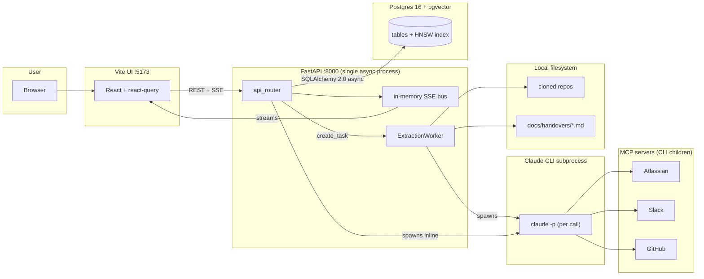
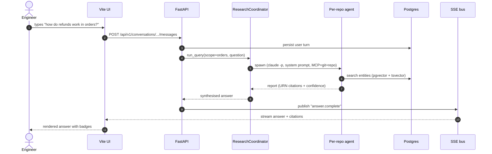

# Bifrost — One Pager

> **Bifrost is an AI-powered engineering knowledge platform.** It clones
> source repos locally, runs Claude through a 7-phase extraction pipeline,
> persists what it finds in Postgres, and lets engineers ask questions,
> hand off coding tasks, and broker cross-team work — all sourced and
> confidence-graded.

---

## The 60-second story

Three conceptual moves. Everything in the handbook elaborates one of these.

| # | Move | What happens |
|---|------|--------------|
| 1 | **Extract** | `git clone <repo>` → 7-phase Claude pipeline → entity rows in Postgres (`COMPONENT`, `FLOW`, `DEPENDENCY`, …) |
| 2 | **Answer** | Question → router fans out per-source agents (Jira / Confluence / GitHub / Slack / per-repo) → coordinator merges → streamed answer with citations + confidence |
| 3 | **Broker** | Team A files a request → clarifier agent grounds it in Team B's handover doc → synthesiser produces a brief Team A can act on |

All three share the same DB, the same Claude CLI subprocess pattern, the same
SSE bus, and the same React shell. They differ only in the surfaces they
expose and the agents they orchestrate.

---

## Architecture in one picture



> **How to read this.** Solid arrows are sync calls; the SSE stream is the
> only push channel back to the browser. Boxes are processes; clusters are
> physical or logical groupings. Everything except the browser and Postgres
> lives inside one Python process.

---

## The seven product surfaces

Defined in `ui/src/App.tsx`. Each is a route, a backing API, and a few
agents.

| Route | Surface | What it solves |
|-------|---------|----------------|
| `/` `/overview` | **Overview** | Ambient state: extractions running, costs spent, repos registered, freshness — before you focus on a task. |
| `/query` | **Chat** | Free-form Q&A with streamed answers, citations, confidence grades. |
| `/tasks`, `/tasks/:id` | **Tasks** | Coding-task lifecycle — `Discuss → Plan → Execute → Verify`. Each step is its own agent. |
| `/knowledge` | **Knowledge** | Browse the entity graph: filter by `entity_type`, `confidence`, `freshness`. |
| `/collaboration` | **Collaboration** | Cross-team sessions + the durable handover docs they ground against. |
| `/spend` | **Spend** | Per-task / per-model / per-phase LLM costs. |
| `/learning` | **Learning** | Onboarding lens — same handover docs viewed through a "new to the team" filter. |

---

## Three concepts to keep in your head

> **URN.** Every entity has a stable identifier shaped like
> `urn:bifrost:component:<repo_id>:<file_path>::<symbol>`. Citations in
> chat answers and brief docs are URNs, so a reader can always find the
> exact source. Defined in `src/bifrost/storage/models.py`. → see
> [09 §URN](./09-glossary.md#urn).

> **Freshness.** Three states: `fresh` / `stale` / `very_stale`. Auto-flagged
> when the underlying repo is re-extracted. Drives when handovers and
> answers warn the user that the source has moved. → see
> [09 §Freshness](./09-glossary.md#freshness).

> **Confidence.** Three grades: `confirmed` (LLM saw direct evidence),
> `inferred` (deduced from adjacent evidence), `uncertain` (best guess).
> Every entity carries one; every chat answer surfaces an aggregate
> grade in the UI as a badge. → see [09 §Confidence](./09-glossary.md#confidence).

---

## A realistic end-to-end walk-through

A platform engineer wants to know how the orders service handles refunds.



Reality check: numbers `1`–`10` are auto-rendered by the `autonumber`
directive. Each citation in the final answer points at a specific URN
the user can click through to view the source code in the Knowledge tab.

---

## Where the code lives

| Concern | Path |
|---------|------|
| API entry | `src/bifrost/api/app.py` |
| All HTTP routers (mounted) | `src/bifrost/api/routes/__init__.py` |
| ORM models | `src/bifrost/storage/models.py` |
| Schema migrations | `alembic/versions/` |
| Extraction pipeline (7 phases) | `src/bifrost/extraction/pipeline.py` |
| Claude CLI subprocess client | `src/bifrost/extraction/cli_client.py` |
| Chat coordinator (multi-source fan-out) | `src/bifrost/research/coordinator.py` |
| Handover-doc generator | `src/bifrost/collaboration/handover_generator.py` |
| Collab clarifier + synthesiser | `src/bifrost/collaboration/{clarifier,synthesizer}.py` |
| Action layer (tasks lifecycle) | `src/bifrost/actions/` |
| In-memory SSE bus | `src/bifrost/api/sse.py` |
| Frontend route table | `ui/src/App.tsx` |
| UI pages | `ui/src/pages/` |
| Dev scripts | `scripts/` (`dev.sh`, `restart.sh`, `health_check.sh`) |

---

## How to run it locally

```sh
# 1. Postgres + pgvector
docker compose up -d

# 2. Schema
uv run alembic upgrade head

# 3. Backend (single async process)
uv run uvicorn bifrost.api.app:create_app --factory --reload

# 4. Frontend (Vite, in a second terminal)
cd ui && npm run dev          # http://localhost:5173
```

**Auth.** No API key. Run `claude auth login` once — extraction and chat both
spawn `claude -p` and inherit that session. → see [10 §Setup](./10-operations.md#setup).

---

## Collaboration capabilities

- Per-section regeneration of handover docs.
- Body-history snapshots with a UI diff viewer.
- Activity timeline and handover audit log.
- tsvector full-text search over handover docs.
- Slack auto-escalation and an opt-in API token gate.

---

## Where to read next

| If you want to… | Read |
|-----------------|------|
| Skim the whole thing | [`README.md`](./README.md) |
| Understand why Bifrost exists | [`01-vision-and-overview.md`](./01-vision-and-overview.md) |
| Trace what runs where | [`02-architecture.md`](./02-architecture.md) |
| Look up a table or column | [`03-data-model.md`](./03-data-model.md) |
| Look up an API route | [`04-api-surface.md`](./04-api-surface.md) |
| Look up an LLM agent | [`05-agents-inventory.md`](./05-agents-inventory.md) |
| Understand extraction phase by phase | [`06-extraction-pipeline.md`](./06-extraction-pipeline.md) |
| Understand the collab + handover system | [`07-collaboration-system.md`](./07-collaboration-system.md) |
| Tour the frontend | [`08-frontend-tour.md`](./08-frontend-tour.md) |
| Look up a domain term | [`09-glossary.md`](./09-glossary.md) |
| Run / monitor / fix the system | [`10-operations.md`](./10-operations.md) |

---

## What Bifrost is not

- **Not a wiki.** Pages are generated, not authored. If you want to edit
  prose, you edit a handover doc or a brief — both are first-class
  artefacts, not free-form pages.
- **Not a CI system.** It has no test pipeline of its own. The `Verify`
  step in the action layer has an agent run pytest and similar commands in
  the task worktree and grade the output; it does not replace your CI.
- **Not a hosted SaaS.** Single-tenant by design. Extraction uses the operator's
  Claude login. API access goes through `identity.provider`: `none`
  (loopback operator), `header` (trusted proxy headers) or `oidc_jwt`
  (bearer JWT), plus `bft_` API tokens for scripts.
- **Not browser-driven for extraction.** Forbidden by the "Browser automation is forbidden" section of `CLAUDE.md`. Code lives locally; external sources flow through
  authenticated MCP servers only.
