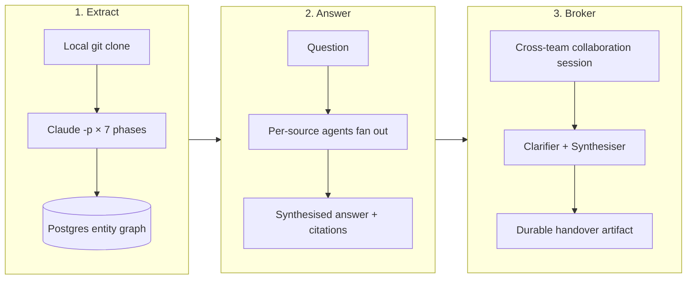
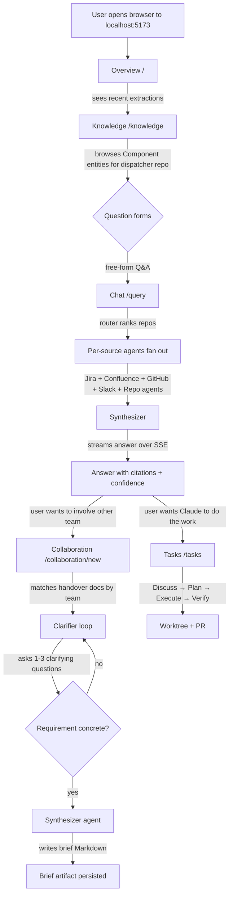

# 01 — Vision and Overview

> **TL;DR.** Bifrost is an AI-powered engineering knowledge platform that
> clones repos locally, runs Claude as a subprocess through a 7-phase
> extraction pipeline, persists everything in one PostgreSQL 16 database
> with `pgvector`, and exposes seven UI surfaces (chat, knowledge browse,
> coding tasks, team-to-team collaboration, plus dashboard / spend /
> learning). The defining choice: **agents replace humans at every
> knowledge layer** — there is no smarter wiki, no LLM gateway, just a
> small backend with a single async process and a single DB. Track A
> (today) is what's built; Track B (Anthropic Managed Agents + Memory
> Stores) is gated on Research Preview access.

> **Read this when** you are new to Bifrost, pitching it to someone, or
> trying to remember which product surface answers which question.
> **Skip if** you already know the seven surfaces and just need to look
> up runtime details — go straight to [02 — Architecture](./02-architecture.md).

## Mental model

Bifrost is best understood as three conceptual moves applied in
sequence:



Every product surface (chat, knowledge browse, tasks, collaboration) is
a different way to traverse those three moves. Hold this picture in
your head as you read on; it is the shape of every other diagram in the
handbook.

---

## 1. Origin and elevator pitch

Bifrost is an AI-powered engineering knowledge platform. It clones source
repositories locally, runs the Claude CLI through a deterministic
seven-phase extraction pipeline, persists what it finds in a single
PostgreSQL 16 database with `pgvector`, and lets engineers ask questions
of the resulting graph through a chat surface, a knowledge-browse
surface, a coding-task surface, and a collaboration surface
that produces durable team handover documents.

The shorthand version: **agents replace humans at every knowledge
layer.** Bifrost does not aim to build a smarter wiki. It aims to
collapse the loop between "a question about a system the asker does not own"
and "a sourced, confidence-graded answer that can be acted on."

The platform was originally framed as the "engineering Q&A surface."
With the collaboration feature it acquired a second purpose: the substrate that lets one team
approach another team for help against a structured artifact, not an ad-hoc
Slack thread. Both purposes share the same extraction graph, the same
agents, and the same UI shell — they differ only in the surfaces they
expose.

> **Remember:** Bifrost is a Q&A platform that grew a brokerage layer.
> One graph, one set of agents, one UI shell — but two distinct user
> intents.

## 2. The single-line system statement

> A FastAPI + Postgres backend that runs Claude as a subprocess against
> locally cloned codebases plus a fixed set of external MCP tools, then
> persists an entity graph and lets a Vite UI ask, browse, task, and
> collaborate over it.

Every word in that line is load-bearing:

- **FastAPI + Postgres.** Single async API process, single DB. The
  surface area is intentionally small — see
  [02 §2](./02-architecture.md#2-process-model) for why this is a
  feature, not an oversight.

- **Claude as a subprocess.** Every LLM call spawns `claude -p`. There
  is no Anthropic API key in the system; auth is the operator's
  Claude login. The actual invocation looks
  roughly like:

  ```bash
  claude -p [prompt-file] --json-schema=... --no-session-persistence
  ```

  See [02 §3.1](./02-architecture.md#31-the-claude--p-subprocess-pattern)
  for the full pattern.

- **Locally cloned codebases.** Extraction runs against `git clone`-d
  working trees on the operator's disk. There is no remote crawler, no
  GitHub API rate-limit dance for source content. The forbidden tooling
  rule (no browser automation) flows from this principle: code lives
  locally, external sources flow through MCP.

- **Fixed set of MCP tools.** Atlassian (Jira / Confluence), Slack,
  GitHub. These are the *only* external read paths. New external sources
  are added by adding MCP servers, not by writing one-off scrapers.
  → see [09 §MCP](./09-glossary.md#m).

- **Vite UI** at `:5173` in dev. React + react-router + react-query +
  Tailwind. The UI is a pure client — every state change goes through
  the API.

> **Remember:** every word in that one-liner is a deliberate constraint.
> Removing any of them (e.g. "what if we hosted Claude as a service?")
> changes the system into a different system.

## 3. Core insight — agents at every layer

The architectural insight motivating Bifrost is:

> Anywhere a human currently reads code, reads tickets, reads chat, and
> writes a synthesised summary — replace the human with an agent
> that has structured access to the same inputs and emits the same
> output.

This shows up in three places. Each is a separate insight worth
understanding on its own.

### 3.1 Insight one — knowledge extraction is a reading loop

A senior engineer onboarding to a new codebase does roughly this: skim,
classify, identify components, trace flows, identify dependencies,
cross-reference, compress to an index. Bifrost's 7-phase extraction
pipeline (`src/bifrost/extraction/pipeline.py`) runs Sonnet through
exactly that loop, phase by phase.

**Example:** a row in the resulting `entities` table looks like:

```
entity_type = COMPONENT
urn         = bifrost:org:acme:component:abc-123:src/delivery/retry.py::schedule_retry
confidence  = 0.85
source_basis = ["bifrost:org:acme:source-object:..."]
```

→ see [03 §2](./03-data-model.md) for the full schema and
[09 §URN](./09-glossary.md#u) for the canonical ID format.

### 3.2 Insight two — cross-source synthesis is parallel agents plus a synthesiser

When a chat question comes in, a router (Haiku) ranks the top-K
relevant repos, then per-source agents (Jira / Confluence / GitHub /
Slack / per-repo) fan out in parallel under
`src/bifrost/research/coordinator.py`. A synthesiser merges the reports
into a single grounded answer.

**Example:** asking "How does webhook retry work in the dispatcher?"
spawns one repo agent against the dispatcher repo, plus a Jira agent
(searching for retry-tagged tickets), a Confluence agent (searching
runbooks), and a GitHub agent (searching PRs). Each emits a
structured `Report`; the synthesiser composes them with citations.
→ see [02 §6.2](./02-architecture.md#62-chat-query-coordinator-fan-out--synthesis).

### 3.3 Insight three — team-to-team brokerage is a clarifier plus a synthesiser

The collaboration session feature uses a clarifier agent + a
synthesiser agent to mediate between a requesting team and the
(durable) handover docs of an owning team — asking only the questions
a human couldn't answer from the docs themselves.

**Example:** a requester pastes "we want to add HMAC signing to
usage-metering events." The matcher finds the `signing-keys` and `usage-metering`
handover docs. The clarifier reads both plus the request, decides
that the only ambiguity is whether metering events should be signed
with the tenant key or a platform key, and asks exactly that one question. → see
[02 §6.4](./02-architecture.md#64-collaboration-session).

Each agent is a fresh Claude CLI subprocess with a tightly scoped
system prompt and a JSON schema. None of them share session state
across calls. This is the V1 design choice: **stateless agents,
stateful database**.

> **Remember:** every "human reading and summarising" loop in the
> pipeline is replaced by a Claude subprocess plus a structured-output
> schema. The graph and the DB carry the state — the agents do not.

## 4. The seven product surfaces today

The UI exposes seven top-level routes (`ui/src/App.tsx:49-78`,
verified). Each is a "product" with its own page and its own set of
API endpoints. Reading the surfaces in order is the fastest way to
understand what Bifrost actually does.

### 4.1 Overview (`/` and `/overview`)

**What problem does this solve?** "What's happening in my system right
now, before I have a focused task?"

The dashboard. The first thing an operator sees on landing. It shows
ambient state — running extractions, recent costs, registered repos,
freshness states, system health — before any focused task. Mounted at
both `/` and `/overview` so links can be unambiguous in either form.

Implementation: `ui/src/pages/dashboard.tsx`. Talks to `/api/v1/repos`,
`/api/v1/costs`, `/api/v1/health`, and the SSE streaming endpoint for
live extraction progress.

### 4.2 Chat (`/query`)

**What problem does this solve?** "I have a question about a system I
don't own — answer it with citations and a confidence grade."

The free-form Q&A surface. User types a question, optionally scopes it
to a repo or domain, and gets a streamed answer with sourced citations
and a confidence grade.

Implementation: `ui/src/pages/query.tsx` (1,772 lines — the largest UI
page) talks to `/api/v1/conversations` for thread management, then to
the SSE streaming endpoint for the actual answer fan-out. Backend is
`bifrost.research.coordinator` doing the multi-source synthesis.
→ see [02 §6.2](./02-architecture.md#62-chat-query-coordinator-fan-out--synthesis).

### 4.3 Tasks (`/tasks`, `/tasks/:id`)

**What problem does this solve?** "I want Claude to actually *do* the
coding change, not just describe it."

The "do" side of Bifrost — the action layer. Users ask Claude to
*perform* a coding change end-to-end through a four-step loop:
**Discuss → Plan → Execute → Verify.** Each task progresses through a
state machine in `src/bifrost/actions/task_lifecycle.py`:

```
draft_intent → discussing → discuss_done →
drafting_plan → plan_ready → executing → verifying →
success / blocked / cancelled
```

Each task executes in a git worktree and ends with a PR.

Tasks were called "Briefs" in early versions. The schema (`tasks`, `task_phases`, …) and the code now use the
`task` vocabulary. → see [09 §Task](./09-glossary.md#t).

Implementation: `ui/src/pages/tasks.tsx`, `ui/src/pages/task-detail.tsx`,
backed by `src/bifrost/actions/`.

### 4.4 Knowledge (`/knowledge`)

**What problem does this solve?** "Did the extractor actually see what
I expected? Let me browse the raw graph."

The browse surface for the entity graph. Users filter and explore
extracted Components, Flows, Dependencies, and entity Communities by
repo, domain, or freshness state. This is the "is the extractor seeing
what it should be seeing" surface — the one you reach for when chat
gives you a wrong-feeling answer and you want to inspect the raw
ground truth.

Legacy `/entities?repo_id=X` URLs redirect here with the parameter
remapped (`ui/src/App.tsx:33-43`, verified). Implementation:
`ui/src/pages/knowledge.tsx`.

### 4.5 Collaboration (`/collaboration`, `/collaboration/...`)

**What problem does this solve?** "Two teams need to talk. Replace the
ad-hoc Slack thread with a structured artifact grounded in real
handover docs."

The collaboration surface has four sub-routes:

- `/collaboration` — landing page; lists open sessions, recent
  handovers, suggested actions.
- `/collaboration/new` — start a new collaboration session: requester
  pastes a problem, system finds matching handover docs, the
  clarifier loop begins.
- `/collaboration/sessions/:id` — live session view; chat-style
  history, structured doubt log, handover-doc citations, and a
  "synthesise brief" action when the requirement is concrete enough.
- `/collaboration/handovers` and `/collaboration/handovers/:id` — the
  list and detail views for the durable handover documents (per
  scope: feature / repo / domain / region / team / session).
  → see [09 §Scope kind](./09-glossary.md#s).

Implementation: `ui/src/pages/collaboration.tsx` exports five
components (`ui/src/App.tsx:12-18`, verified).

### 4.6 Spend (`/costs`)

**What problem does this solve?** "Claude calls are the dominant
variable cost — show me where the money is going before a runaway
pipeline burns the budget."

The cost-observability surface. Every LLM call writes to `llm_cost_log`
(`src/bifrost/storage/models.py:602-625`, verified). The Spend page
aggregates by repo, by phase, by model, by day. Implementation:
`ui/src/pages/costs.tsx`.

This page exists because Claude calls are the dominant variable cost in
the system and the operator needs to see them per-repo, per-phase to
catch a runaway pipeline before it hits the daily budget cap.

### 4.7 Learning (`/admin/learning`)

**What problem does this solve?** "How is the graph drifting under
feedback? Audit the bumps."

The continuous-learning audit surface. When a task completes and its
verify items pass or fail, the action layer writes
`confidence_deltas` rows that bump-up or bump-down individual
entity / relationship confidences. The Learning page shows the running
history of those bumps so an admin can audit how the graph is drifting
under feedback. Implementation: `ui/src/pages/learning.tsx`.

This surface is gated under `/admin/` because it is operational
introspection, not product use. It is not part of an end-user's daily
loop.

> **Remember:** seven surfaces, three intents — *understand* (Overview,
> Knowledge, Spend, Learning), *ask* (Chat), *act* (Tasks), and
> *broker* (Collaboration). If you can name the intent first, the page
> follows.

---

## 5. Two more surfaces that exist as routes but not as user-facing products

For completeness:

- **`/domains/:id`** — domain-detail page. Shown when an operator
  drills into a specific domain card from the dashboard. Not a separate
  product; treat it as a deep-link from Overview.

- **`/entities`** — exists only as a redirect to `/knowledge`. Kept
  alive for the half-dozen old internal links that point to it.

---

## 6. End-to-end user journey

The fastest way to grok the system as a whole is to walk the journey of
a single question — say, "How does webhook retry work in the
dispatcher?" — through every surface it touches.



Walking the diagram top to bottom:

1. **Overview is the entry point.** The operator does not start with a
   question — they start with ambient awareness of what's running.

2. **Knowledge is the inspect-the-graph surface.** Before asking the
   chat agent anything, an operator can see whether the entities they
   expect to be present actually are.

3. **Chat is the question surface.** It runs the same coordinator
   regardless of scope; what changes by scope is which repo agents the
   router activates.

4. **Each per-source agent is independent.** Jira, Confluence, GitHub,
   Slack, and per-repo agents run in parallel. The synthesiser sees
   their structured outputs only — it does not re-read the underlying
   sources.

5. **The synthesiser produces the final, citation-rich answer** and
   streams it through the SSE bus to the page. A sample SSE frame on
   the wire looks like:

   ```
   event: query.token
   data: {"token":"retries","cursor":42}
   ```

   → see [02 §7](./02-architecture.md#7-the-sse-bus) for the bus design.

6. **From the answer, two follow-on actions are possible:**

   - **Collaboration** — if the question really needs another team's
     input, the operator can convert it into a session and produce
     a brief.

   - **Tasks** — if the operator wants Claude to *implement* a change
     based on the answer, they hand it to the action layer.

7. **The action layer is its own four-step loop** with strong state
   machines and a git-worktree-and-PR exit. It writes to its own family
   of tables (`tasks`, `task_phases`, `task_artifacts`, …) but reads
   from the same entity graph the chat and collaboration paths read
   from.

This single journey covers every product surface and every backend
package the codebase has.

> **Remember:** Overview → Knowledge → Chat → (Tasks or Collaboration).
> One mental script covers every product surface.

---

## 7. What Bifrost is *not*

The vision becomes clearer in negative form. Bifrost is *not*:

- **A wiki replacement.** It indexes Confluence and Jira but does not
  re-render them. The handover docs it produces are explicitly *durable
  artefacts* that get checked into `docs/handovers/`, not a wiki.

- **An LLM gateway.** There is no shared inference endpoint. Every
  call is a fresh `claude -p` subprocess; there is no API key store.

- **A code-search engine.** The knowledge graph is a *summary* of code,
  produced by Sonnet. Grep + IDE remain the right tools for
  exact-string code lookup.

- **A multi-tenant SaaS.** V1 is a single-operator tool. There is no
  user table; identity is cookie/session — the `Conversation` table
  has a `session_id` Text column and that is the entire identity model
  (`src/bifrost/storage/models.py:669`, verified). Shared
  deployments use a trusted-proxy or OIDC identity provider with two roles
  (`member`, `admin`) and `bft_` API tokens for scripts
  (`src/bifrost/api/auth/`).

- **A continuous extractor.** Extraction is operator-triggered (and
  manifest-driven for catalog auto-registration); there is no daemon
  that watches GitHub webhooks. Freshness is tracked in
  `repo_freshness` and the operator chooses when to re-extract.
  → see [09 §Freshness state](./09-glossary.md#f).

- **A browser-automation tool.** Per CLAUDE.md, browser-automation
  packages (puppeteer / playwright / selenium / chromium) are forbidden
  in `src/`. External data flows through MCP only. A CI gate at
  `.github/workflows/pr-check.yml` enforces this.

These are not future features that have been deferred. They are
explicit *non-goals* — choosing not to build them is what makes the
system small enough to reason about.

> **Remember:** every "not" in this list trims the surface area. Removing
> any of these constraints turns Bifrost into a different (larger,
> harder) system.

---

## 8. The track-A / track-B split

The architecture document goes deep on this; the headline for the vision
chapter is:

- **Track A (today):** Track A is the only thing built. It uses
  PostgreSQL for persistence, the Claude CLI subprocess for inference,
  and process-local memory for the SSE bus.

- **Track B (future):** Track B uses Anthropic's Managed Agents +
  Memory Stores via MCP. Access is gated on Research Preview, which the
  operator may not have. The codebase has been
  written so that swapping Track A's `AgentStateBackend` and
  `AgentRuntime` for Track B's would not require touching higher
  layers — the spec authors have been disciplined about this.

For the rest of the handbook, "Track A" is the default and "Track B" is
mentioned only when its absence affects an architectural decision.
→ see [09 §Track A/B](./09-glossary.md#t).

> **Remember:** if a sentence in any chapter doesn't say "Track B"
> explicitly, it means Track A.

---

## 9. Where to read next

If you read in order, the next chapter is
[02 — Architecture](./02-architecture.md). It is the deepest chapter in
the handbook and the one that ties the seven surfaces above to the
runtime topology, the data flows, and the major code packages. Skim
chapter 03 (Data model) only after chapter 02 — the model only makes
sense once you know what reads from and writes to it.

The glossary ([09](./09-glossary.md)) is best used as a reference rather
than read straight through. Bookmark it; jump to it the first time a
term feels overloaded.
