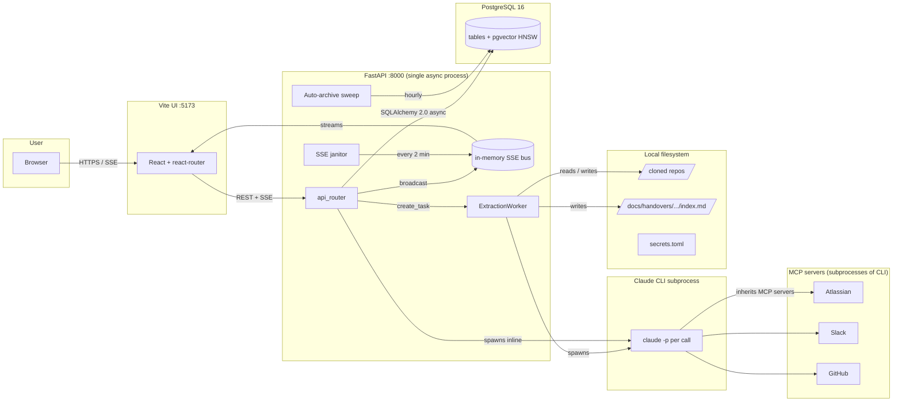
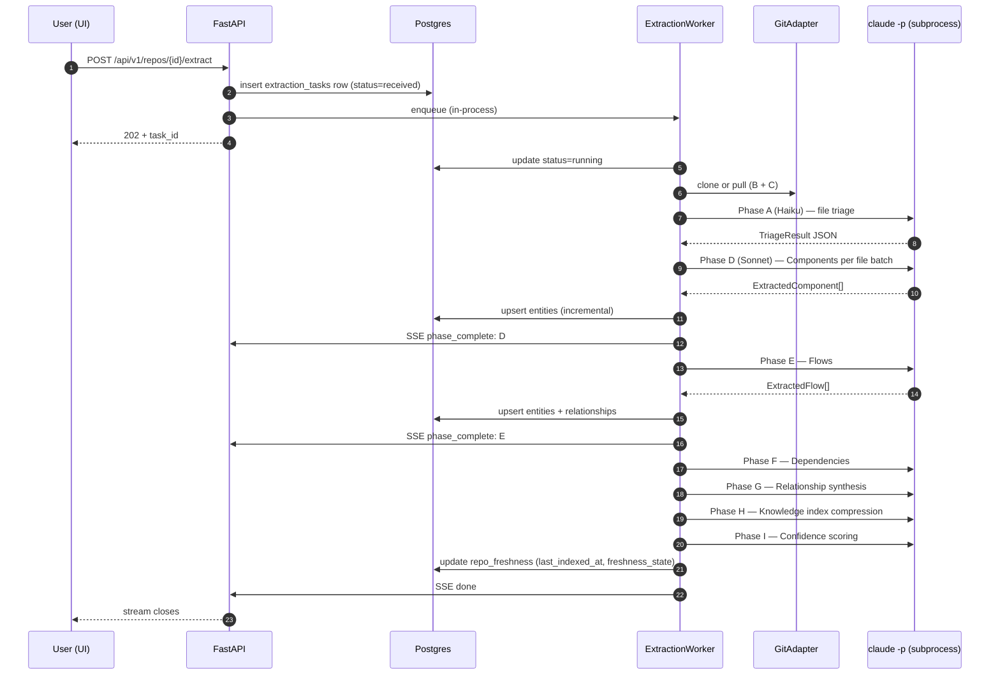
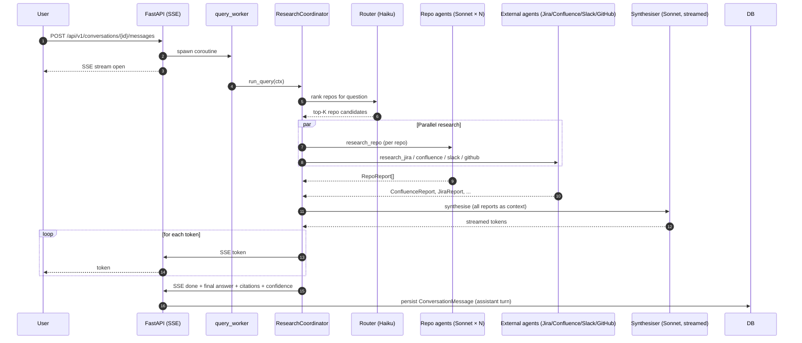
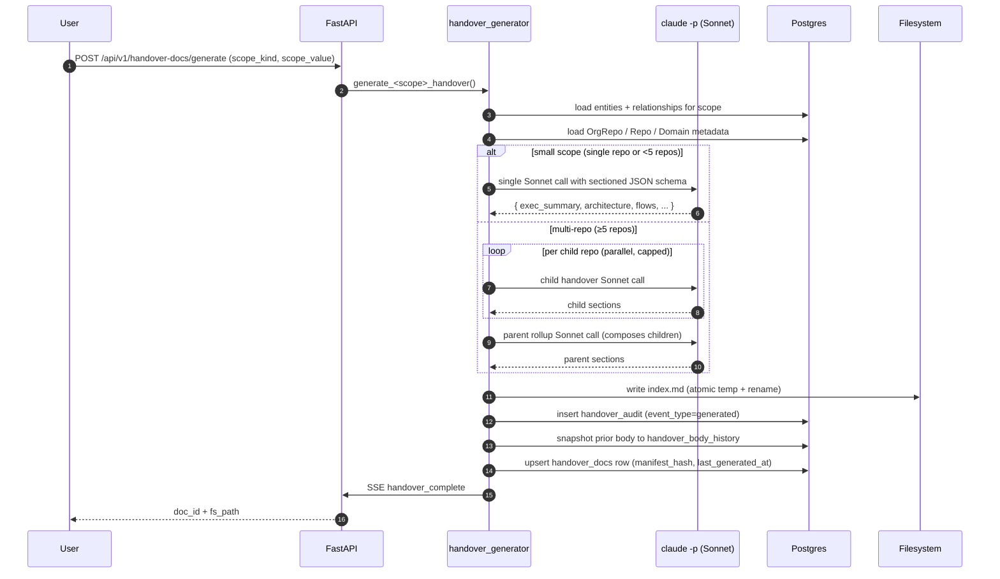
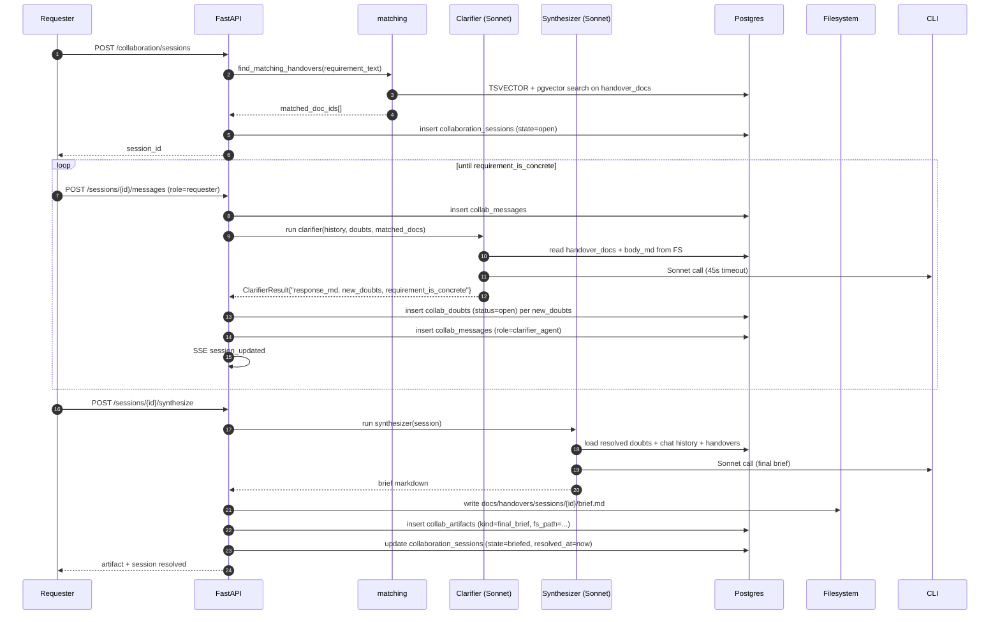

# 02 — Architecture

> **TL;DR.** Bifrost is a single async FastAPI process plus one Postgres 16
> database. There is no Celery, no Redis, no message broker — every
> "background worker" is an `asyncio` task in the same process. Every LLM
> call is a fresh `claude -p` subprocess (no API keys). External sources
> (Jira / Confluence / Slack / GitHub) are reached only through MCP servers
> that the CLI inherits. The four data flows that matter are repo
> extraction (7 phases), chat query (router + per-source agents +
> synthesiser), handover-doc generation (single-call or wave-based), and
> the collaboration session (clarifier loop + final synthesiser).

> **Read this when** you are about to add a new endpoint, agent, MCP
> integration, or data flow — or when an existing flow is misbehaving and
> you need to know where it lives. **Skip if** you only need the data
> model (jump to [03 — Data model](./03-data-model.md)) or product
> surfaces (chapters 04-08).

## 1. Topology at a glance



**How to read this diagram.** Each labelled subgraph is a process or
storage boundary. Solid arrows are calls / data flows; the labels on
arrows are the mechanism (REST, SSE, subprocess spawn, SQLAlchemy).
The Backend subgraph is *one process* — `WK`, `AA`, `SJ`, and `API` are
co-resident `asyncio` tasks, not separate workers. The MCP subgraph is
intentionally rendered as a child of LLM: those processes are spawned
*by* the CLI, not by Bifrost.

Every box in that diagram is reachable from the source code. The rest
of this chapter walks through them one at a time.

> **Remember:** one async process, one DB, one CLI per LLM call, MCP
> servers as children of the CLI. The whole system fits on a single
> diagram for a reason.

---

## 2. Process model

> **Mini-TL;DR.** Bifrost runs as a single async FastAPI process. The
> things that look like background workers are `asyncio` tasks
> launched from the lifespan. This is a deliberate choice that
> trades horizontal scalability for operator simplicity.

Bifrost is a **single async FastAPI process plus zero background workers**.
There is no Celery, no Redis queue, no separate scheduler. The
"workers" you might expect to be processes are, instead, async tasks
running inside the same process.

### 2.1 The lifespan

The async lifespan
([`src/bifrost/api/app.py`](../../src/bifrost/api/app.py), the `lifespan`
function) does the following at startup, in order:

1. **Reads settings.** `bifrost.cli.config.get_settings()` —
   environment-variable driven (Pydantic).
2. **Checks production secrets.** With `BIFROST_PRODUCTION_MODE=true`,
   startup raises if a required secret is missing or still on its dev
   default. There is no Claude-CLI auth probe at startup. Commit
   fbe27e6 removed it, and auth is checked when an extraction runs
   (`extraction/worker.py`) and through `GET /health/claude-cli`.
3. **Constructs the `ExtractionWorker`** and starts it. This is the
   in-process loop that pulls extraction tasks from the DB and executes
   them.
4. **Reclaims orphaned research runs.** Runs older than 10 minutes that
   are still in flight are marked failed. It runs as a background task, so
   the first health probe is not blocked.
5. **Schedules the hourly auto-archive sweep** for tasks. This walks
   `tasks` rows whose `archived_at IS NULL` and whose inactivity exceeds
   the retention window, soft-archiving them.
6. **Starts the SSE replay-buffer janitor.** Every 120 seconds, it
   asks `event_bus.sweep()` to evict any per-task ring buffer whose
   TTL has elapsed (default 5 minutes for terminal events).
7. **Starts the PR observer.** It polls open task PRs every 60 seconds.

In `nohup.out` you'll see roughly:

```
bifrost.startup track=... log_level=...
bifrost.worker_started dry_run=False
bifrost.sse_janitor_started interval_s=120
bifrost.pr_observer_started interval_s=60.0
```

On shutdown, every task is cancelled and awaited; the worker is
stopped; structlog emits `bifrost.shutdown`.

### 2.2 Why single-process

The choice is deliberate, with three justifications visible in the
code:

1. **Operator simplicity.** The system is a one-binary tool that runs
   on the operator's laptop. A single async process collapses to "run
   the script, the UI works." The `scripts/dev.sh` and
   `scripts/restart.sh` files reflect this — one process, one log file
   (`nohup.out`).

2. **No cross-process state to manage.** The SSE bus
   (`src/bifrost/api/sse.py`) is a Python `dict` of `asyncio.Queue`s.
   It cannot be shared across worker processes. The architecture
   chooses correctness here over horizontal scaling — the explicit
   warning in the SSE module is that **multi-worker scaling will
   require Redis** to survive.

3. **Async + asyncpg + httpx is enough.** The dominant latency is
   Claude CLI subprocess wall-time, which the event loop yields
   on. CPU work (embedding the sentence-transformer locally) is
   small. There is no need for a thread pool at this scale.

### 2.3 In-process concurrency

The system runs concurrent work via three patterns:

- **`asyncio.create_task` for fire-and-forget.** Used for the
  orphaned-run reclaim, the auto-archive sweep, the SSE janitor, the PR observer, and
  any "trigger this and don't wait" path. Cancellation is via
  the lifespan teardown.

- **`asyncio.gather` for parallel fan-out.** Used heavily in the
  research coordinator (`bifrost.research.coordinator`) — when a
  question fans out to N per-repo agents, they run as a single
  `gather` call with bounded concurrency.

- **The `ExtractionWorker`'s own loop.** It dequeues tasks from
  the `extraction_tasks` table, runs the 7-phase pipeline, and
  yields control to the event loop between phases.

Bounded-concurrency primitives (semaphores) are used in the
handover generator's wave-based child build (inferred from
`src/bifrost/collaboration/handover_generator.py:80-90`) where the
threshold for switching from a single Sonnet call to a wave-based
build is 5 repos and the parallel cap is set to keep the
total CLI subprocess load bounded.

> **Remember:** one process, three concurrency patterns
> (fire-and-forget, gather-fan-out, in-process worker loop). Anything
> not using one of these is suspicious.

---

## 3. The LLM call path

> **Mini-TL;DR.** Every LLM call spawns a fresh `claude -p` subprocess
> with structured output (`--json-schema`). No API keys, no shared
> session, no persistent context. MCP servers (Atlassian / Slack /
> GitHub) are inherited as CLI subprocesses when needed.

### 3.1 The `claude -p` subprocess pattern

This is the central architectural choice. Every LLM call in Bifrost
is a fresh subprocess spawn of the Claude Code CLI:

```
claude -p [prompt-file] --json-schema=... --no-session-persistence
```

The actual `subprocess.run` argv shape (close to what the client
emits) looks like:

```python
[
    "claude", "-p",
    "--output-format", "json-stream",
    "--tools", "Read,Glob,Grep",
    "--system-prompt-file", "/tmp/extract_phase_d.system.md",
    "--input-file", "/tmp/extract_phase_d.input.txt",
    "--no-session-persistence",
]
```

(`src/bifrost/extraction/cli_client.py:1-100`, verified.) The file's
docstring is unambiguous:

> Replaces AsyncAnthropic. Every LLM call spawns `claude -p` as a
> subprocess, using the machine's Claude login.
> No API keys, no gateway.

Three properties matter:

1. **No API key in the system.** Auth is the operator's Claude Code
   OAuth. Run `claude auth login` once on the box; queries inherit it.
   An expired OAuth shows up when an extraction runs or at
   `GET /health/claude-cli`.

2. **No shared session state across calls.**
   `--no-session-persistence` is set, MCP servers / skills / plugins
   are stripped per-call so every spawn loads ~200 tokens of baseline
   instead of 50K. Each call's input is exactly the prompt + JSON
   schema and nothing else.

3. **Structured output is mandatory.** All prompts use
   `--json-schema`, which makes Claude emit a `StructuredOutput`
   `tool_use` block that the client parses. There is no
   "free-form text" path in the extraction pipeline; the
   chat synthesiser is the one place text streaming is allowed.

The dataclass `CliCompletion`
(`src/bifrost/extraction/cli_client.py:53-58`, verified) carries:

- `parsed: dict` — the structured output (matches the caller's schema)
- `usage: Usage` — input/output/cache tokens + `total_cost_usd` from
  the CLI itself, which is the billing source of truth
- `text: str` — the trailing assistant text (often empty when
  `max_turns=1`, which is the default for extraction calls)

### 3.2 Retry classification

The CLI client classifies stderr into `transient` (rate-limit / 503 /
network) and `auth` (OAuth dead) — see
`src/bifrost/extraction/cli_client.py:61-83` (verified). Transient
errors retry with backoff; auth errors raise `ClaudeCliAuthError` and
bail — because the operator must run `claude auth login` to recover.

A canary check runs after every call: a known token is injected into
the user message and the parsed output is searched for it. If the
canary echoes back inside the *parsed* JSON (not the assistant text,
which often legitimately quotes the prompt), the system flags
possible prompt injection and refuses to commit the result.

### 3.3 MCP servers as Claude-CLI subprocesses

When `inherit_user_mcp=True` is set on a call, the spawned Claude
CLI inherits the operator's authenticated MCP servers (Atlassian,
Slack, GitHub). This is how external sources are read — through
Claude tool calls, not through Python HTTP clients in `src/`. The
forbidden-tooling rule in CLAUDE.md (no browser automation, no
direct HTTP scraping when an MCP path exists) is enforced by both
convention and a CI gate.

The MCP servers themselves are subprocesses of the Claude CLI — they
are not separate processes Bifrost manages. Bifrost authenticates
to them by relying on the operator's `gh auth`, Atlassian OAuth,
and Slack OAuth being set up before the system starts.
→ see [09 §MCP](./09-glossary.md#m).

> **Remember:** every LLM call is a fresh subprocess; structured output
> via `--json-schema` is mandatory; MCP servers are *children* of the
> CLI, not of Bifrost. If a Python file in `src/` is calling
> `httpx.get("https://confluence.../")`, that is a bug — it should
> route through MCP.

---

## 4. Database layer

> **Mini-TL;DR.** PostgreSQL 16 with `pgvector`, accessed via SQLAlchemy
> 2.0 async + asyncpg. One `async_sessionmaker` for the whole process,
> sessions per request via `Depends`. 384-dim embeddings come from a
> *local* sentence-transformer — there is no embedding API call.

### 4.1 Connection management

PostgreSQL access is via SQLAlchemy 2.0 with the asyncpg driver. A single
`async_sessionmaker` (constructed lazily by
`bifrost.api.deps.get_session_factory(settings)`) is shared across the
process. Routes acquire sessions via `Depends(get_session)` which
yields one session per request.

The connection pool is asyncpg's default. There is no PgBouncer or
external pooler because the single-process model means the pool size
matches the request concurrency cap. ([needs verification] for the
exact pool size — it is set by Pydantic settings, not hard-coded.)

### 4.2 Naming and migrations

A naming convention is set on the SQLAlchemy `MetaData`
(`src/bifrost/storage/models.py:33-43`, verified) so that all
constraint and index names are deterministic across migrations:

```python
convention = {
    "ix": "ix_%(column_0_label)s",
    "uq": "uq_%(table_name)s_%(column_0_name)s",
    "ck": "ck_%(table_name)s_%(constraint_name)s",
    "fk": "fk_%(table_name)s_%(column_0_name)s_%(referred_table_name)s",
    "pk": "pk_%(table_name)s",
}
```

The schema lives in a single baseline migration,
`alembic/versions/001_baseline.py`. New migrations are added after it.

### 4.3 pgvector

The `entities`, `confluence_pages`, `jira_issues`, and
`entity_communities` tables all carry a `Vector(384)` column.
384-dim matches sentence-transformers `all-MiniLM-L6-v2`
(`src/bifrost/storage/models.py:134`, verified). This is a *local*
embedding model: no API key, no network egress for embedding. The
HNSW index parameters (`m=16, ef_construction=64`,
`cosine_ops`) are committed in the model definition
(`src/bifrost/storage/models.py:182-188`, verified).

> **Remember:** one async sessionmaker, one DB, one local embedding
> model. The DB is the only durable state — every other layer is
> stateless.

---

## 5. Major code packages

> **Mini-TL;DR.** The `src/bifrost/` tree is organised by intent
> (`extraction/`, `research/`, `collaboration/`, `actions/`) plus
> infrastructure (`api/`, `storage/`, `cli/`). Every package below has
> a single, clear responsibility — no "utils.py" anti-pattern.

```
src/bifrost/
├── actions/         # Task action layer — Discuss / Plan / Execute / Verify
├── adapters/        # Source adapters (git, mock)
├── agents/          # Agent runtime abstractions [needs verification]
├── api/             # FastAPI app, routes, schemas, SSE
├── cli/             # CLI commands + Pydantic settings
├── collaboration/   # collaboration — handover docs, clarifier, synthesiser, matching
├── core/            # Shared core types [needs verification]
├── extraction/      # 7-phase extraction pipeline + secrets scanner
├── orchestration/   # [needs verification] — task coordination glue
├── research/        # Chat coordinator + per-source agents
└── storage/         # SQLAlchemy models + Repository pattern
```

A package-by-package summary, in the order an owner is most likely to
need them:

### 5.1 `api/`

The FastAPI app and its routes. `app.py` is the entry point; it builds
the `FastAPI` instance, mounts CORS + request-logging middleware, mounts
the public `/api/v1/health` route and the gated `/api/v1/...` API
router. Route groups live in `api/routes/`:

- **Lifecycle / catalog:** `repos.py`, `domains.py`, `entities.py`,
  `catalog.py`, `indexer.py`, `knowledge.py`.
- **Extraction:** `extract.py`, `extraction_tasks.py`.
- **Chat / streaming:** `query.py`, `conversations.py`, `streaming.py`.
- **Action layer:** `tasks.py` (the user-facing coding-task lifecycle).
- **Collaboration:** `collaboration.py` (sessions),
  `handover_docs.py` (durable artefacts).
- **Cross-cutting:** `costs.py`, `feedback.py`, `admin.py`,
  `health.py`.

Schemas (Pydantic models for request / response) live in
`api/schemas/`. The wire-format envelope shape is defined in
`api/schemas/envelope.py` ([needs verification] for fields).

### 5.2 `extraction/`

The 7-phase extraction pipeline plus its support cast:

- `pipeline.py` (`ExtractionPipeline`) — phases A → I, configured
  with a `ClaudeLlmClient`, a triage model (Haiku) and an
  extraction model (Sonnet), and a set of progress callbacks.
- `cli_client.py` — the `claude -p` subprocess wrapper.
- `triage.py` — Phase A; classifies files for extraction priority.
- `secrets.py` — secret-scanner that runs before content is fed to
  the LLM. Redacts before extraction.
- `cost.py` — `CostTracker` plus `BudgetExceededError`. Every
  call goes through it.
- `checkpoint.py` — extraction checkpoint persisted to
  `repo_freshness.checkpoint_phase` / `checkpoint_file_cursor`
  so a partial run resumes mid-pipeline.
- `worker.py` — the `ExtractionWorker` that drives the queue.
- `query_worker.py` — the chat-side runtime that wraps
  `bifrost.research.coordinator` invocations as SSE events.
- `cli_auth.py` — `verify_claude_cli_auth`, used by the extraction worker and `GET /health/claude-cli`.

### 5.3 `research/`

The chat side. The entry point is `coordinator.py:ResearchCoordinator`
(`src/bifrost/research/coordinator.py:1-90`, verified):

```
question → scope resolution → freshness/clone ensure (parallel)
        → router (Haiku) → rank top-K relevant repos
        → fan-out sub-agents (Sonnet × N, parallel)
        → synthesis agent (Sonnet, streamed)
        → SSE events out
```

Per-source agents:
- `repo_agent.py` — searches a single cloned repo.
- `jira_agent.py`, `confluence_agent.py`, `slack_agent.py`,
  `github_agent.py` — each wraps one MCP server via
  `claude -p` calls with `inherit_user_mcp=True`.
- `external_agent.py` — multi-source aggregator (calls the
  above in parallel when a question is unscoped).
- `external_indexer.py` — populates the `confluence_pages` and
  `jira_issues` caches on a schedule so chat agents can query
  the cache before going live to MCP.

Support:
- `bundle_cache.py` + `clarify.py` + `planner.py` — follow-up
  query support. After the first turn produces a `ResearchBundle`,
  the planner classifies the next user turn as `clarify` (re-use the
  bundle) or `extend_bundle` (run new research) and routes
  accordingly.
- `subgraph_hydrate.py` + `graph_retrieval.py` — graph-level
  retrieval primitives over the entity table.
- `embeddings.py` + `embed_backfill.py` — sentence-transformer
  embedding helpers.
- `freshness.py` — ensures clones are fresh before research; pulls
  if needed.

### 5.4 `collaboration/`

The collaboration surface. Three sub-areas:

- **Handover doc generation:**
  `handover_generator.py` is a single-Sonnet-call generator with a
  sectioned JSON schema for small scopes. Multi-repo scopes ≥ 5
  repos switch to a wave-based child→parent build
  (`src/bifrost/collaboration/handover_generator.py:80-90`, verified)
  with parallelism capped to keep total CLI subprocess load
  bounded.

- **Collaboration session loop:**
  `clarifier.py` — runs after each `requester` turn; reads the
  requirement + chat history + open doubts; asks 1-3 clarifying
  questions OR signals `requirement_is_concrete=True`. Single
  Sonnet call with a JSON schema, 45s inline timeout.
  `synthesizer.py` — runs once when the session is `resolved`;
  produces the final brief Markdown.
  `matching.py` — finds the handover docs to ground the session in
  (TSVECTOR + pgvector hybrid).
  `loopback.py` — captures recurring doubts as candidate updates to
  the parent handover doc.

- **Cross-cutting:**
  `events.py` — SSE event publishers for the collab surface.
  `cost_estimate.py`, `rate_limit.py`, `slack_escalation.py` —
  guardrails.

### 5.5 `actions/`

The action layer. `task_lifecycle.py` is the state-machine
authority — every legal transition is enumerated in
`_LEGAL_TRANSITIONS` (`src/bifrost/actions/task_lifecycle.py:57-68`,
verified). The agents are:

- `discussion_agent.py` — context-gathering agent.
- `plan_agent.py` — drafts and revises the plan.
- `executor.py` — drives plan-step execution in a worktree.
- `verifier.py` — runs the verify items.
- `intent_router.py` — classifies a freshly-created task.
- `gap_detector.py`, `correction_cascade.py` — correctness loops.
- `pr.py` — opens the PR at the end of a successful task.
- `worktree.py` — manages the per-task git worktree.
- `auto_archive.py` — the hourly sweep.
- `agent_quality.py`, `learning.py` — feedback loop.

### 5.6 `storage/`

- `models.py` — every ORM model. ~1,239 lines. Single file
  intentionally — the schema is a coherent thing and splitting it
  would obscure cross-table relationships.
- `repository.py` — `EntityRepository` + helpers. Read-side queries
  that span tables (e.g. handover-doc search with TSVECTOR + pgvector)
  live here.
- `cache.py` — `KnowledgeTextCache` and `BundleCache` machinery.
- `backend.py` — abstract `AgentStateBackend` so Track B's
  Memory Stores backend can drop in.

> **Remember:** packages are split by intent (extraction / research /
> collaboration / actions) plus infrastructure (api / storage / cli).
> If you can't find code for a feature, the package name is the first
> hint.

---

## 6. Data flow diagrams

> **Mini-TL;DR.** Four flows make up the entire system:
> (1) repo extraction, (2) chat query, (3) handover generation,
> (4) collaboration session. Every box and arrow below corresponds to
> a code path; nothing aspirational.

The four flows that matter end-to-end. Every box and arrow corresponds
to a code path; no aspirational steps.

### 6.1 Repo extraction (7 phases)



The phase letters (`A` – `I`) come from the pipeline docstring
(`src/bifrost/extraction/pipeline.py:1-16`, verified). Phase B
(clone) and Phase C (file inventory) are *not* run by the pipeline
itself — they are pre-conditions handled by `GitAdapter` and the
worker before invoking `ExtractionPipeline.run()`.

The crucial property: **partial outputs are persisted between
phases**. The `on_partial_output` callback lets the worker upsert
entities after each phase so the UI sees them live, not just at the
very end (`src/bifrost/extraction/pipeline.py:359-363`, verified).

A typical SSE frame on the wire during this flow:

```
event: extraction.progress
data: {"phase":"D","files_done":45,"total":500,"task_id":"..."}
```

#### What can go wrong

- **Claude CLI auth missing.** If `claude auth login` has expired,
  extraction still attempts to spawn and `ClaudeCliAuthError` is
  raised on the first call. Fix: run
  `claude auth login` on the operator's box.
- **Git clone fails on a private repo.** `GitAdapter` requires the
  operator's `gh auth` (or SSH key) to be set up; private-repo
  failures show up as Phase-B errors before the pipeline starts.
- **Budget exceeded mid-run.** `CostTracker` raises
  `BudgetExceededError`; the worker catches it, marks the task
  `failed`, and emits a `done` SSE with an error payload. The
  partial entities already upserted remain in the DB.

### 6.2 Chat query (coordinator fan-out + synthesis)



The follow-up planner (`research/planner.py`) is not shown — on
turn N>1 it can short-circuit the `Parallel research` block if the
turn is `MODE_CLARIFY` against an existing `ResearchBundle`. That
optimisation is what makes follow-up turns feel snappy.

#### What can go wrong

- **MCP server not authenticated.** Jira / Confluence / Slack /
  GitHub agents will return empty `Report`s. The synthesiser
  proceeds on partial data with `confidence_level=uncertain`.
  Fix: run the appropriate auth (`gh auth`, Atlassian OAuth, Slack
  OAuth) on the operator's box.
- **Router picks no repos.** Happens when no repo is registered or
  when the question is too generic to rank against any. The
  per-source agents still run; the synthesiser produces an answer
  marked `confidence_level=low`.
- **Synthesiser stream truncates.** A killed CLI subprocess can
  end the stream mid-token. The SSE `done` event is still emitted
  by the worker; the UI shows the partial answer with an error
  banner.

### 6.3 Handover generation



The on-disk Markdown is the *renderable form*; the `handover_docs` row
is the *queryable form*. They diverge only momentarily during
generation — a temp file is written first and `os.rename`d into place
(inferred). → see [09 §Manifest hash](./09-glossary.md#m).

#### What can go wrong

- **Filesystem write race.** Atomic-rename guards against partial
  reads, but two concurrent regenerations of the same scope can
  still race on the DB row. The unique constraint on
  `(scope_kind, scope_value)` prevents two rows; the *body* on disk
  is whichever rename won.
- **JSON schema validation fails.** Sonnet sometimes emits a
  section with the wrong shape; the generator retries once with a
  reminder prompt. Repeated failure marks the run failed and
  leaves the prior `index.md` in place.
- **Wave-build child timeout.** A child repo Sonnet call can time
  out under load; the wave's semaphore lets the rest proceed and
  the parent rollup composes from whichever children succeeded.

### 6.4 Collaboration session



The `clarifier_agent` and `synthesizer_agent` are role values in the
`collab_messages.role` enum (`src/bifrost/storage/models.py:1152-1154`,
verified). They are stored as messages so the session transcript
reads top-to-bottom as a coherent conversation, regardless of who
(or what) emitted each turn.

#### What can go wrong

- **No matching handover docs.** The matcher returns an empty list;
  the session is created anyway but the clarifier has no grounding,
  so it asks broader questions. Fix: generate the missing handover
  doc first.
- **Clarifier loops forever.** The clarifier can in principle keep
  asking new doubts. The 45-second timeout per call plus an
  operator escalation in `slack_escalation.py` short-circuits this.
- **Synthesiser fires before resolution.** If the operator clicks
  "synthesise" while doubts are still `open`, the synthesiser still
  runs but emits a brief flagged as `low_confidence`. The state
  machine does not block this on purpose — operators sometimes
  want the partial brief.

> **Remember:** four flows. If a feature doesn't fit one of these,
> ask whether it belongs in a fifth flow or whether it is misplaced
> in an existing one.

---

## 7. The SSE bus

> **Mini-TL;DR.** An in-memory Python `dict` of `asyncio.Queue`s plus
> a per-task ring-buffer for replay. Survives reconnect, does *not*
> survive multi-worker scaling — that day requires Redis.

[`src/bifrost/api/sse.py`](../../src/bifrost/api/sse.py) hosts a
`TaskEventBus` (line 64, verified) that keeps:

- A dict of `subscribers[task_id] -> list[asyncio.Queue]`.
- A dict of `buffers[task_id] -> deque[(event, timestamp)]` — the
  ring-buffer replay window. Default 200 events, 5-minute TTL.

A typical SSE frame on the wire looks like:

```
event: extraction.progress
data: {"phase":"D","files_done":45,"total":500}

event: assistant_message
data: {"text":"Refunds are handled by..."}
```

Three properties matter:

1. **Per-subscriber queue.** Each connected client gets its own
   queue, so backpressure on one slow client doesn't block events
   for others.

2. **Replay buffer.** Tab switches and flaky wifi close the
   `EventSource`; the browser auto-reconnects with a fresh
   subscription. Without replay, every event in the gap is lost.
   The buffer fixes this by draining the ring on subscription.

3. **Terminal events survive TTL.** `done`, `error`,
   `assistant_message`, `task_complete`, `task_failed`
   (`src/bifrost/api/sse.py:42-44`, verified) — survive past the TTL
   so a *very* late subscriber still sees end-of-stream and closes
   cleanly rather than hanging in "waiting for data."

The bus is in-memory, in-process. **It will not survive multi-worker
scaling.** When the system grows beyond a single uvicorn worker, this
must move to Redis pub-sub. The fact that it is currently
process-local is the largest single architectural constraint
that has shipped without a workaround.

> **Remember:** SSE is process-local. Reconnect works thanks to the
> ring buffer; horizontal scale doesn't work at all without a
> Redis-backed redesign.

---

## 8. Identity, auth, and security boundary

> **Mini-TL;DR.** `IdentityMiddleware` resolves a principal (none, header
> or OIDC provider, or a `bft_` API token) and its role (`member` or
> `admin`) once per request. Role gates sit on the mutating routes. Chats
> are scoped by a signed `session_id` cookie. Secrets scanner redacts file
> content before any LLM call.

### 8.1 Auth at the API boundary

Every route outside the public router needs a principal. The `none`
provider serves loopback clients only; `header` believes identity headers
only from peers in `identity.header.trusted_proxy_cidrs`; `oidc_jwt` verifies
a bearer JWT. `Authorization: Bearer bft_...` is checked against the
`api_tokens` digests in every mode, and any other bearer value is rejected
unless the provider is `oidc_jwt`.

Roles are resolved in the middleware from `identity.roles` (IdP groups to
`admin`), the token's `roles`, or the `none` provider's operator. A route
that corpus-config, bulk-spend, runs code or writes to Jira declares
`dependencies=[AdminOnly]` (`require_role("admin")`); the audit log records
the actor on every decision. `tests/test_route_role_inventory.py` fails
when a mutating route is neither admin-gated nor listed as a member action.

The `public_router` (health and auth) needs no principal, so kube/ELB
liveness probes always pass.

### 8.2 Identity model

User identity is a cookie/session id. There is no user table.
The `Conversation` table has a `session_id: Text` column
(`src/bifrost/storage/models.py:669`, verified) and that's it.
This is appropriate for V1 (single operator) and explicitly does
not scale to multi-tenant — adding tenancy is a deliberate future
project, not a hidden TODO.

### 8.3 Secrets handling

The extraction pipeline runs a secret scanner
(`src/bifrost/extraction/secrets.py`) over file content *before*
sending anything to the LLM. Detected secrets are redacted in-place;
a `RedactionEvent` is emitted for audit. This protects against the
class of bug where a `.env` file in the repo would otherwise be sent
verbatim to Claude.

External-source content (Jira tickets, Confluence pages, Slack
messages) is read through MCP and not re-scanned. The contract is
that the operator's MCP servers do not return secrets in the first
place. ([needs verification] for whether the Confluence / Jira
agents have additional sanitation — the responsibility currently
sits at the source.)

> **Remember:** identity resolved per request by `identity.provider`
> (`none`, `header` or `oidc_jwt`) with `bft_` tokens for scripts,
> secrets-redaction before LLM input. Multi-tenant is an explicit
> future project, not a defect.

---

## 9. Concurrency and back-pressure summary

> **Mini-TL;DR.** Everything coordinates inside one async event loop.
> No broker, no Redis, no Celery, no Postgres `LISTEN/NOTIFY`.

To collect the threads above into one place:

| Concern | Mechanism |
|---|---|
| Per-request DB session | FastAPI `Depends(get_session)` |
| Background tasks | `asyncio.create_task` from the lifespan |
| Parallel research fan-out | `asyncio.gather` in `coordinator.py` |
| Bounded concurrency in handover wave-build | Semaphore (cap visible in `handover_generator.py:80-90`) |
| LLM call retry | Custom `_retry_llm_call` in `extraction/pipeline.py:397-407` |
| SSE per-client queue | `asyncio.Queue` per subscriber |
| SSE replay buffer | `collections.deque` per task |
| Auto-archive | hourly task started in lifespan |
| SSE janitor | every 120s task started in lifespan |
| Extraction queue | `extraction_tasks` table polled by `ExtractionWorker` |

There is **no** message broker, **no** Redis, **no** Celery, **no**
Postgres `LISTEN/NOTIFY`. Everything that needs to coordinate across
"workers" coordinates inside one async event loop.

> **Remember:** the table above is exhaustive. If a feature needs a
> coordination primitive not listed here, that is a flag for design
> review.

---

## 10. Open architectural questions

> **Mini-TL;DR.** Four areas are intentionally not final:
> multi-worker scaling (SSE bus is process-local), MCP-server failure
> model, Track B drop-in, and observability surface beyond logs.

These are areas where the architecture is intentionally not
final, surfaced here so an owner reading the handbook knows what
hasn't been decided.

1. **Multi-worker scaling path.** The SSE bus is process-local. The
   day Bifrost goes from one operator to many will require either
   Redis pub-sub or moving SSE into a sidecar with a durable queue.
   No code change for this exists yet.

2. **MCP-server failure model.** If Atlassian MCP returns 5xx mid-run,
   the per-source agent currently logs and produces an empty
   `Report`. The synthesiser proceeds on partial data with a
   `confidence_level=uncertain`. There is no circuit breaker.
   ([needs verification] for whether a backoff/retry layer wraps MCP
   calls or whether the agent eats the error and moves on.)

3. **Track B drop-in.** `AgentStateBackend` is abstract in
   `storage/backend.py` and `AgentRuntime` lives under `agents/`.
   Track B (Anthropic Managed Agents + Memory Stores via MCP) is
   not implemented. The handbook does not cover
   Track B in any detail because it does not exist yet.
   → see [09 §Track A/B](./09-glossary.md#t).

4. **Observability surface.** Structlog → stderr → `nohup.out` is
   the entire log pipeline. There is no metrics exporter. The Spend
   page is the only observability surface; everything else is grep.

These four items are reasonable to revisit on the next major
architectural review.

> **Remember:** these are not bugs. They are deliberate "we'll know
> when to fix this" items, listed here so nobody mistakes the silence
> for blindness.

---

## 11. Where to read next

- For the *what* of every persisted row, read
  [03 — Data model](./03-data-model.md). It walks every table in the
  same groupings used by the architecture diagrams here.
- For the *where* of any term used above (e.g. "ConfidenceLevel",
  "tier", "freshness state"), use the [09 Glossary](./09-glossary.md).
- The operational chapters (04-08) cover individual product surfaces
  in depth.
