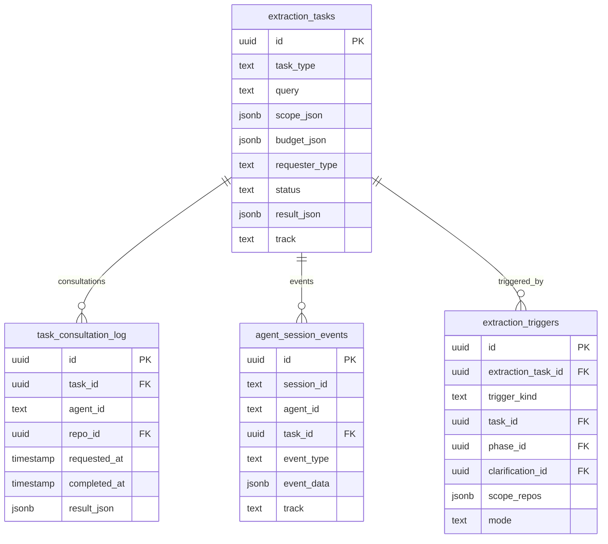
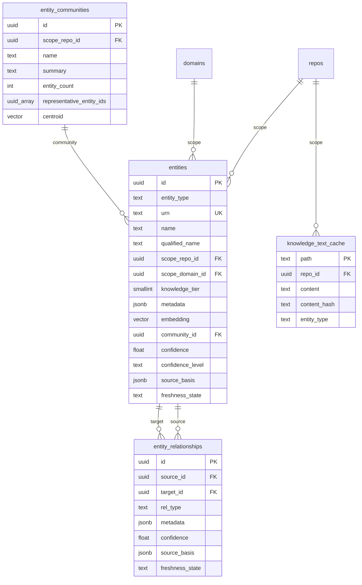
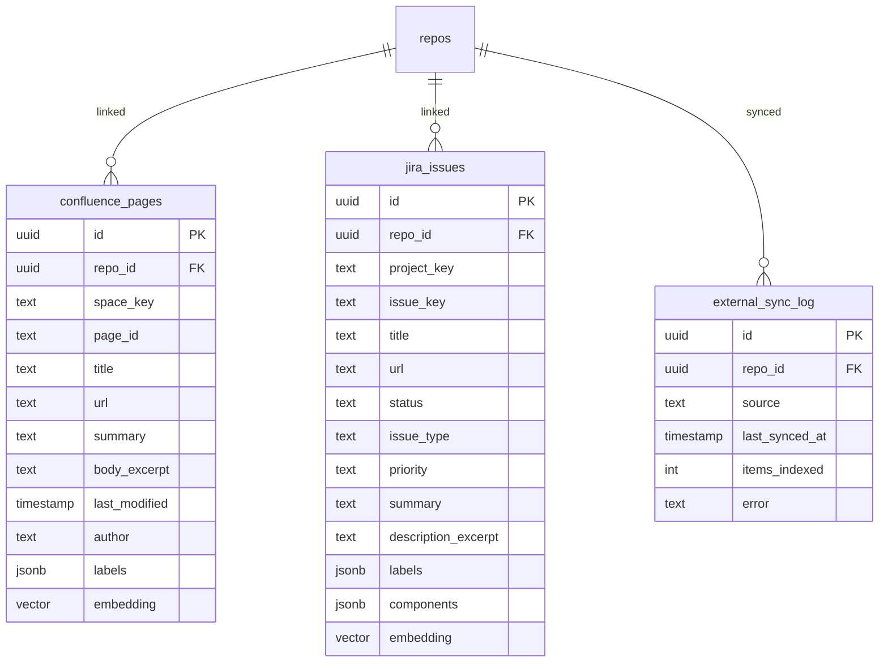
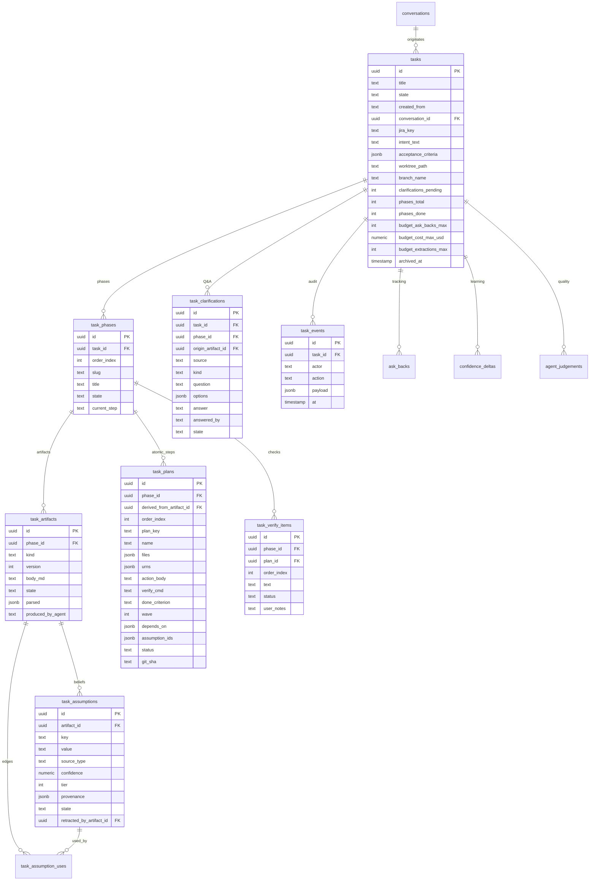
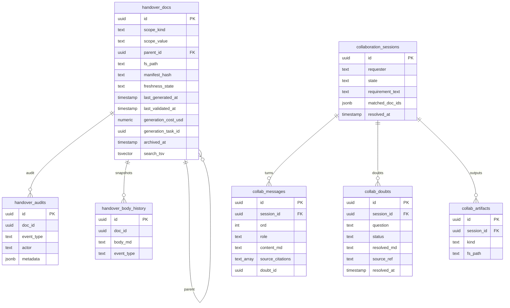

# 03 — Data Model

> **TL;DR.** One PostgreSQL 16 database with `pgvector` is the entire persistence story — no Redis, no S3, no separate metadata store. Tables come from two sources of truth: SQLAlchemy ORM models in `src/bifrost/storage/models.py` and Alembic migrations under `alembic/versions/`. The action-layer `task_*` family is alembic-only (raw SQL access through `src/bifrost/storage/repository.py`). Everything else is ORM-mapped. The schema breaks down into eight thematic groups (repos → extraction lifecycle → knowledge graph → external caches → chat → action layer → collaboration → cross-cutting), each with its own ER diagram below.

> **Read this when** you're: writing a query, debugging a constraint violation, planning a migration, or adding a new table and need to know where it slots in. **Skip if** you're tracing a *route* to its tables — chapter 04 has that map.

---

## 1. How to read this chapter

The data model is one PostgreSQL 16 database with the `pgvector` extension. Every row that persists across a process restart lives here — there is no separate metadata store, no Redis, no S3.

Tables come from two sources of truth:

1. **`src/bifrost/storage/models.py`** — SQLAlchemy 2.0 ORM models for tables the application reads/writes via the ORM.

2. **`alembic/versions/`** — the baseline migration. Some tables (notably the `task_*` family) are created in alembic but *not* mapped as ORM classes — repository functions access them via raw SQL.

This chapter groups tables by purpose:

- **§3** Cross-cutting concerns (read this first)
- **§4** Repos, scopes, ownership
- **§5** Extraction + lifecycle tables
- **§6** Knowledge graph (entities, relationships, communities, text cache)
- **§7** External-source caches (Confluence, Jira)
- **§8** Chat (conversations, messages, research bundle)
- **§9** Action layer (tasks, phases, plans, assumptions, …)
- **§10** Collaboration (handover docs + sessions)
- **§11** Cross-cutting tables (cost, audit, rules)

Each group has an ER diagram. Each table heading is followed by:
- 1-2 sentence purpose
- Sample row block showing realistic field values
- "Read by" / "Written by" subsection (which routes/services touch it)
- Operational notes (if any)

Where a column name in the doc differs from the column name in the DB (e.g. `entity_metadata` Python attr → `metadata` DB column), the discrepancy is noted.

---

## 2. Conventions used in this chapter

- **`(Verified: path)`** — the table's definition lives in that file. The file is canonical.
- **`[inferred]`** — the claim is not directly cited from a single line; explain in the same paragraph why it's safe to assert.
- **Sample rows** — always realistic but synthetic. `id` and `created_at` are abbreviated for readability.
- **"Read by" / "Written by"** lists routes (relative to `/api/v1`) and services (relative to `src/bifrost/`). Lower-case names are services; upper-case `POST/GET/...` are HTTP verbs.

---

## 3. Cross-cutting concerns (read this first)

These conventions hold across nearly every table — calling them out once instead of repeating them.

**ID conventions.**
- Every primary key is `uuid` (UUID v4).
- Wherever a UUID appears in a URL or external string, it is *hyphenated* (`00000000-0000-0000-0000-000000000001`).
- Wherever a UUID appears inside another column's text (e.g. inside a JSONB blob, inside a Markdown body), it may be hex-stripped (`f47ac10b58cc4372a5670e02b2c3d479`). The conversion is one-way at write time; readers normalise on parse.

**Timestamps.**
- `created_at` and `updated_at` are present on most ORM tables, with `server_default=func.now()` and `onupdate=func.now()` respectively. Don't set them in application code.
- Timestamps are stored as `TIMESTAMP WITHOUT TIME ZONE` and treated as UTC by convention.

**Soft delete.**
- Tables that support soft delete carry an `archived_at: timestamp NULL` column. NULL = active; non-NULL = archived. Deletes are normally soft (UPDATE setting `archived_at = NOW()`); a hard `DELETE FROM` is reserved for cleanup tasks.
- Explicit examples: `tasks.archived_at`, `handover_docs.archived_at`, `conversations.archived` (the conversations table predates the convention; uses a boolean instead).

**Audit-vs-source-of-truth.**
- Some tables are *append-only audit logs* (`task_events`, `handover_audits`, `agent_session_events`, `confidence_deltas`). These are intentionally denormalised and have no FK back to the entity they describe — so the trail survives a hard delete of that entity.
- Other tables are *source-of-truth* and update in place (`tasks`, `handover_docs`, `entities`).
- Rule of thumb: if the table is named `*_events` / `*_audits` / `*_log` / `*_history`, it's append-only.

**JSONB columns** are used liberally for structured-but-evolving data (e.g. `tasks.acceptance_criteria`, `entities.metadata`, `repo_ownership.raw_manifest`). The application validates the JSONB shape; Postgres does not.

**`pgvector`** is used on `entities.embedding`, `entity_communities.centroid`, `confluence_pages.embedding`, `jira_issues.embedding`. Default dimension is 384 (sentence-transformers `all-MiniLM-L6-v2`). HNSW index with `m=16, ef_construction=64`, cosine ops.

> **If you remember nothing else about §3.** UUIDs everywhere; timestamps via server defaults; `archived_at` for soft delete; `*_events` / `*_audits` tables are append-only and survive parent hard-deletes.

---

## 4. Repos, scopes, ownership

### 4.1 ER diagram

```mermaid
erDiagram
    domains ||--o{ repos : "groups"
    repos ||--o| repo_freshness : "tracks"
    repos ||--o| repo_ownership : "metadata"
    repos ||--o{ org_repos : "registered_repo_id"
    domains {
        uuid id PK
        text urn UK
        text name
    }
    repos {
        uuid id PK
        text urn UK
        text name
        text url
        uuid domain_id FK
        text local_clone_path
        bool is_primary
        jsonb adapter_config
    }
    org_repos {
        uuid id PK
        text owner
        text name
        text url
        text squad
        text region
        text service_tier
        bool is_primary
        uuid registered_repo_id FK
    }
    repo_freshness {
        uuid repo_id PK_FK
        text last_commit_indexed
        timestamp last_indexed_at
        text index_status
        text checkpoint_phase
        text checkpoint_file_cursor
        int files_analyzed
        text freshness_state
    }
    repo_ownership {
        uuid repo_id PK_FK
        text squad
        text service_tier
        text jira_project_key
        text confluence_space_key
        text slack_channel
        jsonb downstream_services
        jsonb messaging_topics
        jsonb database_names
        jsonb raw_manifest
    }
```

### 4.2 Tables

#### `repos`

The registered list of source repositories. One row per repository the operator has explicitly registered. URN is the canonical id; `local_clone_path` is the path on disk where the working tree is checked out.

```sql
-- example row
id:                '0000...0001'
urn:               'bifrost:repo:acmeco/dispatcher'
name:              'dispatcher'
url:               'https://github.com/acmeco/dispatcher'
domain_id:         '8a12...e0c2'    -- → domains.delivery
local_clone_path:  '/var/bifrost/clones/acmeco__dispatcher'
is_primary:        true             -- canonical answer for the domain
adapter_config:    {"branch": "main", "shallow_depth": 50}
```

The `is_primary` flag designates the canonical answer for chat queries when a domain has multiple repos. Set from the repo manifest (`is_primary: true` in the `generic_yaml` provider) or by the operator.

**Read by:** every research agent, the extraction worker, the handover generator. This is the most-joined-against table in the schema.
**Written by:** `POST /repos`, `POST /catalog/sync` (auto-registration path), `DELETE /repos/{id}` (soft-delete cascade).

(Verified: `src/bifrost/storage/models.py`.)

#### `domains`

A logical grouping of repos. Each repo belongs to at most one domain. URN is `bifrost:domain:<slug>`.

```sql
-- example row
id:    '8a12...e0c2'
urn:   'bifrost:domain:delivery'
name:  'Delivery'
```

**Read by:** the Knowledge browse page, the chat scope resolver, the handover generator (domain-scoped handovers pool entities across all repos with `domain_id` matching).
**Written by:** `POST /domains`, the team-domain step of `POST /admin/index-services`.

(Verified: `src/bifrost/storage/models.py`.)

#### `org_repos`

Catalog of every repo in your configured GitHub orgs (`sources.github.orgs`), populated by `POST /catalog/sync` paging `gh api orgs/<org>/repos`. Enriched best-effort with `squad` (the owning team name), `service_tier`, and `region` from each repo's manifest, read through the providers listed in `manifest.providers`. Provides the universe from which `repos` are auto-registered.

```sql
-- example row
id:                  '4d2e...91ab'
owner:               'acmeco'
name:                'dispatcher'
url:                 'https://github.com/acmeco/dispatcher'
squad:               'delivery'
region:              'GLOBAL'
service_tier:        'tier-1'
is_primary:          true
registered_repo_id:  '0000...0001'  -- non-NULL once registered into `repos`
```

**Read by:** the chat skim-search (when the registered scope doesn't surface a candidate repo, this table is consulted), the auto-registration helper, team / region-scoped handover generators.
**Written by:** `POST /catalog/sync` (re-fetch + upsert), the auto-registration helper (sets `registered_repo_id` after a successful `POST /repos`).

(Verified: `src/bifrost/storage/models.py`.)

#### `repo_freshness`

Per-repo extraction state. Tracks `last_commit_indexed`, `last_indexed_at`, `index_status`, mid-pipeline checkpoint cursors, file/component/flow/dependency counts, and the freshness state along with a human-readable `stale_reason`.

```sql
-- example row
repo_id:                 '0000...0001'
last_commit_indexed:     'abc123def456'  -- git sha
last_indexed_at:         '2025-01-15 14:32:08'
index_status:            'completed'      -- one of: pending|running|completed|failed|paused
checkpoint_phase:        NULL             -- non-NULL only mid-run
checkpoint_file_cursor:  NULL
files_analyzed:          218
freshness_state:         'fresh'          -- one of: fresh|stale|unknown
```

**Read by:** the dashboard (to render the freshness indicator per repo), the extraction worker (to resume from checkpoint on a partial run), the chat freshness check (to decide whether to pull before researching).
**Written by:** `POST /repos/{id}/extract` (creates baseline row), the extraction worker (updates checkpoint cursors + final state).

(Verified: `src/bifrost/storage/models.py`.)

#### `repo_ownership`

Parsed manifest metadata (Backstage `catalog-info.yaml`, `CODEOWNERS`, or a generic YAML file). Carries team ownership (the `squad` column), service tier, compliance tags (the manifest's `compliance` list, lowercased and de-duplicated; stored in the `compliance_tags` column), the cross-repo dependency graph (via `downstream_services`, `messaging_topics`, `database_names`), and the per-repo Jira project key, Confluence space key, Slack channel that research agents use to scope their searches.

```sql
-- example row
repo_id:               '0000...0001'
squad:                 'delivery'
service_tier:          'tier-1'
jira_project_key:      'DLVR'
confluence_space_key:  'DLVR'
slack_channel:         '#delivery'
downstream_services:   ["delivery-gateway", "signing-keys"]
messaging_topics:      ["events.accepted.v1", "events.failed.v1"]
database_names:        ["subscriptions_db"]
raw_manifest:          { ... merged parsed manifest ... }
```

`raw_manifest` keeps the merged parsed manifest content as JSONB so future fields can be lifted without a re-sync.

**Read by:** every per-source research agent (to know *which* Jira project, Slack channel, etc. to query), the handover generator (ownership section), the action layer (to know which team's PR template to use).
**Written by:** `POST /repos/{id}/sync-ownership`, and `POST /repos` when a manifest is present at registration.

(Verified: `src/bifrost/storage/models.py`.)

#### Service graph (rows in `entities` and `entity_relationships`)

`POST /admin/index-services` builds a service-level graph from the manifests. For each repo it upserts a service entity (`urn:bifrost:service:<repo>`) and a team domain (`urn:bifrost:domain:<team>`), then inserts edges. The call is idempotent. Edges carry a `confidence` and the `matched_on` value that produced them.

| `rel_type` | Where it comes from | Confidence |
|---|---|---|
| `depends_on` | A dependency the manifest declares (`spec.dependsOn` in Backstage) that names another repo | 0.9 |
| `calls_service` | A `*_HOST`, `*_URL` or `*_ENDPOINT` key in a config file. The key's prefix (`SIGNING_KEYS_HOST` gives `signing-keys`) or the host's first label must match a repo name | 0.88 |
| `publishes_to` | A `*_TOPIC` or `*_QUEUE` key whose prefix matches a repo name | 0.85 |
| `shares_topic` | Two repos whose config files carry the same topic or queue value | 0.8 |

Config files are the ones in `manifest.config_globs`. Only matched keys and scrubbed values are stored, never whole files. A reference that matches no registered repo is counted as unresolved and reported in the response, not guessed.

> **If you remember nothing else about §4.** `repos` is the source-of-truth for *what's registered*; `org_repos` is the bigger universe of *what could be registered*; `repo_ownership` is *where the repo manifest lives once parsed*; `repo_freshness` is *the index pointer*. Every research path joins on `repos.id`.

---

## 5. Extraction + lifecycle tables

### 5.1 ER diagram



### 5.2 Tables

#### `extraction_tasks`

The extraction-job lifecycle table. **Named `extraction_tasks`** so the name `tasks` stays free for the user-facing action-layer concept. One row per submitted extraction.

```sql
-- example row
id:              'ext-789...'
task_type:       'full_extraction'
query:           NULL
scope_json:      { "repo_id": "f47a...c479" }
budget_json:     { "max_cost_usd": 50, "max_files": 500 }
requester_type:  'human'           -- 'human' or 'agent'
status:          'completed'        -- received → running → completed/failed
result_json:     { "components_extracted": 42, "flows_extracted": 8, ... }
track:           'A'                -- 'A' or 'B'
```

The `requester_type` is `"human"` by default but can also be `"agent"` when an action-layer agent triggers an extraction mid-task to refresh its context.

**Read by:** the `ExtractionWorker` (polls for new rows), the Overview dashboard, the SSE streaming endpoint, the Spend page (joins on cost rows).
**Written by:** `POST /repos/{id}/extract`, `POST /extract`, `POST /extraction-tasks` (worker self-submit), the action-layer ask-back path.

(Verified: `src/bifrost/storage/models.py`.)

#### `task_consultation_log`

Persistent intermediate results from multi-agent consultations during an extraction or chat task. One row per consultation request + response cycle.

```sql
-- example row
id:            'tcl-111...'
task_id:       'ext-789...'
agent_id:      'repo_agent'
repo_id:       '0000...0001'
requested_at:  '2025-01-15 14:30:01'
completed_at:  '2025-01-15 14:30:34'
result_json:   { "relevance": "high", "summary": "..." }
```

**Read by:** debug pages, audit, the SSE replay flow when a client reconnects mid-extraction.
**Written by:** the research coordinator (one row per per-agent worker hand-off), the extraction worker.

(Verified: `src/bifrost/storage/models.py`.)

#### `agent_session_events`

Append-only audit log for agent session lifecycle events. Carries `session_id`, `agent_id`, `event_type`, JSONB `event_data`, and the track designator.

```sql
-- example row
id:          'evt-222...'
session_id:  'sess-abc'
agent_id:    'discussion_agent'
task_id:     'tsk-456...'
event_type:  'agent.completed'   -- agent.started, agent.completed, agent.failed, ...
event_data:  { "tokens_in": 4200, "tokens_out": 800, "cost_usd": 0.12 }
track:       'A'
```

**Read by:** observability views, the Spend page (joins for per-agent aggregation), the debugger surface.
**Written by:** any agent that emits a lifecycle event.

(Verified: `src/bifrost/storage/models.py`.)

#### `extraction_triggers` (alembic-only)

Audit row for every extraction triggered automatically by the action layer. Records the trigger kind, which task / phase / clarification caused it, the scope of repos targeted, and the mode.

```sql
-- example row
id:                   'trig-333...'
extraction_task_id:   'ext-789...'
trigger_kind:         'ask_back_gap'   -- auto_manifest_only|ask_back_gap|user_requested|scheduled
task_id:              'tsk-456...'
phase_id:             'tp-100...'
clarification_id:     'tc-200...'
scope_repos:          ["f47a...c479"]
mode:                 'shallow'         -- 'shallow' or 'deep'
```

**Read by:** Spend (to attribute extraction cost back to the triggering task), Tasks page (to render "extraction running for this task" state).
**Written by:** action-layer ask-back resolver.

**Chains into the action layer.** When an ask-back resolver fires this trigger, it stores the new `extraction_triggers.id` on the ask-back row (`ask_backs.triggered_extraction_id`). That makes `extraction_triggers` the join point between extraction (this section) and the action layer (§9). § 9's `ask_backs` discussion deliberately does NOT redefine the table — re-read this entry from §9 if you need the columns.

(Verified: `alembic/versions/001_baseline.py`.)

> **If you remember nothing else about §5.** `extraction_tasks` is *Bifrost-driven indexing jobs*, NOT user tasks. The action-layer `tasks` table (chapter §9) is a different beast — they share none of the schema.

---

## 6. Knowledge graph

### 6.1 ER diagram



### 6.2 Tables

#### `entities`

The knowledge graph's polymorphic node table. Every kind of extracted entity (Component, Flow, Dependency, …) lives here, distinguished by `entity_type`. URN is the canonical id.

```sql
-- example row
id:                '7f3a...0bf2'
entity_type:       'COMPONENT'
urn:               'bifrost:repo:acmeco/dispatcher:component:dispatcher/fanout.py::FanoutService'
name:              'FanoutService'
qualified_name:    'dispatcher.fanout.FanoutService'
scope_repo_id:     '0000...0001'
scope_domain_id:   '8a12...e0c2'
knowledge_tier:    1                 -- 0-3, broad-to-deep per F1 §7.1
metadata:          { "exports": ["get_status", "fan_out"], "language": "python" }
embedding:         [0.012, -0.034, 0.18, ...]   -- 384-dim, MiniLM
community_id:      'ec-9090...'
confidence:        0.91
confidence_level:  'confirmed'        -- confirmed|inferred|stale|uncertain|unknown|conflicting
source_basis:      [{ "type": "extraction", "phase": "D", "file": "dispatcher/fanout.py" }]
freshness_state:   'fresh'            -- fresh|stale|unknown
```

Key columns to flag:
- **`entity_metadata` (Python attr) → `metadata` (DB column)** — renamed because `metadata` is reserved on Declarative.
- **`embedding: Vector(384)`** — sentence-transformers `all-MiniLM-L6-v2`. HNSW index with `m=16, ef_construction=64`, cosine ops.
- **`community_id`** — Louvain-cluster id (Stage 6 of post-extraction).
- **`source_basis: jsonb`** — array of evidence URNs supporting the entity.

**Read by:** every research agent, every handover generator, the Knowledge browse page, the chat synthesiser via citations.
**Written by:** the extraction pipeline (upserts entities at the end of each phase D, E, F, G, H, I); the cross-repo linker (updates `metadata`); the learning loop (updates `confidence` + `confidence_level`).

(Verified: `src/bifrost/storage/models.py`.)

#### `entity_relationships`

Typed directional edges. One row per `(source_id, target_id, rel_type)` triple (uniqueness enforced). `source_id != target_id` is also enforced.

```sql
-- example row
id:               'er-555...'
source_id:        '7f3a...0bf2'        -- FanoutService
target_id:        '8b1c...e3f1'        -- EndpointRouter
rel_type:         'CALLS'
metadata:         { "evidence": "dispatcher/fanout.py:142", "method": "fan_out" }
confidence:       0.85
source_basis:     [{ "type": "phase_g_synthesis" }]
freshness_state:  'fresh'
```

**Read by:** dependency-impact / blast-radius queries, graph retrieval helpers, the handover generator's flow and dependency sections.
**Written by:** the extraction pipeline's Phase G (relationship synthesis); cross-repo linker (cross-repo edges).

(Verified: `src/bifrost/storage/models.py`.)

#### `entity_communities`

Louvain-clustered groups of entities with an LLM-generated summary plus a centroid embedding. Powers "global" queries where the user asks about a whole domain or area and vector-top-K over individual entities under-retrieves.

```sql
-- example row
id:                          'ec-9090...'
scope_repo_id:               '0000...0001'
name:                        'Fan-out & Delivery'
summary:                     'Components and flows handling end-to-end delivery lifecycle...'
entity_count:                14
representative_entity_ids:   ['7f3a...0bf2', '8b1c...e3f1', ...]
centroid:                    [0.011, -0.030, 0.19, ...]   -- average of member embeddings
```

**Read by:** the chat coordinator's domain-scoped queries; the Knowledge browse page renders communities as a top-level grouping.
**Written by:** the Stage-6 community-detection job (`POST /admin/rebuild-communities`).

(Verified: `src/bifrost/storage/models.py`.)

#### `knowledge_text_cache`

The `AgentStateBackend` Track A storage. Holds raw text documents (file content, snippet, summary) keyed by `path`. The `content_hash` lets a cache lookup short-circuit when the file hasn't changed.

```sql
-- example row
path:          'agents/research/cache/repo_abc/fanout-summary'
repo_id:       '0000...0001'
content:       'FanoutService routes events through EndpointRouter...'
content_hash:  'sha256:1a2b3c...'
entity_type:   'summary'
```

**Read by:** any agent that needs to retrieve previously-cached text.
**Written by:** agents that persist intermediate text artefacts.

(Verified: `src/bifrost/storage/models.py`.)

> **If you remember nothing else about §6.** `entities` is the polymorphic node table; `entity_relationships` is its edge table; `entity_communities` is the cluster table that makes domain-scoped retrieval tractable. All three are touched by every research path.

---

## 7. External-source caches

### 7.1 ER diagram



### 7.2 Tables

#### `confluence_pages`

Cached Confluence page metadata per repo. The Atlassian MCP populates this via the indexer; chat agents query the cache first and fall back to live MCP only when the cache is missing or stale.

```sql
-- example row
id:                  'cp-101...'
repo_id:             '0000...0001'
space_key:           'DLVR'
page_id:             '123456789'
title:               'Dispatcher Runbook'
url:                 'https://acmeco.atlassian.net/wiki/spaces/DLVR/pages/123456789'
summary:             'On-call runbook for the dispatcher...'
body_excerpt:        '## Common alerts\n- endpoint_503...'
last_modified:       '2025-01-12 09:14:01'
author:              'jane.doe'
labels:              ["runbook", "on-call"]
embedding:           [0.022, ...]    -- 384-dim
```

**Read by:** `confluence_agent`, the handover generator's docs section, full-text search through TSVECTOR + the embedding vector for semantic match.
**Written by:** `external_indexer` running the Confluence sync (`POST /indexer/repos/{id}` or `/indexer/all`); admin re-embed (`POST /admin/embed/confluence`).

(Verified: `src/bifrost/storage/models.py`.)

#### `jira_issues`

Cached Jira issue metadata per repo. Same indexer pattern as Confluence pages.

```sql
-- example row
id:                    'ji-202...'
repo_id:               '0000...0001'
project_key:           'DLVR'
issue_key:             'DLVR-1234'
title:                 'Add retry backoff to the dispatcher'
url:                   'https://acmeco.atlassian.net/browse/DLVR-1234'
status:                'In Progress'
issue_type:            'Story'
priority:              'High'
summary:               'Add exponential backoff across...'
description_excerpt:   'Acceptance criteria: ...'
labels:                ["reliability", "delivery"]
components:            ["dispatcher", "delivery-gateway"]
embedding:             [0.045, ...]
```

**Read by:** `jira_agent`, the action-layer `intent_router` (resolves a Jira issue key into the underlying request), the handover generator's "active work" section.
**Written by:** `external_indexer` running the Jira sync; admin re-embed (`POST /admin/embed/jira`).

(Verified: `src/bifrost/storage/models.py`.)

#### `external_sync_log`

One row per `(repo_id, source)` sync run, used as a cheap staleness lookup ("when did we last sync Confluence for this repo?").

```sql
-- example row
id:                'esl-303...'
repo_id:           '0000...0001'
source:            'confluence'      -- confluence|jira|github|slack
last_synced_at:    '2025-01-15 03:00:00'
items_indexed:     147
error:             NULL
```

**Read by:** the dashboard freshness indicator, the indexer's scheduling logic, `GET /indexer/status`.
**Written by:** any external-source sync completing (success or error).

(Verified: `src/bifrost/storage/models.py`.)

> **If you remember nothing else about §7.** External caches are *cache, not source-of-truth*. The Atlassian / GitHub / Slack systems own the data; we mirror it for fast embed-search and to reduce per-question MCP-call cost.

---

## 8. Chat (conversations)

### 8.1 ER diagram

```mermaid
erDiagram
    conversations ||--o{ conversation_messages : "messages"
    conversations ||--|| conversation_research_state : "bundle"
    domains ||--o{ conversations : "scope"
    conversations {
        uuid id PK
        text session_id
        text title
        jsonb scope_repo_ids
        uuid scope_domain_id FK
        bool archived
    }
    conversation_messages {
        uuid id PK
        uuid conversation_id FK
        int turn_index
        text role
        text content
        jsonb sources
        text confidence
        text reasoning
        jsonb gaps
        jsonb token_counts
        float cost_usd
    }
    conversation_research_state {
        uuid conversation_id PK_FK
        jsonb bundle
        jsonb last_question_embedding
    }
```

### 8.2 Tables

#### `conversations`

A persistent chat thread. Cookie-based ownership. Carries the chat title, the optional scope (a list of `scope_repo_ids` as JSONB UUID strings, plus an optional `scope_domain_id`), and the `archived` flag.

```sql
-- example row
id:                'conv-abc...'
session_id:        'cookie-xyz...'   -- bifrost_session cookie value
title:             'Why did delivery fail for endpoint XYZ?'
scope_repo_ids:    ["f47a...c479", "9a99...0011"]
scope_domain_id:   NULL
archived:          false              -- bool, predates archived_at convention
```

**Read by:** the Chat page (to populate the thread list), the query worker (to load history when continuing a thread).
**Written by:** `POST /conversations`, `PATCH /conversations/{id}` (rename), `DELETE /conversations/{id}` (sets `archived=true`).

(Verified: `src/bifrost/storage/models.py`.)

#### `conversation_messages`

One row per turn (user or assistant). Beyond `content`, the assistant turn carries citations, confidence, reasoning, gap notes, and per-turn cost.

```sql
-- example row (assistant turn)
id:               'msg-456...'
conversation_id:  'conv-abc...'
turn_index:       3
role:             'assistant'
content:          'FanoutService dispatches events via EndpointRouter [^1]...'
sources:          [{ "type": "entity", "urn": "bifrost:repo:.../component:FanoutService", "title": "FanoutService" }]
confidence:       'confirmed'
reasoning:        'Multiple research agents converged on FanoutService → EndpointRouter chain.'
gaps:             ["Retry timing for 5xx responses unclear"]
token_counts:     { "input": 12400, "output": 1800 }
cost_usd:         0.18
```

Uniqueness is enforced on `(conversation_id, turn_index)` so turns are strictly ordered and there are no gaps.

**Read by:** the Chat page, the follow-up planner (to load recent turns into context), the audit / debug surfaces.
**Written by:** `POST /conversations/{id}/messages` (user turn); the SSE finaliser when an assistant turn completes.

(Verified: `src/bifrost/storage/models.py`.)

#### `conversation_research_state`

Persistent backup for the in-memory `BundleCache`. Stores the serialised `ResearchBundle` (per-source reports + entity snippets) + the embedding of the last question. Lets a long-running chat session survive an API restart without losing the prior research context.

```sql
-- example row
conversation_id:           'conv-abc...'
bundle:                    { "repo_reports": [...], "confluence_reports": [...], ... }
last_question_embedding:   [0.022, -0.041, ...]
```

**Read by:** the follow-up planner on the first turn after an API restart.
**Written by:** the coordinator after each research turn completes.

(Verified: `src/bifrost/storage/models.py`.)

> **If you remember nothing else about §8.** `conversations.archived` is a bool — predates the `archived_at` convention. Don't use it as a template for new tables.

---

## 9. Action layer

The action layer was originally called "Briefs" and is now called "Tasks". Every table in this group is created by the baseline migration. **None of these tables have ORM model classes** — they are accessed via raw SQL through helpers in `src/bifrost/storage/repository.py` and the routes in `src/bifrost/api/routes/tasks.py`. (Inferred from the absence of `class Task*` in `models.py`.)

### 9.1 ER diagram



### 9.2 Tables

#### `tasks`

The action-layer top-level entity. State machine: `draft_intent → discussing → discuss_done → drafting_plan → plan_ready → executing → verifying → success / blocked / cancelled` (verified: `src/bifrost/actions/task_lifecycle.py`).

```sql
-- example row
id:                       'tsk-456...'
title:                    'Add retry backoff to the dispatcher'
state:                    'plan_ready'
created_from:             'jira'             -- 'jira'|'chat'|'manual'
conversation_id:          NULL                -- non-NULL when promoted from chat
jira_key:                 'DLVR-1234'
intent_text:              'Add retry backoff across the dispatcher...'
acceptance_criteria:      [{ "key": "AC1", "text": "Retries use exponential backoff with jitter" }, ...]
worktree_path:            NULL                -- non-NULL while executing
branch_name:              NULL
clarifications_pending:   0
phases_total:             1
phases_done:              0
budget_ask_backs_max:     5
budget_cost_max_usd:      10.00
budget_extractions_max:   2
archived_at:              NULL                -- soft-archive
```

**Read by:** Tasks page, Task detail page, the `auto_archive` sweep, every action-layer agent.
**Written by:** `POST /tasks` (creation), `POST /tasks/{id}/advance` (state machine), `POST /tasks/{id}/archive`/`/unarchive`, `POST /tasks/auto-archive`.

(Verified: `alembic/versions/001_baseline.py`.)

#### `task_phases`

A task has an ordered list of phases. Each phase runs the four-step loop. One uniqueness constraint: `(task_id, order_index)`.

```sql
-- example row
id:            'tp-100...'
task_id:       'tsk-456...'
order_index:   0
slug:          'retry-backoff'
title:         'Add backoff setting to retry policy'
state:         'planning'              -- planning|executing|verifying|done
current_step:  'plan'                   -- discuss|plan|execute|verify|done
```

**Read by:** the Task detail page (renders phases as a Kanban column), every action-layer agent (knows what step it's on).
**Written by:** the planner when a task transitions out of `draft_intent`; phase-step transitions during the lifecycle.

(Verified: `alembic/versions/001_baseline.py`.)

#### `task_artifacts`

The belief-DAG nodes. Five canonical kinds: `context`, `research`, `plan`, `summary`, `verify`. Each artifact is `body_md` Markdown (source of truth) + an optional `parsed: jsonb` (structured form).

```sql
-- example row
id:                  'ta-200...'
phase_id:            'tp-100...'
kind:                'plan'
version:             2
body_md:             '## Plan\nP1-T1: ...'
state:               'approved'         -- draft|approved|stale|invalidated
parsed:              { "tasks": [{"key": "P1-T1", ...}] }
produced_by_agent:   'plan_agent'
```

**Read by:** the Task detail page (renders the markdown), the planner (re-parses `plan` artifacts), the next agent in the loop (reads upstream artifacts for context).
**Written by:** any per-phase agent at completion (discussion_agent, plan_agent, executor's run summary, verifier).

(Verified: `alembic/versions/001_baseline.py`.)

#### `task_assumptions`

Atomic belief cells. Each assumption is keyed within an artifact (`A1`, `A2`, …) and carries a value, provenance, and a confidence/tier grade.

```sql
-- example row
id:                            'asm-300...'
artifact_id:                   'ta-200...'
key:                           'A3'
value:                         'Dispatcher runs on Python 3.12 with FastAPI'
source_type:                   'manifest'    -- user_stated|code_verified|manifest|gradle|...
confidence:                    0.95
tier:                          1                -- 1-5 (1=most reliable, 5=guess)
provenance:                    [{ "file": "pyproject.toml", "line": 4 }]
state:                         'active'         -- 'active' or 'retracted'
retracted_by_artifact_id:      NULL
```

`source_type` enum: `user_stated` / `code_verified` / `manifest` / `gradle` / `package_json` / `metadata_match` / `confluence` / `jira` / `github_issue` / `slack` / `fuzzy_match` / `llm_guess` / `research`.

**Read by:** the planner (decides which assumptions a plan step needs), the verifier (cross-checks assumptions against ground truth), the learning loop (compounds confidence shifts).
**Written by:** any agent that emits an artifact whose claims are parsed (discussion → assumptions; plan → cited assumptions; verify → confirmed/contradicted).

(Verified: `alembic/versions/001_baseline.py`.)

#### `task_assumption_uses`

Belief-DAG edges. Composite PK on `(artifact_id, assumption_id)`. Records which artifact relies on which assumption.

```sql
-- example row
artifact_id:     'ta-200...'   -- the plan artifact
assumption_id:   'asm-300...'  -- A3, "Python 3.12 runtime"
```

**Read by:** the cascade-invalidator (when an assumption is retracted, every artifact using it goes stale).
**Written by:** the artifact committer when it parses the body and records which assumptions are cited.

(Verified: `alembic/versions/001_baseline.py`.)

#### `task_clarifications`

The Q&A queue between agents and user.

```sql
-- example row
id:                  'tc-200...'
task_id:             'tsk-456...'
phase_id:            'tp-100...'
origin_artifact_id:  'ta-150...'    -- the artifact that asked the question
source:              'agent'          -- agent|user|system
kind:                'need_user_input'  -- need_research|need_user_input|conflict|ambiguity
question:            'Should retries be capped per endpoint or per event?'
options:             ["per_endpoint", "per_event"]   -- empty = free-text
answer:              'per_endpoint'
answered_by:         'user'           -- user|bifrost_research|bifrost_extraction|system
state:               'answered'       -- open|answered|skipped|superseded
```

**Read by:** the Task detail page (clarifications inbox), the ask-back budget enforcement, the action-layer router (decides whether a clarification needs research vs human).
**Written by:** any agent that emits a clarification request; `POST /tasks/{id}/clarifications/{cid}/answer` to resolve.

(Verified: `alembic/versions/001_baseline.py`.)

#### `task_plans`

Atomic execution steps parsed from a plan artifact.

```sql
-- example row
id:                          'tpln-400...'
phase_id:                    'tp-100...'
derived_from_artifact_id:    'ta-200...'
order_index:                 0
plan_key:                    'P1-T1'
name:                        'Add backoff setting to retry policy'
files:                       ["dispatcher/fanout.py"]
urns:                        ["bifrost:repo:.../component:RetryPolicy"]
action_body:                 'Add a backoff_seconds field to RetryPolicy and ensure it...'
verify_cmd:                  'pytest tests/test_retry.py'
done_criterion:              'test_retry passes including the new backoff case'
wave:                        1                  -- parallel grouping
depends_on:                  []                  -- list of plan_keys this depends on
assumption_ids:              ["asm-300...", "asm-301..."]
status:                      'completed'          -- pending|approved|executing|completed|failed|rejected
git_sha:                     'abc123def456'       -- populated after execution
```

**Read by:** the executor (runs each plan step), the verifier (cross-references plan to artifacts), the Task detail page.
**Written by:** the plan-checker when the plan artifact is committed; the executor on completion (sets `git_sha`, `commit_msg`, `output_log`).

(Verified: `alembic/versions/001_baseline.py`.)

#### `task_verify_items`

Verification checklist items.

```sql
-- example row
id:           'tv-500...'
phase_id:     'tp-100...'
plan_id:      'tpln-400...'
order_index:  0
text:         'Run mvn test and confirm OrderServiceTest passes'
status:       'pass'                -- pending|pass|fail|skipped
user_notes:   NULL
```

**Read by:** the Task detail page (renders the checklist), the action-layer state machine (advances task to `success` when all pass).
**Written by:** the verifier drafts the items after execution; user override via `POST /tasks/{id}/verify-items/{iid}/override`.

(Verified: `alembic/versions/001_baseline.py`.)

#### `task_events`

Append-only audit log.

```sql
-- example row
id:        'te-600...'
task_id:   'tsk-456...'
actor:     'agent'                  -- user|agent|system
action:    'phase.advanced'
payload:   { "from": "drafting_plan", "to": "plan_ready" }
at:        '2025-01-15 14:35:12'
```

**Read by:** Task detail timeline view, audit / forensics.
**Written by:** every state transition or notable event.

(Verified: `alembic/versions/001_baseline.py`.)

#### `confidence_deltas`

The learning-loop audit. Every time a verify pass/fail or a correction or a re-extraction shifts an entity's or relationship's confidence, a row is written.

```sql
-- example row
id:                  'cd-700...'
target_kind:         'entity'              -- 'entity' or 'relationship'
target_id:           '7f3a...0bf2'
reason:              'verify_passed'        -- enumerated cause
old_confidence:      0.85
new_confidence:      0.95
old_confidence_level: 'inferred'
new_confidence_level: 'confirmed'
old_tier:            2
new_tier:            1
created_at:          '2025-01-15 14:38:01'
```

**Read by:** the Learning admin page (renders the running history), audit.
**Written by:** the cascade applier when a confidence value shifts.

(Verified: `alembic/versions/001_baseline.py`.)

#### `agent_judgements`

Quality-tracking for individual agent claims.

```sql
-- example row
id:           'aj-800...'
claim:        'EndpointRouter routes by country code from the request'
cited_tiers:  [1, 2]
cited_urns:   ["bifrost:repo:.../component:EndpointRouter"]
outcome:      'confirmed'          -- 'confirmed' | 'contradicted' | NULL
```

**Read by:** the agent-quality dashboard, the learning loop.
**Written by:** an agent emitting a claim; user/verifier confirming or contradicting via `/admin/learning/confirm` or `/admin/learning/contradict`.

(Verified: `alembic/versions/001_baseline.py`.)

#### `ask_backs`

The audit/cost row written every time the action layer asks the user (or research pipeline) a clarifying question. When the answer requires a fresh extraction, the resolver fires an `extraction_triggers` row and stores its id on the ask-back so cost attribution chains back to the originating task.

> Table reference: `extraction_triggers` itself is defined in §5 — see the ["#### `extraction_triggers` (alembic-only)"](#extraction_triggers-alembic-only) entry for its columns. We don't redefine it here to avoid drift.

```sql
-- ask_backs example row
id:                          'ab-900...'
task_id:                     'tsk-456...'
question:                    'Is delivery-gateway the right place for retry logic?'
scope_repos:                 ["f47a...c479"]
answered_from:               'extraction_then_research'  -- graph_only|research_pipeline|extraction_then_research|user|budget_exceeded
triggered_extraction_id:     'trig-333...'  -- → extraction_triggers.id (defined in §5)
research_tokens:             4200
research_cost_usd:           0.18
research_duration_seconds:   34
```

**Foreign-key chain:** `ask_backs.triggered_extraction_id → extraction_triggers.id → extraction_tasks.id`. The Spend page walks this chain to attribute extraction cost back to a triggering task.

**Read by:** the Spend page (attributes extraction cost back to a triggering task), audit.
**Written by:** the action-layer ask-back resolver.

(Verified: `alembic/versions/001_baseline.py`.)

> **If you remember nothing else about §9.** Five canonical artifact kinds (`context`, `research`, `plan`, `summary`, `verify`); one task = ordered phases; one phase = four-step loop. Every assumption has provenance — that's the difference between this and a rubber-duck planning system.

---

## 10. Collaboration

### 10.1 ER diagram



### 10.2 Tables

#### `handover_docs`

One row per handover artefact. The on-disk Markdown file is the *source of truth*; this row is the *queryable form*.

```sql
-- example row
id:                    'hd-xyz...'
scope_kind:            'repo'                -- feature|repo|domain|region|team|session
scope_value:           'dispatcher'
parent_id:             NULL                   -- non-NULL for tree-decomposed children
fs_path:               '/var/bifrost/docs/handovers/repos/dispatcher/index.md'
manifest_hash:         'sha256:1a2b3c...'    -- sha256(sorted source URNs + extraction timestamps)
freshness_state:       'fresh'                -- fresh|stale|very_stale|enriched_by_children|stale_due_to_children
last_generated_at:     '2025-01-15 13:00:00'
last_validated_at:     '2025-01-15 14:00:00'
generation_cost_usd:   1.42
generation_task_id:    'ext-789...'
archived_at:           NULL                    -- soft-archive
search_tsv:            -- Postgres-generated TSVECTOR; GIN-indexed
```

**Read by:** the Collaboration handovers page (list + detail views), the matcher when starting a session, the generator when re-generating (loads prior body for diff).
**Written by:** the handover generator (insert on generation, update on regenerate); `DELETE /handover-docs/{id}` (sets `archived_at`); `POST /handover-docs/{id}/restore` (clears it).

(Verified: `src/bifrost/storage/models.py`.)

#### `handover_audits`

Append-only lifecycle audit. One row per mutating event. **Reads do NOT emit audit rows.**

```sql
-- example row
id:          'ha-aaa...'
doc_id:      'hd-xyz...'
event_type:  'edited'              -- generated|archived|restored|edited|promoted
actor:       'cookie-xyz...'        -- session id for user events; "system" for generator
metadata:    { "version_before": 3, "version_after": 4, "diff_lines": 12 }
```

`actor` is the cookie session id for user events, `"system"` for generator events; NULL allowed when the route lacks a cookie.

**Intentionally has no FK to `handover_docs`** so the trail survives a hard-delete of the source doc — same survival rationale as `handover_body_history`.

**Read by:** `GET /handover-docs/{id}/audit` (Activity Timeline disclosure on the handover detail page), audit / forensics.
**Written by:** `POST /handover-docs/{id}/body` (PATCH), `POST /handover-docs/{id}/promote-candidate`, `DELETE /handover-docs/{id}` (archive), `POST /handover-docs/{id}/restore`, the generator on completion.

(Verified: `src/bifrost/storage/models.py`.)

#### `handover_body_history`

Pre-overwrite snapshots of a handover doc's body Markdown. One row captured *before* each overwrite. `event_type` mirrors the *upcoming* event. Retention is bounded at 20 rows per `doc_id` by the repository helper.

```sql
-- example row
id:          'hbh-bbb...'
doc_id:      'hd-xyz...'
body_md:     '# Dispatcher Handover\n\n...'   -- the prior body
event_type:  'pre-edit'                          -- pre-regen|pre-edit|pre-promote
created_at:  '2025-01-15 14:35:00'
```

**Read by:** `GET /handover-docs/{id}/history` (the diff viewer).
**Written by:** the registry helper before any body overwrite.

(Verified: `src/bifrost/storage/models.py`.)

#### `collaboration_sessions`

The collaboration session top-level entity. State machine: `open` → `clarifying` → `resolved` → `briefed` → `closed`.

```sql
-- example row
id:                'cs-abc...'
requester:         'cookie-xyz...'   -- bifrost_session cookie
state:             'briefed'
requirement_text:  'We need to add retry backoff to the dispatcher.'
matched_doc_ids:   ["hd-xyz...", "hd-abc..."]   -- handover docs this session is grounded in
resolved_at:       '2025-01-15 15:10:00'
```

**Read by:** the Collaboration landing page (open sessions list), the session detail page, the loop-back analyser (recurring doubts → candidate updates).
**Written by:** `POST /collab-sessions` (create), `POST /collab-sessions/{id}/messages` (state transitions), `POST /collab-sessions/{id}/close`, `POST /collab-sessions/{id}/reopen`.

(Verified: `src/bifrost/storage/models.py`.)

#### `collab_messages`

One row per turn. Uniqueness on `(session_id, ord)` so turns are strictly ordered.

```sql
-- example row
id:                 'cm-ccc...'
session_id:         'cs-abc...'
ord:                3
role:               'clarifier_agent'   -- requester|system|clarifier_agent|synthesizer_agent
content_md:         'Could you clarify whether retries are capped per endpoint or per event?'
source_citations:   ["bifrost:repo:.../doc:dispatcher-runbook#retries"]   -- text[] of URNs
doubt_id:           'cd-ddd...'         -- non-NULL when this message asks/answers a specific doubt
```

**Read by:** the session detail page (chat history pane).
**Written by:** `POST /collab-sessions/{id}/messages` (user turn + agent turn appended atomically).

(Verified: `src/bifrost/storage/models.py`.)

#### `collab_doubts`

The structured doubt log.

```sql
-- example row
id:           'cd-ddd...'
session_id:   'cs-abc...'
question:     'Are retries capped per endpoint or per event?'
status:       'answered_by_doc'   -- open|answered_by_doc|answered_by_human|unresolved|escalated
resolved_md:  'Per the dispatcher runbook, retries are capped per endpoint.'
source_ref:   'bifrost:repo:.../doc:dispatcher-runbook#retries'
resolved_at:  '2025-01-15 15:08:00'
```

**Read by:** the session detail page (doubt log pane), the loop-back analyser (recurring questions → candidate updates), the synthesiser (resolved + unresolved doubts go into the brief).
**Written by:** the clarifier on each turn (emits `new_doubts`); `POST /collab-sessions/{id}/doubts/{did}/resolve` (manual resolution).

(Verified: `src/bifrost/storage/models.py`.)

#### `collab_artifacts`

Produced artefacts attached to a session.

```sql
-- example row
id:          'ca-eee...'
session_id:  'cs-abc...'
kind:        'final_brief'    -- final_brief|estimate|risk_log|draft_ask_message
fs_path:     '/var/bifrost/docs/handovers/sessions/cs-abc/brief.md'
```

**Read by:** the session detail page (artefacts pane), the filesystem reader when an operator opens the brief.
**Written by:** `POST /collab-sessions/{id}/close` (synthesiser writes `final_brief`); user-triggered derived artefacts (e.g. `draft_ask_message`).

(Verified: `src/bifrost/storage/models.py`.)

> **If you remember nothing else about §10.** The handover doc on disk is source-of-truth; the row is the index. `handover_audits` and `handover_body_history` are *intentionally* FK-less so they survive a hard delete of the parent doc.

---

## 11. Cross-cutting tables

### 11.1 `agent_configs`

Agent configuration per agent type and scope. One row per `(agent_type, scope_id)` (uniqueness enforced). Carries the config JSONB plus per-track variants (`track_a_config`, `track_b_config`) so a future Track-B drop-in can swap configs without touching code.

```sql
-- example row
id:               'ac-fff...'
agent_type:       'discussion_agent'
scope_id:         NULL                    -- NULL = global default; non-NULL = per-task scope
config:           { "max_turns": 6 }
track_a_config:   { "model": "claude-sonnet-4-6" }
track_b_config:   { "model": "managed-agents:default" }
```

**Read by:** every agent at startup of its session.
**Written by:** admin sets a config override (no UI yet — direct DB or admin route).

(Verified: `src/bifrost/storage/models.py`.)

### 11.2 `llm_cost_log`

One row per LLM call. The Spend page's foundation.

```sql
-- example row
id:                 'lcl-111...'
session_id:         'sess-abc'
agent_id:           'plan_agent'
phase:              'plan'           -- 'A' (triage), 'D' (components), 'plan', 'execute', etc.
model:              'claude-sonnet-4-6'
input_tokens:       12400
output_tokens:      1800
cost_usd:           0.18
track_b_overhead:   NULL              -- non-NULL only on Track B
skipped:            false
skip_reason:        NULL              -- 'cache_hit' | 'budget_exceeded' | NULL
created_at:         '2025-01-15 14:35:01'
```

`skipped` + `skip_reason` capture calls that were short-circuited (e.g. cache hit, budget exceeded).

**Read by:** the Spend page (`GET /costs/summary`), the budget enforcer, daily-cost alerts.
**Written by:** every `claude -p` invocation completes (success or error) — written by `extraction/cost.py::CostTracker.record()`.

(Verified: `src/bifrost/storage/models.py`.)

### 11.3 `global_rules`

Behavioural rules injected into all agent system prompts. `applies_to` lets a rule narrow to specific agent kinds; `priority` orders multiple matches; `active` lets a rule be soft-disabled.

```sql
-- example row
id:           'gr-222...'
rule_type:    'safety'
rule_text:    'Never invoke web-fetch or browser tools; use MCP servers instead.'
applies_to:   ["discussion_agent", "plan_agent", "executor"]
priority:     10
active:       true
```

**Read by:** every agent at prompt-construction time.
**Written by:** admin curates rules (no UI yet — direct DB or admin route).

(Verified: `src/bifrost/storage/models.py`.)

> **If you remember nothing else about §11.** `llm_cost_log` is THE source of cost truth — `cost.py::CostTracker.record()` is the only writer; the Spend page is the only reader. Everything else is plumbing.

---

## 12. What's missing from this chapter

Two intentional omissions:

1. **Indexes other than the `pgvector` HNSW and the partial indexes called out in the model.** Read `src/bifrost/storage/models.py` `__table_args__` directly when planning a query — every non-trivial query in the codebase is expected to map to an index named there.

2. **Constraint names.** Every check / unique / foreign-key constraint is deterministically named via the convention in `models.py:33-43`. When debugging a constraint-violation error from Postgres, that section is the decoder ring.

For row-by-row detail beyond what's here, the canonical sources are:

- ORM-mapped tables: `src/bifrost/storage/models.py`.
- Alembic-only tables (action layer): created by `alembic/versions/001_baseline.py` along with every other table.
- Schema history: `alembic/versions/` (a single baseline migration, `001_baseline.py`).

---

## 13. Where to read next

- For *who* reads each table in real-world flows, the architecture chapter's [§6 Data flow diagrams](./02-architecture.md#6-data-flow-diagrams) shows the read/write paths in sequence form.
- For terminology used above (e.g. tier, scope_kind, freshness state) the [glossary](./09-glossary.md) is the single-paragraph-per-term reference.
- For the operational side (which routes write to which tables, what to do when a row gets stuck), the operational chapters (04-08) are the next stop.
