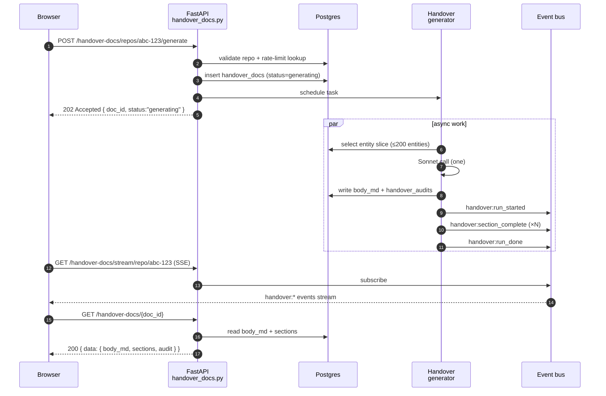
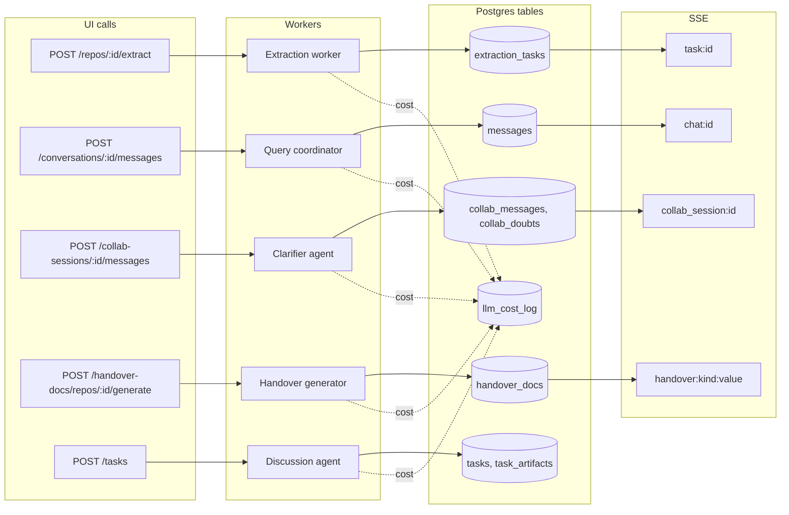

# 04 — API Surface

> **TL;DR.** Bifrost's HTTP surface is one FastAPI app at `/api/v1/*` (plus an unauthed `/health/*` and a separately-gated `/admin/*`). Every successful response is wrapped in `{ data, errors, meta }`. Every long-running operation publishes progress on Server-Sent Events through one of four channel families (`task:*`, `chat:*`, `collab_session:*`, `handover:*`). Every route needs a principal (trusted proxy, OIDC or a `bft_` API token) and mutating routes that change the corpus, spend in bulk, run code or write to Jira need the `admin` role; a signed `bifrost_session` cookie scopes per-browser ownership for chats and collab sessions.

> **Read this when** you're about to add a route, debug an SSE event that didn't arrive, or trace which DB tables a request actually writes to. **Skip if** you're looking for the *implementation* of a route's worker — that's chapter 05 (agents) or 06 (extraction pipeline).

> **Audience:** the owner who needs a same-day refresher on every endpoint Bifrost exposes — what it does, where it lives, and what fires when it's hit.

All routes are mounted at the prefix `/api/v1` by `src/bifrost/api/app.py`. The router composition lives in `src/bifrost/api/routes/__init__.py:39-69`:

- `api_router` — every group below; `IdentityMiddleware` requires a principal, and admin-only routes add `AdminOnly` on their decorator.
- `public_router` — health and auth routers; no principal needed so liveness probes and the identity gate work.
- `admin_router` — every route requires the `admin` role.

Every successful response is wrapped in `BifrostEnvelope` (`{ data, errors, meta }`); error responses use FastAPI's `HTTPException` shape.

---

## 0. Common patterns (read these once, skip on every route)

**Envelope shape.** Every success body is:
```json
{
  "data": { ... route-specific shape ... },
  "errors": [],
  "meta": { "request_id": "abc-123", "duration_ms": 42 }
}
```

**Error shape** (FastAPI's HTTPException):
```json
{ "detail": "human-readable error", "status_code": 4xx | 5xx }
```

**Idempotency.** Most mutating routes are non-idempotent — `POST /repos` twice with the same URL creates two `repos` rows (or 409s on uniqueness). The exceptions are *register-or-update* endpoints (`POST /repos/{id}/sync-ownership`, `POST /catalog/sync`) which are safe to retry.

**Cookies.** `bifrost_session` is set HTTP-only=false on the first POST to `/conversations` or `/collab-sessions`. Subsequent requests with the cookie inherit ownership of those threads. `max_age=1y`. There is no login UI — the cookie is the identity.

**Streaming.** Long-running operations return `202 Accepted` with a `task_id` (or `conversation_id`, etc.) and the caller subscribes to the matching SSE channel. See §19 for the four channel families.

**Reading the route lines.** Every route below cites a `path:line` — that's the FastAPI handler function. Search for the literal path string in the file if the line has drifted.

---

## 1. Mini request flow — how `POST /handover-docs/repos/{id}/generate` actually fires

A representative end-to-end sequence for one of the most write-heavy mutating routes:



Two takeaways: (1) writes happen *before* the 202 returns so the doc row exists; (2) the SSE subscription is independent of the work — the client can join late and reads buffered events.

---

## 2. Auth at a glance

| Layer | Source | Where applied | Header / cookie |
|-------|--------|---------------|-----------------|
| Principal | `identity.provider` (none, header, oidc_jwt) or a `bft_` token in `api_tokens` | `IdentityMiddleware`, every route outside health and auth | proxy headers, or `Authorization: Bearer <JWT or bft_ token>` |
| Role | `identity.roles`, token `roles`, or the `none` operator | `AdminOnly` on admin and mutating-corpus routes | n/a |
| `bifrost_session` cookie | server-set on first POST | conversations + collaboration | HTTP-only=false, max_age=1y, HMAC-signed; bare or badly signed values get a fresh session |

See `src/bifrost/api/auth/` and `src/bifrost/api/deps.py` for the wiring.

> **If you remember nothing else about §2.** Two roles (`member`, `admin`), one cookie. A 403 with `auth.role_required` means the route needs `admin`.

---

## 3. Health (`/health/*`)

Liveness + capability probes. Mounted on `public_router`, never authed — they're called by kubelets and the UI's `ClaudeCliBanner` before any auth state exists.

### `GET /health/detailed`
**Purpose:** Component-by-component health (DB connectivity, Claude CLI status, dry-run mode).
**Example request:** `curl http://localhost:8000/api/v1/health/detailed`
**Example response:**
```json
{ "data": { "ok": true, "components": { "db": "ok", "claude_cli": "ok", "dry_run": false } }, "errors": [], "meta": {} }
```
**Why it exists:** kube/ELB liveness; also surfaced in the UI `ClaudeCliBanner` so the operator sees "Claude CLI not logged in" before they hit a chat. (`src/bifrost/api/routes/health.py:21`.)

### `GET /health/claude-cli`
**Purpose:** Reports whether `claude auth status` succeeds. Uses a fast subprocess timeout to avoid hanging the probe if the CLI is mid-OAuth.
**Example response:** `{ "data": { "ok": true, "status": "authenticated", "message": "Logged in as ..." } }`
(`src/bifrost/api/routes/health.py:45`.)

---

## 4. Repos (`/repos`)

The registry of source-of-truth repositories Bifrost extracts from. Each registered repo gets a `repos` row, an extraction lifecycle, and (optionally) a `repo_ownership` row when a manifest (Backstage `catalog-info.yaml`, `CODEOWNERS` or a generic YAML file) syncs. File: `src/bifrost/api/routes/repos.py`.

### `POST /repos`
**Purpose:** Register a repo. Records `repo_url`, optional `org`/`org_repo_id`, and seeds a `repos` row plus a baseline `repo_freshness` row.
**Example request:**
```http
POST /api/v1/repos
{ "repo_url": "https://github.com/acmeco/dispatcher", "name": "dispatcher", "default_branch": "main" }
```
**Example response:**
```http
202 Accepted
{ "data": { "repo": { "id": "abc-123", "urn": "bifrost:repo:acmeco/dispatcher", "name": "dispatcher" }, "ownership_synced": true } }
```
**Side effects:** writes `repos`, `repo_freshness`; if a manifest is present the same call schedules a `RepoOwnership` sync. (`repos.py:42`.)

### `POST /repos/{repo_id}/sync-ownership`
**Purpose:** Re-read the repo manifest through the configured providers, update `RepoOwnership` rows.
**Side effects:** writes `repo_ownership`; emits no SSE. (`repos.py:96`.)

### `GET /repos`
**Purpose:** List every registered repo with freshness state and last task summary.
**Example response shape:** `{ data: [ { id, urn, name, freshness_state, last_task: { status, completed_at, cost_usd } } ] }`
(`repos.py:130`. Outputs `list[RepoSummary]`.)

### `GET /repos/{repo_id}`
**Purpose:** Repo detail (entity counts, freshness, ownership, last task).
**Outputs:** `RepoDetail`. (`repos.py:152`.)

### `DELETE /repos/{repo_id}`
**Purpose:** Deregister a repo. Soft-delete: cascades to a *deletion* of entities and ownership rows but preserves cost-log history. (`repos.py:184`.)

### `POST /repos/{repo_id}/extract`
**Purpose:** Trigger a fresh extraction for this repo. Submits an `ExtractionTask` and dispatches to the worker.
**Example request:** `POST /api/v1/repos/abc-123/extract` (no body)
**Example response:**
```http
202 Accepted
{ "data": { "task_id": "ext-789" } }
```
**Side effects:** writes `extraction_tasks`; the worker emits SSE events on `task:{task_id}`. (`repos.py:198`. Outputs `TriggerExtractionData`.)

### `GET /repos/{repo_id}/checkpoint`
**Purpose:** Returns the resume checkpoint (which extraction phases are completed for the latest task).
**Outputs:** `RepoCheckpointStatus`. (`repos.py:244`.)

> **If you remember nothing else about §4.** `POST /repos` is the front door; everything downstream (extraction, ownership, indexer state) hangs off the resulting `repos.id`.

---

## 5. Domains (`/domains`)

Logical groupings of repos. Used by the multi-repo handover scopes. A domain is a soft container — repos can move between domains without losing data. File: `src/bifrost/api/routes/domains.py`.

### `POST /domains`
**Purpose:** Create a new domain.
**Example request:** `POST /api/v1/domains  { "name": "delivery", "description": "Webhook delivery" }`
**Example response:** `{ "data": { "domain": { "id": "...", "urn": "bifrost:domain:delivery" } } }`
(`domains.py:32`. Inputs `CreateDomainRequest`; outputs `CreateDomainData`.)

### `GET /domains` & `GET /domains/{id}`
**Purpose:** List / fetch a domain. Detail includes attached repos.
(`domains.py:54` list; `:69` detail.)

### `PUT /domains/{id}` / `DELETE /domains/{id}`
**Purpose:** Update name/description / delete a domain. Delete is a soft-delete: detaches repos but preserves cost history.
(`domains.py:133` / `:156`.)

### `POST /domains/{id}/repos` / `DELETE /domains/{id}/repos/{repo_id}`
**Purpose:** Attach a repo to a domain (`repos.domain_id`) / detach.
(`domains.py:170` / `:376`.)

### `POST /domains/{id}/discover-repos`
**Purpose:** Find repos in the GitHub orgs from `sources.github.orgs` whose manifest names a team, then register the new ones and attach them to the domain. Existing repos with no domain are linked to this one. A repo already in another domain is reported under `errors` and not moved.

**Example request:** `{ "team": "delivery", "dry_run": true }`
**Example response:** `{ "data": { "dry_run": true, "candidates_found": 5, "added": [{ "full_name": "acmeco/dispatcher", "repo_id": null }], "linked": [...], "already_linked": [...], "errors": [...] } }`

With `dry_run: true` nothing is written and `repo_id` is null for repos that would be added. Team matching uses the providers in `manifest.providers`. (`domains.py`.)

---

## 6. Extraction Tasks (`/extraction-tasks`)

Lifecycle for the extraction-job machine — *the indexing tasks*, not the user-facing action layer. File: `src/bifrost/api/routes/extraction_tasks.py`.

> **Naming note:** this prefix used to be `/tasks` until the brief→task rename. The user-facing task layer (the "spec-driven action layer") is now mounted bare on the root router as `/tasks` (see §7). Keep the distinction sharp — they're two different routers and two different tables (`extraction_tasks` vs `tasks`).

### `POST /extraction-tasks`
**Purpose:** Submit an extraction task. Used by the worker; less commonly hit directly than `POST /repos/{id}/extract`.
**Example request:**
```http
POST /api/v1/extraction-tasks
{ "task_type": "full_extraction", "scope_json": { "repo_id": "abc-123" } }
```
(`extraction_tasks.py:23`.)

### `GET /extraction-tasks`
**Purpose:** List extraction tasks, filterable by `repo_id`, `status`. (`extraction_tasks.py:48`.)

### `GET /extraction-tasks/{id}`
**Purpose:** Detail with per-phase progress + the final ExtractionOutput when complete. (`extraction_tasks.py:74`.)

### `DELETE /extraction-tasks/{id}`
**Purpose:** Cancel a running task. Worker honors via the `CancellationToken`. (`extraction_tasks.py:96`.)

### `POST /extraction-tasks/{id}/pause` / `…/resume`
**Purpose:** Cooperative pause/resume between phases. Resume picks up from the last completed phase using the on-disk `ExtractionCheckpoint`.
(`extraction_tasks.py:123`, `:148`.)

### Streaming: `GET /tasks/{task_id}/stream`
**Purpose:** Server-Sent Events stream for extraction progress. Channel = `task:{task_id}`. Emitted events: `phase_started`, `phase_progress`, `phase_complete`, `partial_output`, `task_complete`, `task_error`.
**Example event payload:**
```
event: phase_started
data: {"phase":"D","phase_label":"Components","files_total":127}
```
**Auth:** inherits `api_router` gate. (`src/bifrost/api/routes/streaming.py:13`.)

---

## 7. Tasks — action layer (`/tasks/*`, `/quick`)

The **spec-driven action layer**: discuss → plan → execute → verify. The largest router by far (~2,300 lines). Routes are bare-prefix because they were the old `/briefs` namespace and the rename kept them stable. All task endpoints are envelope-wrapped. File: `src/bifrost/api/routes/tasks.py`.

### Lifecycle CRUD

| Method | Path | Line | Purpose |
|---|---|---|---|
| POST | `/intent/classify` | 130 | Run the Haiku intent router on a single message. Returns `{intent, confidence, reasoning, jira_key?, clarifying_question?}`. Used by the chat composer to surface inline "promote to Task" chips. |
| POST | `/tasks` | 145 | Create a task from a prompt or Jira link. Side effects: inserts `tasks` row, opens phase=`discussion`, schedules first agent run. |
| GET | `/tasks/stats` | 193 | Counts by state for the Tasks page header. |
| GET | `/tasks` | 256 | List tasks, filterable by `state`, `q` (full-text), `include_archived`, `archived_only`. |
| GET | `/tasks/{id}` | 331 | Detail incl. current phase + assumption count. |
| POST | `/tasks/{id}/advance` | 349 | Move state machine forward (e.g. `drafting_plan` → `verifying`). |
| POST | `/tasks/{id}/link` | 414 | Link a task to a Jira issue / PR / external entity. |
| POST | `/tasks/{id}/cancel` | 727 | Cancel an active task. |
| POST | `/tasks/{id}/archive` / `/unarchive` | 2158 / 2205 | Hide / restore. |
| POST | `/tasks/auto-archive` | 2250 | Sweep terminal tasks older than the auto-archive cutoff (retention). |

**Example: create a task.**
```http
POST /api/v1/tasks
{ "intent_text": "Add retry to FanoutService.get_status", "jira_key": "DLVR-1234" }

→ 202 Accepted
{ "data": { "task": { "id": "tsk-abc", "state": "discussing", "phases_total": 1 } } }
```
**Side effects:** inserts `tasks` + `task_phases` + `task_events`.

### Per-phase agents

| Method | Path | Line | Agent | Phase |
|---|---|---|---|---|
| POST | `/tasks/{id}/discuss` | 1242 | `discussion_agent` | discussion |
| POST | `/tasks/{id}/plan` | 1566 | `plan_agent` | drafting_plan |
| POST | `/tasks/{id}/execute` | 1764 | `executor` | executing |
| POST | `/tasks/{id}/verify` | 1936 | `verifier` | verifying |
| POST | `/tasks/{id}/plans/{plan_id}/debug` | 2038 | `debugger` | iteration |
| POST | `/tasks/{id}/plans/{plan_id}/retry` | 1805 | `executor` (retry) | executing |
| POST | `/tasks/{id}/gap-check` | 960 | `gap_detector` | discussion |

**Side effects (any of the above):** writes a new `task_artifacts` row (kind `context` / `plan` / `verify` etc.); appends to `task_events`; for `execute`, the worktree on disk is mutated and `task_plans.git_sha` populated when complete.

### Tools the agents call (REST entry points)

| Method | Path | Line | Tool | Notes |
|---|---|---|---|---|
| POST | `/tasks/{id}/tools/research` | 979 | `bifrost_research` | Spawn a research bundle for a sub-question; result writes to `task_research`. |
| POST | `/tasks/{id}/tools/extract` | 1014 | `bifrost_extract` | On-demand extraction for an unindexed repo. |
| POST | `/tasks/{id}/tools/ask-user` | 1041 | `bifrost_ask_user` | Open an `ask_back` row that the UI surfaces in the right rail. |

### Discoverable state

| Method | Path | Line | Purpose |
|---|---|---|---|
| GET | `/tasks/{id}/budget` | 945 | Current spend vs cost ceiling. |
| GET | `/tasks/{id}/ask-backs` | 1064 | Open + answered ask-back questions. |
| GET | `/tasks/{id}/clarifications` | 1115 | Clarification queue. |
| POST | `/tasks/{id}/clarifications/{cid}/answer` | 1159 | Resolve a clarification. |
| GET | `/tasks/{id}/extractions` | 1187 | What this task pulled out from research. |
| GET | `/tasks/{id}/phases` | 1280 | Audit history of phase transitions. |
| GET | `/tasks/{id}/artifacts` | 1319 | Versioned artifacts (context, plan, verify report). |
| GET | `/tasks/{id}/phases/{pid}/assumption-history` | 1389 | Per-phase assumption diff. |
| GET | `/tasks/{id}/plans` / `/verify-items` | 1598 / 1663 | Phase-specific lists. |
| GET | `/tasks/{id}/artifacts/{aid}/assumptions` | 1513 | Assumptions snapshot for an artifact version. |
| GET | `/tasks/{id}/execution-status` | 1866 | Worktree + run status. |
| GET | `/tasks/{id}/conversations` | 468 | Chat threads linked to this task (the chat→task hand-off). |
| GET | `/conversations/{cid}/tasks` | 518 | Reverse: tasks spawned from a chat thread. |

### Side actions

| Method | Path | Line | Purpose |
|---|---|---|---|
| POST | `/tasks/{id}/promote-message` | 645 | Promote a chat message to a Task input. |
| POST | `/tasks/{id}/artifacts/{aid}/approve` | 1704 | Mark artifact approved (humans signing off on an LLM plan). |
| POST | `/tasks/{id}/verify-items/{iid}/override` | 1966 | Force-pass a verify item ("I'll deal with it later"). |
| POST | `/tasks/{id}/create-pr` | 2005 | Run `pr.py` against the worktree. **Side effects:** writes a remote PR via `gh`. |
| POST | `/tasks/{id}/worktree/remove` | 1918 | Tear down a stale worktree. **Side effects:** filesystem mutation; updates `tasks.worktree_path = NULL`. |
| POST | `/tasks/{id}/enrich-from-jira` | 2121 | Pull Jira context via `actions/jira_enrich.py`. **Side effects:** writes Jira-derived `task_assumptions`. |
| POST | `/conversations/{cid}/spawn-task` | 557 | "Promote chat to Task" hand-off from QueryPage. **Side effects:** inserts `tasks` row pre-populated from the chat thread. |
| POST | `/quick` | 2074 | Run the quick-fix agent (small/trivial code change). Standalone — no Task row needed. **Side effects:** worktree mutation + `llm_cost_log` row; no `tasks`/`task_*` rows. |

> **If you remember nothing else about §7.** A Task is a state machine over `tasks` + `task_phases` + `task_artifacts` + `task_assumptions`. Per-phase routes invoke the agent for that phase and persist a new artifact version. `/quick` is the only path that bypasses the whole machine.

---

## 8. Conversations (`/conversations`)

Chat threads. Per-cookie ownership. The assistant response always streams via SSE — the POST returns immediately. File: `src/bifrost/api/routes/conversations.py`.

| Method | Path | Line | Purpose |
|---|---|---|---|
| POST | `/conversations` | 56 | Create a thread. Sets `bifrost_session` cookie if missing. |
| GET | `/conversations` | 80 | List threads scoped to the cookie. |
| GET | `/conversations/{id}` | 119 | Full thread detail (messages, scope, research state). |
| PATCH | `/conversations/{id}` | 171 | Rename / set title manually. |
| DELETE | `/conversations/{id}` | 205 | Soft delete. |
| POST | `/conversations/{id}/messages` | 239 | Append a user message. Returns immediately; the assistant response streams over SSE. **Side effects:** schedules `query_worker` which fans out to the research coordinator. |
| GET | `/conversations/{id}/stream` | 325 | SSE channel for assistant messages, research progress, citations. Channel: `chat:{conversation_id}`. |

**Example: send a chat message.**
```http
POST /api/v1/conversations/conv-123/messages
{ "content": "How does FanoutService route events to customer endpoints?" }

→ 202 Accepted
{ "data": { "conversation_id": "conv-123", "user_message_id": "msg-456" } }
```
Then subscribe to `GET /conversations/conv-123/stream` for events:
```
event: agent:repo_selected
data: {"repos":["dispatcher","delivery-gateway"]}

event: agent:research_done
data: {"repo":"dispatcher","cost_usd":0.18}

event: assistant:message
data: {"chunk":"FanoutService dispatches to..."}
```

---

## 9. Query (`/query`)

The synchronous one-shot path. Used by tooling / scripts; the UI uses `/conversations/{id}/messages` for chat ergonomics. File: `src/bifrost/api/routes/query.py`.

### `POST /query`
**Purpose:** Run a question against the research coordinator and return the answer synchronously (no SSE).
**Example request:**
```http
POST /api/v1/query
{ "question": "What does EndpointRouter do?", "repo_ids": ["abc-123"] }
```
**Example response shape:** `{ data: { answer_md, citations: [{type, urn, title}], confidence, ... } }`
**Side effects:** writes to `llm_cost_log` per Sonnet call. (`query.py:51`. Outputs `QueryAnswer`.)

---

## 10. Knowledge (`/knowledge`)

Read model the UI Knowledge page hangs off — the overview of what is indexed. File: `src/bifrost/api/routes/knowledge.py`.

### `GET /knowledge/repos`
**Purpose:** Every registered repo with freshness, ownership, latest task, entity-count rollup.
**Example response shape:** `{ data: { repos: [{ id, name, freshness, entity_counts: { COMPONENT: 42, FLOW: 8 }, last_task: {...} }] } }`
(`knowledge.py:91`. Outputs `KnowledgeOverview`.)

---

## 11. Entities (`/entities`)

Direct entity-graph access. The catch-all path `/entities/{urn:path}` exists because URNs contain `/`. File: `src/bifrost/api/routes/entities.py`.

| Method | Path | Line | Purpose |
|---|---|---|---|
| GET | `/entities/search` | 58 | Embedding + lexical hybrid search across entities (param: `q`, `repo_id?`). |
| GET | `/entities` | 87 | List entities by repo / type. |
| GET | `/entities/by-id/{eid}/relationships` | 107 | Outgoing + incoming `EntityRelationship` rows. |
| GET | `/entities/by-id/{eid}/source` | 179 | Source file + line range for an entity. |
| GET | `/entities/{urn:path}` | 247 | Detail by URN (catch-all path because URNs contain `/`). |

**Example: search.**
```http
GET /api/v1/entities/search?q=FanoutService&repo_id=abc-123

→ 200 OK
{ "data": { "results": [
  { "urn": "bifrost:repo:.../component:FanoutService", "name": "FanoutService",
    "score": 0.91, "confidence_level": "confirmed" }
]}}
```

---

## 12. Costs (`/costs`)

The Spend page lives off this. Source table: `llm_cost_log`. File: `src/bifrost/api/routes/costs.py:54`.

### `GET /costs/summary`
**Purpose:** Totals + grouped breakouts by model, phase, repo, plus a 7-day daily series.
**Inputs:** `?window=7d|30d|all` (default `30d`).
**Example response shape:**
```json
{ "data": {
  "total_usd": 142.31,
  "by_model": { "claude-sonnet-4-6": 137.20, "claude-haiku-4-5-20251001": 5.11 },
  "by_phase": { "D": 89.12, "E": 22.04, "agent": 31.15 },
  "daily": [{ "date": "2025-01-15", "usd": 12.4 }, ... ]
}}
```
**Implementation note:** Phase labels are mapped via `_phase_label()` (`A`→Triage, `D`→Components, etc.). Every Sonnet/Haiku CLI call records to this table via `extraction/cost.py::CostTracker.record()`.

---

## 13. Indexer (`/indexer`)

Per-repo indexer state for external sources (Confluence / Jira / GitHub / Slack). File: `src/bifrost/api/routes/indexer.py`.

| Method | Path | Line | Purpose |
|---|---|---|---|
| POST | `/indexer/repos/{repo_id}` | 46 | Kick off external-source indexing for one repo. |
| POST | `/indexer/all` | 84 | Background-fan-out for every registered repo. |
| GET | `/indexer/status` | 117 | Last-sync state per (repo, source) pair. |

**Side effects of `POST /indexer/repos/{id}`:** writes `confluence_pages` / `jira_issues`, plus an `external_sync_log` row per source.

---

## 14. Catalog (`/catalog`)

Org-wide catalog mirror. One row per repo in the GitHub orgs listed in `sources.github.orgs`, populated by the catalog sync. File: `src/bifrost/api/routes/catalog.py`.

| Method | Path | Line | Purpose |
|---|---|---|---|
| GET | `/catalog/summary` | 54 | Org / domain / team counts. |
| GET | `/catalog` | 91 | The flat row list (one per `OrgRepo`). |
| POST | `/catalog/sync` | 131 | Re-fetch the org catalog (`research/org_catalog.py`). Returns counts + top diffs. |

**Side effects of `POST /catalog/sync`:** writes `org_repos` rows; non-destructive — existing rows are upserted with manifest deltas merged.

---

## 15. Collaboration (`/collab-sessions`)

Cross-team feature requests. Cookie-scoped per-browser ownership, same as conversations. File: `src/bifrost/api/routes/collaboration.py`.

| Method | Path | Line | Purpose |
|---|---|---|---|
| POST | `/collab-sessions` | 77 | Open a new session. Body has the requirement + scope. Cookie `bifrost_session` set if absent. |
| GET | `/collab-sessions` | 116 | List sessions for this cookie. |
| GET | `/collab-sessions/{id}` | 146 | Full detail: messages + open/resolved doubts + artifacts. |
| POST | `/collab-sessions/{id}/messages` | 173 | Append a requester message. **Side effects:** runs the **clarifier** agent inline (or fallback message on LLM error); inserts both the user message and the agent response; emits `agent:running` / `agent:done` over SSE; persists new doubts and resolved-doubt indices. |
| POST | `/collab-sessions/{id}/doubts/{did}/resolve` | 217 | Resolve / escalate / mark-as-doc-answered a single doubt. Body carries `status`, `resolution_md`, optional `escalation_target`. If `BIFROST_SLACK_ESCALATION_CHANNEL` and `BIFROST_SLACK_BOT_TOKEN` are set and `status=escalated`, the session also fires `slack_escalation.post_escalation_to_slack`; a Slack failure returns 502 with code `slack.escalation.post_failed`. |
| POST | `/collab-sessions/{id}/close` | 395 | Close a session. **Side effects:** runs the **synthesizer** agent → writes `<handovers_dir>/sessions/<sid>/brief.md`, inserts a `collab_artifacts` row, transitions state `resolved` → `briefed`. |
| POST | `/collab-sessions/{id}/reopen` | 436 | Reopen a closed/briefed session. |
| GET | `/collab-sessions/{id}/stream` | 469 | SSE for the session: `agent:running`, `agent:done`, `session:updated`, `message:appended`, `doubt:resolved`. Channel: `collab_session:{id}`. |
| GET | `/collab-sessions/{id}/brief.md` | 579 | Streamed Markdown download of the session brief artifact. |

**Example: open a session.**
```http
POST /api/v1/collab-sessions
{ "requirement_text": "We need to add retry backoff to the dispatcher.", "scope": { "kind": "domain", "value": "delivery" } }

→ 201 Created
{ "data": { "session": { "id": "cs-abc", "state": "open" } } }
```

---

## 16. Handover Docs (`/handover-docs`)

Generated team handover documents. Second largest router after tasks (~1,400 lines). Four scope kinds: repo / domain / team / region. Multi-repo scopes use tree decomposition above 5 repos (`_TREE_THRESHOLD=5`). File: `src/bifrost/api/routes/handover_docs.py`.

### List + read

| Method | Path | Line | Purpose |
|---|---|---|---|
| GET | `/handover-docs` | 151 | Index of all handover docs, scoped by `kind` and `q`. |
| GET | `/handover-docs/search` | 215 | tsvector full-text search across handover bodies. |
| GET | `/handover-docs/{id}` | 277 | Detail (body_md, sections, audit metadata). |

### Cost preview

| Method | Path | Line | Scope |
|---|---|---|---|
| GET | `/handover-docs/repos/{repo_id}/estimate` | 305 | repo |
| GET | `/handover-docs/domains/{did}/estimate` | 324 | domain |
| GET | `/handover-docs/teams/{squad}/estimate` | 343 | team (`{squad}` is the owning team name) |
| GET | `/handover-docs/regions/{region}/estimate` | 366 | region |

Each returns a `CostEstimateData` so the UI can show an *estimated $X for this generation* gate before the user authorizes the spend (cost ceiling).

**Example response:** `{ data: { estimate_usd: 4.20, child_count: 8, will_use_tree_decomposition: true } }`

### Generate

| Method | Path | Line | Side effects |
|---|---|---|---|
| POST | `/handover-docs/repos/{repo_id}/generate` | 391 | Single Sonnet call → `docs/handovers/repos/<slug>/index.md` + `handover_docs` row. |
| POST | `/handover-docs/domains/{did}/generate` | 451 | Multi-repo: tree-decomposition above 5 repos, pooled below. |
| POST | `/handover-docs/teams/{squad}/generate` | 507 | Team scope. |
| POST | `/handover-docs/regions/{region}/generate` | 565 | Geographic scope. |

All four enforce per-cookie rate limit (`handover_rate_limit_per_minute`). Multi-repo scopes also validate against `handover_max_cost_usd` unless `?force=true`.

**Example: generate one repo handover.**
```http
POST /api/v1/handover-docs/repos/abc-123/generate

→ 202 Accepted
{ "data": { "doc_id": "hd-xyz", "scope_kind": "repo", "scope_value": "abc-123", "status": "generating" } }
```
Then subscribe to `GET /handover-docs/stream/repo/abc-123` for `handover:run_started` → `handover:section_complete` → `handover:run_done`.

### Loop-back + edit

| Method | Path | Line | Purpose |
|---|---|---|---|
| GET | `/handover-docs/{id}/candidates` | 703 | Doubt candidates clustered from collab sessions (loop-back). Threshold: `occurrence_count >= 3`. |
| GET | `/handover-docs/{id}/audit` | 741 | `handover_audits` log of who read/edited what. |
| GET | `/handover-docs/{id}/history` | 782 | Body-version history for the diff viewer. |
| POST | `/handover-docs/{id}/promote-candidate` | 827 | Promote a doubt cluster → handover section addition. |
| PATCH | `/handover-docs/{id}/body` | 918 | Hybrid LLM-or-human override edit. Snapshots prior body to `handover_body_history`. |
| POST | `/handover-docs/{id}/sections/{key}/regenerate` | 1034 | Per-section regen — keeps untouched sections stable, re-pulls just the named section. |
| DELETE | `/handover-docs/{id}` | 1176 | Archive a handover (soft delete; sets `archived_at`). |
| POST | `/handover-docs/{id}/restore` | 1222 | Unarchive. |
| POST | `/handover-docs/bulk/refresh-stale` | 1264 | Re-generate every stale handover for an org/domain in one call. |

**Example: PATCH the body.**
```http
PATCH /api/v1/handover-docs/hd-xyz/body
{ "mode": "llm_revise", "instruction": "Tighten the executive summary to 2 paragraphs." }

→ 200 OK
{ "data": { "body_md": "...", "version": 4 } }
```
**Side effects:** snapshots prior body to `handover_body_history`; appends `handover_audits` row with `event_type: edited`.

### Streaming

| Method | Path | Line | Purpose |
|---|---|---|---|
| GET | `/handover-docs/stream/{kind}/{value}` | 1403 | SSE for in-flight handover generation. Events: `handover:run_started`, `handover:child_done`, `handover:section_complete`, `handover:run_done`. Channel: `handover:{kind}:{value}`. |

> **If you remember nothing else about §16.** The four `/estimate` endpoints exist because multi-repo handovers can run away on cost. The hard ceiling is `BIFROST_HANDOVER_MAX_COST_USD` (default $10). `?force=true` is the operator's bypass.

---

## 17. Extract (`/extract`)

A thin shim. Used by the action layer's `bifrost_extract` tool to trigger an extraction without going through `/repos/{id}/extract`. File: `src/bifrost/api/routes/extract.py:16`.

### `POST /extract`
**Purpose:** A non-repo-specific extraction endpoint; commonly used by the action layer's `bifrost_extract` tool. Body identifies the target repo + optional file-path constraints.
**Example request:**
```http
POST /api/v1/extract
{ "repo_id": "abc-123", "file_paths": ["src/orders.py"] }
```
**Outputs:** `TriggerExtractionData { task_id }`. (Same envelope as `/repos/{id}/extract`.)

---

## 18. Feedback (`/feedback`)

Thumbs-up/down + free text scoped to a chat turn or task artifact. Drives the learning loop in `actions/learning.py`. File: `src/bifrost/api/routes/feedback.py:16`.

### `POST /feedback`
**Body:** `SubmitFeedbackRequest { target_kind, target_id, rating, comment? }`
**Example request:**
```http
POST /api/v1/feedback
{ "target_kind": "chat_message", "target_id": "msg-456", "rating": "down", "comment": "Cited the wrong repo" }
```
**Side effects:** writes a `feedback` row; nothing immediate, but the learning loop sweeps these into `agent_judgements` updates.

---

## 19. Admin (`/admin/*`)

Every route requires the `admin` role. File: `src/bifrost/api/routes/admin.py`.

### Embedding maintenance

| Method | Path | Line | Purpose |
|---|---|---|---|
| POST | `/admin/embed/entities` | 62 | Backfill entity embeddings; `?force=1` to re-embed. |
| POST | `/admin/embed/confluence` | 91 | Confluence pages. |
| POST | `/admin/embed/jira` | 115 | Jira issues. |

### Cross-repo + community structure

| Method | Path | Line | Purpose |
|---|---|---|---|
| POST | `/admin/link-cross-repo` | 162 | Run the cross-repo entity linker (`research/cross_repo_linker.py`). |
| POST | `/admin/rebuild-communities` | 194 | Rebuild Louvain entity communities (`research/communities.py`). |
| POST | `/admin/index-services` | 258 | Build the service graph (services, team domains, `depends_on` / `calls_service` / `publishes_to` / `shares_topic` edges) from repo manifests. Query `include_catalog=false` to skip catalog-only repos. |

### Learning / agent quality

| Method | Path | Line | Purpose |
|---|---|---|---|
| POST | `/admin/learning/confirm` | 333 | Confirm an LLM judgement (positive feedback). |
| POST | `/admin/learning/contradict` | 364 | Contradict an LLM judgement (negative feedback → cascade revisions). |
| GET | `/admin/learning/deltas` | 394 | Delta history. |
| GET | `/admin/learning/pending-upgrades` | 415 | Tier upgrades waiting for human approval. |
| GET | `/admin/learning/judgements` | 427 | Recent judgements log. |
| GET | `/admin/learning/stats` | 446 | Learning loop stats. |
| POST | `/admin/cleanup/placeholder-squads` | 466 | Sweep placeholder team names (those listed in `conventions.placeholder_teams`) left over from manifest stubs. |
| GET | `/admin/agent-quality` | 576 | Agent quality dashboard data (`actions/agent_quality.py`). |

> **If you remember nothing else about §19.** Admin endpoints can mutate confidence values en masse — `link-cross-repo` and `rebuild-communities` rewrite large parts of the entity graph. Always check the dry-run docs before firing in prod.

---

## 20. Streaming (the four SSE channels)

Bifrost has four distinct SSE channel families, each emitted from the in-process event bus (`bifrost.api.sse.event_bus`):

| Channel | Producer | Consumer | Events |
|---------|----------|----------|--------|
| `task:{task_id}` | `extraction/worker.py` | `tasks/{id}` UI page | `phase_started`, `phase_progress`, `phase_complete`, `partial_output`, `task_complete`, `task_error` |
| `chat:{conversation_id}` | `query_worker` (research coordinator) | `query` page | `agent:repo_selected`, `agent:research_started`, `agent:research_done`, `assistant:message`, `assistant:citation` |
| `collab_session:{session_id}` | `collaboration/events.py` | `collaboration/sessions/:id` UI | `agent:running`, `agent:done`, `session:updated`, `message:appended`, `doubt:resolved` |
| `handover:{kind}:{value}` | `collaboration/handover_generator.py` | handovers list / detail | `handover:run_started`, `handover:child_done`, `handover:section_complete`, `handover:run_done` |

All endpoints are `text/event-stream` with the standard `data: {json}\n\n` framing. Streams stay open for the duration of the work, then send a terminal event before closing. Reconnect logic is on the client (the UI uses `lib/sse.ts`).

> **If you remember nothing else about §20.** Channel naming is `{family}:{id}` — search the bus for the literal channel string when something doesn't arrive. The producer is in-process, so a missing event is almost always a missing `await event_bus.publish(...)` call somewhere in the worker.

---

## 21. Mermaid: route → side-effect map



---

## 22. Things you'll wish you knew

- **Two `/tasks` routers exist.** `extraction-tasks` for indexing jobs, bare `/tasks/*` for the action layer. Search for the literal path before grepping by name.
- **Cookies are how anonymity-mode auth works.** No login UI; the `bifrost_session` cookie scopes conversations + collab sessions per browser. Same model both places.
- **Every route needs a principal.** Under `identity.provider: none` the local operator (loopback only) is an admin; under `header` and `oidc_jwt` admin comes from `identity.roles`.
- **Scripts use `bft_` tokens.** `bifrost token new` prints one; list its sha256 under `api_tokens`.
- **Cost is the bottleneck on multi-repo handovers.** All four `/estimate` endpoints exist precisely so the UI shows the price tag before the spend. The hard ceiling is `BIFROST_HANDOVER_MAX_COST_USD` (default $10).
- **`/quick` skips the Task lifecycle.** The action layer's "two-second fix" path. No phases, no artifacts; just one Sonnet call + an inline diff.
- **SSE events buffer.** A late subscriber (e.g. browser refresh mid-generate) gets the buffered events, not a stale snapshot. The terminal event is what tells the client to stop listening.
