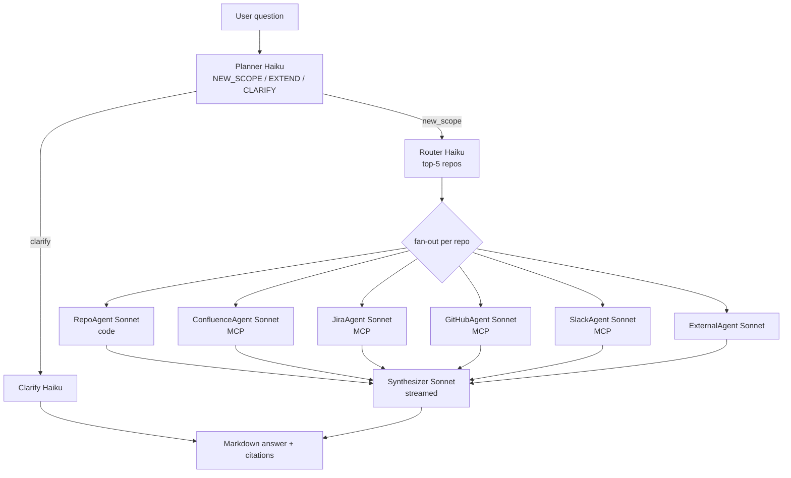

# 05 — Agents Inventory

> **TL;DR.** Bifrost runs ~25 LLM agents grouped into five families: extraction-pipeline (A→I), research/chat (router + per-source fan-out + synthesiser), action-layer (discuss → plan → execute → verify → debug), collaboration (clarifier + synthesiser + handover authors), and utility classifiers (intent, planner, scope-matcher). Three logical models do all the work: **Haiku** for cheap classification, **Sonnet** for reasoning + writing, and **MiniLM-384** locally for embeddings. Every call goes through a `claude -p` subprocess — there is no API-key path. Every successful call is recorded to `llm_cost_log`, which the Spend page rolls up.

> **Read this when** you're: tracking down which agent emitted a given message, sizing the cost of a feature that adds an LLM call, or deciding which agent to extend instead of writing a new one. **Skip if** you only need to look up *what one route does* — that's chapter 04.

---

## 0. Models in play

Bifrost runs against **three logical models** configured via `BifrostSettings` (`src/bifrost/cli/config.py:46-48`):

| Setting | Default | Used by |
|---|---|---|
| `triage_model` | `claude-haiku-4-5-20251001` | Haiku — Phase A triage, intent routing, scope matching, planner classification, quick-fix path |
| `extraction_model` | `claude-sonnet-4-6` | Sonnet — Phases D–I of extraction (components, flows, dependencies, relationships, knowledge index, confidence) |
| `agent_model` | `claude-sonnet-4-6` | Sonnet — every reasoning agent (research, action layer, collaboration) |

All calls go through `ClaudeLlmClient` (`src/bifrost/extraction/cli_client.py`), which spawns a `claude -p` subprocess and parses its NDJSON output. **There is no API-key path** — auth is whatever your Claude login (`claude auth login`) provides. Only `extraction_probe/agent.py` builds an `anthropic` client, from `ANTHROPIC_API_KEY`.

Every successful call records to `llm_cost_log` via `extraction/cost.py::CostTracker.record()`. The Costs page rolls these up.

> **If you remember nothing else about §0.** One auth path (`claude auth login`), one cost ledger (`llm_cost_log`), one model knob per family (`triage_model` / `extraction_model` / `agent_model`).

---

## 0.5 Taxonomy + fan-out diagram

The five agent families and how they relate at runtime:

| Family | Where they live | Lifetime | Inherits user MCP? |
|---|---|---|---|
| Extraction pipeline | `src/bifrost/extraction/` | Per-extraction-task, in-process worker | No — runs in a closed subprocess |
| Research / chat | `src/bifrost/research/` | Per chat turn, fans out concurrently | **Yes** for Confluence / Jira / GitHub / Slack agents (they call MCP tools); No for code-only agents |
| Action layer | `src/bifrost/actions/` | Per Task, sequential phases | Mixed: discuss/plan/verify/debug = no MCP; execute = inherits Claude Code's worktree-scoped tools |
| Collaboration | `src/bifrost/collaboration/` | Per session / per generate | Clarifier inherits MCP indirectly via handover-doc context; synthesiser does not |
| Utility classifiers | scattered | One-shot, sub-second | No |



**MCP-inheritance security note.** Any agent marked "MCP" above runs the user's authenticated `mcp__atlassian__*`, `mcp__github__*`, or `mcp__claude_ai_Slack__*` tools. That means the bill (and the read-permissions exposure) is *the user's*, not Bifrost's. Code-only agents (RepoAgent, executor, verifier) explicitly do **not** inherit user MCP — they get a tightly scoped tool set against the local clone or the worktree.

> **If you remember nothing else about §0.5.** The chat answer is one Haiku call followed by N parallel Sonnet calls (capped at 5 repos × ~5 source agents = ~25 max), then one Sonnet synthesiser call to merge. That's where chat cost lives.

---

## 1. Extraction pipeline agents

The **A → I** phase pipeline. Code: `src/bifrost/extraction/pipeline.py` + `src/bifrost/extraction/prompts.py` (~970 lines of pure prompt strings).

> **Why phase letters skip B/C:** the spec assigned `B` and `C` to clone-and-list operations that happen *outside* the LLM pipeline (the GitAdapter handles them). The pipeline class never sees them; the letters were preserved so phase labels in cost charts and the database stay legible. (Comment block at `pipeline.py:1-15`.)

### 1.1 Phase A — Triage agent

**Purpose:** Classify every file path in the cloned repo into one of seven categories so Phases D–I only burn Sonnet cycles on files that matter.
**Model:** **Haiku** (`triage_model`).
**System prompt sketch** (greppable as `TRIAGE_SYSTEM_PROMPT`):
```
You are a code file classifier for an engineering knowledge system.
Classify each file path into one of these categories:
- component_definition: main source files defining modules, services, classes, handlers
- interface_definition: API specs, protobuf, OpenAPI, Avro, GraphQL schemas
- configuration: build configs, deployment manifests, k8s YAML, env configs
- test, generated, documentation, dependency_manifest, irrelevant
For each file, also estimate likely_key_component: true | false
```
**Output schema:** `{ files: [{ path, category, reason, likely_key_component }] }` parsed against `TRIAGE_TOOL_SCHEMA`.
**Called from:** First step of `ExtractionPipeline.run()` — runs unconditionally (`extraction/triage.py`, 135-line core).
**Inherits MCP:** No.
**Cost target:** **~$0.02 per repo** — Haiku is cheap; this is the optimization that makes extraction affordable.
**Failure mode:** Falls back to extension-based heuristics in `should_exclude_path()`.

**Pre-LLM filtering.** `should_exclude_path()` and pattern rules reject obvious files (`.png`, `node_modules/`, `.lock`, `.min.js`) *before* the LLM ever sees them. The LLM only judges ambiguous cases — most files in typical codebases never reach it.

(Source: `prompts.py:255`.)

### 1.2 Phase D — Component extraction

**Purpose:** For each prioritized file, extract logical software components (classes, modules, services, handlers) with purpose + exported interfaces + internal dependencies.
**Model:** **Sonnet** (`extraction_model`).
**System prompt sketch** (greppable as `COMPONENT_SYSTEM_PROMPT`):
```
You are a software architecture analyst extracting component knowledge from source code.
For each source file, identify the logical software components and extract:
component_name, component_type (module|service|library|package), purpose,
exported_interfaces, internal_dependencies, known_gaps.
Rules: one file may contain multiple components; a component may span multiple files;
confidence is always "inferred" for freshly extracted entities; do NOT invent.
```
**Output schema:** `ExtractedComponent[] { component_name, component_type, purpose, source_file, exported_interfaces[], internal_dependencies[], known_gaps[] }`.
**Called from:** `pipeline.py::_extract_components()` and `_extract_components_batch()`.
**Inherits MCP:** No.
**Concurrency:** `PHASE_D_CONCURRENCY = 5` (semaphore). Files ≤ 3,500 chars are packed in groups of 5; larger files go solo. Cuts subprocess spawn overhead by ~70%.
**Retry:** 3 attempts with exponential backoff (`MAX_RETRIES=3`, `BACKOFF_SECONDS=(1,2,4)`) on transient errors.
**Cost target:** **~$0.05–0.20 per file**. 200-file repo ≈ **$10–30**.
**Failure mode:** Per-file errors append to `output.errors`; Phase E still runs.

(Source: `prompts.py:343`.)

### 1.3 Phase E — Flow extraction

**Purpose:** Produce sequence-of-steps flows for entry-point files (controllers, handlers, jobs) so the knowledge graph captures *how* the code is used end-to-end.
**Model:** **Sonnet**.
**Output schema:** `ExtractedFlow[] { flow_name, flow_type, segments[{component_name, segment_type, description, order}] }`.
**Called from:** `pipeline.py::_extract_flows()` after Phase D produces components; runs only on files marked `likely_key_component`.
**Inherits MCP:** No.
**Concurrency:** `PHASE_E_CONCURRENCY = 3`, per-call timeout 90 s.
**Pre-filter:** `_has_flows_worth_extracting()` skips enum-only / pure-data files (no branches, no loops, no awaits) — was hanging the LLM on POJOs before this guard landed.
**Cap:** "≤3 flows, ≤6 segments per flow" enforced by prompt + schema.
**Cost target:** **~$0.10–0.30 per entry-point file**. Repo with 5–10 entry points ≈ **$2–5**.
**Why it was the slow phase:** 30-min tail on big repos until parallelization cut wall-clock to ~10 min.

(Source: `prompts.py:462`.)

### 1.4 Phase F — Dependency extraction

**Purpose:** Parse manifests (package.json, pom.xml, build.gradle, requirements.txt) and source imports into typed dependency edges.
**Model:** **Sonnet**.
**Output schema:** `ExtractedDependency[] { source_name, target_name, dep_type, discovery_method, description }`. `discovery_method` ∈ `import` | `manifest` | `runtime` | `inferred`.
**Called from:** `pipeline.py` after Phase D; runs over `dependency_manifest`-classified files.
**Inherits MCP:** No.
**Cost target:** **~$0.05 per manifest file**.

(Source: `prompts.py:580`.)

### 1.5 Phase G — Relationship synthesis

**Purpose:** Cross-reference all components + flows + dependencies extracted in D/E/F to surface relationships that no single file can show alone.
**Model:** **Sonnet**.
**Output schema:** `ExtractedRelationship[] { source_urn, target_urn, relationship_type, description, evidence }`.
**Called from:** `pipeline.py` after D, E, F all complete; reads their outputs as input.
**Inherits MCP:** No.
**Why it's a separate call:** Cross-references emerge only from the union; per-file extraction can't see them.
**Cost target:** **~$0.50–2 per repo** (one big call).

(Source: `prompts.py:690`.)

### 1.6 Phase H — Knowledge index

**Purpose:** Compress every entity into a ≤5K-token, search-friendly summary so downstream agents can fan over the entire repo cheaply.
**Model:** **Sonnet**.
**Output schema:** `KnowledgeIndexEntry[] { entity_urn, summary, key_facts[], search_keywords[] }`.
**Called from:** `pipeline.py` after Phase G.
**Inherits MCP:** No.
**Cost target:** **~$0.30–1 per repo**.

(Source: `prompts.py:792`.)

### 1.7 Phase I — Confidence scoring

**Purpose:** Assign `low | medium | high` confidence to every extracted entity per the canonical S3 ConfidenceLevel enum.
**Model:** **Sonnet**.
**Output schema:** `ConfidenceScore[] { entity_urn, confidence_level, confidence_score, reason }`.
**Called from:** Final step of `ExtractionPipeline.run()`.
**Inherits MCP:** No.
**Cost target:** **~$0.30 per repo**.

(Source: `prompts.py:880`. Maps to ConfidenceLevel canonical enum from spec S3.)

### 1.8 Pipeline-wide guarantees

- **Canary tokens.** Every prompt embeds a random `BIFROST-CANARY-<hex>` token. After parsing, `validate_canary()` checks the *parsed JSON output* (not the assistant text — too many false positives) for echo. Echo = possible prompt injection, logs a warning. (`prompts.py:17-28`, `pipeline.py:414`.)
- **Content size limit.** `MAX_CHARS_PER_CALL = 200,000` (~50K tokens). Exceeding this throws `ContentTooLargeError` *before* the LLM sees anything. (`prompts.py:33-35`.)
- **Cost recording.** Every `_run_phase_call()` calls `_record_cost()` which writes to `llm_cost_log`. The CLI's `total_cost_usd` field is preferred over our local price-table estimate. (`pipeline.py:364-381`.)

> **If you remember nothing else about §1.** Phase D dominates the bill on real repos because it scales linearly with file count. Triage exists *because* of this — the pre-filter is what keeps a fresh extraction in the $15–50 range instead of $100+.

---

## 2. Research / chat agents

The chat product. Path: `src/bifrost/research/`. The **Coordinator** orchestrates the rest.

### 2.1 Coordinator (synthesis agent)

**Purpose:** Fan-in step — merge per-repo + per-source reports + scope subgraph into a streamed Markdown answer with footnote citations.
**Model:** **Sonnet** (`agent_model`).
**System prompt sketch** (greppable as `_SYNTHESIS_SYSTEM_PROMPT`):
```
You are a senior staff engineer writing the definitive answer to a co-worker's
engineering question by synthesising evidence from multiple specialized research
agents + a graph of pre-extracted entities.
HARD RULES:
1. Every non-trivial factual claim MUST have a GFM footnote citation.
2. Prefer URNs from the Evidence block over vague repo-name citations.
3. Follow this EXACT structure: ### TL;DR / ### End-to-end flow / ...
```
**Output:** Streamed Markdown answer with inline citation chips. The text is parsed loosely; structure is enforced by the prompt, not a JSON schema.
**Called from:** Last step of `coordinator.py::run_research()` — per chat turn.
**Inherits MCP:** No.
**Cost target:** **~$0.05–0.30 per chat turn**.
**Failure mode:** Returns a fallback "couldn't synthesize" message; per-repo reports are still surfaced.

(Sources: `coordinator.py:526` and `:639`. The `:639` block extends the base prompt with `CODE_IS_TRUTH_POLICY`, `DIAGRAM_RULES_BLOCK`, and a continuity rule for follow-up turns.)

### 2.2 Router (repo selector)

**Purpose:** Given a question + the candidate repo list (capped at 200), rank each `high | medium | low | none` so the coordinator can fan out to the top 5.
**Model:** **Haiku** (`triage_model`).
**System prompt sketch** (greppable as `_ROUTER_SYSTEM_PROMPT`):
```
You are a routing classifier for an engineering-knowledge system.
Given a user question and a list of repositories with their summaries,
decide which repos are likely to contain information relevant to the question.
Err on the side of INCLUSION when uncertain — the downstream system has a
hard cap on how many repos it investigates.
For each repo, pick exactly one relevance label: high / medium / low / none.
When a repo is flagged [primary], treat it as the canonical service repo for its team.
```
**Output schema:** `[{ repo_id, relevance: high|medium|low|none, reason }]` — `_ROUTER_SCHEMA`.
**Called from:** `router.py:158` — after question scoping; fed candidate repo list with summaries.
**Inherits MCP:** No.
**Cap:** `MAX_REPOS_PER_QUESTION = 5` survives the cut.
**Cost target:** **~$0.005–0.01 per question**.

(Source: `research/router.py:52`.)

### 2.3 Per-repo research agent

**Purpose:** For one repo, answer "what does THIS repo do toward the user's question?" using Grep+Read against the local clone with a strict turn budget.
**Model:** **Sonnet**.
**System prompt sketch** (greppable as `_REPO_AGENT_SYSTEM_PROMPT`):
```
You are a research agent for ONE repository. STRICT turn budget — hard cap on
tool calls; exceed it and you emit NOTHING.
PRIMARY JOB: relevance + role_in_answer + key_components(2-4) + key_flows(1-2)
+ key_files(2-4) + evidence.
OPTIONAL BONUS (only if 4+ turns left): 1-3 edge_verifications + missed_edges.
STRICT TURN DISCIPLINE: max 8 tool calls; turn 9-10 MUST emit StructuredOutput.
NEVER Read the same file twice.
```
**Output schema:** `RepoReport { relevance, role_in_answer, key_components[], key_flows[], key_files[], evidence, gaps[], edge_verifications[], missed_edges[] }`.
**Called from:** `repo_agent.py:362` — per high-relevance repo, in parallel after the router.
**Tools:** `Grep`, `Read` against the local clone — strict turn budget (8 max).
**Inherits MCP:** No (code-only).
**Cost target:** **~$0.10–0.50 per repo**.
**Failure mode:** Returns `relevance="none"` with `error` populated; coordinator drops it from synthesis.

(Source: `research/repo_agent.py:119`.)

### 2.4 Confluence agent

**Purpose:** Search the repo's Confluence space for runbooks, ADRs, post-mortems, onboarding docs that answer the user's question.
**Model:** **Sonnet**.
**System prompt sketch** (greppable as `_CONFLUENCE_SYSTEM_PROMPT`):
```
You are a Confluence research agent for ONE specific repository.
Tools: mcp__atlassian__searchConfluenceUsingCql (PRIMARY), getConfluencePage, getConfluenceSpaces.
Strategy: start with CQL scoped to repo's space; if scoped search returns nothing,
broaden the TEXT QUERY but KEEP the space filter — never company-wide.
```
**Output schema:** `ConfluenceReport { relevance, summary, citations[{title, url}] }`.
**Called from:** `confluence_agent.py:47` — per repo, parallel with repo_agent if Confluence pages are indexed.
**Inherits MCP:** **Yes** — `mcp__atlassian__*` tools.
**Cost target:** **~$0.05–0.20 per repo**.

### 2.5 Jira agent

**Purpose:** Find Jira epics/stories/bugs/incidents for the repo's project key that bear on the user's question.
**Model:** **Sonnet**.
**System prompt sketch** (greppable as `_JIRA_SYSTEM_PROMPT`):
```
You are a Jira research agent for ONE specific repository.
Tools: mcp__atlassian__searchJiraIssuesUsingJql (PRIMARY), getJiraIssue.
Strategy: scoped JQL using project key; expand only if scoped returns nothing.
```
**Output schema:** `JiraReport { relevance, summary, citations[{key, url, status}] }`.
**Called from:** `jira_agent.py:51` — per repo if Jira issues are indexed.
**Inherits MCP:** **Yes** — `mcp__atlassian__*` tools.
**Cost target:** **~$0.05–0.15 per repo**.

### 2.6 GitHub agent

**Purpose:** Surface RECENT and RELEVANT PRs/issues/discussions — activity signal that complements static code analysis.
**Model:** **Sonnet**.
**System prompt sketch** (greppable as `_GITHUB_SYSTEM_PROMPT`):
```
You are a GitHub activity research agent for ONE specific repository.
Tools: mcp__github__list_pull_requests, get_pull_request, list_issues, get_issue.
Job: surface what changed recently and what bugs are open — these only live on GitHub.
```
**Output schema:** `GitHubReport { relevance, summary, citations[{pr_number, title, state}] }`.
**Called from:** `github_agent.py:59` — per repo, when GitHub PRs are indexed.
**Inherits MCP:** **Yes** — `mcp__github__*` tools.
**Cost target:** **~$0.05 per repo**.

### 2.7 Slack agent

**Purpose:** Surface relevant Slack conversations from the repo's team channel.
**Model:** **Sonnet**.
**Output schema:** `SlackReport { relevance, summary, citations[{channel, ts, permalink}] }`.
**Called from:** `slack_agent.py:52` — per repo if Slack channels are indexed for the team.
**Inherits MCP:** **Yes** — `mcp__claude_ai_Slack__*` tools.
**Cost target:** **~$0.05 per repo**.

### 2.8 External agent

**Purpose:** Pull in cached snippets from external sources (e.g. third-party API docs) when internal sources alone can't answer.
**Model:** **Sonnet**.
**Output schema:** `ExternalFindings { summary, citations[] }`.
**Called from:** `external_agent.py:55` — when the question can't be answered from internal sources alone.
**Inherits MCP:** No.
**Cost target:** **~$0.05–0.10 per question**.

### 2.9 Planner (follow-up classifier)

**Purpose:** Decide whether a non-first chat turn needs fresh research, an extension of the prior bundle, or just a clarify pass over the prior answer.
**Model:** **Haiku**.
**System prompt sketch** (greppable as `_LLM_SYSTEM_PROMPT`):
```
You classify chat follow-up questions. Given a prior research bundle and the
user's NEW question, decide:
  NEW_SCOPE: a topic shift requiring fresh research from scratch.
  EXTEND_BUNDLE: same topic, more depth or narrow expansion. Reuse subgraph.
  CLARIFY: same topic, prior answer already contains the info. NO new research.
Return JSON. Be conservative: prefer EXTEND_BUNDLE over CLARIFY when uncertain.
```
**Output schema:** `{ mode: "clarify" | "new_question" | "extend_bundle", reasoning }`.
**Called from:** `planner.py:191` — when a chat turn arrives that isn't the first turn.
**Inherits MCP:** No.
**Cost target:** **~$0.005 per follow-up turn**.

(Source: `research/planner.py:142`.)

### 2.10 Clarify follow-up synthesizer

**Purpose:** When the planner returns `clarify`, write a short Markdown clarification of the prior answer without re-running research.
**Model:** **Haiku**.
**Input:** Original question + answer + follow-up + bundle highlights.
**Output:** A short Markdown clarification (no fan-out; just one Haiku call).
**Called from:** `clarify.py:45` — Mode = `clarify` from the planner.
**Inherits MCP:** No.
**Cost target:** **~$0.01 per clarification turn**.

### 2.11 External indexer (Confluence + Jira)

**Purpose:** Periodic background distillation — fetch source via MCP, summarise with Sonnet, embed locally, store rows for the per-source agents to query.
**Model:** **Sonnet** for distillation, **MiniLM-384** locally for embeddings.
**Called from:** `external_indexer.py:51, 227` — `POST /indexer/repos/{id}` or `POST /indexer/all`.
**Inherits MCP:** **Yes** — Atlassian.
**Cost target:** **~$0.10 per Confluence page** distilled.

### 2.12 Communities summary

**Purpose:** Generate a 1–2 sentence summary per Louvain community of entities so the chat coordinator can surface "framing" context for domain-scoped queries.
**Model:** **Sonnet**.
**Called from:** `communities.py:429` — `POST /admin/rebuild-communities`.
**Inherits MCP:** No.
**Cost target:** **~$0.50–2 total per rebuild** (depends on community count).

> **If you remember nothing else about §2.** Per-source agents (Confluence, Jira, GitHub, Slack) inherit user MCP — they run *as the user*. The code-only RepoAgent does not. This is the line between "I'm using your Atlassian read-permissions" and "I'm grepping a local clone".

---

## 3. Action layer agents

The spec-driven workflow: **discuss → plan → execute → verify → debug**. Path: `src/bifrost/actions/`.

### 3.1 Intent router

**Purpose:** Classify a user message into one of five intents so the chat composer can offer "promote to Task" chips inline.
**Model:** **Haiku** (`triage_model`) — 15s timeout.
**System prompt sketch** (greppable as `_ROUTER_SYSTEM_PROMPT` in `actions/intent_router.py`):
```
You are Bifrost's intent classifier. Every user message gets one of five intents:
  ask | plan | execute | quick | clarify
Guidance:
  * A Jira URL alone → prefer `clarify`.
  * "Implement + Jira" → `execute`.
  * A question ending in "?" almost always → `ask`.
  * Imperative verbs at the start (add/fix/implement/refactor) → likely `execute`.
  * "plan for ..." / "what would it take ..." → `plan`.
```
**Output schema:** `_INTENT_SCHEMA`: `{ intent: "ask"|"plan"|"execute"|"quick"|"clarify", confidence, reasoning, clarifying_question? }`.
**Called from:** `intent_router.py:199` — `POST /tasks/intent/classify`.
**Inherits MCP:** No.
**Fast paths:** (a) Explicit prefix `ask: …` / `plan: …` / `execute: …` → no LLM call. (b) Pure question (`?`) with no imperative → also no LLM.
**Cost target:** **~$0.001 per classified message**.
**Failure mode:** If LLM fails: clarify (when Jira URL present) or `ask`.

(Source: `actions/intent_router.py:105`.)

### 3.2 Discussion agent

**Purpose:** Take an engineering intent and turn it into a SHARED UNDERSTANDING — a short context.md, atomic typed assumptions, open-question queue.
**Model:** **Sonnet** (`agent_model`).
**System prompt sketch** (greppable as `_DISCUSSION_SYSTEM_PROMPT`):
```
You are Bifrost's discussion agent.
HARD RULES:
1. ASSUMPTIONS ARE ATOMIC. One fact per row.
2. ASSUMPTIONS HAVE PROVENANCE. source_type ∈ {user_stated, manifest, gradle,
   package_json, code_verified, llm_guess, research}.
3. KEYS ARE STABLE ACROSS VERSIONS (A1 stays A1).
4. OPEN QUESTIONS ARE ASKED ONLY IF THE ANSWER BLOCKS REAL WORK.
5. CONTEXT.MD IS ≤ 60 LINES.
6. READY_TO_PLAN = true only when goal is crisp + scope bounded + blockers answered.
```
**Output schema:** `{ context_md, assumptions[{key, value, source_type, confidence, tier}], open_questions[{key, blocks_state, options[]}], ready_to_plan }`.
**Called from:** `discussion_agent.py:273` — `POST /tasks/{id}/discuss`.
**Inherits MCP:** No.
**Cost target:** **~$0.10–0.30 per discussion turn**, often multiple turns per task.

(Source: `actions/discussion_agent.py:147`.)

### 3.3 Plan agent

**Purpose:** Take an APPROVED shared-understanding and produce an atomic execution plan (waves, tasks, files, verify items).
**Model:** **Sonnet**.
**System prompt sketch** (greppable as `_PLAN_SYSTEM_PROMPT`):
```
You are Bifrost's plan agent.
HARD RULES:
1. TASKS ARE ATOMIC. "Migrate the cache" is NOT a task; "Create the
   order_status_cache table" and "Wire the Postgres reader into
   OrderService.get_status" are.
2. EVERY TASK CITES ASSUMPTIONS IT DEPENDS ON.
3. WAVES ENABLE PARALLELISM. wave=1 has no inter-deps; depends_on for ordering.
```
**Output:** Structured plan with phases, files-to-touch, verify items.
**Called from:** `plan_agent.py:317` — `POST /tasks/{id}/plan` after `ready_to_plan = true`.
**Inherits MCP:** No.
**Cost target:** **~$0.30–1.00 per plan**.

(Source: `actions/plan_agent.py:161`.)

### 3.4 Executor

**Purpose:** Apply ONE atomic plan task inside a freshly-created git worktree using the full Claude Code tool set.
**Model:** **Sonnet**.
**System prompt sketch** (greppable as `_EXECUTOR_SYSTEM_PROMPT`):
```
You are Bifrost's executor agent. ONE atomic task in a fresh worktree.
HARD RULES:
1. STAY IN SCOPE. Edit only files listed under "Files".
2. DO NOT SURPRISE. No refactors / renames / "while I'm here" cleanup.
3. USE THE TOOLS YOU HAVE. Read/Glob/Grep/Edit/Write/Bash for THIS dir only.
4. NO COMMITS. Bifrost commits for you.
5. WHEN DONE, WRITE A SHORT SUMMARY (1-3 sentences).
```
**Output:** Modified files + a run summary.
**Called from:** `executor.py:176` — `POST /tasks/{id}/execute` against an approved plan.
**Inherits MCP:** No. The CLI runs with a strict empty MCP config and no setting sources. Tools are `Read`, `Write`, `Edit`, `Glob`, `Grep` and an allowlisted `Bash`, including `Bash(python *)`.
**Cost target:** **~$1–5 per task** — this is where the bills come from.

(Source: `actions/executor.py:76`.)

### 3.5 Verifier

**Purpose:** Walk the plan's verify items and grade pass/fail with on-disk evidence (tests, greps, command output).
**Model:** **Sonnet**.
**System prompt sketch** (greppable as `_VERIFIER_SYSTEM_PROMPT`):
```
You are Bifrost's verifier agent. Read/Glob/Grep/Bash in a worktree where an
executor just made changes.
HARD RULES:
1. USE TOOLS TO VERIFY. For each check: Read/Grep the files; run verify_cmd
   via Bash; if "tests pass", run the tests — don't believe the executor.
2. ONE LINE OF EVIDENCE PER VERDICT. Cite commit sha, file:line, or output.
3. VERDICT RULES: pass | fail | inconclusive — strict gating on actual evidence.
```
**Output schema:** `{ verify_items[{item_id, status, evidence_md}] }`.
**Called from:** `verifier.py:262` — `POST /tasks/{id}/verify` after execute.
**Inherits MCP:** No (Bash is an allowlist that includes `Bash(python *)`; no Write or Edit tool).
**Cost target:** **~$0.30–1 per verify**.

(Source: `actions/verifier.py:113`.)

### 3.6 Debugger

**Purpose:** When verify fails, diagnose WHY in one short pass — no fix, just a grounded retry hint.
**Model:** **Sonnet**.
**System prompt sketch** (greppable as `_DEBUG_SYSTEM_PROMPT`):
```
You are Bifrost's debug helper. A single executor task failed.
Rules:
1. START FROM THE LOG (transcript + verify output).
2. CITE SPECIFICS. "Tests failed" isn't a diagnosis.
3. DON'T WRITE. Read/Grep/Bash (read-only). Do not Edit / commit / create.
4. BE HONEST ABOUT retry_safe.
```
**Output:** `{ diagnosis_md, retry_safe, retry_hint? }`.
**Called from:** `debugger.py:183` — `POST /tasks/{id}/plans/{plan_id}/debug`.
**Inherits MCP:** No (same tool list as the verifier).
**Cost target:** **~$0.50–2 per debug round**.

(Source: `actions/debugger.py:91`.)

### 3.7 Quick (the two-second fix)

**Purpose:** Bypass the whole Task lifecycle — turn a tiny request into ONE atomic executor task. No phases, no artifacts, just one Sonnet plan + an inline diff.
**Model:** **Haiku** (`triage_model`).
**System prompt sketch** (greppable as `_QUICK_SYSTEM_PROMPT`):
```
You are Bifrost's quick-mode planner. Trivial code change — typo, rename,
one-liner. ONE atomic task for the executor.
HARD RULES:
1. ONE TASK. No waves. No depends_on. If it needs more, ready_to_execute=false.
2. FILES MUST BE SPECIFIC. Never list more than 3.
3. ACTION_BODY IS CONCRETE. Imperative, ~3-5 sentences.
4. VERIFY_CMD IS A SINGLE SHELL COMMAND OR EMPTY.
```
**Output:** Inline diff + commit-message suggestion.
**Called from:** `quick.py:202` — `POST /quick`.
**Inherits MCP:** No.
**Cost target:** **~$0.01–0.05 per quick**.

(Source: `actions/quick.py:123`.)

### 3.8 Gap detector

**Purpose:** Detect "this task is missing context that should block planning" before the plan agent burns Sonnet on incomplete inputs.
**Model:** **Sonnet** (no `_SYSTEM_PROMPT` constant — system message is built inline).
**Output:** `{ gaps[], blocks_planning }`.
**Called from:** `gap_detector.py` — `POST /tasks/{id}/gap-check`.
**Inherits MCP:** No.
**Cost target:** **~$0.05 per check**.

> **If you remember nothing else about §3.** The executor is the only action-layer agent that can mutate files. Everything before it (intent → discuss → plan) is debate; everything after (verify → debug) has no Write or Edit tool, but its `Bash(python *)` can still run code, so it is not a read-only sandbox. The phase boundary between plan-approved and execute is where humans gate the spend.

---

## 4. Collaboration agents

The interaction substrate. Path: `src/bifrost/collaboration/`.

### 4.1 Clarifier

**Purpose:** After every requester message in a collab session, decide whether to ask a clarifying question, mark the requirement concrete, or close a doubt with a handover-doc citation.
**Model:** **Sonnet** (`agent_model`) — 45s inline timeout.
**System prompt sketch** (greppable as `_CLARIFIER_SYSTEM_PROMPT`):
```
You are Bifrost's collaboration clarifier. A team member is asking another
team for help. Make the request concrete enough that the owning team can scope it.
EITHER: (a) ask 1-3 specific clarifying questions and emit each as new_doubts,
OR     (b) set requirement_is_concrete=true and write a short Markdown ack.
For matched HANDOVER DOCS: if a doubt is ALREADY ANSWERED by a handover, return
doc_resolutions with citation_md + source_ref so the doubt closes as answered_by_doc.
```
**Output schema:** `{ response_md, new_doubts[], requirement_is_concrete, resolved_doubt_indices[], doc_resolutions[] }`.
**Called from:** `clarifier.py:292` — `POST /collab-sessions/{id}/messages`.
**Inherits MCP:** No (pulls handover snippets from local DB; no live MCP).
**Loop-back behavior:** `resolved_doubt_indices` closes doubts the requester answered; `doc_resolutions` marks doubts as `answered_by_doc` with citation.
**Cost target:** **~$0.05 per turn**.
**Failure mode:** Falls back to a stub message ("Got it — let me know more") so the user isn't blocked.

(Source: `collaboration/clarifier.py:59`.)

### 4.2 Synthesizer

**Purpose:** At session close, write the FINAL BRIEF the requesting team will hand to the owning team — title, summary, affected scopes, owning teams, effort estimate, risks, draft Slack/email message.
**Model:** **Sonnet** — 180s inline timeout.
**System prompt sketch** (greppable as `_SYNTHESIZER_SYSTEM_PROMPT`):
```
You are Bifrost's collaboration synthesizer. Produce the FINAL BRIEF.
Fields: title (≤80 chars), summary_md (60-120 words, owning-team frame),
affected_scopes (bulleted), owning_teams (don't invent names),
estimated_work_md, required_artifacts_md, contacts_md, open_risks_md
(every unresolved doubt → bullet), draft_ask_message (~80-150 words,
ready-to-paste Slack/email).
```
**Output schema:** `{ title, summary_md, affected_scopes[], owning_teams[], estimated_work_md, required_artifacts_md, contacts_md, open_risks_md, draft_ask_message }`.
**Called from:** `synthesizer.py` — `POST /collab-sessions/{id}/close` after the requirement is concrete.
**Inherits MCP:** No.
**Side effects:** Writes `<handovers>/sessions/<id>/brief.md`, inserts `collab_artifacts` row, transitions session `resolved` → `briefed`.
**Cost target:** **~$0.20–0.50 per close**.
**Failure mode:** Falls back to a templated brief built from the chat directly.

(Source: `collaboration/synthesizer.py:65`.)

### 4.3 Scope matcher (Haiku)

**Purpose:** Inside the clarifier flow, pick which (≤3) handover docs to inject as context — metadata-level pre-filter before the Sonnet clarifier sees full bodies.
**Model:** **Haiku** (`triage_model`) — 15s timeout.
**System prompt sketch** (greppable as `_MATCHER_SYSTEM_PROMPT`):
```
You are Bifrost's scope classifier. Pick candidate handover indices most
relevant to the user_intent. Return at most 3 indices, ordered by relevance.
Rules:
  * Match on semantic intent, not literal token overlap.
  * Don't fabricate indices not in the candidate list.
  * Two equally relevant: prefer more specific scope_kind (repo > domain > team).
  * Better to return [] than guess; substring fallback handles obvious cases.
```
**Output:** `matched_indices[]` (≤3 indices into the candidate list).
**Called from:** `matching.py:152` — inside the clarifier flow before the Sonnet call.
**Inherits MCP:** No.
**Cost target:** **~$0.001 per session turn**.
**Failure mode:** Returns `None` → falls back to substring matching.
**Why this is Haiku:** Metadata-level matching is fine for picking what to inject; the *real* reasoning happens in the Sonnet clarifier with full context.

(Source: `collaboration/matching.py:71`.)

### 4.4 Slack escalation post (no agent)

**Purpose:** When a doubt is escalated and both `BIFROST_SLACK_ESCALATION_CHANNEL` and `BIFROST_SLACK_BOT_TOKEN` are set, post the synthesizer's `draft_ask_message` verbatim to that channel.
**Model:** none. This is a plain Slack Web API call (`chat.postMessage`, `chat.getPermalink`), not an LLM agent.
**Called from:** `api/routes/collaboration.py` via `slack_escalation.py`.
**Inherits MCP:** **No.**
**Cost:** none.

### 4.5 Handover generator (the four scope variants)

**Purpose:** Generate a handover document for one of four scopes — repo / domain / team / region. Each scope gets its own prompt because the audience and the input shape differ.
**Model:** **Sonnet** for all four.
**System prompt sketch** (greppable as `_HANDOVER_SYSTEM_PROMPT`, repo-scoped variant):
```
You are Bifrost's repo-scoped handover-doc author. Given metadata + a slice of
the entity graph, write a handover that helps an external engineer
(a) understand what this team owns, (b) know whom to talk to, (c) frame asks.
Sections (separate JSON fields): title, executive_summary, architecture
(Mermaid only when confident), critical_flows, ownership, dependencies,
ktlo_surface, glossary.
```

| Variant | Prompt | Function | Trigger |
|---|---|---|---|
| Repo-scoped | `_HANDOVER_SYSTEM_PROMPT` (line 125) | `generate_repo_handover()` | `POST /handover-docs/repos/{id}/generate` |
| Domain-scoped | `_DOMAIN_HANDOVER_SYSTEM_PROMPT` (line 1504) | `generate_domain_handover()` | `POST /handover-docs/domains/{id}/generate` |
| Team-scoped | `_TEAM_HANDOVER_SYSTEM_PROMPT` (line 1568) | `generate_team_handover()` | `POST /handover-docs/teams/{squad}/generate` |
| Region-scoped | `_REGION_HANDOVER_SYSTEM_PROMPT` (line 1633) | `generate_region_handover()` | `POST /handover-docs/regions/{region}/generate` |

**Output sections:** 7 (title, executive_summary, architecture, critical_flows, ownership, dependencies, ktlo_surface, glossary).
**Inherits MCP:** No (pulls from local entity graph + cached Confluence/Jira).
**Single prompt input cap:** 30 entities/type, 200 entities total (`_PER_TYPE_CAP=30`, `_TOTAL_ENTITY_CAP=200`) — keeps the input size sane.
**Confluence injection:** Up to 5 pages, 2,000 chars each.
**Cross-repo diagram:** Top 15 cross-repo edges aggregated as a Mermaid flowchart.
**Cost target:** **~$0.30–2 per repo-scoped doc**, **~$2–10 per multi-repo doc** depending on scale.

(All four are in `collaboration/handover_generator.py`.)

### 4.6 Parent composer (tree decomposition)

**Purpose:** Above 5 repos, the per-repo children run separately and the parent composer merges their truncated bodies into the parent doc.
**Model:** **Sonnet**.
**System prompt sketch** (greppable as `_PARENT_COMPOSER_SYSTEM_PROMPT` at line 1352):
```
You are Bifrost's multi-repo composer. Given truncated child handovers,
compose the parent doc — preserve the canonical 7 sections; lift only
cross-cutting facts; do NOT re-author per-repo content children already covered.
```
**Output:** Parent doc body Markdown.
**Called from:** `handover_generator.py:2029` — when a multi-repo scope has > 5 repos (`_TREE_THRESHOLD = 5`); fired *after* per-repo child handovers complete.
**Inherits MCP:** No.
**Concurrency:** `_CONCURRENT_CHILD_CAP = 8` per parent run.
**Truncation:** `_CHILD_BODY_CHAR_CAP = 3,000` chars per child.
**Cost target:** **~$1–3 per parent run**; total cost = parent + N×child (which is why the cost ceiling exists).

### 4.7 Per-section regenerator

**Purpose:** Re-pull just one named section of an existing handover, leaving every other section intact. Avoids the cost of full regeneration when the user only wants to refresh, say, "ownership".
**Model:** **Sonnet**.
**Called from:** `handover_generator.py::regenerate_section()` — `POST /handover-docs/{id}/sections/{key}/regenerate`.
**Inherits MCP:** No.
**Cost target:** **~$0.05–0.30 per section**.

### 4.8 Hybrid edit (PATCH body)

**Purpose:** Apply a natural-language edit instruction to the body Markdown while preserving structure — a "polish this paragraph" mode that doesn't require a full regen.
**Model:** **Sonnet**.
**Called from:** `PATCH /handover-docs/{id}/body` with `mode=llm_revise`.
**Inherits MCP:** No.
**Cost target:** **~$0.05–0.20 per edit**.

> **If you remember nothing else about §4.** Tree decomposition (`_TREE_THRESHOLD=5`) is what makes domain handovers tractable: ≤5 repos = one Sonnet call; >5 repos = N children + 1 parent. The cost ceiling (`BIFROST_HANDOVER_MAX_COST_USD`, default $10) exists because the second mode can run away.

---

## 5. Cost summary table

A cheat sheet for where the Anthropic bill goes. All numbers are order-of-magnitude — actual will vary with input size and Anthropic's pricing.

| Scenario | Model mix | Per-event cost | Notes |
|---|---|---|---|
| Triage one repo | Haiku | ~$0.02 | One call |
| Full extraction one 200-file repo | Sonnet (D-I) + Haiku (A) | **$15-50** | Phase D dominates |
| One chat turn (5 repos) | Haiku router + 5×Sonnet repo + Sonnet synth | **$0.50-2.50** | Add Confluence/Jira/Slack agents per repo |
| Quick fix | Haiku | ~$0.05 | |
| Full Task (discuss → plan → execute → verify) | Sonnet × ~10 calls | **$2-10** | Executor dominates |
| Collab session turn | Haiku matcher + Sonnet clarifier | ~$0.05 | |
| Collab close (synth) | Sonnet | ~$0.30 | One call |
| Repo-scoped handover | Sonnet | **$0.30-2** | One call |
| Domain handover (10 repos, tree decomp) | Sonnet × ~12 (10 children + parent + maybe a re-run) | **$5-25** | Capped by `BIFROST_HANDOVER_MAX_COST_USD` |

---

## 6. Things you'll wish you knew

- **Haiku is the lever to pull on cost.** Triage / intent / scope-matching all run on Haiku; the cost-per-event for those is in the ~$0.001-0.02 range. Doubling them barely shows up. Sonnet calls (extraction, agents, synthesis) are 50-500× more expensive each.
- **Worst offenders:** Phase D (component extraction) and the executor in a multi-file Task. These are where the Sonnet bill actually accumulates.
- **`agent_model` controls *most* of the bill.** Set `BIFROST_AGENT_MODEL=claude-haiku-4-5` to demolish your spend in exchange for noticeably worse synthesis. Don't do this in production unless you've tested.
- **Every prompt has a canary.** Echoed canary in a structured output = injection signal. Look for the warning in `bifrost_server.log` and treat it like a security incident.
- **Cost per run is preferred over our estimate.** The Claude CLI returns `total_cost_usd` per call; the cost tracker uses it as ground truth. A >50% divergence between CLI-reported and our local estimate logs a warning (`extraction/cost.py:191`).
- **Tree decomposition is opt-in by scale.** For ≤5 repos, multi-repo handover is a single Sonnet call (cheap). Above 5, it's per-repo children + parent (expensive but better signal). The threshold lives in `_TREE_THRESHOLD = 5`.
- **MCP-inheritance follows the user's permissions.** Confluence/Jira/GitHub/Slack agents run as the logged-in user, with the user's scopes. The local code agents (RepoAgent, executor, verifier) explicitly do not inherit MCP — they get a tightly scoped tool set.
