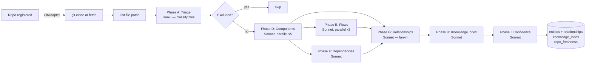
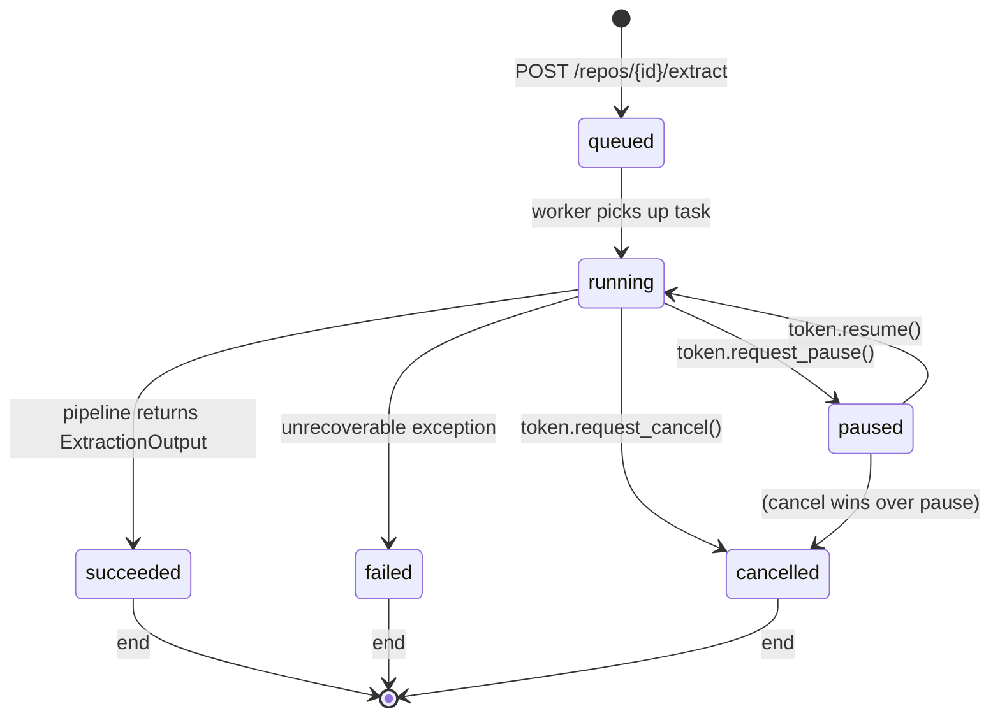
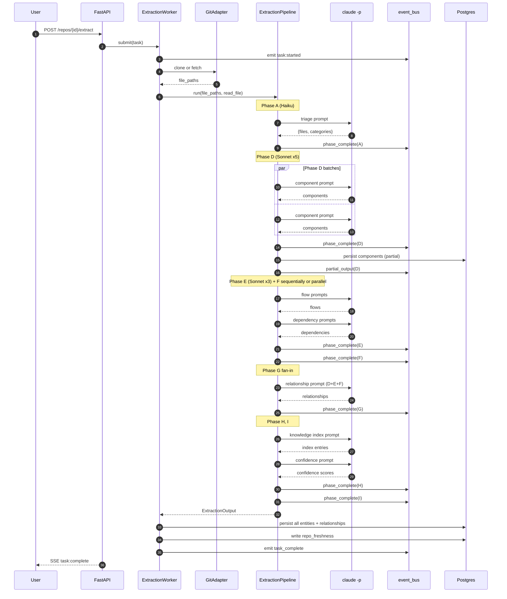

# 06 — Extraction Pipeline

> The 7 phases that turn a `git clone` into structured knowledge. Where the IP is. The phase that took 30 minutes before parallelization. Why the letters skip B and C.

> **TL;DR.** Bifrost extracts a repo through seven sequential LLM phases (A, D, E, F, G, H, I — letters skipped intentionally). Phase A is a cheap Haiku triage; D-I run on Sonnet. Phase D (component extraction) eats 80% of the bill on a typical repo. Every phase persists incrementally so the UI sees results land live, every batch checkpoints so a crashed worker resumes without redoing work, and every prompt embeds a canary so injection attempts are detectable.

> **Read this when** you're investigating why an extraction is slow or expensive, debugging a phase that hangs, tuning concurrency for a new repo shape, or onboarding to the extraction codebase.
> **Skip if** you only consume extracted knowledge through chat / handovers and never trigger extractions yourself.

---

## 0. Why this matters

Extraction is the front door. Without it, every other Bifrost capability — chat, handovers, action layer — has nothing to reason over. It is also the most expensive operation in the whole system (a single 200-file repo is estimated at **$15-50** in Sonnet calls), so the pipeline is engineered for resumability, observability, and partial-output liveness.

**Source-of-truth files:**
- `src/bifrost/extraction/pipeline.py` — `ExtractionPipeline` orchestrator
- `src/bifrost/extraction/worker.py` — lifecycle (start/pause/resume/cancel)
- `src/bifrost/extraction/prompts.py` — every system prompt + JSON schema
- `src/bifrost/extraction/triage.py` — Phase A (Haiku)
- `src/bifrost/extraction/checkpoint.py` — resume substrate
- `src/bifrost/extraction/cost.py` — cost-tracker writeback to `llm_cost_log`
- `src/bifrost/extraction/cli_client.py` — `claude -p` subprocess wrapper

---

## 1. The 7-phase pipeline at a glance



The phase letters skip **B** and **C**: those were originally assigned to clone/fetch and file inventory, both of which happen *before* the pipeline class (`ExtractionPipeline.run()`) is invoked. The caller (`ExtractionWorker._run_pipeline()`) does the clone via the GitAdapter abstraction and hands the pipeline a list of file paths (`src/bifrost/extraction/pipeline.py:1-15`, `:425-445`).

### `extraction_tasks.status` lifecycle



### If you remember nothing else
- Phases run **A → D → E,F (parallel) → G → H → I**.
- B and C are GitAdapter steps, not pipeline phases — that is why the letters skip.
- Every phase persists between runs so the UI sees entities appear *during* the run.

---

## 2. Phase A — Triage (Haiku)

**Job.** Classify every tracked file into one of seven categories so subsequent phases only run against signal-bearing files.

**LLM call shape.**
- Model: `BIFROST_TRIAGE_MODEL` (default `claude-haiku-4-5-20251001`)
- System prompt: `TRIAGE_SYSTEM_PROMPT` in `src/bifrost/extraction/prompts.py` — the most-tuned prompt in the codebase
- JSON schema returns `{ files: [{ path, category, likely_key_component }] }`

**Categories** (`src/bifrost/extraction/prompts.py`):

| Category | Examples | Downstream consumer |
|---|---|---|
| `component_definition` | services, modules, classes | Phase D |
| `dependency_manifest` | package.json, pom.xml, build.gradle | Phase F |
| `documentation` | README.md, docs/ | (informational only) |
| `infrastructure` | Dockerfiles, terraform, k8s | (informational only) |
| `entry_point` | main.py, app.ts, server entry | Phase D + E |
| `boilerplate` | auto-generated, tests, fixtures, snapshots | (skipped) |
| `excluded` | assets, lock files, binaries | (skipped) |

**Pre-filter to save money.** `should_exclude_path()` rejects roughly 80% of files before the LLM sees anything:
- Extensions in `EXCLUDED_EXTENSIONS` (PNG, MP3, ZIP, PDF, lock files, ...)
- Directories in `EXCLUDED_DIRS` (`node_modules`, `.git`, `dist`, `build`, ...)
- Path segments in `_EXCLUDED_PATH_SEGMENTS` (test/, spec/, __snapshots__, ...)

**Pattern-based fast paths.** Most remaining files match obvious conventions (any `.java` under `src/main/java` is a component, any `pom.xml` is a manifest). The LLM is only consulted for genuinely ambiguous files — dotfiles with no extension, generic names, unusual extensions.

**Output flag of note.** `likely_key_component` is set on files the LLM thinks are entry points (services, controllers, top-level orchestrators). **Phase E only runs against files where this is true**, so triage doubles as the gating mechanism for flow extraction.

**Sample input → sample output:**
```jsonc
// Input (a slice of a Java repo's file list)
[
  "src/main/java/com/shop/CancelController.java",
  "src/main/java/com/shop/CancelService.java",
  "src/main/java/com/shop/dto/CancelRequest.java",
  "pom.xml",
  "src/test/java/com/shop/CancelServiceTest.java"
]

// Output
{
  "files": [
    { "path": "src/main/java/.../CancelController.java",
      "category": "entry_point",       "likely_key_component": true  },
    { "path": "src/main/java/.../CancelService.java",
      "category": "component_definition", "likely_key_component": true },
    { "path": "src/main/java/.../dto/CancelRequest.java",
      "category": "component_definition", "likely_key_component": false },
    { "path": "pom.xml",
      "category": "dependency_manifest", "likely_key_component": false },
    { "path": "src/test/java/.../CancelServiceTest.java",
      "category": "boilerplate",          "likely_key_component": false }
  ]
}
```

**Failure modes.**
1. **Haiku timeout / rate-limit.** Triage is small (<2K input tokens per batch), so this is rare. Backoff retries cover it.
2. **Misclassification of unconventional files.** Dotfiles or files with one-off extensions sometimes land in `boilerplate` when they should be `component_definition`. Confirm by spot-checking the worker log; tune `_EXCLUDED_PATH_SEGMENTS` if it is systemic.

**Cost.** Approximately $0.02 for an entire 1,000-file repo. Triage is the cheapest phase by 100×.

### If you remember nothing else
- Triage is the gate: if a file is mis-classified here, every downstream phase will under-extract.
- Edit `TRIAGE_SYSTEM_PROMPT` only with a strong before/after on a fixture repo.

---

## 3. Phase D — Components (Sonnet, parallel ×5)

**Job.** Extract `Component` entities from each prioritized source file.

**Input artefact.** Triage output filtered to `component_definition` + `entry_point`. The pipeline reads each file's content via the caller-supplied `read_file(path)` callback.

**LLM call shape.**
- Model: `BIFROST_EXTRACTION_MODEL` (default `claude-sonnet-4-6`)
- System prompt: `COMPONENT_SYSTEM_PROMPT` (`prompts.py`)
- JSON schema: `ExtractedComponent` (see below)
- Subprocess: `claude -p` via `cli_client.py`, neutral cwd, MCP stripped

**Concurrency.** `PHASE_D_CONCURRENCY = 5` — five `claude -p` subprocesses run simultaneously, gated by an `asyncio.Semaphore`. This is conservative for a single Claude login's session limits.

**Batching.** Files smaller than `PHASE_D_SMALL_FILE_CHARS = 3,500` are packed into batches of 5 (`PHASE_D_BATCH_SIZE = 5`). Larger files go solo. Subprocess spawn cost is roughly 1-2s per call, so packing amortizes that to ~5× throughput on small-file repos.

**Pre-flight size check.** Every file is read and validated through `_validate_content_size()` before the LLM call. Hard cap: `MAX_CHARS_PER_CALL = 200,000` (~50K tokens). Files over this throw `ContentTooLargeError` and are skipped with an entry in `output.errors`.

**Output schema** (`pipeline.py:228`):
```python
ExtractedComponent {
  component_name: str        # e.g. "OrderService"
  component_type: str        # service | controller | utility | repository | model | ...
  purpose: str               # 1-2 sentences
  source_file: str           # canonical path inside the repo
  exported_interfaces: list[str]
  internal_dependencies: list[str]
  known_gaps: list[str]      # things the LLM noted as "I couldn't determine X"
}
```

**Sample output snippet:**
```json
{
  "component_name": "CancelService",
  "component_type": "service",
  "purpose": "Coordinates cancel requests by validating eligibility, releasing reserved stock, and emitting an order.cancelled event.",
  "source_file": "src/main/java/com/shop/CancelService.java",
  "exported_interfaces": ["CancelService.requestCancel(CancelRequest)", "CancelService.undoCancel(String)"],
  "internal_dependencies": ["InventoryClient", "EventPublisher", "CancelRepository"],
  "known_gaps": ["The retry backoff in requestCancel references a Resilience4j config not visible in this file."]
}
```

**Retry.** Each batch retries up to 3× on transient errors (timeout, rate limit, parse failure) with exponential backoff `(1s, 2s, 4s)`. After exhaustion, errors are recorded but the phase continues.

**Resumability.** Each batch's checkpoint key is `"|".join(sorted(paths))` — stable across runs, so if the worker crashes mid-pipeline, resume picks up exactly where it left off without redoing batches.

**Live persistence.** `_on_partial_output("D", output)` fires after the phase completes, letting the worker persist Components to Postgres so the UI sees them appear *during* the run instead of all at the end.

**Failure modes.**
1. **`ContentTooLargeError`.** A single file exceeds `MAX_CHARS_PER_CALL`. Logged in `output.errors`; the phase continues.
2. **JSON parse failure.** The LLM returned malformed JSON. The retry loop catches this; after 3 retries the batch is skipped with an error record.
3. **Subprocess hang.** The `claude -p` invocation never returns. Bounded by `BIFROST_CLAUDE_CLI_TIMEOUT_SECONDS` (default 600).
4. **Auth lapsed mid-run.** First failure surfaces as a CLI auth error; subsequent retries fail immediately. Operator must `claude auth login` and resume.

**Cost.** Approximately $0.05-0.20 per file. A 200-file repo runs **$10-30** just for Phase D.

### If you remember nothing else
- Phase D is 80% of the bill. Tune `PHASE_D_CONCURRENCY` and `PHASE_D_BATCH_SIZE` to control throughput vs subprocess load.
- Resume is per-batch, not per-file: a crashed batch re-runs all 5 packed files.

---

## 4. Phase E — Flows (Sonnet, parallel ×3)

**Job.** For each entry-point file, extract sequenced "flows" — `request_flow`, `event_flow`, `batch_flow` — described as ordered segments.

**Input artefact.** Files where Phase A set `likely_key_component=true`. Everything else is skipped.

**The skip-the-POJOs pre-filter.** `_has_flows_worth_extracting()` (`pipeline.py:88-129`) rejects files that are obviously data-only:
- Pure `enum` declarations with no methods
- Interfaces with only signatures
- `record` / data-class declarations with no body

These were hanging the LLM before — the prompt demands a flow but there is nothing flow-like to find, so the model thinks in circles for 90 seconds. The heuristic looks for "behavior markers" (`if`, `for`, `while`, `try`, `await`, `return`, `throw`, `.then(`, `.catch(`) and short-circuits when none are found.

**LLM call shape.**
- Model: `BIFROST_EXTRACTION_MODEL`
- System prompt: `FLOW_SYSTEM_PROMPT` (`prompts.py`)
- Hard cap baked into prompt: "≤3 flows, ≤6 segments per flow"
- Per-call timeout: `PHASE_E_TIMEOUT_SECONDS = 90`

**Concurrency.** `PHASE_E_CONCURRENCY = 3` — lower than Phase D because Phase E calls are bigger and more expensive. Parallelizing 3-way cut wall-clock from 30+ min to ~10 min on big repos.

**Output schema** (`pipeline.py:241-258`):
```python
ExtractedFlow {
  flow_name: str
  flow_type: str             # canonical S5 enum: request_flow | event_flow | ...
  segments: list[ExtractedFlowSegment {
    component_name: str
    segment_type: str        # canonical S5 SegmentType enum
    description: str
    order: int
  }]
  known_gaps: list[str]
}
```

**Sample output snippet:**
```json
{
  "flow_name": "Customer-initiated cancellation",
  "flow_type": "request_flow",
  "segments": [
    { "order": 1, "component_name": "CancelController",
      "segment_type": "http_handler",
      "description": "Validates the JWT and parses the CancelRequest body." },
    { "order": 2, "component_name": "CancelService",
      "segment_type": "business_logic",
      "description": "Looks up eligibility, locks the inventory row." },
    { "order": 3, "component_name": "InventoryClient",
      "segment_type": "external_call",
      "description": "Calls /inventory/release synchronously." },
    { "order": 4, "component_name": "EventPublisher",
      "segment_type": "event_emit",
      "description": "Emits order.cancelled to the SNS topic." }
  ],
  "known_gaps": []
}
```

**Failure modes.**
1. **90s timeout on a POJO that slipped past the heuristic.** Tune `_has_flows_worth_extracting`; treat repeated timeouts on the same file as a heuristic gap.
2. **Empty flows array.** The model ran but found nothing flow-shaped — usually correct. Acceptable.
3. **Segment count overflow.** Prompt-enforced ≤6, but the model occasionally returns 7-8. Validation truncates to 6.

**Cost.** Approximately $0.10-0.30 per entry-point file. Most repos have 5-10 entry points → **$2-5** total for Phase E.

### If you remember nothing else
- Phase E used to hang on POJOs; the `_has_flows_worth_extracting` heuristic is load-bearing.
- 3-way concurrency is the sweet spot — Phase E calls are heavy.

---

## 5. Phase F — Dependencies (Sonnet)

**Job.** From dependency-manifest files, extract `Dependency` entities.

**Input artefact.** Files Phase A flagged as `dependency_manifest`: `package.json`, `pom.xml`, `build.gradle`, `requirements.txt`, `Cargo.toml`, `go.mod`, `*.csproj`, etc.

**LLM call shape.**
- Model: `BIFROST_EXTRACTION_MODEL`
- System prompt: `DEPENDENCY_SYSTEM_PROMPT`
- Output schema: `ExtractedDependency` per row

**Output schema** (`pipeline.py:260-269`):
```python
ExtractedDependency {
  source_name: str           # this repo / component
  target_name: str           # what it depends on (e.g. "spring-boot-starter-web")
  dep_type: str              # runtime | dev | test | provided
  discovery_method: str      # manifest | import | runtime | inferred
  description: str
}
```

**Sample output snippet:**
```json
[
  { "source_name": "orders-service", "target_name": "spring-boot-starter-web",
    "dep_type": "runtime", "discovery_method": "manifest",
    "description": "Provides the embedded Tomcat HTTP server and Spring MVC routing." },
  { "source_name": "orders-service", "target_name": "resilience4j-spring-boot3",
    "dep_type": "runtime", "discovery_method": "manifest",
    "description": "Circuit breakers and retry decorators for downstream calls." },
  { "source_name": "orders-service", "target_name": "junit-jupiter",
    "dep_type": "test", "discovery_method": "manifest",
    "description": "Unit-test runner." }
]
```

**Why this is its own phase.** Manifest files have completely different structure from code. Trying to mix them with Phase D would force the LLM to context-switch between "is this a Java class?" and "is this a TOML key?". Cleaner to fan separately.

**Failure modes.**
1. **Lockfile drift.** `requirements.txt` versions don't match `Pipfile.lock`. The LLM picks one; downstream relationships may carry the wrong version.
2. **Monorepo with multiple manifests.** Per-manifest extraction creates duplicate `target_name` rows; Phase G deduplicates by URN.

**Cost.** Approximately $0.05 per manifest file. Most repos have 1-3 manifests → **<$1** total for Phase F.

### If you remember nothing else
- Manifest files are a different data shape from code; they get their own phase to keep prompts focused.
- Phase F output is small but enables Phase G's cross-component edges.

---

## 6. Phase G — Relationships (Sonnet, fan-in)

**Job.** Cross-reference outputs from Phases D, E, and F to synthesize relationships *between* entities ("Component X uses Service Y", "Flow Z calls into Component W").

**Why it can't be earlier.** Per-file extraction (D, E, F) only sees one file at a time. The "X calls Y" edge cannot emerge until both X and Y are known. Phase G sees the union.

**Input artefact.** All `ExtractedComponent` + `ExtractedFlow` + `ExtractedDependency` rows from the run, packed into a single big prompt.

**LLM call shape.**
- Single Sonnet call (no fan-out)
- System prompt: `RELATIONSHIP_SYSTEM_PROMPT`
- Output: array of `ExtractedRelationship`

**Output schema** (`pipeline.py:271-281`):
```python
ExtractedRelationship {
  source_urn: str            # urn:bifrost:repo/<name>/component/<X>
  target_urn: str            # urn:bifrost:repo/<name>/component/<Y>
  relationship_type: str     # uses | calls | extends | implements | depends_on | ...
  description: str
  evidence: str              # 1-2 sentences citing why
}
```

**Sample output snippet:**
```json
{
  "source_urn": "urn:bifrost:repo/orders-service/component/CancelController",
  "target_urn": "urn:bifrost:repo/orders-service/component/CancelService",
  "relationship_type": "calls",
  "description": "CancelController delegates request validation to CancelService.requestCancel.",
  "evidence": "CancelController.cancel() injects CancelService and invokes requestCancel(req) within the post handler."
}
```

**Failure modes.**
1. **Token budget overflow.** Big repos (>500 components) push the prompt past Sonnet's input limit. The pipeline truncates to top-priority entities; rare on Phase A's filtered output but possible.
2. **Hallucinated edges.** The model occasionally invents an edge between two components that share a name fragment. The `evidence` field is the human spot-check.

**Cost.** Approximately $0.50-2 per repo. One big call.

### If you remember nothing else
- Phase G is fan-in: it cannot start until D + E + F are all done.
- The `evidence` column is for humans to validate hallucinated edges — read it.

---

## 7. Phase H — Knowledge Index (Sonnet)

**Job.** Compress every entity into a ≤5K-token, search-friendly summary that the chat product retrieves later.

**Why a separate phase.** The raw entity is rich (full source file, all relationships). For chat retrieval, you do not want to feed the agent everything — you want a compressed "what is this thing" summary plus search keywords. Phase H is the compression step.

**Input artefact.** Every persisted `Component`, `Flow`, and `Dependency` row from Phases D-G.

**LLM call shape.** One Sonnet call per entity batch, output schema below.

**Output schema** (`pipeline.py:283-291`):
```python
KnowledgeIndexEntry {
  entity_urn: str
  summary: str               # the 5K-token blurb
  key_facts: list[str]       # bullet list
  search_keywords: list[str] # for keyword search fallback
}
```

**Sample output snippet:**
```json
{
  "entity_urn": "urn:bifrost:repo/orders-service/component/CancelService",
  "summary": "CancelService orchestrates customer-initiated order cancellations. It validates eligibility against the inventory ledger, releases the reserved stock, and emits an order.cancelled event. Wraps two external dependencies (InventoryClient over HTTP, EventPublisher over SNS) with Resilience4j retry decorators. Owned by the orders-platform team. Tier-1 service per its catalog-info.yaml.",
  "key_facts": [
    "Synchronous HTTP release call to the inventory service",
    "Emits order.cancelled (SNS topic: orders-events)",
    "Idempotent — keyed by CancelRequest.id"
  ],
  "search_keywords": ["cancel", "inventory", "orders-platform", "tier-1", "resilience4j", "sns"]
}
```

These rows are later embedded (locally via MiniLM-384 — see admin `/embed/entities`) for vector retrieval.

**Failure modes.**
1. **Summary exceeds budget.** Rare — the prompt enforces ≤5K. Validator truncates.
2. **Sparse `key_facts` for low-information components.** Pure-data entities (DTOs) often produce 1-2 facts; acceptable.

**Cost.** Approximately $0.30-1 per repo.

### If you remember nothing else
- Phase H is the "compress for chat" step; without it, retrieval would feed too much per entity.
- The `search_keywords` array powers keyword fallback when vector search misses.

---

## 8. Phase I — Confidence (Sonnet)

**Job.** Assign a `ConfidenceLevel` to every extracted entity — `low` / `medium` / `high` plus a numeric score and reason.

**Why this exists.** Per spec S3, every answer Bifrost returns must surface confidence. Without this phase, the chat synthesizer would have to guess at each entity's reliability inline. Phase I makes confidence a first-class column.

**Input artefact.** All persisted entities from D-H, plus their `known_gaps` arrays (which the model uses to lower confidence).

**LLM call shape.** One Sonnet call over the batch, output schema below.

**Output schema** (`pipeline.py:293-300`):
```python
ConfidenceScore {
  entity_urn: str
  confidence_level: str      # canonical S3 enum
  confidence_score: float    # 0.0 - 1.0
  reason: str                # why this level was assigned
}
```

**Sample output snippet:**
```json
[
  { "entity_urn": "urn:bifrost:.../CancelService",
    "confidence_level": "high", "confidence_score": 0.92,
    "reason": "Single-file class with explicit method signatures, no known_gaps from Phase D, two corroborating Phase E flows reference it." },
  { "entity_urn": "urn:bifrost:.../LegacyRetryShim",
    "confidence_level": "low", "confidence_score": 0.31,
    "reason": "Phase D recorded 3 known_gaps about runtime behaviour; no Phase E flow corroboration." }
]
```

**Failure modes.**
1. **Uniform "medium" output.** Sometimes the model defaults to medium when uncertain. Spot-check; if widespread, refine the prompt's calibration examples.
2. **Score ↔ level mismatch.** Score 0.9 but level "low" — the validator clamps to consistent buckets.

**Cost.** Approximately $0.30 per repo.

### If you remember nothing else
- Confidence is a column, not an inline calculation. Every chat / handover answer reads it.
- Refer to S3 for the canonical enum; do not invent new levels.

---

## 9. Resumability — `ExtractionCheckpoint`

The pipeline is built to resume mid-stream. Every phase has unit-level checkpointing:

- Phase D: per-batch (key = sorted file paths joined by `|`)
- Phase E: per-entry-point file
- Phases A, F, G, H, I: phase-level (binary done/not-done)

The checkpoint is persisted to `BIFROST_CHECKPOINT_DIR` (default `/tmp/bifrost-checkpoints`) as a JSON file keyed by `repo_id` and `task_id`. On worker restart, `ExtractionPipeline.run()` reads `resume_checkpoint.get_completed_phases()` and skips them.

**Crash mid-batch ≠ skip.** Batches are marked `mark_unit_done("D", batch_key)` *after* successful extraction, not before. So a crash mid-batch re-runs that batch on resume rather than silently skipping it.

### If you remember nothing else
- Resume is per-batch in Phase D, per-file in Phase E, per-phase elsewhere.
- The checkpoint dir is per-machine; cross-host resume is not supported.

---

## 10. Pause / Resume / Cancel

`ExtractionWorker` exposes lifecycle controls. The pipeline cooperates via `CancellationToken` (`worker.py:44-87`):

| Operation | Mechanism | Effect |
|---|---|---|
| **Pause** | `token.request_pause()` | Clears an event; the next `await token.check()` (between phases / between batches) blocks until resume. Worker fires an `on_paused` callback. |
| **Resume** | `token.resume()` | Sets the event; pending checks unblock. |
| **Cancel** | `token.request_cancel()` | Raises `asyncio.CancelledError` from the next check. Pause + cancel together → cancel wins. |

The token is checked at every phase boundary and inside every parallel batch loop, so the latency from a pause/cancel request to actual halt is bounded by the per-call timeout (Phase E has the longest, 90s).

### If you remember nothing else
- Pause / resume / cancel are all checkpoint-aware — work already done is not lost.
- Cancel wins when racing pause: there is no "paused, then cancelled, then resumed" recovery.

---

## 11. Cost tracking

Every LLM invocation routes through `_run_phase_call()` (`pipeline.py:383`) which calls `_record_cost()` immediately after a successful response. The tracker writes to `llm_cost_log` with:

- `model` (which Sonnet/Haiku variant)
- `phase` (`A`, `D`, `E`, `F`, `G`, `H`, `I`)
- `input_tokens`, `output_tokens`, `cache_read_tokens`
- `estimated_cost_usd` (Anthropic CLI's billed number — preferred — falling back to local price-table)
- `repo_id`, `task_id`

The Costs page (`/costs/summary`) groups by phase and shows where the bill goes. Phase D is almost always the largest bucket.

**Divergence guard.** If the local estimate diverges from the CLI-reported cost by >50%, a warning is logged. This catches both pricing-table drift and bugs in the local estimator (`extraction/cost.py:191`).

### If you remember nothing else
- Every LLM call writes one row; the Costs page is the aggregate view.
- Watch for divergence-guard warnings — they mean the local price table is wrong or the CLI is misreporting.

---

## 12. Prompt safety — canary tokens

Every phase prompt embeds a random canary: `BIFROST-CANARY-<32 hex chars>` (`prompts.py:14-23`). After parsing, `validate_canary()` checks the **serialized JSON output** (not the assistant text — that gave 95% false positives) for echo:

```python
parsed_text = json.dumps(completion.parsed)
if not validate_canary(parsed_text, canary):
    logger.warning("Canary echoed in phase X structured output — possible prompt injection")
```

A canary echo means user-supplied content (e.g., a malicious string in a code comment) tricked the model into reproducing the canary in structured output. It is a high-signal injection detector. Treat warnings as security incidents — do not ignore them.

→ See [09 §Canary](./09-glossary.md#c) for the term.

### If you remember nothing else
- A canary echo in JSON output = treat as a security incident.
- The canary check runs against parsed JSON, not assistant prose, to avoid false positives.

---

## 13. Mock pipeline (dry-run)

When `BIFROST_EXTRACTION_DRY_RUN=true`, `worker.py::_mock_extraction()` runs in place of the real pipeline. It produces synthetic entities (5 components, 1 flow, 3 dependencies) with `asyncio.sleep()` delays simulating real call latency. Used in:

- CI / smoke tests
- The Phase 0 extraction probe
- Any environment without `claude auth login`

The fixture is bare-minimum but exercises the same SSE channels and persistence paths, so the UI flow is still validatable.

The restart script (`scripts/restart.sh`) unsets `BIFROST_EXTRACTION_DRY_RUN` on every start so a stale env var does not silently turn real extractions into fixtures.

---

## 14. End-to-end: a single repo extraction



---

## 15. When extraction goes wrong

The most common failure modes, the symptoms in the log / UI, and how to diagnose. For the full operator runbook → see [10 §6 Troubleshooting cookbook](./10-operations.md#6-troubleshooting-cookbook).

| Symptom | Likely cause | First diagnostic |
|---|---|---|
| Task stuck in `running`, no progress | Auth lapsed; CLI retries failing | `curl /api/v1/health/claude-cli` |
| Phase E times out repeatedly at 90s | POJO slipped past `_has_flows_worth_extracting` | Inspect file content; tune the heuristic |
| Phase D shows "5/200 (3 errors)" forever | Stale `claude -p` subprocess hung | `ps aux \| grep "claude -p"` then `pkill -f "claude -p"` |
| Output entities have no relationships | Phase G token budget overflow | Worker log: `relationship prompt truncated` |
| Costs spike on a small repo | MCP servers not stripped, model emitting tool-use | Check `cli_client.py` neutral-cwd path |
| Canary warning in logs | Possible prompt injection | Treat as security incident; capture file content |
| `ContentTooLargeError` on a generated file | File >200K chars (often `*.pb.go`, lockfiles) | Add path to `EXCLUDED_DIRS` or extension to `EXCLUDED_EXTENSIONS` |

### If you remember nothing else
- Most extraction failures bottom out in CLI auth, prompt budget, or the Phase E heuristic.
- Capture the exact phase + repo + file in the bug; that triple narrows diagnosis fast.

---

## 16. Things you'll wish you knew

- **Phase D is 80% of the bill.** Tune `PHASE_D_CONCURRENCY` and `PHASE_D_BATCH_SIZE` to control throughput vs subprocess load.
- **Phase E used to hang on POJOs.** The `_has_flows_worth_extracting` heuristic is load-bearing. If you ever see Phase E timing out at 90s on simple data files, check that this filter still matches your codebase's idioms.
- **The 200K-char hard cap is not the model's context window.** It is a self-imposed budget tuned for cost + latency. The model can take more — we just do not.
- **Resume is per-batch, not per-file.** If a batch packing 5 small files crashes after extracting 3 of them, resume re-runs all 5. This is intentional (avoids partial-batch ambiguity) but means batch granularity bounds resume waste.
- **The triage prompt is the most-tuned prompt in the codebase.** Edit `TRIAGE_SYSTEM_PROMPT` only with a strong before/after on a fixture repo — small wording changes produce wildly different category distributions.
- **Phase letters in cost charts can confuse new readers.** B and C are missing on purpose; the "phase" column in `llm_cost_log` reflects pipeline phases, not GitAdapter steps. The Spend page already maps these via `_phase_label()` (`A`→Triage, `D`→Components, ...) so the user never sees the raw letter.
- **Dry-run mode is real and useful.** `BIFROST_EXTRACTION_DRY_RUN=true` lets you smoke-test the entire SSE + persistence path without a single real LLM call. The restart script unsets this on every restart so you do not accidentally ship a no-op.
