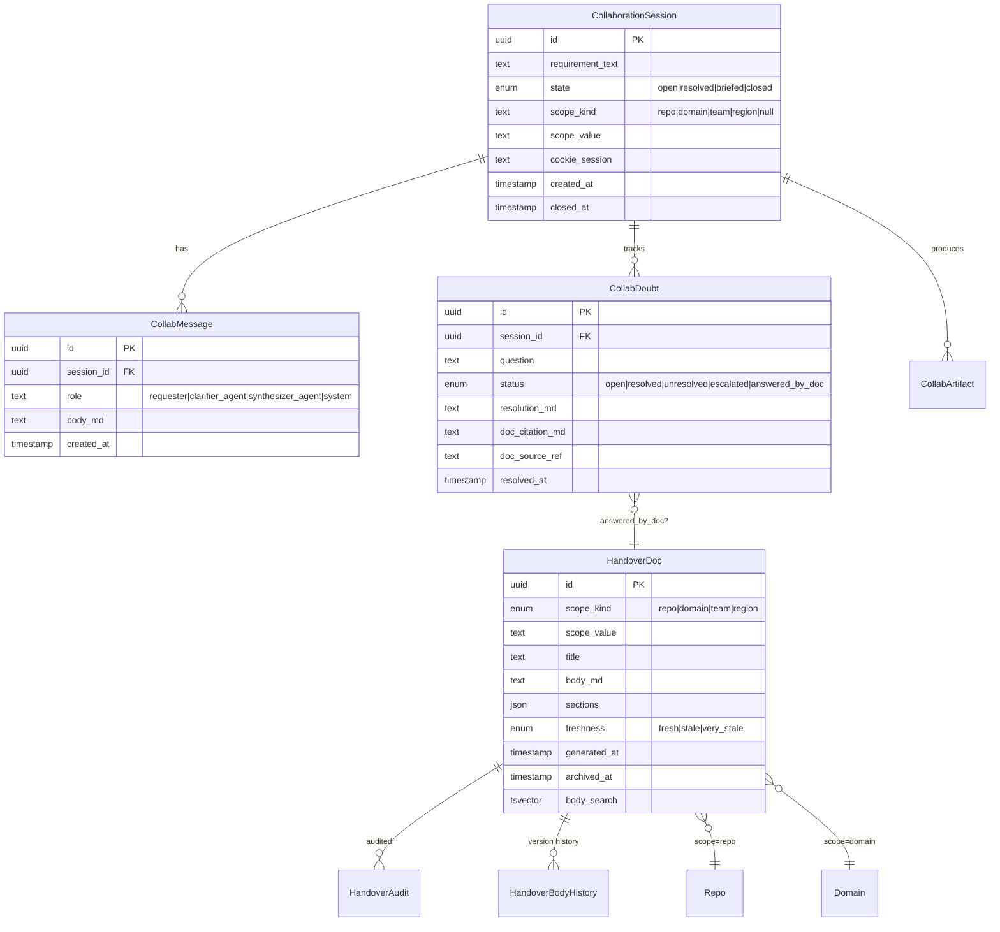
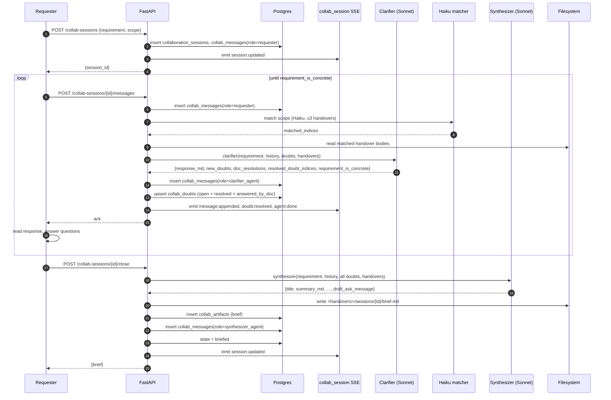
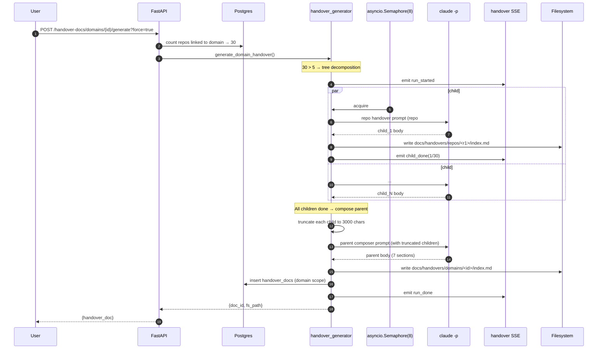
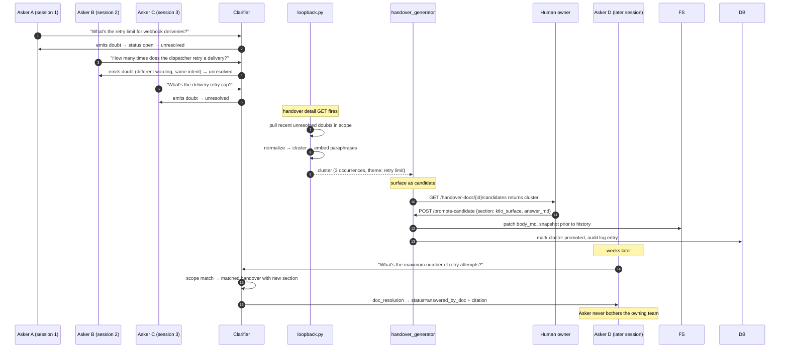
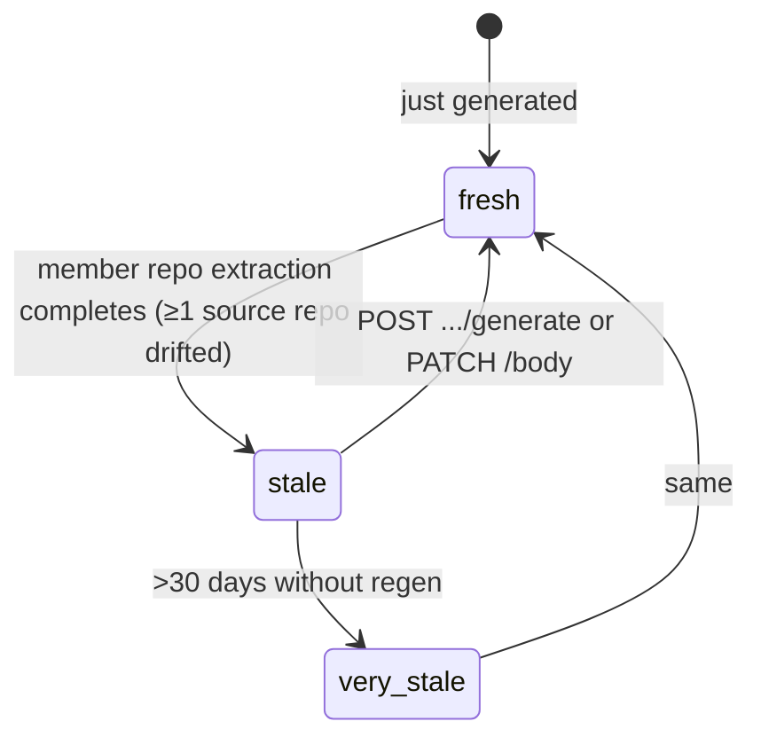

# 07 — Collaboration System

> The cross-team interaction substrate. From "I have a feature idea I need to coordinate with another team" → a handed-off, written-down, citation-grounded brief. Plus the handover docs the brief gets grounded in. **Every capability traced to code, with sequence diagrams.**

> **TL;DR.** Two coupled subsystems share one substrate. Collaboration sessions force a structured back-and-forth between a requester and a `clarifier` agent until the requirement is concrete enough to brief; closing fires a `synthesizer` that writes a Markdown brief. Handover docs are auto-generated team documentation (per repo / domain / team / region) that the clarifier uses as grounding. Every cycle of a session improves the handover (loop-back); every improvement to a handover reduces the next session's questions.

> **Read this when** you're investigating a stuck collab session, generating a handover for a new scope, debugging the loop-back / candidate-promotion flow, or onboarding to the collaboration codebase.
> **Skip if** you only consume handovers as a reader — chapter 8 (Frontend tour) shows the UI without the substrate.

---

## 0. Why this matters

The collaboration feature solves two distinct problems with one substrate:

1. **Collaboration sessions.** Cross-team feature requests. The asker does not fully know what they need; the owning team does not have spare cycles. The session forces a structured back-and-forth (clarifier ↔ requester) until the requirement is concrete enough to brief.
2. **Handover docs.** Auto-generated team documentation that the clarifier can use as grounding. Generated per-scope (repo / domain / team / region), updated when extraction freshness drifts.

These two problems share data (`CollabDoubt` ↔ doubt candidates promote to handover sections) and infrastructure (Sonnet agents, SSE channels, Postgres tables). The system is built so that *every cycle of a session improves the handover, and every improvement to a handover reduces the next session's questions*.

**Source-of-truth files:**
- `src/bifrost/collaboration/clarifier.py` (462 lines) — the per-turn clarifier agent
- `src/bifrost/collaboration/synthesizer.py` (439 lines) — the session-close brief generator
- `src/bifrost/collaboration/handover_generator.py` (2,861 lines) — all four scope variants + tree decomp + per-section regen
- `src/bifrost/collaboration/matching.py` (330 lines) — Haiku scope matcher + substring fallback
- `src/bifrost/collaboration/loopback.py` (394 lines) — doubt-candidate clustering
- `src/bifrost/collaboration/cost_estimate.py` (349 lines) — per-scope cost preview
- `src/bifrost/collaboration/rate_limit.py` — per-cookie rate limit
- `src/bifrost/collaboration/slack_escalation.py` (~130 lines) — Slack auto-post (Slack Web API)
- `src/bifrost/api/routes/collaboration.py` (652 lines) — session HTTP routes
- `src/bifrost/api/routes/handover_docs.py` (1,475 lines) — handover HTTP routes

---

## 1. A realistic session, end to end

Before the details, here is what an actual session looks like turn by turn. Walk through this once and the rest of the chapter is variations on the theme.

> **Scenario.** Alice on the `PLAT` team wants to add a `max_attempts` field to webhook subscriptions. The owning team is `DLVR`. She files a session scoped to the `webhooks` domain.

**Turn 0 — File the session.**
- Alice hits `POST /collab-sessions` with `{ requirement: "Add a max_attempts field to webhook subscriptions so tenants can cap delivery retries.", scope_kind: "domain", scope_value: "webhooks" }`.
- API inserts a row into `collaboration_sessions` with `state=open`, plus a `collab_messages` row `(role=requester, body_md=requirement)`.
- API publishes `session:updated` on `collab_session:{id}` — Alice's UI flips to the active session view.

**Turn 1 — First clarifier pass.**
- Alice does not type anything yet — the substrate fires the clarifier on session create as well as on every `requester` message. The Haiku scope matcher walks the handover index, picks ≤3 relevant docs (the repo handover for `dispatcher`, the domain handover for `webhooks`), reads them from disk, and feeds them to the Sonnet clarifier as `<handover_context>` blocks.
- Clarifier returns `{ response_md: "Got it...", new_doubts: [...3 questions...], doc_resolutions: [...1 question answered from the handover...], requirement_is_concrete: false }`.
- API inserts a `collab_messages` row `(role=clarifier_agent)`, three `collab_doubts` rows `(status=open)`, one with `status=answered_by_doc` plus a citation pulled from the handover.
- API publishes `message:appended`, `doubt:resolved` (for the answered_by_doc), and `agent:done` on the SSE channel.

**Turn 2 — Alice answers.**
- She replies in the chat composer; `POST /collab-sessions/{id}/messages` inserts a new `requester` row and re-runs the clarifier.
- The clarifier sees the answered doubts, marks them `resolved` via `resolved_doubt_indices[]` in its output, and either emits new doubts or sets `requirement_is_concrete=true`.

**Turn N — Requirement concrete.**
- After 2-4 turns the clarifier sets `requirement_is_concrete=true`; session state advances to `resolved`.
- Alice clicks **Close session**.

**Turn N+1 — Synthesizer.**
- `POST /collab-sessions/{id}/close` invokes `synthesizer.py`. One Sonnet call, 180s timeout, eight-section schema (title / summary / affected_scopes / owning_teams / estimated_work / required_artifacts / contacts / open_risks / draft_ask_message).
- Output is written to `<handovers_dir>/sessions/<sid>/brief.md` and persisted as a `collab_artifacts` row.
- API inserts a `collab_messages` row `(role=synthesizer_agent)`, transitions session to `briefed`, publishes `session:updated`.

**Optional — Slack escalation.**
- An unresolved doubt is escalated → `POST /collab-sessions/{id}/doubts/{did}/resolve {status: escalated}`.
- If `BIFROST_SLACK_ESCALATION_CHANNEL` and `BIFROST_SLACK_BOT_TOKEN` are both set, `slack_escalation.py` posts the templated `draft_ask_message` to that channel through the Slack Web API (`chat.postMessage`, then `chat.getPermalink`). Otherwise it stays as an on-disk artifact for Alice to copy-paste.

**Optional — Loop-back.**
- Months later, three sessions have escalated similar retry-limit doubts. The next time anyone hits `GET /handover-docs/{id}`, `loopback.py` clusters them and surfaces a candidate. A team owner clicks "Promote to section" and the answer lands in the handover. Future asks resolve as `answered_by_doc` automatically.

### If you remember nothing else
- A session is `open → resolved → briefed`; close fires the synthesizer once.
- The clarifier reads handovers as grounding; doubts answered from a doc carry citations.
- Loop-back closes the cycle: a recurring doubt becomes a handover section, future sessions never bother the team.

---

## 2. The data model



All of these tables are created by the baseline migration, `alembic/versions/001_baseline.py`.

### If you remember nothing else
- Sessions and handovers are joined by *citation*, not foreign key. The clarifier records a `doc_source_ref` when it grounds an answer.
- Cookie identity, not user identity. Sessions are scoped to `bifrost_session` cookies.

---

## 3. Substrate

The interaction model alone, no generation pipeline. Validates the UX before burning time on synthesis.

**What it includes:**
- `collaboration_sessions` / `collab_messages` / `collab_doubts` / `collab_artifacts` tables (baseline migration)
- Bare CRUD routes (`/collab-sessions`, `…/messages`, `…/doubts/{id}/resolve`, `…/close`)
- Session state machine: `open` → `resolved` → `briefed` → (optional `closed`)
- Cookie-based identity (`bifrost_session`)
- SSE channel `collab_session:{id}` for live message + doubt updates
- Manual mode: a human-in-the-loop drives the clarifier role

The substrate has no agents of its own: the clarifier and synthesizer (section 4), handover docs (section 5) and grounding (section 6) build on it.

---

## 4. Clarifier and synthesizer agents

**Clarifier** (`src/bifrost/collaboration/clarifier.py:59-115`):
- Runs after every requester message
- Single Sonnet call, 45s timeout
- Reads requirement + chat history + open doubts (no handover grounding yet)
- Decides: ambiguous → emit 1-3 doubts, or concrete → set `requirement_is_concrete=true`
- Output schema includes `resolved_doubt_indices[]` (close doubts the user just answered) — the foundation for loop-back
- Fallback: a stub message so the user is not blocked on LLM failure

**Synthesizer** (`src/bifrost/collaboration/synthesizer.py:65-118`):
- Runs at `POST …/close`
- Single Sonnet call, 180s timeout
- 8-section brief: title / summary / affected_scopes / owning_teams / estimated_work / required_artifacts / contacts / open_risks / draft_ask_message
- Writes brief to `<handovers_dir>/sessions/<sid>/brief.md`
- Inserts `collab_artifacts` row, transitions session to `briefed`

The two agents share a fallback substrate: on LLM failure, the user sees a synthetic "graceful failure" message rather than an error, and the session keeps moving manually.

---

## 5. Repo handover generation

Repo-scoped only, no children. Single Sonnet call.

**What it includes:**
- `handover_docs` table base columns
- `_HANDOVER_SYSTEM_PROMPT` (`handover_generator.py:123-177`) — the canonical 7-section prompt
- `generate_repo_handover()` function — single Sonnet call
- Output → `docs/handovers/repos/<slug>/index.md` + `handover_docs` row
- `POST /handover-docs/repos/{repo_id}/generate`
- `GET /handover-docs` + `…/{id}` for list/detail
- The 8 sections (returned as separate JSON fields then rendered as Markdown):
  - `title` — `"<repo> — handover"`
  - `executive_summary` — 2-3 paragraphs
  - `architecture` — 3-7 components + Mermaid `flowchart TD` if confident
  - `critical_flows` — top 3-7 user-visible flows
  - `ownership` — team / contacts (defers to the repo manifest and CODEOWNERS if not in extraction)
  - `dependencies` — upstream + downstream
  - `ktlo_surface` — operational ownership, on-call, alerting
  - `glossary` — repo-specific terminology

Note: input cap of `_PER_TYPE_CAP=30` entities/type, `_TOTAL_ENTITY_CAP=200` total. Single-call constraint forces tight signal density.

---

## 6. Multi-scope handovers and clarifier grounding

**Clarifier grounding.**
- `find_matching_handovers()` (in `matching.py`) walks the handover index for scope-relevant docs
- Matched bodies are read from disk and injected into the clarifier prompt as `<handover_context handover_ref="...">` blocks
- Clarifier prompt updated to support a new schema field: `doc_resolutions[{ index, citation_md, source_ref }]` — the model can answer doubts directly with handover citations rather than punting to the human
- New doubt status: `answered_by_doc`

**Multi-repo scopes.**
- `_DOMAIN_HANDOVER_SYSTEM_PROMPT` (`handover_generator.py:1156`) — pools entities across all repos linked via `repos.domain_id`
- `_TEAM_HANDOVER_SYSTEM_PROMPT` (`handover_generator.py:1568`) — pools across all repos whose manifest names that team (joined via `OrgRepo.registered_repo_id`)
- Both reuse the 7-section schema; prompts differ only in framing ("call out which repo contributes which capability")
- Output → `docs/handovers/{domains|teams}/<slug>/index.md`
- Routes: `POST /handover-docs/domains/{id}/generate`, `…/teams/{squad}/generate`

---

## 7. Tree decomposition, loop-back, Haiku matcher, multi-scope staleness

**Tree decomposition.**
- When a multi-repo scope has > `_TREE_THRESHOLD = 5` repos, switch from "pool entities into one Sonnet call" to "generate per-repo child docs in parallel + compose parent from their bodies"
- Concurrency cap: `_CONCURRENT_CHILD_CAP = 8` (asyncio.Semaphore)
- Per-child body truncation: `_CHILD_BODY_CHAR_CAP = 3000` (~750 tokens) keeps the parent prompt bounded even for 50+ children
- Parent prompt: `_PARENT_COMPOSER_SYSTEM_PROMPT` (`handover_generator.py:1352`)
- Trade-off: 2-3× the Sonnet cost vs pooled, but each child uses its repo's full signal

### Worked example: a 30-repo domain handover

> Alice files `POST /handover-docs/domains/webhooks/generate?force=true`. The domain has 30 registered repos.

| Step | Action | Wave | Time | Cost |
|---|---|---|---|---|
| Estimate | `cost_estimate.py` walks the scope, returns `{estimated_cost_usd: $14, child_count: 30}`. Cost > $10 ceiling → API requires `?force=true`. | 0 | <1s | $0 |
| Children — wave 1 | Semaphore acquires 8; first 8 child handovers fire in parallel. Each: 1 Sonnet call, ≤30 entities, ~$0.40, ~25s. Children 9-30 queue. | 1 | ~25s | $3.20 |
| Children — wave 2 | Wave 1 finishes, semaphore releases, next 8 fire. | 2 | ~25s | $3.20 |
| Children — wave 3 | Same as wave 2. | 3 | ~25s | $3.20 |
| Children — wave 4 | Final 6 children. | 4 | ~25s | $2.40 |
| Parent compose | Each child body truncated to 3000 chars, packed into `_PARENT_COMPOSER_SYSTEM_PROMPT`. One big Sonnet call (~$2). | 5 | ~30s | $2.00 |
| **Total** | | | **~2 min** | **~$14** |

Throughout, SSE on `handover:domain:webhooks` publishes `handover:run_started`, `handover:child_done` (1/30 → 30/30), `handover:section_complete` (×7), `handover:run_done`. The UI shows a live progress bar instead of a 30-second spinner.

**Loop-back.**
- `loopback.py::compute_doubt_candidates()` — clusters unresolved/escalated doubts across recent collab sessions
- Two-phase clustering: normalize-equal first (cheap), then MiniLM-384 cosine similarity ≥ `_DEFAULT_CLUSTER_THRESHOLD = 0.85` (`BIFROST_DOUBT_CLUSTER_THRESHOLD` overrides)
- Surfaces clusters with `occurrence_count >= 3` via `GET /handover-docs/{id}/candidates`
- Pure Python + local embedding — no LLM call. Runs on every handover-detail GET.

**Haiku scope matcher.**
- `_haiku_match_handovers()` in `matching.py:110-160`
- Replaces a substring-only match with a Haiku call over the candidate list
- Haiku sees `scope_kind` + `scope_value` only (no body — would blow prompt budget)
- 15s timeout; on any failure → substring fallback. Never raises.
- Cap: 200 candidates (`_CANDIDATE_LIMIT`)
- Output: ≤3 indices in relevance order

**Multi-scope stale propagation.**
- When a member repo of a domain/team/region drifts, the parent handover gets `freshness=stale`
- Auto-set on extraction completion via the freshness propagation hook

### If you remember nothing else
- Tree decomposition kicks in at 6 repos. `_TREE_THRESHOLD = 5` is "above which to decompose"; ≤5 stays pooled.
- Loop-back is free (pure Python + local MiniLM); it runs on every handover-detail GET.

---

## 8. Cost ceiling, promotion, embedding clustering

**Cost ceiling.**
- `BIFROST_HANDOVER_MAX_COST_USD` (default `$10`) — when a tree-decomp would exceed this, the API returns `409 Conflict` unless caller passes `?force=true`
- Pre-flight estimator: `cost_estimate.py` walks the scope and returns `{ estimated_cost_usd, child_count, breakdown }`
- Routes: `GET /handover-docs/{repos|domains|teams|regions}/{X}/estimate`

**Doubt-candidate promotion.**
- `POST /handover-docs/{id}/promote-candidate` — human picks a candidate cluster, supplies the section to add it to + the answer
- The handover body is patched in-place; `body_md` updated; future clarifier runs find this answer and resolve the doubt as `answered_by_doc`
- The doubt cluster is marked promoted so it does not re-surface in `/candidates`

**Embedding-based clustering.**
- Loop-back upgrade — `loopback.py` switches from string-normalize-only to MiniLM cosine similarity
- Catches paraphrases that string-equal misses

**Per-cookie rate limit.**
- `BIFROST_HANDOVER_RATE_LIMIT_PER_MINUTE` (default `6`) — caps how many `…/generate` calls a single cookie can fire
- Prevents "queue 100 generates in parallel and burn the cost ceiling 100×"
- `0` disables the gate

---

## 9. Onboarding lens, region scope, multi-team brief, SSE progress

**Onboarding lens.**
- New synthesis variant of the handover prompt — generates a "Day 1 / Week 1 / First quarter" view
- Same source data as the standard handover; alternate prompt produces a different framing
- Useful for newly onboarded engineers who need orientation, not architecture deep-dive

**Doubt promotion UI completion.**
- Wires candidate promotion (section 8) into the handover detail page
- Right rail shows candidate clusters; click to promote; live-update via SSE

**Multi-team brief.**
- Synthesizer can now name multiple owning teams in the brief
- Each team gets its own `draft_ask_message` so the requester can copy-paste tailored asks

**Region scope.**
- Geographic region grouping (e.g. `us`, `eu`, `apac`)
- New table column: `OrgRepo.region`
- `_REGION_HANDOVER_SYSTEM_PROMPT` (`handover_generator.py:1633`) — structurally identical to the team variant; only the join column differs
- Routes: `POST /handover-docs/regions/{region}/generate`, `…/estimate`

**SSE progress.**
- Handover generation now emits SSE on `handover:{kind}:{value}` channel
- Events: `handover:run_started`, `handover:child_done` (per-child in tree decomp), `handover:section_complete`, `handover:run_done`
- UI shows a live progress bar instead of a 30-second spinner

---

## 10. Background generation, bulk regen, Mermaid validation, editor

**Background generation.**
- `POST /handover-docs/.../generate` returns immediately with a `run_id`
- Generation continues in the background; client subscribes to the SSE stream
- Frees the UI from a 30s+ blocking spinner

**Bulk regen.**
- `POST /handover-docs/bulk/refresh-stale` — sweep every stale handover for an org/domain in one call
- Implementation in `handover_docs.py:1264-1400`

**Mermaid validation.**
- Generated Mermaid blocks are parsed before persistence; invalid blocks are stripped (with a debug log line)
- Stops the rendered handover from showing "Syntax error in graph" when the model emits malformed Mermaid

**Inline editor.**
- The body becomes editable in the UI (right rail of `HandoverDocDetailPage`)
- Two modes: `human_override` (raw Markdown edit) and `llm_revise` (natural-language instruction → Sonnet rewrite)
- `PATCH /handover-docs/{id}/body` accepts `{ body_md? | revise_instruction?, mode }`

---

## 11. Archival, Confluence, Slack drafts, Markdown download

**Archival.**
- `DELETE /handover-docs/{id}` — soft delete, sets `archived_at`
- `POST /handover-docs/{id}/restore` — unarchive
- Archived docs hidden from default list but still served on direct GET

**Confluence injection.**
- Up to `_CONFLUENCE_PAGE_CAP = 5` pages per scope, truncated to `_CONFLUENCE_BODY_CHAR_CAP = 2000` chars each
- Pages are injected into the handover prompt as `<confluence_context>` blocks
- Prompt updated: "Cite Confluence page titles + URLs verbatim from `<confluence_context>` blocks where they support a section"
- Source: indexed Confluence pages from `external_indexer.py`

**Slack draft delivery.**
- The synthesizer's `draft_ask_message` is now formatted in Slack mrkdwn
- Stored as a downloadable artifact alongside `brief.md`

**Markdown download.**
- `GET /collab-sessions/{id}/brief.md` — direct streamed Markdown
- `GET /handover-docs/{id}` already exposes body_md; this completes the symmetry

---

## 12. Search, staleness, Slack auto-post, bearer auth

**Slack auto-post.**
- When a doubt is escalated *and* `BIFROST_SLACK_ESCALATION_CHANNEL` and `BIFROST_SLACK_BOT_TOKEN` are set, the resolve handler also posts the templated `draft_ask_message` through the Slack Web API
- Implementation: `slack_escalation.py`, plain `httpx`, no LLM and no subprocess
- Each Slack call is tried twice. Then the resolve request returns 502 with `slack.escalation.post_failed` or `slack.escalation.permalink_failed`; the on-disk draft is still there
- **Security note.** The body is posted verbatim to the one configured channel, so text inside a doubt cannot redirect it. The bot token is a `SecretStr` and is never logged.

**Search.**
- `GET /handover-docs/search?q=<query>` — keyword search, scope filter
- Backed by the tsvector index described in section 13

**Staleness propagation deepening.**
- When a member repo of a *parent* scope (domain/team/region) drifts, the parent doc gets `freshness=stale`
- Triggered from the extraction worker's freshness writeback hook

**Bearer-token API gate.**
- `BIFROST_API_TOKEN` and the `require_api_token` gate were removed; setting the variable stops startup
- Scripts use `bft_` API tokens listed under `api_tokens` (`bifrost token new`)
- Every `/api/v1/*` route except health and auth needs a principal

---

## 13. tsvector search, audit, cross-repo flow, rate limit

**tsvector full-text search.**
- Replaces an earlier `LIKE`-based search
- `handover_docs.body_search` is a `tsvector` column with a GIN index
- Trigger keeps it in sync with `body_md` updates
- Ranking via `ts_rank()`; supports phrase queries, prefix matching

**Audit log.**
- `handover_audits` table — records read, edit, regenerate, archive, restore events with actor (cookie session) + timestamp + diff summary
- `GET /handover-docs/{id}/audit` returns a chronological timeline

**Auto-derived cross-repo flow diagram.**
- For multi-repo scopes, the generator now aggregates `(source_repo, target_repo, rel_type)` edges from `EntityRelationship` rows
- Top `_CROSS_REPO_DIAGRAM_EDGE_CAP = 15` edges → a Mermaid `flowchart LR` rendered in the architecture section
- Prevents "unreadable hairball" on dense scopes

**Per-cookie rate limit deepening.**
- `rate_limit.py` — sliding-window cookie tracker
- Returns `429 Too Many Requests` with `Retry-After` header when triggered

---

## 14. Audit timeline and diff viewer

**Audit timeline UI.**
- `HandoverDocDetailPage` gets a third tab: "History"
- Renders `GET /handover-docs/{id}/audit` as a vertical timeline
- Each entry: actor, action, timestamp, summary

**Diff viewer.**
- `handover_body_history` — every body update snapshots the *prior* body to `handover_body_history`
- `GET /handover-docs/{id}/history` returns the version list
- UI renders side-by-side or unified diffs (uses the existing `Prose` component for both panes)
- **Security note.** Body-history persistence runs the same validation as fresh generation, so untrusted body content cannot be replayed without canary/sanitisation.

---

## 15. Per-section regeneration

Surgical edits without re-running the whole generator.

**What it does:**
- `POST /handover-docs/{id}/sections/{section_key}/regenerate` (`handover_docs.py:1034`)
- Same input bundle as full generation, but the prompt instructs the model to return *only* the named section
- Untouched sections preserved verbatim; the new section is spliced in via `body_md` patch
- Body history snapshots the prior version so the diff viewer can show before/after

**Why this matters.** The previous pattern was "regenerate the whole doc to fix one section." That cost $2-10 and lost human edits. Per-section regen is ~$0.05-0.30 and surgical.

**Section keys:** `executive_summary`, `architecture`, `critical_flows`, `ownership`, `dependencies`, `ktlo_surface`, `glossary` (the canonical 7).

---

## 16. End-to-end: a collaboration session



---

## 17. End-to-end: domain handover (30 repos, tree decomposition)



---

## 18. End-to-end: loop-back



---

## 19. SSE event reference

| Event | Channel | Trigger | Payload |
|---|---|---|---|
| `session:updated` | `collab_session:{id}` | any state change | `{ session_id, state, message_count, doubt_counts }` |
| `message:appended` | `collab_session:{id}` | new message inserted | `{ message_id, role, body_md_excerpt }` |
| `doubt:resolved` | `collab_session:{id}` | doubt status change | `{ doubt_id, status, resolution_md }` |
| `agent:running` | `collab_session:{id}` | agent invocation start | `{ agent: "clarifier" \| "synthesizer" }` |
| `agent:done` | `collab_session:{id}` | agent invocation end | `{ agent, used_fallback, duration_ms }` |
| `handover:run_started` | `handover:{kind}:{value}` | generator begins | `{ run_id, scope, expected_children? }` |
| `handover:child_done` | `handover:{kind}:{value}` | tree-decomp child completes | `{ child_repo_id, index, total }` |
| `handover:section_complete` | `handover:{kind}:{value}` | one of 7 sections done | `{ section_key }` |
| `handover:run_done` | `handover:{kind}:{value}` | full generation complete | `{ doc_id, fs_path, cost_usd }` |

---

## 20. State machines

### Session state

```mermaid
stateDiagram-v2
  [*] --> open : POST /collab-sessions (publishes session_state_changed)
  open --> resolved : clarifier sets requirement_is_concrete (publishes session_state_changed)
  open --> open : POST /messages (publishes message:appended; clarifier still open)
  resolved --> briefed : POST /close (synthesizer runs; publishes session_state_changed)
  briefed --> open : POST /reopen (publishes session_state_changed)
  briefed --> closed : (manual)
  open --> closed : (manual cancel)
```


### Doubt status
```mermaid
stateDiagram-v2
  [*] --> open : clarifier emits new_doubt (publishes doubt:resolved with status=open? no — message:appended)
  open --> resolved : POST /doubts/{id}/resolve {status: resolved} (publishes doubt:resolved)
  open --> answered_by_doc : clarifier emits doc_resolution (publishes doubt:resolved)
  open --> escalated : POST /doubts/{id}/resolve {status: escalated} (publishes doubt:resolved; may auto-Slack)
  open --> unresolved : session closes with doubt still open (publishes session_state_changed)
  escalated --> resolved : human follows up (publishes doubt:resolved)
  escalated --> unresolved : never resolved (becomes risk in brief)
```

### Handover freshness


---

## 21. Cost dynamics summary

| Operation | Cost | Driver |
|---|---|---|
| Collab session turn | ~$0.05 | Haiku matcher + Sonnet clarifier |
| Collab close | ~$0.30 | Sonnet synthesizer (1 call) |
| Repo handover | $0.30-2 | Sonnet (1 call) |
| Domain handover (≤5 repos, pooled) | $0.50-3 | Sonnet (1 call) |
| Domain handover (>5 repos, tree decomp) | $5-25 | Sonnet × N children + parent |
| Per-section regen | $0.05-0.30 | Sonnet (smaller call) |
| Loop-back clustering | $0 | Pure Python + local MiniLM |
| Slack escalation draft | $0.005 | Haiku |
| Hybrid edit (`llm_revise`) | $0.05-0.20 | Sonnet |

The `BIFROST_HANDOVER_MAX_COST_USD = $10` ceiling is calibrated to make a domain handover with ~30-50 repos require explicit `?force=true`. The estimator runs Postgres-side (no LLM call) so the user sees the price tag before authorizing.

### If you remember nothing else
- Sessions are cheap (cents per turn). Handovers are expensive (dollars per scope).
- Per-section regen is the "edit one thing without reburning the whole doc" mechanism — use it.

---

## 22. Security-relevant moments

These are the points in the substrate that handle untrusted content, cookies, or external systems.

| Moment | Why it matters | Hardening |
|---|---|---|
| **Slack escalation auto-post** | Posts to a channel using the operator's MCP auth | Channel ID validated; message body sanitised; falls back silently if MCP not authenticated |
| **Cookie identity verification** | `bifrost_session` cookie is the only identity signal | Sliding-window rate limit per cookie; audit log records cookie hash, not raw value |
| **Body-history persistence** | `handover_body_history` retains pre-overwrite snapshots; replays must not bypass canary | Insert path runs the same validation pipeline as fresh generation |
| **`PATCH /body` with `llm_revise`** | Untrusted natural-language instruction → Sonnet rewrite | Instruction wrapped in prompt-safety boundary; output canary-validated |
| **Promote-candidate** | Human-supplied answer body merges into a handover | Body sanitised, audit logged, body-history snapshot captured |
| **Confluence injection** | External page bodies enter prompts as `<confluence_context>` | Truncated to 2000 chars; wrapped in clearly-delimited tags; canary check on output |

### If you remember nothing else
- The substrate touches untrusted content at Slack escalation, body PATCH, and Confluence injection.
- Every mutating event writes a `handover_audits` row; that table is your forensic trail.

---

## 23. Things you'll wish you knew

- **The state machine is `open → resolved → briefed → closed`.** Reopening goes back to `open`. Do not confuse session state with doubt status — they are separate enums.
- **Loop-back fires on handover-detail GET.** Every `GET /handover-docs/{id}` runs the loopback clustering. It is cheap (no LLM call), but if you see slow handover-detail loads on a busy system, this is one place to look.
- **Cookie identity, not user identity.** Sessions are scoped to `bifrost_session` cookies, not authenticated users. Same browser = same identity.
- **Slack auto-post is opt-in.** It needs both `BIFROST_SLACK_ESCALATION_CHANNEL` and `BIFROST_SLACK_BOT_TOKEN`. Without them it is the on-disk artifact only (the requester copy-pastes).
- **Tree decomposition kicks in at 6 repos.** `_TREE_THRESHOLD = 5` is "above which to decompose"; ≤5 stays pooled. Lower the threshold to make decomposition more aggressive (better signal, higher cost).
- **The synthesizer hallucinates team names if you let it.** The prompt explicitly forbids inventing names — but the prompt also is just a prompt. If a brief lists a "Delivery Gateway Team" and the manifest says `delivery-gateway`, treat that as the synthesizer's best guess, not a fact.
- **Per-section regen preserves human edits.** Without it, a human override followed by a full regen loses the edits. With it, you can regen `architecture` while keeping a humans-edited `ownership` intact.
- **Mermaid validation strips invalid blocks silently.** If you see "where did my mermaid diagram go?", check the debug log for "stripped invalid mermaid". The model occasionally emits malformed Mermaid (especially nested subgraphs); we do not ship that to users.
- **The audit log is per-cookie.** `handover_audits.actor_cookie` records *which browser session* did the edit, not which human. Two engineers sharing a laptop will look like one actor.
