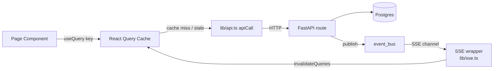
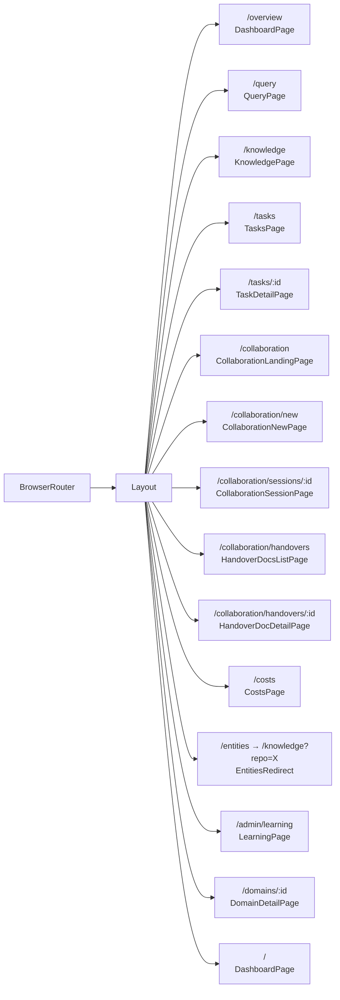
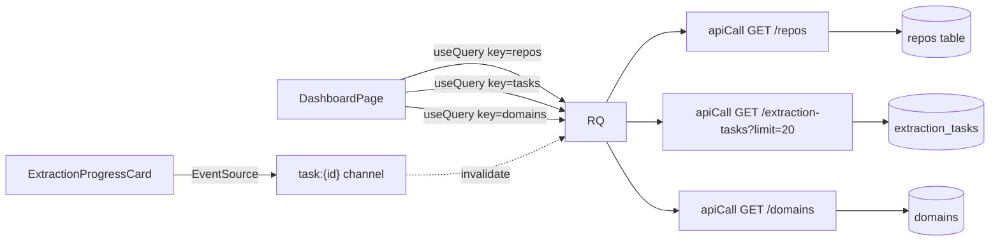
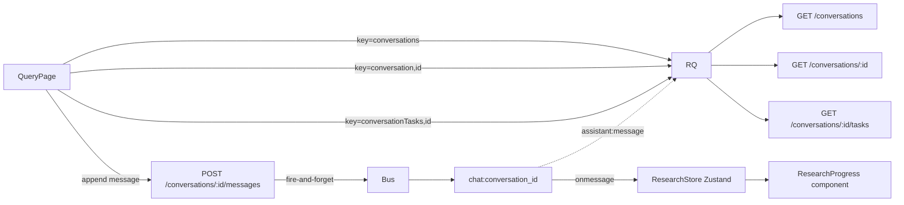
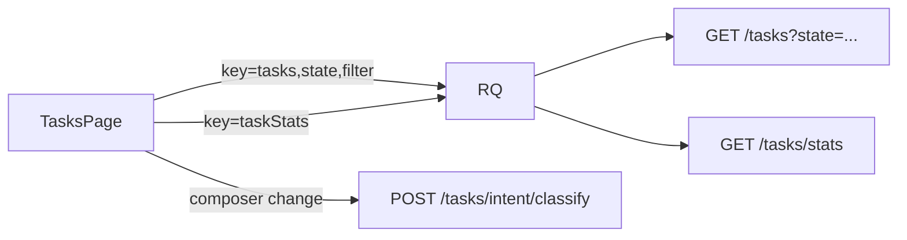
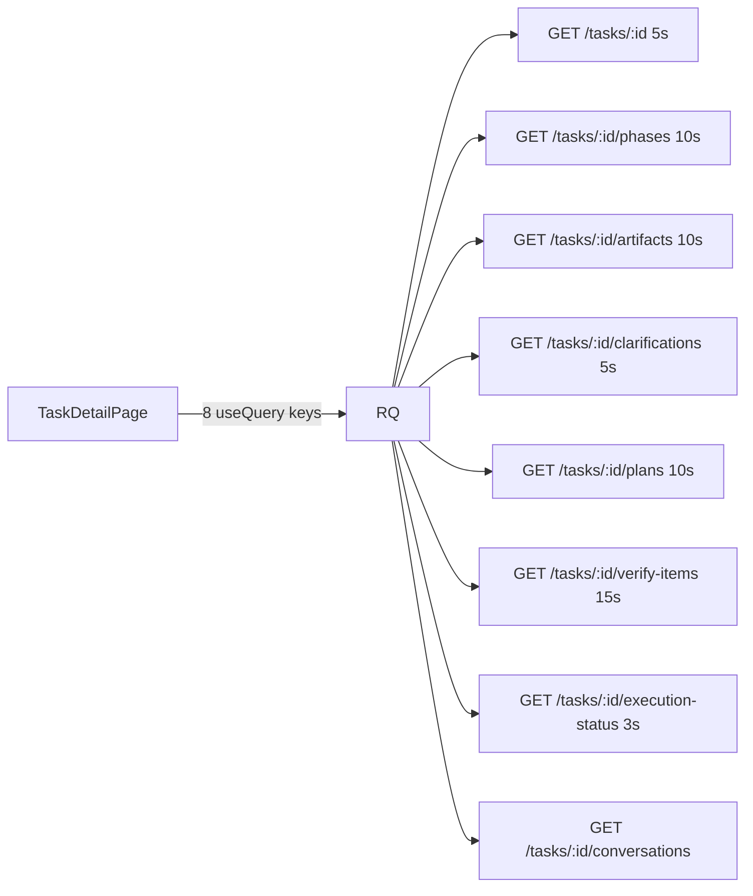
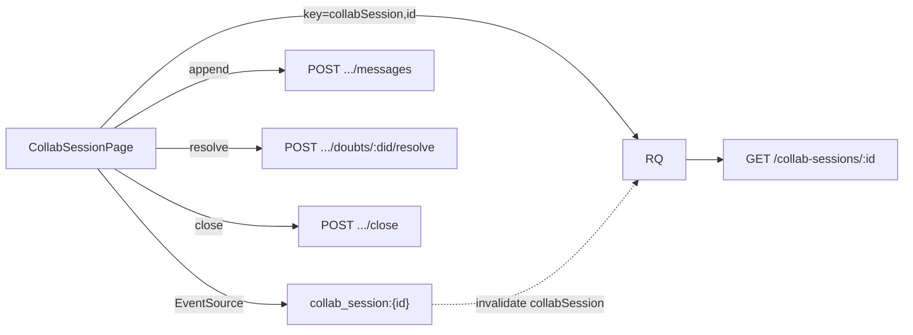

# 08 — Frontend Tour

> Every page in the React app — what you see, which API calls drive it, how live updates flow. The UI lives in `ui/src/`.

> **TL;DR.** Bifrost's UI is a React + Vite SPA with a sidebar shell and seven primary pages (Dashboard, Chat, Tasks, Knowledge, Collaboration, Spend, Learning). State flows through `@tanstack/react-query` keys → typed `apiCall()` wrappers → FastAPI; live updates ride SSE channels (`task:`, `chat:`, `collab_session:`, `handover:`). Most pages combine a 15-30s polling baseline with SSE-driven cache invalidation, so events feel instant when SSE works and degrade gracefully if it drops.

> **Read this when** you're adding a new page, debugging why a UI region is stale, or tracing why an SSE event did not flip a panel.
> **Skip if** you only consume the UI as a user — the operational chapters (06, 07, 10) cover the substrate the UI sits on.

---

## 0. Stack at a glance

- **Build:** Vite 5 (`ui/vite.config.ts`)
- **Routing:** React Router v6
- **Data:** `@tanstack/react-query` for server state — every page is a query graph
- **Styling:** Tailwind CSS with HSL custom-property tokens (`ui/src/index.css`)
- **UI primitives:** shadcn-style components in `ui/src/components/ui/` (sonner, dialog, skeleton, etc.)
- **Icons:** `lucide-react`
- **Real-time:** native `EventSource` wrapped in `ui/src/lib/sse.ts`

The whole app is mounted by `ui/src/App.tsx`. Routes are wrapped in `<Layout>` (the sidebar + content shell).

### How state flows (the canonical pattern)



Every page follows this shape. The differences are which query keys, which SSE channels, and which polling cadences.

### If you remember nothing else
- React Query keys are tuple-shaped: `["task", id]` not `"task-${id}"`. That is what enables `qc.invalidateQueries({ queryKey: ["task"] })` to invalidate every task query at once.
- SSE wrappers handle reconnect with exponential backoff; you do not write your own.

---

## 1. Navigation shell

**File:** `ui/src/components/layout.tsx`

### What you see
A 220px sidebar on the left (collapsible to 60px), the main content area on the right, and a thin status banner pinned to the top showing Claude CLI auth state. The sidebar groups every primary page as an icon + label; the active route is subtly highlighted (no glow, no neon).

The sidebar is built from the `NAV` array (lines 27-35):

| Path | Label | Icon | Owner page |
|---|---|---|---|
| `/overview` | Overview | LayoutDashboard | `pages/dashboard.tsx` |
| `/query` | Chat | MessageSquare | `pages/query.tsx` |
| `/tasks` | Tasks | ClipboardList | `pages/tasks.tsx` |
| `/collaboration` | Collaboration | Users | `pages/collaboration.tsx` |
| `/knowledge` | Knowledge | BookOpen | `pages/knowledge.tsx` |
| `/costs` | Spend | Receipt | `pages/costs.tsx` |
| `/admin/learning` | Learning | Activity | `pages/learning.tsx` |

### What it talks to
- `<ClaudeCliBanner />` polls `GET /api/v1/health/claude-cli` every 30s; turns red if the CLI is not authed.

### Routing notes
Active state: `to === "/overview"` matches both `/` and `/overview` (the dashboard is the landing page); other routes use `pathname.startsWith(to)`.

The collapse button (line 104) uses `useState<collapsed>` to toggle between `220px` and `60px`. There is no persistence — collapse state resets on refresh.

---

## 2. Route map (App.tsx)



Note: `/entities` is a legacy redirect that maps `?repo_id=X` → `?repo=X` and forwards to `/knowledge` (`App.tsx:32-46`). Bookmarks from the old "Entities" page still work.

---

## 3. `/` and `/overview` — DashboardPage

**File:** `ui/src/pages/dashboard.tsx`
**Header:** "State of the bridge"

### What you see
The landing page is a wide single column with three stacked sections. At the top, a row of stat cards (fresh / stale / not-indexed repos) gives an at-a-glance fleet health read. Below that, an "Active extractions" card surfaces any in-flight extraction with a live progress bar (one of the SSE hero interactions in the app — see §17). Then a long table of every registered repo, each row carrying a freshness pill, ownership chip, and per-row actions (extract / sync / deregister). Recent activity (last 20 tasks) sits at the bottom.

### What it talks to (all polled at 30s, `POLL_INTERVAL`)
- `listRepos()` → `GET /repos`
- `listTasks(undefined, 20)` → `GET /extraction-tasks`
- `listDomains()` → `GET /domains`

### Mutations
- `triggerExtraction(repoId)` → `POST /repos/{id}/extract`
- `deregisterRepo(repoId)` → `DELETE /repos/{id}`
- Register flow opens `<RegisterRepoDialog>` → `POST /repos`

### How state flows


### Components used
`Skeleton`, `FreshnessIndicator`, `ExtractionProgressCard`, `RegisterRepoDialog`. All in `ui/src/components/`.

### If you remember nothing else
- The dashboard polls 3 endpoints in parallel every 30s. Watch the network tab during the tick to see which call is slow.
- `<ExtractionProgressCard>` is one of the two big SSE-driven live regions in the app.

---

## 4. `/query` — QueryPage (chat)

**File:** `ui/src/pages/query.tsx`
**Header:** Inline with thread name

### What you see
A 3-column layout: thread list on the left (200px), turn-by-turn conversation in the center, and a research-progress rail on the right that appears only while the coordinator is working. The composer is pinned to the bottom of the center column. Under each user message a small intent chip surfaces the Haiku intent router's classification (`ask` / `plan` / `execute` / `quick` / `clarify`). Citation chips render inline within assistant messages; clicking one opens a side panel with the source.

### What it talks to
- `listConversations()` → `GET /conversations` (every 30s)
- `getConversation(id)` → `GET /conversations/{id}` (refetches on activeId change)
- `appendMessage(id, body)` → `POST /conversations/{id}/messages` — returns immediately, response streams via SSE
- `classifyIntent(message)` → `POST /tasks/intent/classify`
- `runQuick(message, repo)` → `POST /quick`
- `spawnTaskFromChat(...)` → `POST /conversations/{cid}/spawn-task`
- `listRepos()` → for the scope picker
- `getConversationTasks(id)` → `GET /conversations/{cid}/tasks`

### How state flows


### Real-time
**SSE channel:** `chat:{conversation_id}` via `subscribeResearchSideEffect()` in `lib/research-store.ts`. Events:
- `agent:repo_selected` — router picked a repo
- `agent:research_started` / `…_done` — per-agent lifecycle
- `assistant:message` — streaming Markdown chunks
- `assistant:citation` — citation chip data

The `useLiveResearch` hook (`lib/research-store.ts`) bridges the SSE stream into a `ResearchState` Zustand-style store; the right rail's `<ResearchProgress>` component subscribes to it.

### Routing
Each thread has a stable URL: `/query?conversation=<id>`. The `useSearchParams` hook syncs `activeId` ↔ URL.

### If you remember nothing else
- The chat page is a hybrid: messages stream via SSE, thread list polls every 30s.
- Intent chips are best-effort. When classification is slow / fails, the chip just does not appear.

---

## 5. `/tasks` — TasksPage

**File:** `ui/src/pages/tasks.tsx`
**Header:** "Tasks" with new-task composer

### What you see
A 2-pane layout. The composer (collapsible) sits at the top with a free-text input plus a live intent-classification preview. Below it, a horizontal filter bar (state pills, archive view, debounced search box). The remaining vertical space is a flat list of task rows, each showing state pill, clarification badge, age, and a click target that navigates to `/tasks/:id`.

### What it talks to
- `listTasks(state, opts)` → `GET /tasks` (15s poll; suppressed during search)
- `getTaskStats()` → `GET /tasks/stats` (30s)
- `classifyIntent(message)` for the composer preview
- `archiveTask` / `unarchiveTask` / `autoArchiveTasks`

### How state flows


### Default filter
The page defaults to `state="open"` (not `"all"`) so the user sees only in-flight work. Terminal tasks (success/blocked/cancelled) are read-only history.

---

## 6. `/tasks/:id` — TaskDetailPage

**File:** `ui/src/pages/task-detail.tsx`

The action-layer cockpit. Most polling-heavy page in the app.

### What you see
A single-column stacked layout broken into named panels: a top header with task title + state pill + age + actions; a Discussion panel (context.md preview + assumptions + open clarifications); a Plan panel (proposed plans with approve buttons); an Execution panel (worktree status + run-execute + live progress); a Verify panel (verify items + override buttons); and a PR panel (base branch + draft toggle + create-PR). Each panel collapses when not relevant to the current task state.

### What it talks to (the polling cadence is bracketed)
- `getTask(id)` → `GET /tasks/{id}` (5s)
- `getTaskConversations(id)` → `GET /tasks/{id}/conversations`
- `listPhases(id)` → `GET /tasks/{id}/phases` (10s)
- `listArtifacts(id, {kind:"context", latest_only:true})` → `GET /tasks/{id}/artifacts` (10s)
- `listClarifications(id, "open")` → `GET /tasks/{id}/clarifications` (5s)
- `listPlans(id)` → `GET /tasks/{id}/plans` (10s)
- `listVerifyItems(id)` → `GET /tasks/{id}/verify-items` (15s)
- `getExecutionStatus(id)` → `GET /tasks/{id}/execution-status` (3s — fastest poll, because the user is watching the executor work)

### Mutations
`runDiscussion`, `runPlan`, `executePlan`, `verifyExecution`, `runDebug`, `createPr`, `enrichFromJira`, `archiveTask`, plus per-clarification and per-verify-item answers/overrides.

### How state flows


### Strategy
React Query polling, no SSE on this page. The cadences are tuned per panel — execution status polls every 3s because that is where the user is staring; verify items polls 15s because they update less often.

### If you remember nothing else
- TaskDetail polls 8 endpoints; it is the heaviest page in the app by network.
- Cadences are panel-specific. If you change them, profile first.

---

## 7. `/collaboration` — CollaborationLandingPage

**File:** `ui/src/pages/collaboration.tsx:116-244`

### What you see
A 2-column dashboard: open and recent collaboration sessions on the left, recently generated handover docs on the right. Each list item is a card with status pill (open / resolved / briefed / closed for sessions; freshness for handovers) and a last-updated timestamp. Two CTAs — "Start session" and "Browse handovers" — sit at the top.

### What it talks to
- `listCollabSessions()` → `GET /collab-sessions` (15s poll)
- `listHandoverDocs({ archived: false })` → `GET /handover-docs`

→ See [07 §1](./07-collaboration-system.md#1-a-realistic-session-end-to-end) for what one of these sessions actually does.

---

## 8. `/collaboration/new` — CollaborationNewPage

**File:** `ui/src/pages/collaboration.tsx:245-345`

### What you see
A single form: requirement text area at the top, scope picker (radio buttons + dropdown depending on kind), and a live "matched handovers" preview that updates as the user types in the requirement. Submit button at the bottom.

### What it talks to
- `listDomains()`, `listRepos()` for scope dropdowns
- `searchHandoverDocs(q)` for the live "what handovers might be relevant" preview
- `createCollabSession({requirement, scope_kind, scope_value})` → `POST /collab-sessions`
- After creation, navigates to `/collaboration/sessions/:id`.

---

## 9. `/collaboration/sessions/:id` — CollaborationSessionPage

**File:** `ui/src/pages/collaboration.tsx:346-1372`

The collab-session UX. Largest single page component in the app at ~1,000 lines.

### What you see
A 2-pane layout: a chat-style conversation in the center column showing turn-by-turn messages from requester, clarifier_agent, and synthesizer_agent (each role color-coded), with the input composer pinned to the bottom; and a right rail with three stacked sections — Open Doubts (with answer composers), Suggested Handovers (matched scope-relevant docs), and Brief Preview (rendered Markdown after the session reaches `briefed`). The header carries the requirement, state pill, and a Close button (when `state=resolved`).

### What it talks to
- `getCollabSession(id)` → `GET /collab-sessions/{id}` (initial + after every event)
- `appendCollabMessage(id, body)` → `POST /collab-sessions/{id}/messages`
- `resolveCollabDoubt(sid, did, status, resolutionMd)` → `POST /collab-sessions/{id}/doubts/{did}/resolve`
- `closeCollabSession(id)` → `POST /collab-sessions/{id}/close`
- `reopenCollabSession(id)` → `POST /collab-sessions/{id}/reopen`

### How state flows


### Real-time
**SSE channel:** `collab_session:{id}` via `subscribeToCollabStream()`. Events: `agent:running`, `agent:done`, `session:updated`, `message:appended`, `doubt:resolved`. Each event invalidates the relevant React Query keys, triggering a refetch of the affected slice.

### If you remember nothing else
- Collab session is the second of the two SSE hero interactions in the app.
- Polling is a 30s safety net under SSE; events typically propagate in <500ms.

---

## 10. `/collaboration/handovers` — HandoverDocsListPage

**File:** `ui/src/pages/collaboration.tsx:1373-2544`

### What you see
A filter bar across the top (scope kind tabs, search box, archived toggle) and a vertical card list below. Each card carries the doc title, scope, freshness pill, last-generated date, and a "Generate" button next to scope-kind generators. A "Bulk refresh" button sits in the top-right.

### What it talks to
- `listHandoverDocs(params)` → `GET /handover-docs` (30s poll)
- `searchHandoverDocs(q)` → `GET /handover-docs/search`
- `estimateRepoHandoverCost` / `…Domain` / `…Team` / `…Region` → `GET …/estimate` (called *before* generation to show price)
- `generateRepoHandover` / `…Domain` / `…Team` / `…Region` → `POST …/generate`

### Real-time
When a generation is in flight: subscribes to `handover:{kind}:{value}` SSE, shows progress bar with `child_done` count.

→ See [07 §17](./07-collaboration-system.md#17-end-to-end-domain-handover-30-repos-tree-decomposition) for the worked example of what a 30-repo generation actually fires.

---

## 11. `/collaboration/handovers/:id` — HandoverDocDetailPage

**File:** `ui/src/pages/collaboration.tsx:2545-end`

The handover reader/editor. Tabbed view.

### What you see
A document reader with four tabs at the top:

**1. Read** — rendered Markdown via `<Prose>`. Section anchors, Mermaid diagrams rendered inline. Right rail shows section navigation and metadata (scope, freshness, last-generated).

**2. Edit** — two modes:
- `human_override` — raw Markdown editor, save → `PATCH /body` with `mode=human_override`.
- `llm_revise` — natural-language instruction, save → `PATCH /body` with `mode=llm_revise` (Sonnet rewrites in place).
- Per-section "Regenerate" button → `POST /sections/{key}/regenerate`.

**3. Candidates** — doubt clusters. Each card shows the cluster theme, occurrence count, and a Promote button that opens a dialog asking which section to add the answer to.

**4. History** — audit timeline + body version diff viewer. Side-by-side or unified diff via the existing `<Prose>` component.

### What it talks to
- `getHandoverDoc(id)` → `GET /handover-docs/{id}` (initial + on tab change)
- `getHandoverDoubtCandidates(id)` → `GET /handover-docs/{id}/candidates`
- `getHandoverAudits(id)` → `GET /handover-docs/{id}/audit`
- `getHandoverBodyHistory(id)` → `GET /handover-docs/{id}/history`
- `patchHandoverDocBody(id, body)` → `PATCH /handover-docs/{id}/body`
- `regenerateHandoverSection(id, key)` → `POST /handover-docs/{id}/sections/{key}/regenerate`
- `promoteDoubtCandidate(id, params)` → `POST /handover-docs/{id}/promote-candidate`
- `archiveHandoverDoc(id)` → `DELETE /handover-docs/{id}`
- `restoreHandoverDoc(id)` → `POST /handover-docs/{id}/restore`

---

## 12. `/knowledge` — KnowledgePage

**File:** `ui/src/pages/knowledge.tsx`

The unified repo control panel + entity browser. **Replaces the old `/entities` page** (still aliased via `EntitiesRedirect`).

### What you see
A 2-column layout. The left rail (320px) lists every registered repo with per-row ownership chip, action menu, search box, domain filter, and "show more" pagination (initial cap 100). The right pane is `<EntityBrowser>` — a filterable, sortable table of entities scoped to the selected repo (or all repos when none selected). Click a repo row to filter; click an entity row to see its detail panel.

### What it talks to
- `getKnowledgeOverview()` → `GET /knowledge/repos` (20s poll)
- `triggerExtractionRich(repoId, opts)` → `POST /repos/{id}/extract`
- `syncRepoOwnership(repoId)` → `POST /repos/{id}/sync-ownership`
- `deregisterRepo(repoId)` → `DELETE /repos/{id}`

The right pane's `<EntityBrowser>` makes its own queries against `/entities/search` and `/entities`.

### URL contract
- `/knowledge` — all repos
- `/knowledge?repo=<id>` — select that repo + filter entities
- `/knowledge?domain=<id>` — filter by domain
- `/knowledge?search=<term>` — seed entity search

### If you remember nothing else
- `/knowledge` is the unified replacement for the old `/entities` page — bookmarks still resolve.
- The right-pane EntityBrowser fires its own queries; it is essentially a sub-app.

---

## 13. `/costs` — CostsPage

**File:** `ui/src/pages/costs.tsx`

### What you see
A grid of cards. Top: window selector (7d / 30d / all) + a big total-cost card showing $ + token totals. Below: two bar charts side by side (by model, by phase). Below that: a sortable table grouped by repo. At the bottom: a 7-day daily series line chart.

### What it talks to
- `getCostSummary(window)` → `GET /costs/summary` (60s poll)

The endpoint returns pre-aggregated rows; the page is mostly chart wiring on top of that single response.

→ See [10 §4 Cost monitoring](./10-operations.md#4-cost-monitoring) for the operator-side view of the same data.

---

## 14. `/domains/:id` — DomainDetailPage

**File:** `ui/src/pages/domain-detail.tsx`

### What you see
A header with the domain name, repo count, and a "Generate handover" button. A table below lists all repos in the domain with freshness pill, last-extracted timestamp, and per-row "extract" / "remove from domain" actions. A "Discover repos" button at the top right calls `POST /domains/{id}/discover-repos` to add the repos whose manifest names the domain's team.

### What it talks to
- `getDomain(id)` → `GET /domains/{id}` (15s poll, keeps extraction status fresh)
- `addRepoToDomain` / `removeRepoFromDomain` mutations
- `triggerExtraction` for per-repo extract buttons

---

## 15. `/admin/learning` — LearningPage

**File:** `ui/src/pages/learning.tsx`

The agent-quality console. Polls aggressively (10-15s) because operators are watching live judgements.

### What you see
A 2-column dashboard. Left column: a stats card (total judgements, confirms vs contradicts, pending upgrades) and a chronological feed of recent judgements (each with reason). Right column: a "Pending upgrades" list (entities awaiting tier promotion approval) and a "Deltas" panel showing what changed and why.

### What it talks to (every 10-15s)
- `GET /admin/learning/stats`
- `GET /admin/learning/pending-upgrades`
- `GET /admin/learning/judgements`
- `GET /admin/learning/deltas`

### Mutations
- `POST /admin/learning/confirm` / `…/contradict`

**Auth note:** every admin call requires the `admin` role. The page uses whatever identity the browser session already has.

→ See [10 §2.4 Security gates](./10-operations.md#24-security-gates-opt-in) for token setup.

---

## 16. The hero SSE-driven live regions

Two pages anchor the SSE-driven UX. They are the moments when the user sees something happen *because something else just happened in the backend*, not because a poll fired.

| Region | Page | Channel | What feels alive |
|---|---|---|---|
| `<ExtractionProgressCard>` | DashboardPage / KnowledgePage | `task:{task_id}` | Phase letters light up as each phase completes; entity counts increment as Phase D batches finish; the spinner becomes a checkmark when the worker emits `task:complete`. |
| Collab session panel | CollaborationSessionPage | `collab_session:{session_id}` | Clarifier "thinking..." indicator appears the instant the agent starts; messages append as they are inserted; doubts flip to `resolved` / `answered_by_doc` without a refetch. |

Both regions share the same underlying pattern: SSE events trigger `qc.invalidateQueries(...)` calls which flow through React Query to refetch the affected slice. The feel is "instant" when SSE is healthy and degrades to the polling baseline (30s) when it drops.

### If you remember nothing else
- The "instant" feel comes from SSE → invalidateQueries → React Query refetch, not from rendering events directly.
- Polling is the safety net. If you see slow updates, check whether SSE is connected.

---

## 17. Real-time mechanisms

Bifrost uses **two patterns** for keeping the UI fresh:

### 17.1 SSE (push)
For long-running, low-event-rate streams.

| Channel | Used by | Events | Wrapper |
|---|---|---|---|
| `task:{task_id}` | TaskDetailPage (when extraction running) | `phase_*`, `partial_output`, `task_complete` | `lib/sse.ts::subscribeToTaskStream` |
| `chat:{conversation_id}` | QueryPage | `agent:*`, `assistant:message`, `assistant:citation` | `lib/research-store.ts::subscribeResearchSideEffect` |
| `collab_session:{session_id}` | CollaborationSessionPage | `agent:*`, `session:updated`, `message:appended`, `doubt:resolved` | `lib/sse.ts::subscribeToCollabStream` |
| `handover:{kind}:{value}` | HandoverDocsListPage (when generating) | `handover:run_started`, `…:child_done`, `…:section_complete`, `…:run_done` | `lib/sse.ts::subscribeToHandoverStream` |

Wrappers handle reconnect on transient failures with exponential backoff.

### 17.2 Polling (pull)
For pages where state changes are infrequent or batchy.

| Page | Cadence | Why |
|---|---|---|
| Dashboard | 30s | Ambient state, does not need to be instant |
| Knowledge | 20s | Repo list updates, not critical |
| Tasks list | 15s | New tasks appear, but not super often |
| Task detail (per panel) | 3-15s | Tighter on execution-status (3s) |
| Collaboration list | 15s | Sessions and handovers |
| Costs | 60s | Aggregate data, slow-moving |
| Learning | 10-15s | Operator is watching live decisions |

### 17.3 The hybrid pattern
Most pages combine both. Example: `CollaborationSessionPage`:
- Polls `getCollabSession(id)` at 30s as a baseline (catches missed SSE events)
- SSE handler invalidates the React Query cache on each event → immediate refetch
- Net effect: events propagate in <500ms when SSE works; falls back to 30s polling if SSE drops

---

## 18. Design tokens

Source: `ui/src/index.css`. Tokens are HSL custom properties under `:root`, with a light variant under `:root.light` (or `prefers-color-scheme: light`).

```css
/* Dark (default) */
--bg-0: hsl(220 13% 9%)    /* page background */
--bg-1: hsl(220 11% 12%)   /* sidebar, cards */
--bg-2: hsl(220 10% 16%)   /* hover surface */
--bg-3: hsl(220 9% 20%)    /* selected/active surface */
--bg-4: hsl(220 8% 24%)    /* tooltip, popover */

--fg-0: hsl(210 20% 98%)   /* primary text */
--fg-1: hsl(210 14% 82%)   /* secondary text */
--fg-2: hsl(210 10% 60%)   /* tertiary / muted */
--fg-3: hsl(210 8% 42%)    /* disabled */

--border: hsl(220 8% 18%)
--border-strong: hsl(220 8% 28%)
--border-focus: hsl(175 70% 45%)

--accent: hsl(175 70% 50%)        /* the teal/cyan brand */
--accent-fg: hsl(180 100% 6%)     /* text on accent */
--accent-soft: hsl(175 70% 50% / 0.12)  /* tinted background */
--accent-ring: hsl(175 70% 50% / 0.35)  /* focus ring */
```

Light theme uses the same scale with inverted lightness.

The shadcn shim aliases (`--background`, `--foreground`, `--card`, ...) point at the `--bg-*` / `--fg-*` tokens so shadcn components inherit the theme automatically.

**Style philosophy** (from `layout.tsx:18-21`): *"Studio-style shell. Narrow sidebar with icon+label nav, subtle active state (no cyberpunk glow), clean 6-8px radii, calm slate surfaces."* The accent is used **sparingly** — focus rings, active icons, primary buttons — not for general decoration.

---

## 19. Components index (the big ones)

Everything in `ui/src/components/`:

| Component | File | Purpose |
|---|---|---|
| `Layout` | `layout.tsx` | The sidebar + content shell |
| `ClaudeCliBanner` | `claude-cli-banner.tsx` | Top banner showing CLI auth status |
| `RegisterRepoDialog` | `register-repo-dialog.tsx` | Modal for `POST /repos` |
| `ExtractionProgressCard` | `extraction-progress-card.tsx` | Live phase-by-phase progress UI |
| `FreshnessIndicator` | `freshness-indicator.tsx` | The freshness pill (fresh/stale/very_stale) |
| `RepoActionGroup` | `repo-action-group.tsx` | Per-repo actions (extract / sync / deregister) |
| `EntityBrowser` | `entity-browser.tsx` | The right pane on /knowledge |
| `ConfidenceBadge` | `confidence-badge.tsx` | low/medium/high pill |
| `ResearchProgress` | `research-progress.tsx` | Live research-coordinator progress, fed by `useLiveResearch` |
| `Prose` | `prose.tsx` | Tailwind-typography wrapper for Markdown rendering |
| `AgentGraph` | `agent-graph.tsx` | The repo-fan-out diagram on /query |
| `ui/*` | `ui/` | shadcn-style primitives (button, dialog, sonner, etc.) |

---

## 20. Things you'll wish you knew

- **Refresh + cookie = fresh identity.** Sessions and conversations are scoped to the `bifrost_session` cookie. Clearing cookies = abandoning all your threads. Do not do this in production debugging.
- **The intent classifier is best-effort.** When it is slow / fails, the chip just does not appear. The UI does not block on it.
- **SSE wrappers handle reconnect.** If you see "WebSocket-style flicker" in the network panel — that is the wrapper retrying with backoff. Not a bug.
- **`lib/api.ts` is the single source of truth for endpoints.** Every fetch goes through `apiCall(method, path, body?)` which wraps the envelope unwrapping + error normalization. Never `fetch()` directly from a page.
- **React Query keys are tuple-shaped.** `["task", id]` not `"task-${id}"`. This is what enables `qc.invalidateQueries({ queryKey: ["task"] })` to invalidate every task query at once.
- **The dashboard polls 3 endpoints in parallel.** Repos + tasks + domains. Watching the network tab during the 30s tick gives you a feel for which calls are slow.
- **Tasks/:id polls 8 endpoints.** Heaviest page in the app by network. The cadences are picked per-panel; if you change them, profile first.
- **Mermaid diagrams are validated server-side before persistence**. If a handover renders a Mermaid block successfully in the editor, it will render the same way in production. No "looks fine in dev, broken in prod."
- **The collapse-sidebar state does not persist.** Refresh = expanded again. Persist via `localStorage` if you change this; the collapse mostly exists for screenshots.
- **There's no /admin page index.** Admin endpoints are exposed only through `/admin/learning`. Other admin operations (embed backfill, community rebuild, service-graph re-index) require curl with an admin API token.
